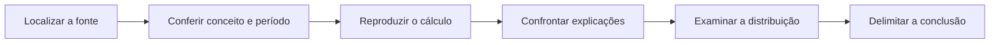

# Método de evidência e comparação do Brasil Project

> **Revisão editorial:** 19/10/2026.
> **Recorte da evidência:** regras editoriais desta edição; cada estudo informa os períodos efetivamente cobertos pelas suas fontes.

O objetivo é explicar a trajetória brasileira com evidência verificável e perspectivas concorrentes. O mesmo critério vale para qualquer governo, partido, instituição ou proposta. A quantidade de argumentos de cada lado não determina a conclusão: uma interpretação só ganha força quando suas premissas e seu mecanismo são sustentados.

## Ordem lógica de cada estudo

1. **Pergunta e recorte:** qual problema está sendo examinado, em que população e período.
2. **Fatos e dados:** medições, atos, documentos e decisões com referência ao item exato.
3. **Interpretações:** mecanismos econômicos e institucionais plausíveis, atribuídos ou identificados como hipóteses.
4. **Comparação:** mesmas unidades, universos, estágios e intervalos; diferenças legítimas explicitadas.
5. **Distribuição:** quem é afetado por renda, território, raça/cor, gênero, idade ou setor, quando a base permite.
6. **Conclusão:** o que a evidência sustenta, explicações concorrentes e questões que permanecem abertas.

Uma sequência cronológica ou uma conexão no grafo é uma ferramenta de navegação. Não demonstra influência, responsabilidade criminal ou causalidade. Diagramas de mecanismos devem indicar quando representam hipóteses.

## Registro de uma alegação

| Campo | Regra |
| :--- | :--- |
| Identificação | Pergunta ou afirmação verificável, sem misturar fatos distintos. |
| Valor e natureza | Número com unidade; observado, estimado, projetado, cenário ou não estabelecido. Ausência não é zero. |
| Período e população | Mês/ano ou intervalo, cobertura territorial e pessoas, empresas ou processos incluídos. |
| Definição | Conceito, numerador, denominador, preços correntes/constantes e eventual ajuste sazonal. |
| Proveniência | Autor/instituição, título, tabela/variável/artigo/processo, página ou timestamp e URL direta. |
| Cálculo | Entradas, fórmula e arredondamento suficientes para reprodução. |
| Versão | Data de acesso, data da publicação quando disponível e revisões relevantes. |
| Limitação | Exclusões, quebra de série, amostra, recurso judicial ou interpretação não resolvida. |

Os capítulos apresentam as fontes junto aos fatos; o [dicionário](DICIONARIO_INDICADORES.md) fixa os conceitos recorrentes. A [comparação entre períodos de governo](COMPARACOES_GOVERNOS.md) tem respostas públicas preservadas em `data/snapshots` e cálculo reproduzível. Guardar uma resposta não torna correta qualquer interpretação feita a partir dela.

## Fluxo de revisão editorial

O diagrama representa etapas de trabalho; suas setas não afirmam causalidade entre acontecimentos políticos ou econômicos.

## Hierarquia e independência das fontes

- **Medição oficial:** usar tabela e variável do órgão responsável, não apenas seu nome. O [IBGE documenta o acesso às suas APIs](https://servicodados.ibge.gov.br/api/docs/).
- **Ato jurídico:** usar texto da norma e versão pertinente. Para processos, distinguir peça de uma parte, decisão, notícia institucional e inteiro teor.
- **Fonte primária privada ou acadêmica:** identificar autoria, população e método; Serasa, universidades e associações não são órgãos estatais. Uma instituição interessada pode documentar seu próprio ato, mas não provar sozinha seus efeitos ou a regularidade de todos os fatos.
- **Fonte secundária:** pode contextualizar ou localizar o original; sua natureza deve ficar visível. Repetições de uma mesma notícia não constituem confirmação independente.

A referência pode falhar por mudança de endereço, bloqueio automático ou indisponibilidade. Isso exige registrar a limitação, não concluir que o documento é falso. Inversamente, uma página acessível não comprova a afirmação que a cita.

## Comparações econômicas

Inflação acumulada é composição de índices, não soma de percentuais. Crescimento do PIB, inflação e mudança da dívida usam fórmulas diferentes. Pontos percentuais não são variação percentual. A [metodologia da PNAD Contínua](https://www.ibge.gov.br/estatisticas/sociais/trabalho/9171-pesquisa-nacional-por-amostra-de-domicilios-continua-mensal.html) não é intercambiável com registros de vínculos do CAGED; a PME não deve ser colada à PNADC como se fosse uma série nacional homogênea.

Comparar governos não identifica automaticamente efeito do presidente. Choques globais, políticas herdadas, estados, municípios, Congresso, Banco Central, demografia e composição produtiva podem afetar os resultados. Termos como efeito, causou ou comprovou exigem desenho de identificação compatível; sem ele, apresentar associação ou hipótese.

## Casos judiciais e declarações

A ficha de cada caso deve separar **pessoa e fato imputado; processo; órgão/instância; ato e data; situação recursal conhecida**. Oferecimento de denúncia difere de recebimento; anulação não equivale por si a absolvição de mérito; condenação não prova trânsito em julgado. Os textos registram o último marco documental efetivamente utilizado, sem inventar acompanhamento em tempo real.

Falas literais exigem gravação, documento ou transcrição identificável com página/timestamp. Quando a redação exata não está estabelecida, usar paráfrase atribuída e declarar a limitação. Uma fala de aliado não é automaticamente posição formal de um partido ou ato de governo.

## Verificação e atualização

A edição contém verificações automáticas de estrutura, fontes declaradas, links internos, âncoras, cálculos do painel comparativo e carregamento do aplicativo. Elas não substituem revisão factual humana. A data editorial informa quando o texto foi trabalhado; não significa que todos os dados se refiram a esse dia. Uma atualização só pode ser chamada de concluída depois de rever tabelas, resumo, conclusão e documentos que dependem do resultado.

A atualização externa não roda em segundo plano. Novas respostas de APIs precisam de coleta explícita, registro da versão e nova revisão. O projeto não oferece cotação, andamento processual ou indicador econômico em tempo real.

## Efeitos distributivos

A pergunta distributiva deve acompanhar o diagnóstico, não entrar apenas como ressalva final. Comparações precisam declarar quais grupos estão representados, quais ficaram sem evidência e se o dado mede pessoa, domicílio, empresa ou território. Sem amostra ou microdados compatíveis, a análise pode explicar mecanismos e lacunas, mas não inventar estimativas por grupo.

## Conclusão e limites da evidência

O método torna afirmações rastreáveis e revisáveis. Ele não garante ausência universal de erro nem transforma simetria editorial em equivalência entre evidências diferentes. Uma conclusão forte exige fonte e desenho fortes; quando estes faltarem, o texto deve reduzir o alcance da conclusão e registrar o trabalho necessário para avançar.
