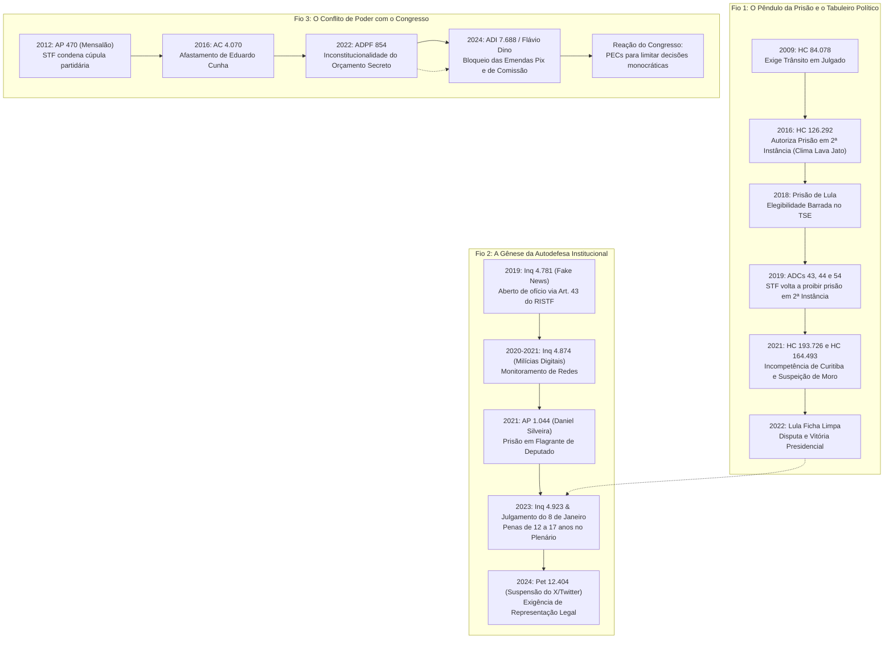

# Casos Históricos do STF: Linha do Tempo e Conexão de Fatores

> **Documento Analítico e Histórico-Jurisprudencial**  
> **Escopo:** Grandes decisões, inquéritos e crises institucionais no Supremo Tribunal Federal (STF), organizados **dos mais recentes aos mais antigos**.  
> **Metodologia de Conexão:** Cada decisão é analisada não como um evento isolado, mas como um elo causal que provocou o próximo desdobramento político, jurídico ou institucional no Brasil.

---

## 1. O Diagrama dos Três Fios Condutores

Para compreender a trajetória do STF nas últimas décadas, é necessário observar três cadeias causais interconectadas:

---

## 2. Linha do Tempo Analítica (Dos Mais Recentes aos Mais Antigos)

---

### [2024] A Suspensão da Rede Social X / Twitter (Petição 12.404)
* **Órgão Julgador:** Decisão Monocrática do Min. Alexandre de Moraes, referendada por unanimidade pela Primeira Turma (Moraes, Flávio Dino, Cristiano Zanin, Cármen Lúcia e Luiz Fux).
* **Fato Concreto:** Após meses de intimações judiciais para que a plataforma retirasse do ar perfis investigados por incitação a atos antidemocráticos e ataques às urnas eletrônicas, o proprietário da rede, Elon Musk, fechou o escritório da empresa no Brasil, demitiu os funcionários locais e recusou-se a nomear novo representante legal, descumprindo ordens da corte.
* **Decisão:** Bloqueio nacional da plataforma com aplicação de multa diária de R$ 50 mil a usuários que utilizassem artifícios técnicos (como VPNs) para burlar a decisão, além do bloqueio das contas financeiras da empresa Starlink para garantir o pagamento de multas processuais.
* **Desfecho:** A rede X pagou mais de **R$ 28 milhões em multas**, nomeou uma advogada residente no país como representante formal e bloqueou os perfis indicados judicialmente, obtendo a revogação do bloqueio em outubro de 2024.
* **Fator Conector:** Desdobramento direto do Inquérito das Fake News (2019) e do Inquérito das Milícias Digitais. Consolida o STF como árbitro regulatório *de facto* das grandes plataformas tecnológicas (*Big Techs*) diante da omissão legislativa na aprovação do PL 2630 (PL das Fake News).

---

### [2024] O Bloqueio das "Emendas Pix" e Emendas de Comissão (ADI 7.688 e ADPF 854)
* **Órgão Julgador:** Decisão Monocrática do Min. Flávio Dino, referendada pelo Plenário por 11 votos a 0.
* **Fato Concreto:** Após a anulação das emendas de relator (RP9) em 2022, o Congresso Nacional criou as transferências especiais sem convênio ("Emendas Pix") e expandiu as emendas de comissão (RP8) para continuar alocando mais de R$ 30 bilhões anuais com baixa identificação do autor e do destino dos recursos.
* **Decisão:** Dino determinou a **suspensão imediata de todos os repasses de emendas impositivas e Emendas Pix** até que o Executivo e o Legislativo apresentassem um sistema auditável, transparente e público que identificasse o parlamentar solicitante, o plano de trabalho e a rastreabilidade pelo TCU e CGU (em obediência aos artigos 37 e 163-A da CF/88).
* **Fator Conector:** Conecta-se diretamente ao julgamento do Orçamento Secreto de 2022 e gerou uma crise entre os Três Poderes, culminando em um pacto institucional mediado pelo presidente do STF, Luís Roberto Barroso, e em reações do Congresso que pautaram Propostas de Emenda à Constituição (PECs) para limitar decisões monocráticas do Supremo e estabelecer mandatos para ministros da corte.

---

### [2023 – 2024] Julgamento dos Atos de 8 de Janeiro (Ações Penais 1.060 e correlatas)
* **Órgão Julgador:** Plenário do STF (Relatoria: Min. Alexandre de Moraes).
* **Fato Concreto:** A invasão, depredação e pilhagem das sedes do Congresso Nacional, Palácio do Planalto e do próprio edifício-sede do Supremo Tribunal Federal em 8 de janeiro de 2023 por manifestantes que contestavam o resultado da eleição presidencial.
* **Decisão e Penas:** O STF fixou a sua própria **competência originária** para processar e julgar os invasores — rejeitando preliminares da defesa que pediam o envio à 1ª instância da Justiça Federal por ausência de foro privilegiado —, sob o argumento de continência e conexão com inquéritos de autoridades com prerrogativa de função. Condenou mais de duas centenas de réus a penas de **12 a 17 anos de prisão** pelos crimes de golpe de Estado, abolição violenta do Estado Democrático de Direito, dano qualificado e deterioração de patrimônio tombado.
* **Fator Conector:** O julgamento colocou o STF no papel de vítima direta dos ataques e simultaneamente de órgão julgador dos agressores. Fortaleceu a aliança institucional do tribunal com o Poder Executivo recém-empossado e aprofundou a polarização com a oposição parlamentar.

---

### [2023 – 2024] A Revisão das Multas de Leniência da Lava Jato (Petição 11.127)
* **Órgão Julgador:** Decisões Monocráticas do Min. Dias Toffoli.
* **Fato Concreto:** Grandes conglomerados econômicos (Novonor/antiga Odebrecht e grupo J&F) acionaram o STF alegando que os acordos de leniência firmados durante a Operação Lava Jato — que impuseram multas de R$ 8,5 bilhões e R$ 10,3 bilhões — foram celebrados sob coação psicológica e em conluio ilícito entre a força-tarefa de Curitiba e a 13ª Vara Federal.
* **Decisão:** Com base no acervo de mensagens da Operação Spoofing (*Vaza Jato*), Toffoli suspendeu cautelarmente o pagamento das multas bilionárias e determinou que a Controladoria-Geral da União (CGU) e a Advocacia-Geral da União (AGU) renegociassem consensualmente os valores e condições com as empresas.
* **Fator Conector:** Marca a desconstrução final do arcabouço punitivo corporativo da Lava Jato pelo STF, conectando-se à anulação das condenações de pessoas físicas e ao reconhecimento da parcialidade dos órgãos investigadores de Curitiba.

---

### [2022] Inconstitucionalidade do "Orçamento Secreto" (ADPFs 850, 851, 854 e 857)
* **Órgão Julgador:** Plenário do STF (6 votos a 5. Relatoria: Min. Rosa Weber).
* **Fato Concreto:** Questionamento da constitucionalidade das Emendas de Relator-Geral (RP9), mecanismo orçamentário que canalizou bilhões de reais a redutos eleitorais de deputados e senadores da base governista sem identificação formal do parlamentar demandante.
* **Decisão:** A maioria do tribunal declarou o dispositivo inconstitucional por violar os princípios constitucionais da transparência, publicidade, impessoalidade e moralidade administrativa (Art. 37 da CF/88).
* **Fator Conector:** Alterou as negociações de governabilidade na transição presidencial do governo Bolsonaro para o governo Lula 3. O Congresso foi forçado a negociar a PEC da Transição (EC 126/2022) para acomodar os gastos sociais e redistribuiu as verbas sob novos formatos (Emendas Pix), deflagrando a crise subsequente com Flávio Dino em 2024.

---

### [2021 – 2023] Caso Deputado Daniel Silveira: Imunidade, Prisão e Perdão Presidencial
* **Órgão Julgador:** Plenário do STF (AP 1.044, Pet 10.300 e ADPF 964).
* **Fato Concreto:** Em fevereiro de 2021, o deputado federal Daniel Silveira (PTB/PL-RJ) publicou vídeo em redes sociais com ataques verbais violentos, ameaças físicas aos ministros do STF e apologia ao Ato Institucional nº 5 (AI-5).
* **Decisão 1 (A Prisão em Flagrante):** Alexandre de Moraes decretou a prisão em flagrante por crime inafiançável contra a segurança nacional, mantida por unanimidade pela Câmara dos Deputados.
* **Decisão 2 (A Condenação):** Em abril de 2022, o STF condenou Silveira a 8 anos e 9 meses de reclusão em regime fechado, perda do mandato e suspensão de direitos políticos.
* **Decisão 3 (O Indulto e a Anulação):** No dia seguinte à condenação, o presidente Jair Bolsonaro editou decreto concedendo "graça constitucional" (perdão da pena) ao parlamentar. Em maio de 2023, o STF declarou o decreto presidencial **inconstitucional por desvio de finalidade**, assentando que o indulto não pode ser utilizado para proteger aliados políticos pessoais de punições legítimas do Judiciário. Silveira retornou ao cárcere.
* **Fator Conector:** Estabeleceu os limites da **imunidade parlamentar material** (Art. 53 da CF/88), pacificando que a prerrogativa da palavra não acoberta crimes contra o Estado Democrático de Direito ou incitação armada contra os Poderes da República.

---

### [2021] A Anulação dos Processos de Lula e a Suspeição de Sergio Moro (HC 193.726 e HC 164.493)
* **Órgão Julgador:** Min. Edson Fachin / Plenário do STF e Segunda Turma do STF.
* **Fato Concreto:** Recursos da defesa do ex-presidente Lula questionando a competência territorial da 13ª Vara Federal de Curitiba para julgar fatos sem relação direta com desvios da Petrobras e apontando a parcialidade do juiz Sergio Moro.
* **Decisão 1 (Incompetência Territorial):** Em março de 2021, o ministro Edson Fachin concedeu o HC 193.726 para declarar Curitiba incompetente, anulando todas as decisões e remetendo os processos ao DF (confirmado pelo Plenário por 8 a 3).
* **Decisão 2 (Suspeição de Moro):** No mesmo mês, a Segunda Turma concluiu o julgamento do HC 164.493 (voto decisivo da ministra Cármen Lúcia, que mudou seu posicionamento anterior). Moro foi declarado **suspeito e parcial** por 3 votos a 2, com a invalidação completa das provas colhidas na instrução.
* **Fator Conector:** Este foi o **maior ponto de inflexão política da história recente do país**. Ao zerar os processos de Lula e provocar sua elegibilidade imediata, o STF viabilizou a disputa eleitoral de 2022 entre Lula e Bolsonaro, reconfigurando a correlação de forças nacionais.

---

### [2019] O Inquérito das Fake News (Inquérito 4.781)
* **Órgão Julgador:** Portaria nº 69/2019 assinada pelo presidente do STF, Min. Dias Toffoli (Relator designado: Min. Alexandre de Moraes).
* **Fato Concreto:** Aumento exponencial de ameaças de morte, intimidações a familiares e campanhas digitais de descredibilização pública dirigidas a ministros do Supremo Tribunal Federal.
* **Decisão:** Em **14 de março de 2019**, Dias Toffoli abriu o inquérito **de ofício** (sem requerimento do Ministério Público Federal ou da Polícia Federal), valendo-se do Artigo 43 do Regimento Interno do STF (RISTF), que autorizava o presidente da corte a instaurar inquérito caso infrações ocorressem "na sede ou dependências do Tribunal". A relatoria foi entregue diretamente a Alexandre de Moraes, sem sorteio.
* **A Reação e a Validação:** A então Procuradora-Geral da República, Raquel Dodge, manifestou-se formalmente pelo arquivamento do inquérito por considerar violado o sistema acusatório (onde o MP deve ser o titular da ação penal). Moraes rejeitou o pedido de arquivamento. Em junho de 2020, o Plenário do STF julgou a **ADPF 572** e declarou o inquérito **constitucional** por 10 votos a 1 (vencido apenas o Min. Marco Aurélio Mello).
* **Fator Conector:** É a **"árvore-mãe"** do ativismo institucional do Supremo. A partir do Inquérito 4.781, Moraes estruturou as medidas cautelares de censura a páginas, bloqueio de contas bancárias, quebras de sigilo telemático e prisões preventivas que desaguaram nos Inquéritos das Milícias Digitais, Atos Golpistas e bloqueios de plataformas.

---

### [2019] O Retorno do Trânsito em Julgado e o Fim da Prisão em 2ª Instância (ADCs 43, 44 e 54)
* **Órgão Julgador:** Plenário do STF (6 votos a 5. Voto decisivo: Min. Dias Toffoli).
* **Fato Concreto:** Ações constitucionais movidas por OAB, PCdoB e Patriota questionando a validade da execução provisória de penas criminais após condenação em segundo grau sem trânsito em julgado.
* **Decisão:** Em 7 de novembro de 2019, o STF alterou seu entendimento jurisprudencial de 2016 e fixou que o Artigo 5º, inciso LVII, da Constituição Federal (*"ninguém será considerado culpado até o trânsito em julgado de sentença penal condenatória"*) é literal e intransponível. A prisão para cumprimento de pena só pode iniciar após o esgotamento de todos os recursos cabíveis (STJ e STF).
* **Fator Conector:** A decisão provocou a **soltura imediata de Lula** no dia seguinte (8 de novembro de 2019), após 580 dias de prisão em Curitiba, bem como a soltura de dezenas de outros réus da Lava Jato.

---

### [2018] A Restrição do Foro por Prerrogativa de Função (Ação Penal 937)
* **Órgão Julgador:** Plenário do STF (Relatoria: Min. Luís Roberto Barroso).
* **Fato Concreto:** Congestionamento crônico do STF com centenas de inquéritos e ações penais contra deputados federais e senadores por crimes sem conexão com a vida parlamentar (homicídios, estelionatos e delitos anteriores ao cargo).
* **Decisão:** O STF fixou a tese de que o foro privilegiado aplica-se **apenas aos crimes cometidos durante o exercício do cargo e relacionados às funções desempenhadas**. Crimes comuns anteriores ou sem vínculo com o mandato foram remetidos para a 1ª instância.
* **Fator Conector:** Reduziu drasticamente o acervo criminal do STF em um primeiro momento. Em 2024, sob relatoria do ministro Gilmar Mendes, o STF iniciou uma nova virada jurisprudencial para restabelecer a manutenção do foro mesmo após a saída do cargo público.

---

### [2016] A Suspensão da Posse de Lula como Ministro da Casa Civil (Mandado de Segurança 34.070)
* **Órgão Julgador:** Decisão Monocrática do Min. Gilmar Mendes.
* **Fato Concreto:** Em março de 2016, no auge do processo de impeachment de Dilma Rousseff, o juiz Sergio Moro retirou o sigilo telefônico de interceptações ilegais da Presidência da República, vazando o diálogo em que Dilma avisava Lula sobre o envio do termo de posse (*"para você usar em caso de necessidade"*). Partidos de oposição (PPS e PSDB) ingressaram com mandado de segurança alegando que a nomeação visava conferir foro privilegiado no STF e retirar Lula da jurisdição da 13ª Vara de Curitiba.
* **Decisão:** Gilmar Mendes concedeu liminar suspendendo a posse de Lula por **desvio de finalidade** da prerrogativa presidencial de nomear ministros.
* **Fator Conector:** A decisão impediu Lula de assumir a articulação política do governo, selou o isolamento político final de Dilma Rousseff e acelerou a aprovação do seu impeachment pela Câmara e pelo Senado dois meses depois.

---

### [2016] O Afastamento de Eduardo Cunha da Presidência da Câmara (Ação Cautelar 4.070)
* **Órgão Julgador:** Decisão Monocrática do Min. Teori Zavascki, referendada pelo Plenário por 11 a 0.
* **Fato Concreto:** Eduardo Cunha, réu no STF por contas secretas na Suíça, utilizava o regimento e o poder da Presidência da Câmara para intimidar parlamentares, retaliar desafetos e atrasar o processo de cassação de seu mandato no Conselho de Ética.
* **Decisão:** Em maio de 2016, pela primeira vez na história constitucional do Brasil, o STF afastou cautelarmente um presidente da Câmara dos Deputados em pleno exercício de suas funções parlamentares por uso ilícito das prerrogativas do cargo para obstruir a Justiça.
* **Fator Conector:** Abriu o precedente para que o Supremo tomasse medidas extremas de afastamento de chefes de Poderes do Legislativo, consolidando uma expansão do poder cautelar do tribunal.

---

### [2016] A Autorização Provisória da Prisão em 2ª Instância (HC 126.292)
* **Órgão Julgador:** Plenário do STF (7 votos a 4. Relatoria: Min. Teori Zavascki).
* **Fato Concreto:** Sob o ápice do clamor social e da pressão da Operação Lava Jato, o STF alterou a jurisprudência que vigorava desde 2009 e autorizou a execução da pena logo após a confirmação da condenação por tribunal de segunda instância (Tribunais de Justiça ou Tribunais Regionais Federais).
* **Fator Conector:** Foi a decisão jurídica que viabilizou juridicamente a prisão de Lula em abril de 2018 (após o julgamento no TRF-4) e de centenas de executivos e políticos investigados pela Lava Jato, gerando a posterior reviravolta de 2019.

---

### [2015] A Prisão em Flagrante de Delcídio do Amaral no Exercício do Senado (Ação Cautelar 4.039)
* **Órgão Julgador:** Segunda Turma do STF (Relatoria: Min. Teori Zavascki).
* **Fato Concreto:** O líder do governo Dilma no Senado, Delcídio do Amaral (PT-MS), foi gravado pelo filho do ex-diretor da Petrobras Nestor Cerveró oferecendo mesada de R$ 50 mil e um plano de fuga para a Espanha com o objetivo de evitar uma delação premiada.
* **Decisão:** A Segunda Turma autorizou a **prisão em flagrante por crime inafiançável** (organização criminosa em estado permanente) de um senador no exercício do mandato, inédito desde 1988. A prisão foi referendada pelo plenário do Senado.
* **Fator Conector:** Provocou a delação premiada de Delcídio, que atingiu em cheio a cúpula do governo Dilma, do PT e do PMDB, precipitando o colapso da sustentação política de Dilma Rousseff.

---

### [2012] O Julgamento do "Mensalão" (Ação Penal 470)
* **Órgão Julgador:** Plenário do STF (Relatoria: Min. Joaquim Barbosa / Revisão: Min. Ricardo Lewandowski).
* **Fato Concreto:** Desvio de recursos públicos (Visanet/agências de Marcos Valério) para compra de apoio parlamentar de partidos aliados no primeiro governo Lula.
* **Decisão:** 25 condenados (incluindo José Dirceu, José Genoino, Delúbio Soares, Roberto Jefferson e Valdemar Costa Neto) por corrupção e peculato, com a consagração da teoria do domínio do fato.
* **Fator Conector:** Foi o marco inicial da **midiatização e politização do STF**. Com sessões transmitidas ao vivo pela TV Justiça, os ministros se tornaram celebridades públicas e os embates entre Joaquim Barbosa, Ricardo Lewandowski e Gilmar Mendes criaram a cultura do escrutínio popular diário sobre as decisões da corte.

---

### [2009] O Estabelecimento Inicial do Trânsito em Julgado (Habeas Corpus 84.078)
* **Órgão Julgador:** Plenário do STF (7 votos a 4. Relatoria: Min. Eros Grau).
* **Fato Concreto:** Caso de um fazendeiro de Minas Gerais (Omar Coelho Vitor) condenado por tentativa de homicídio que teve a prisão decretada logo após o acórdão de 2ª instância.
* **Decisão:** O STF superou a Súmula 9 do STJ e fixou que o Art. 5º, LVII da CF/88 consagra a presunção de não culpabilidade de forma absoluta contra execuções penais antecipadas. A prisão antes do trânsito só poderia ocorrer se demonstrados os requisitos cautelares da prisão preventiva (Art. 312 do CPP).
* **Fator Conector:** É o precedente original que estabeleceu o dogma constitucional da presunção de inocência no Brasil democrático. Quando o STF mudou essa jurisprudência em 2016 e retornou a ela em 2019, foi sempre em torno da fundamentação do voto histórico de Eros Grau e Celso de Mello de 2009.

---

### [2009] Demarcação da Terra Indígena Raposa Serra do Sol (Petição 3.388)
* **Órgão Julgador:** Plenário do STF (Relatoria: Min. Carlos Ayres Britto).
* **Fato Concreto:** Disputa fundiária em Roraima entre arrozeiros não indígenas e povos originários em uma área contínua de 1,7 milhão de hectares na fronteira com Venezuela e Guiana.
* **Decisão:** O STF determinou a demarcação contínua e a desintrusão dos produtores rurais, fixando **19 condicionantes** para resguardar a soberania nacional, defesa de fronteiras e exploração de recursos.
* **Fator Conector:** O voto do ministro Menezes Direito nesta ação gerou a tese do **"Marco Temporal"** (a exigência de que os indígenas estivessem na terra na data da promulgação da CF/88 em 5 de outubro de 1988), que se transformou no maior cabo de guerra fundiário dos 15 anos seguintes, culminando na declaração de inconstitucionalidade do marco pelo STF em setembro de 2023 (RE 1.017.365) e nova reação legislativa do Congresso (Lei 14.701/2023).

---

### [2008] Pesquisas com Células-Tronco Embrionárias (ADI 3.510)
* **Órgão Julgador:** Plenário do STF (Relatoria: Min. Carlos Ayres Britto).
* **Fato Concreto:** A Procuradoria-Geral da República (Cláudio Fonteles) ajuizou ação direta contra o artigo 5º da Lei de Biossegurança (Lei 11.105/2005), que autorizava o uso de células-tronco embrionárias obtidas de embriões humanos fertilizados *in vitro* e inviáveis ou congelados há mais de três anos para fins de pesquisa médica.
* **Decisão:** Por 6 votos a 5 em relação aos limites (e improcedência da ação), o STF julgou a lei integralmente constitucional. O tribunal fixou que a personalidade jurídica e a dignidade da pessoa humana começam com o nascimento com vida, não sendo o embrião fertilizado *in vitro* e pré-implantatório sujeito de direitos fundamentais autônomos.
* **Fator Conector:** Estabeleceu a base jurisprudencial para o julgamento posterior da antecipação terapêutica do parto de fetos anencéfalos em 2012 (ADPF 54) e abriu as portas para o debate da descriminalização da interrupção da gravidez no STF (ADPF 442).

---

### [2003] O Caso Siegfried Ellwanger: Racismo e Antissemitismo (Habeas Corpus 82.424)
* **Órgão Julgador:** Plenário do STF (8 votos a 3. Relator para o acórdão: Min. Maurício Corrêa).
* **Fato Concreto:** O editor e escritor gaúcho Siegfried Ellwanger foi condenado pelo Tribunal de Justiça do Rio Grande do Sul por editar, publicar e comercializar livros de conteúdo revisionista do Holocausto e de discriminação antissemita contra o povo judeu. A defesa impetrou habeas corpus no STF alegando que os judeus não constituem uma "raça" em termos biológicos, pleiteando a prescrição do crime.
* **Decisão:** O STF fixou que o conceito de racismo inscrito no Art. 5º, inciso XLII da CF/88 (que torna o crime **inafiançável e imprescritível**) não se restringe a critérios biológicos (já superados pela ciência), mas abrange qualquer divisão social ou ideológica que busque hierarquizar grupos humanos. O antissemitismo foi formalmente enquadrado como espécie do gênero racismo.
* **Fator Conector:** É o precedente fundamental sobre os **limites da liberdade de expressão** perante discursos de ódio no direito brasileiro. Esse mesmo precedente foi utilizado décadas depois no Inquérito das Fake News, na condenação de Daniel Silveira e na equiparação da homotransfobia ao crime de racismo em 2019 (ADO 26).

---

## 3. Síntese Conceitual: Da Corte Constitucional à Autodefesa Institucional

A evolução cronológica revela uma transformação nítida no perfil do Supremo Tribunal Federal ao longo de três décadas:

1. **Até 2012 (O Tribunal Árbitro):** O STF atuava predominantemente como corte de controle abstrato de constitucionalidade e garantismo penal (células-tronco, união homoafetiva, terras indígenas, caso Ellwanger).
2. **De 2012 a 2018 (O Tribunal justiceiro e a Simbiose com a Opinião Pública):** Com a TV Justiça, o Mensalão e a Operação Lava Jato, o tribunal tornou-se o epicentro de disputas políticas e abriu mão do garantismo em prol da punibilidade célere (prisão em 2ª instância, afastamento de chefes de poder).
3. **De 2019 até o Presente (O Tribunal de Autodefesa e Gestão de Crise):** Diante de ameaças diretas à sua integridade física e institucional, a corte rompeu com o princípio da inércia (Inquérito das Fake News aberto de ofício), concentrou poderes investigatórios na figura de um único relator e passou a atuar como um poder moderador e regulador de redes sociais e de alocação de emendas parlamentares.
