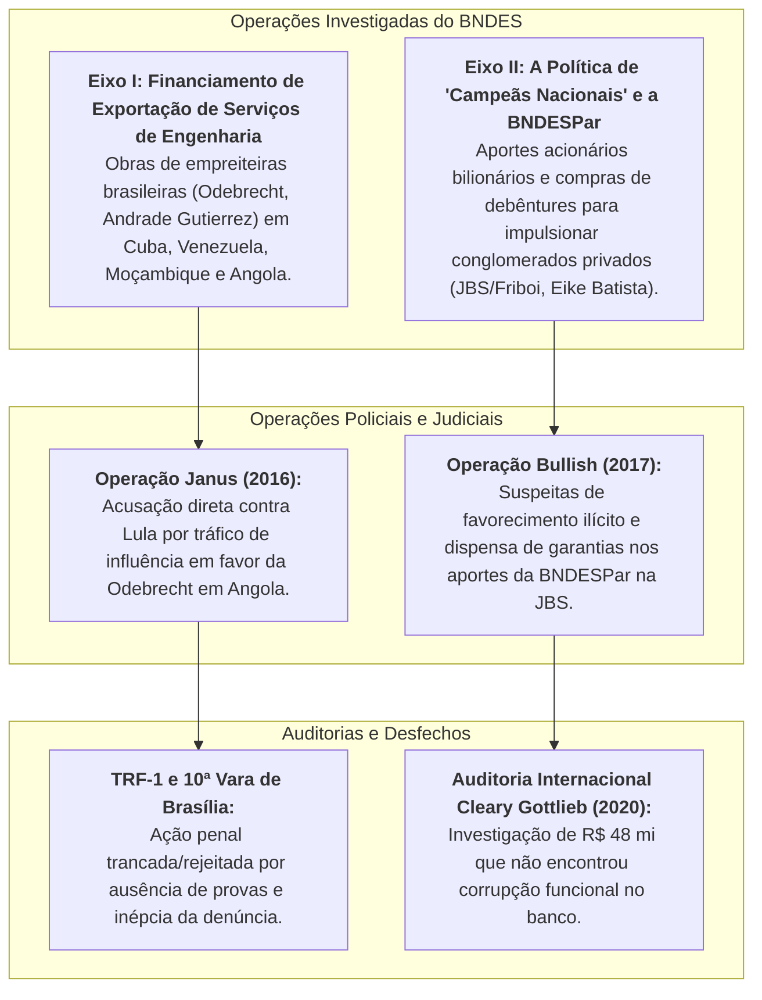
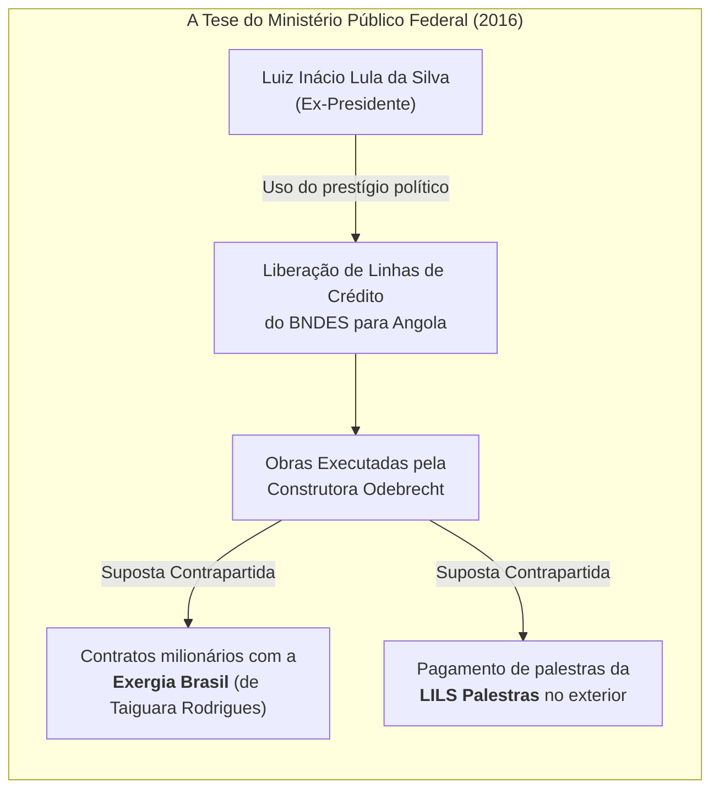

# Os Escândalos do BNDES: Investigações, Financiamentos Externos e os Vínculos com Lula

> **Classificação:** Análise de Fatos Judiciais, Auditorias de Controle e História Econômico-Financeira  
> **Período Investigado:** 2003 – 2026  
> **Órgãos e Instâncias Envolvidas:** Polícia Federal (Operações Janus, Bullish e Greenfield), Ministério Público Federal (MPF/DF), 10ª Vara Federal de Brasília, Tribunal Regional Federal da 1ª Região (TRF-1), Supremo Tribunal Federal (STF), Tribunal de Contas da União (TCU), CPIs do BNDES e Auditoria Internacional Cleary Gottlieb.  
> **Objetivo:** Registrar e detalhar de forma estritamente factual e neutra todas as investigações, auditorias, delações e processos judiciais que envolveram o Banco Nacional de Desenvolvimento Econômico e Social (BNDES) nos governos do PT, esclarecendo quais foram os fatos comprovados, as evidências materiais e a situação jurídica formal do presidente Luiz Inácio Lula da Silva.

---

## 1. Visão Geral: O Papel do BNDES e os Dois Grandes Eixos de Suspeita

Durante os governos Lula (2003–2010) e Dilma Rousseff (2011–2016), o BNDES foi o principal instrumento financeiro da política de fomento neodesenvolvimentista do governo federal. O banco teve seu orçamento brutalmente ampliado por meio de empréstimos diretos do Tesouro Nacional que superaram **R$ 500 bilhões**.

As investigações policiais, auditorias do TCU e comissões parlamentares concentraram-se em **dois grandes eixos de suspeitas**:

---

## 2. Eixo I: O Financiamento à Exportação de Engenharia no Exterior e os Calotes

### 2.1. Como Funcionava Tecnicamente o Mecanismo (BNDES Exim)
Ao contrário do mito popular difundido em redes sociais, **o BNDES jamais enviou dinheiro em espécie para governos estrangeiros**. A modalidade operacional (*BNDES Exim*) funcionava da seguinte forma:
1. **Desembolso em Reais no Brasil:** O BNDES desembolsava o valor do financiamento diretamente no Brasil, em moeda nacional (reais), para a construtora brasileira contratada (Odebrecht, Andrade Gutierrez, Camargo Corrêa, Queiroz Galvão);
2. **Exportação de Bens e Serviços:** As empreiteiras utilizavam os recursos para adquirir insumos brasileiros e prestar serviços de engenharia no exterior;
3. **A Dívida Soberana:** O governo estrangeiro (devedor) assumia a obrigação de pagar o financiamento ao BNDES em moeda forte (dólares ou euros), com juros acordados;
4. **O Fundo de Garantia à Exportação (FGE):** Todas as operações contavam com o seguro do FGE, um fundo público gerido pelo Tesouro Nacional para garantir o ressarcimento caso o país estrangeiro ficasse inadimplente.

### 2.2. As Grandes Obras e os Calotes Reais Sofridos pelo Brasil

| País Tomador | Obra Financiada | Empreiteira Brasileira | Volume Financiado | Situação Financeira e Calote |
| :--- | :--- | :--- | :--- | :--- |
| **Cuba** | Ampliação e Modernização do **Porto de Mariel** | Odebrecht | **US$ 682 milhões** | **Inadimplência Formal (Calote):** Cuba utilizava como garantia receitas futuras da exportação de charutos/tabaco depositadas em conta fiduciária no exterior. Diante da crise econômica e de liquidez na ilha, Cuba entrou em atraso contínuo a partir de 2018. O FGE do Tesouro brasileiro foi acionado para ressarcir o BNDES. |
| **Venezuela** | **Metrô de Caracas** (Linha 5), Metrô Los Teques e Siderúrgica Nacional | Odebrecht | **US$ 1,5 bilhão+** (projetos acumulados) | **Inadimplência Grave (Default):** Com o colapso econômico e o embargo internacional à gestão Nicolás Maduro, a Venezuela suspendeu os pagamentos internacionais a partir de 2017, deixando centenas de milhões de dólares em aberto cobertos pelo seguro do Tesouro. |
| **Moçambique** | **Aeroporto Internacional de Nacala** e Barragem de Moamba Major | Odebrecht / Andrade Gutierrez | **US$ 125 milhões** | **Calote Soberano:** O governo de Moçambique declarou calote em títulos internacionais em 2017, e o BNDES foi ressarcido pelo FGE brasileiro. |
| **Angola** | Hidrelétrica de **Cambambe**, infraestrutura de Luanda | Odebrecht | **US$ 3,2 bilhões+** (várias linhas) | **Adimplente (Garantia em Petróleo):** Ao contrário de Cuba e Venezuela, Angola vinculou os pagamentos à exportação de barris de petróleo depositados em contas escrow internacionais e renegociou pontualmente suas obrigações, mantendo o saldo adimplente com o BNDES. |

* **O Prejuízo Acumulado Coberto pelo Tesouro:** De acordo com dados oficiais da Secretaria do Tesouro Nacional e do BNDES, as indenizações pagas pelo Fundo de Garantia à Exportação (FGE) decorrentes da inadimplência soberana acumulada de Cuba, Venezuela e Moçambique somavam mais de **US$ 1,3 bilhão** (aproximadamente **R$ 6,5 a R$ 7 bilhões** em moeda corrente).

---

## 3. O Vínculo com Lula: A Operação Janus da Polícia Federal (2016)

A **Operação Janus** foi a principal investigação penal brasileira instaurada para apurar se Luiz Inácio Lula da Silva cometeu crimes de corrupção e tráfico de influência envolvendo diretamente o BNDES e contratos no exterior.

### 3.1. A Denúncia Formal do MPF (Outubro de 2016)
Em 13 de outubro de 2016, o juiz Vallisney de Souza Oliveira, da 10ª Vara Federal de Brasília, aceitou a denúncia do MPF/DF (Ação Penal nº 0053154-82.2016.4.01.3400) contra Lula, Marcelo Odebrecht, Taiguara Rodrigues dos Santos e outros 8 réus:
* **Crimes Imputados a Lula:** Tráfico de influência (Art. 332 do CP), corrupção passiva qualificada (Art. 317 do CP), lavagem de dinheiro e organização criminosa;
* **O Argumento Central do MPF:** A acusação sustentou que Lula, entre 2011 e 2014 (já fora da Presidência da República), utilizou sua influência política sobre a presidente Dilma Rousseff e diretores do BNDES para interferir na ampliação da linha de crédito do banco para obras da Odebrecht em Angola. Em troca, a construtora teria repassado propinas disfarçadas de duas formas:
  1. **Contratos com a Exergia Brasil:** A Odebrecht subcontratou para obras em Angola a empresa de engenharia *Exergia Brasil*, de propriedade de **Taiguara Rodrigues dos Santos** (sobrinho da primeira mulher de Lula, dona Maria Letícia). A empresa recebeu cerca de **R$ 20 milhões** da empreiteira por serviços que o MPF alegou serem fictícios ou superfaturados;
  2. **Palestras Remuneradas (LILS Palestras):** A Odebrecht pagou honorários de centenas de milhares de dólares por palestras de Lula em viagens oficiais a Angola e outros países africanos.

### 3.2. As Evidências Apresentadas pela Acusação
1. **E-mails e Mensagens de Executivos da Odebrecht:** Mensagens apreendidas pela PF trocadas entre Marcelo Odebrecht, Alexandrino Alencar e diretores locais em Angola citando reuniões com Lula e a necessidade de "atender o sobrinho" (Taiguara) para manter portas abertas no governo angolano e brasileiro;
2. **Contratos e Fluxo Financeiro da Exergia:** Comprovação documental de que a empresa de Taiguara, recém-criada e sem histórico expressivo de obras de grande porte, recebeu repasses milionários da Odebrecht em Angola;
3. **Agendas e Viagens Compartilhadas:** Registros de viagens de Lula a Angola em que ele participou de encontros de alto nível com o então presidente angolano, José Eduardo dos Santos, acompanhado por executivos da Odebrecht.

### 3.3. Os Argumentos da Defesa de Lula
1. **Papel Legítimo de Promoção Comercial Internacional:** A defesa de Lula sustentou que chefes de Estado e ex-presidentes de democracias liberais consolidadas (como EUA, França, Reino Unido e Alemanha) atuam corriqueiramente como diplomatas comerciais de suas indústrias nacionais no exterior, o que constitui lobby institucional legal de exportação e diplomacia econômica;
2. **Efetividade das Palestras:** A defesa comprovou com fotografias, recortes de imprensa internacional e gravações que as palestras contratadas pela LILS foram efetivamente realizadas perante plateias de dezenas de empresários e autoridades, com recolhimento regular de todos os tributos federais devidos;
3. **Inexistência de Ato de Ofício sobre o BNDES:** O BNDES é uma empresa pública com mais de 2.000 funcionários concursados e comitês colegiados de crédito independentes. Não foi apresentada nenhuma prova de ordem, telefonema ou pressão de Lula sobre qualquer funcionário ou membro do comitê de enquadramento do banco para aprovar linhas irregulares.

### 3.4. O Desfecho Judicial da Operação Janus

A Operação Janus teve desfechos sucessivos favoráveis à defesa de Lula na Justiça Federal:

1. **Rejeição Parcial da Acusação (Setembro de 2019):**  
   Em setembro de 2019, o juiz Vallisney de Souza Oliveira (10ª Vara Federal de Brasília), acolhendo manifestação do próprio Ministério Público Federal, **rejeitou a denúncia** no que dizia respeito à acusação de corrupção e tráfico de influência para ampliação da linha de crédito do BNDES em Angola. A decisão judicial registrou formalmente a **ausência de suporte probatório mínimo** que demonstrasse ingerência ilícita de Lula sobre a governança técnica do banco;
2. **Trancamento Definitivo pelo Tribunal Regional Federal (Outubro de 2020):**  
   Em **outubro de 2020**, a Quarta Turma do **Tribunal Regional Federal da 1ª Região (TRF-1)**, ao julgar Habeas Corpus impetrado pela defesa de Lula, **trancou por unanimidade a ação penal da Operação Janus**.  
   * **Fundamento do Acórdão do TRF-1:** Os desembargadores federais concluíram que a denúncia era inepta e carecia de justa causa. O acórdão enfatizou que a atuação de ex-presidentes em palestras e em defesa de empresas nacionais no exterior não constitui crime por si só e que as operações de crédito do BNDES em Angola seguiram todos os trâmites regulamentares e pareceres técnicos exigidos pelos órgãos internos do banco.

---

## 4. Eixo II: A BNDESPar e a Operação Bullish (O Frigorífico JBS / J&F)

### 4.1. O Objeto da Investigação (Maio de 2017)
Deflagrada em maio de 2017 pela Polícia Federal e pelo MPF, a **Operação Bullish** investigou os aportes de capital, compra de debêntures e participações societárias realizadas pela BNDESPar (braço de participações do BNDES) no grupo J&F/JBS entre 2007 e 2011:
* O volume aportado pelo banco na JBS superou **R$ 8,1 bilhões**;
* O MPF apontou que os recursos permitiram ao frigorífico familiar brasileiro adquirir empresas concorrentes gigantescas nos Estados Unidos (Swift & Company em 2007, Pilgrim's Pride em 2009 e Smithfield Beef), tornando a JBS a maior processadora de proteína animal do planeta;
* **Suspeitas:** A acusação sustentava que a diretoria do BNDES teria dispensado garantias usuais de mercado, pago ágio indevido na aquisição de ações e ignorado alertas de técnicos do banco por suposta orientação política do Palácio do Planalto e do ex-ministro da Fazenda Guido Mantega.

### 4.2. As Declarações de Joesley Batista e o Contraponto
* **Delação Premiada da J&F (2017):** O empresário Joesley Batista declarou à PGR que mantinha duas contas no exterior (geridas pelo operador financeiro Lúcio Funaro) com saldos milionários que teriam como beneficiários finais os ex-presidentes Lula e Dilma Rousseff, cujas retiradas seriam autorizadas pelo ex-ministro Guido Mantega em troca de facilidades governamentais e recursos do BNDES.
* **A Falta de Materialidade Pericial:**  
  * Tanto Lula quanto Dilma Rousseff negaram enfaticamente a titularidade ou conhecimento de qualquer conta bancária fora do país;
  * Perícias internacionais e auditorias financeiras conduzidas pelas autoridades **não localizaram nenhuma conta, assinatura ou vínculo bancário formal** de Lula com as contas apontadas por Joesley no exterior;
  * Em relação ao corpo funcional do BNDES, as ações penais abertas contra analistas e diretores do banco foram progressivamente trancadas ou rejeitadas na Justiça Federal do DF por ausência de dolo funcional.

---

## 5. A Auditoria Internacional da "Caixa-Preta do BNDES" (2019 – 2020)

Uma das maiores controvérsias políticas recentes em torno do BNDES envolveu a promessa do governo Jair Bolsonaro de "abrir a caixa-preta do BNDES", insinuando a existência de esquemas multibilionários ocultos de corrupção sistemática.

### 5.1. A Contratação e o Escopo Forense
Em 2019, a diretoria do BNDES (sob gestão de Roberto Castello Branco e, posteriormente, Gustavo Montezano) contratou um consórcio internacional de perícia forense liderado pelo conceituado escritório norte-americano **Cleary Gottlieb Steen & Hamilton LLP**, com suporte da firma de investigação corporativa **Kroll**:
* **Custo da Auditoria:** **R$ 48 milhões** pagos pelo BNDES;
* **Período e Alvo Auditados:** Todas as operações financeiras realizadas pelo BNDES e BNDESPar com as empresas do grupo J&F (JBS, Bertin, Eldorado Celulose) entre **2005 e 2018**;
* **Volume de Dados Analisado:** Mais de **2,5 milhões de e-mails corporativos**, mais de **130 mil documentos confidenciais** e realização de cerca de 50 entrevistas com funcionários, analistas e diretores do banco.

### 5.2. O Relatório Final (Janeiro de 2020)
Em **21 de janeiro de 2020**, o escritório Cleary Gottlieb divulgou o relatório conclusivo da auditoria independente:
* **Conclusão:** **NÃO foram encontradas evidências de corrupção, suborno, pagamentos ilegais ou favorecimento doloso** nos procedimentos internos do BNDES;
* O relatório atestou que as aprovações de crédito e compra de ações seguiram os ritos de governança vigentes, contavam com análises de comitês técnicos e foram embasadas em avaliações econômicas fundamentadas no momento de cada operação, desmistificando a tese de fraude operacional interna no banco.

---

## 6. As Três CPIs do BNDES no Congresso Nacional

O Congresso Nacional instalou três Comissões Parlamentares de Inquérito para apurar contratos do banco:

1. **CPI do BNDES de 2015 (Câmara dos Deputados):** Encerrou seus trabalhos sem indiciamento de figuras centrais, concluindo pela legalidade da maioria das operações;
2. **CPI do BNDES de 2016 (Senado Federal):** Focou nos empréstimos ao exterior; aprovou relatório sugerindo maior transparência e fim do sigilo em operações com governos estrangeiros;
3. **CPI do BNDES de 2019 (Câmara dos Deputados):**  
   * **Relatório Final (Relator Dep. Altineu Côrtes):** Aprovado em outubro de 2019, pediu o indiciamento de mais de 60 pessoas, incluindo Lula, Dilma Rousseff, Luciano Coutinho, Guido Mantega, Antonio Palocci e Joesley Batista, sob acusações genéricas de gestão fraudulenta e formação de quadrilha;
   * **Desfecho no Ministério Público Federal:** A PGR e o MPF/DF arquivaram os pedidos de indiciamento parlamentar relativos aos ex-presidentes, por considerarem que o relatório da CPI não apresentou novos elementos de prova ou justa causa que justificassem reabrir ações penais já rejeitadas pela Justiça.

---

## 7. O Tribunal de Contas da União (TCU): Gestão Antieconômica vs. Crime

O Tribunal de Contas da União é o órgão com o diagnóstico técnico mais detalhado sobre o banco:

### 7.1. A Condenação da Política de Subsídios (TJLP vs. Selic)
* Nos acórdãos sobre o custo dos empréstimos do Tesouro ao BNDES (Acórdão nº 3.077/2018-Plenário), o TCU declarou que a política governamental de repassar R$ 500 bilhões do Tesouro com juros subsidiados (TJLP muito abaixo da Selic) constituiu uma **política pública antieconômica e de alto custo fiscal** para a sociedade (prejuízo implícito superior a R$ 150 bilhões);
* O TCU determinou ao BNDES a devolução antecipada dos recursos ao Tesouro Nacional (o que foi executado entre 2018 e 2022).

### 7.2. Responsabilização de Gestores vs. Lula
* O TCU abriu Tomadas de Contas Especiais (TCE) contra ex-diretores do banco e executivos da JBS para apurar suposto superfaturamento na compra de ações da Bertin pela BNDESPar;
* **Vínculo com Lula perante o TCU:** O tribunal de contas analisa a responsabilidade de gestores públicos diretos (quem assina atos administrativos, pareceres e liberações financeiras). Por isso, **o TCU não condenou Lula a ressarcimento ou multa por decisões operacionais do BNDES**, uma vez que o Presidente da República não integra a diretoria executiva nem o comitê de crédito do banco.

---

## 8. Quadro Sintético: Fatos Comprovados vs. Desfechos Judiciais de Lula

| Tópico / Acusação | Fato Histórico Comprovado | O que a Investigação Alegou | O que a Justiça / Auditoria Decidiu | Situação Jurídica Atual de Lula |
| :--- | :--- | :--- | :--- | :--- |
| **Operação Janus (Obras em Angola)** | Lula fez viagens e palestras em Angola e a Odebrecht contratou a empresa de seu sobrinho Taiguara (Exergia). | Que Lula vendeu influência política junto a Dilma e ao BNDES em troca de repasses para a Exergia e palestras da LILS. | **Ação Penal Trancada:** A 10ª Vara do DF e o TRF-1 (out/2020) trancaram o processo por falta de justa causa e inépcia da denúncia. | **Extinta / Arquivada em definitivo.** Nenhuma condenação. |
| **Financiamentos no Exterior (Cuba, Venezuela)** | Cuba e Venezuela receberam obras de construtoras brasileiras via BNDES e deram calotes de mais de US$ 1,3 bi no Tesouro. | Que a concessão de crédito obedeceu a afinidades ideológicas e acordos escusos entre os líderes do PT e regimes estrangeiros. | O BNDES e a Justiça atestaram que as operações seguiram o rito legal do *BNDES Exim*, com aprovação no Comitê de Financiamento e Garantia das Exportações (Cofiex/Camex). | **Sem acusação penal procedente.** O calote existiu como fato econômico, mas gerou cobrança de dívida soberana, não condenação penal. |
| **Operação Bullish (Frigorífico JBS)** | O BNDESPar aportou R$ 8,1 bi na JBS, viabilizando sua expansão para se tornar a maior do mundo. | Que houve orientação política para favorecer o grupo em troca de propinas mantidas em contas no exterior (delação de Joesley). | **Auditoria Cleary Gottlieb (2020):** Auditoria de R$ 48 mi não encontrou corrupção interna. Perícias da PF não acharam contas de Lula fora do país. | **Arquivada.** Processos contra técnicos foram trancados. |
| **A "Caixa-Preta do BNDES"** | Promessa eleitoral de 2018 de revelar bilhões em corrupção oculta nos arquivos internos do banco. | Suposta existência de documentos secretos que comprovariam ordens ilegais emitidas do Planalto para o banco. | O consórcio internacional Cleary Gottlieb / Kroll analisou 2,5 milhões de e-mails corporativos e **não encontrou corrupção interna**. | **Mito desmistificado por perícia independente.** |

---

## 9. Catálogo de Fontes Oficiais Primárias

| Órgão / Tribunal | Processo / Documento Oficial | Teor da Decisão / Relatório | Link / Acesso |
| :--- | :--- | :--- | :--- |
| **Tribunal Regional Federal da 1ª Região (TRF-1)** | **Habeas Corpus nº 1032331-50.2020.4.01.0000** | Acórdão unânime da 4ª Turma trancando a Ação Penal da Operação Janus contra Lula por ausência de justa causa. | [TRF-1 Jurisprudência](https://www.trf1.jus.br/) |
| **Justiça Federal do DF (10ª Vara Federal)** | **Ação Penal nº 0053154-82.2016.4.01.3400** | Decisão que rejeitou denúncia parcial de corrupção sobre contratos do BNDES em Angola por falta de suporte probatório. | [JFDF - Consulta](https://portal.trf1.jus.br/sjdf/) |
| **BNDES / Cleary Gottlieb** | **Relatório da Auditoria Forense Independente (2020)** | Relatório final da investigação independente sobre operações com JBS/Bertin (análise de 2,5 milhões de e-mails). | [BNDES - Transparência](https://www.bndes.gov.br/) |
| **Tribunal de Contas da União (TCU)** | **Acórdão nº 3.077/2018-Plenário** | Auditoria operacional sobre os subsídios do Tesouro ao BNDES e desproporção concorrencial da política de Campeãs Nacionais. | [TCU - Acórdão 3077/2018](https://pesquisa.apps.tcu.gov.br/) |
| **Secretaria do Tesouro Nacional (STN)** | **Painel do Fundo de Garantia à Exportação (FGE)** | Dados oficiais sobre as indenizações pagas pelo Tesouro brasileiro em decorrência do calote de Cuba, Venezuela e Moçambique. | [Tesouro Transparente - FGE](https://www.tesourotransparente.gov.br/) |
| **Câmara dos Deputados** | **Relatório Final da CPI do BNDES (2019)** | Documento aprovado com pedidos de indiciamento e histórico de oitivas de ministros e presidentes de bancos. | [Câmara dos Deputados - CPI BNDES](https://www.camara.leg.br/) |
