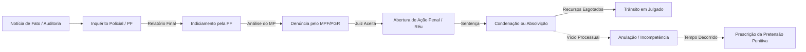

# Repositório de Investigações, Corrupção e Fatos Judiciais da Política Brasileira

> **Repositório Documental e Cronológico de Fatos Judiciais e Investigações Oficiais**  
> **Objetivo:** Fornecer uma base de dados neutra, estritamente factual e juridicamente precisa sobre escândalos de corrupção, operações policiais, processos criminais, prisões e desfechos judiciais no Brasil.  
> **Critério Anti-Desinformação:** Nenhuma alegação sem respaldo em inquéritos policiais (Polícia Federal), denúncias do Ministério Público (MPF/PGR), acórdãos judiciais (STF, STJ, TRFs) ou auditorias de órgãos de controle (CGU, TCU).

---

## 1. Glossário Jurídico Fundamental e Fases Processuais

No debate público brasileiro, termos jurídicos são frequentemente confundidos ou distorcidos. Para evitar a propagação de desinformação, todos os documentos deste repositório respeitam com rigor as seguintes distinções técnicas do Código de Processo Penal (CPP) e da Constituição Federal de 1988:

### Definições Processuais:
1. **Inquérito Policial (IP):** Procedimento investigatório preliminar de natureza administrativa, conduzido pela autoridade policial (Polícia Federal ou Civil). O investigado **não** é réu e não há condenação.
2. **Indiciamento:** Ato privativo do delegado de polícia que conclui haver indícios de autoria e materialidade contra determinada pessoa. Não significa acusação formal na Justiça.
3. **Denúncia do Ministério Público (MPF / PGR):** A peça inaugural da ação penal pública. O procurador da República decide se acusa formalmente perante o Judiciário ou pede o arquivamento do inquérito.
4. **Recebimento da Denúncia / Condição de Réu:** O juiz ou tribunal analisa se a denúncia preenche os requisitos legais. Apenas após a decisão de "receber a denúncia" o investigado se torna **réu**.
5. **Sentença / Acórdão Condenatório:** Julgamento de mérito em 1ª instância (juiz singular) ou em instâncias colegiadas (Tribunais Regionais Federais, Superior Tribunal de Justiça ou Supremo Tribunal Federal).
6. **Trânsito em Julgado:** Ocorre quando se esgotam todos os recursos possíveis ou se expiram os prazos para recorrer. Apenas com o trânsito em julgado a presunção de inocência constitucional (Art. 5º, LVII da CF/88) deixa de existir de forma definitiva.
7. **Anulação Processual por Vício de Forma / Competência:** Decisão judicial que invalida atos de um processo porque foram praticados por juízo incompetente ou juiz considerado suspeito/parcial. **Não equivale automaticamente a uma absolvição de mérito**, mas zera os atos decisórios praticados, podendo ensejar novo processo ou arquivamento por prescrição.
8. **Prescrição:** Perda do direito do Estado de punir devido ao decurso do tempo fixado em lei (Código Penal, arts. 109 a 115). Quando um processo é anulado e remetido a outro juiz, os prazos prescricionais continuam correndo e podem extinguir a punibilidade.

### Modalidades de Prisão:
* **Prisão em Flagrante:** Ocorre no momento da prática do crime ou logo após (Art. 302 do CPP).
* **Prisão Temporária:** Cabível durante a fase de inquérito policial para viabilizar investigações urgentes por prazo determinado (5 dias, prorrogáveis por mais 5 em crimes comuns, ou 30 + 30 em crimes hediondos - Lei nº 7.960/1989).
* **Prisão Preventiva:** Medida cautelar sem prazo fixo pré-determinado, decretada para garantir a ordem pública, econômica, a conveniência da instrução criminal ou para assegurar a aplicação da lei penal (Art. 312 do CPP). Não é cumprimento de pena antecipado.
* **Execução Provisória da Pena (Prisão após 2ª Instância):** Vigorou entre 2016 e 2019 no Brasil por entendimento jurisprudencial do STF; em novembro de 2019, o STF julgou as ADCs 43, 44 e 54, decidindo que a prisão para cumprimento de pena só pode ocorrer após o trânsito em julgado.
* **Cumprimento de Pena Definitivo:** Execução penal após trânsito em julgado em regime fechado, semiaberto ou aberto.

---

## 2. Mapa dos Arquivos e Grupos Documentados

O repositório é segmentado em documentos temáticos por momento histórico, grupo político e operação:

1. **[`01_operacao_lava_jato_e_petrolao.md`](file:///Users/rodrigofregonasse/Code/brasil-project/corrupcao_e_investigacoes/01_operacao_lava_jato_e_petrolao.md)**
   * Desvios na Petrobras, esquema de empreiteiras (Odebrecht, OAS, Camargo Corrêa).
   * Casos: Luiz Inácio Lula da Silva, Sérgio Cabral, Eduardo Cunha, Antonio Palocci, José Dirceu.
   * Prisões, solturas, anulações no STF (incompetência e suspeição de Sergio Moro) e situação atual.
2. **[`02_governo_bolsonaro_e_investigacoes.md`](file:///Users/rodrigofregonasse/Code/brasil-project/corrupcao_e_investigacoes/02_governo_bolsonaro_e_investigacoes.md)**
   * Caso das Joias Sauditas (indiciamento pela PF e envio à PGR).
   * Falsificação de Certificados de Vacina (prisões preventivas de assessores e Mauro Cid; delação premiada).
   * Caso das "Rachadinhas" na ALERJ (Fabrício Queiroz, Flávio Bolsonaro e anulações no STJ).
   * Fraudes na Saúde / Covaxin (CPI da Pandemia).
   * Escândalo dos "Pastores do MEC" (prisão e soltura do ex-ministro Milton Ribeiro).
3. **[`03_governo_temer_e_mdb.md`](file:///Users/rodrigofregonasse/Code/brasil-project/corrupcao_e_investigacoes/03_governo_temer_e_mdb.md)**
   * O "Joesley Day" (gravações no Palácio do Jaburu, mala de R$ 500 mil de Rodrigo Rocha Loures).
   * Prisões de Michel Temer na Operação Descontaminação (decretadas por Marcelo Bretas, revogadas pelo TRF-2 e absolvições no TRF-1).
   * O caso do "Bunker de R$ 51 milhões" em Salvador (Geddel Vieira Lima: prisão, condenação no STF e progressão penal).
4. **[`04_acao_penal_470_mensalao.md`](file:///Users/rodrigofregonasse/Code/brasil-project/corrupcao_e_investigacoes/04_acao_penal_470_mensalao.md)**
   * Julgamento histórico no Plenário do STF (relatoria Min. Joaquim Barbosa).
   * Compra de votos no Congresso, agências de publicidade (Marcos Valério).
   * Condenações de José Dirceu, José Genoino, Roberto Jefferson, Delúbio Soares; cumprimento de pena e indultos.
5. **[`05_centrao_orcamento_secreto_e_codevasf.md`](file:///Users/rodrigofregonasse/Code/brasil-project/corrupcao_e_investigacoes/05_centrao_orcamento_secreto_e_codevasf.md)**
   * Emendas de Relator (RP9) e julgamento de inconstitucionalidade no STF (ADPF 854).
   * Operação Odoacro e Operação Benfeitor da Polícia Federal (desvios de verbas na Codevasf).
   * Indiciamento do Ministro das Comunicações Juscelino Filho (União Brasil) pela Polícia Federal e envio ao STF.
6. **[`06_casos_em_aberto_e_instabilidades_recentes.md`](file:///Users/rodrigofregonasse/Code/brasil-project/corrupcao_e_investigacoes/06_casos_em_aberto_e_instabilidades_recentes.md)**
   * Escândalos e inquéritos em andamento sem julgamento definitivo (Lula 3 / Estatais / Sistema Financeiro).
   * Casos envolvendo Fundos de Pensão (Postalis, Previ, Funcef / Operação Greenfield e revisões de multas de leniência).
   * Operações da PF contra fraudes estruturadas no INSS.
   * Investigação sobre operações do Banco Master e BRB.
7. **[`07_stf_casos_historicos_e_conexoes.md`](file:///Users/rodrigofregonasse/Code/brasil-project/corrupcao_e_investigacoes/07_stf_casos_historicos_e_conexoes.md)**
   * Grandes casos, julgamentos paradigmáticos e inquéritos do STF organizados dos mais recentes aos mais antigos (2024 até 2003).
   * Conexão dos três fios condutores: O Pêndulo da Prisão em 2ª Instância, a Gênese do Superpoder de Autodefesa (Inquérito das Fake News até a suspensão do X) e o Conflito Distributivo com o Congresso Nacional.
8. **[`08_escandalos_bndes_operacoes_e_vinculos_lula.md`](file:///Users/rodrigofregonasse/Code/brasil-project/corrupcao_e_investigacoes/08_escandalos_bndes_operacoes_e_vinculos_lula.md)**
   * Os escândalos do BNDES: Financiamento de exportação de engenharia (Porto de Mariel em Cuba, Metrô de Caracas na Venezuela, Moçambique) e calotes de mais de US$ 1,3 bilhão pagos pelo Tesouro Nacional (FGE).
   * O vínculo investigado com Lula: A **Operação Janus** (PF/MPF - acusação de tráfico de influência para a Odebrecht em Angola, empresa do sobrinho Taiguara e palestras LILS) e seu **desfecho judicial** (rejeição e trancamento definitivo pelo TRF-1 por inépcia da denúncia e ausência de justa causa).
   * Operação Bullish (aportes na JBS/J&F), a auditoria internacional independente de R$ 48 milhões da Cleary Gottlieb / Kroll (que não encontrou corrupção no banco) e acórdãos do TCU sobre subsídios implícitos.

---

## 3. Fontes Oficiais de Checagem Permanente

Para verificar atualizações de processos em andamento:
* **Supremo Tribunal Federal (STF):** Portal de Acompanhamento Processual (`stf.jus.br`).
* **Superior Tribunal de Justiça (STJ):** Jurisprudência e Processos (`stj.jus.br`).
* **Polícia Federal (PF):** Comunicação Social / Notícias de Operações (`gov.br/pf`).
* **Procuradoria-Geral da República (PGR / MPF):** Notícias e Denúncias (`mpf.mp.br`).
* **Tribunal de Contas da União (TCU):** Acórdãos e Tomadas de Contas Especiais (`tcu.gov.br`).
* **Controladoria-Geral da União (CGU):** Painel de Acordos de Leniência e Operações Especiais (`cgu.gov.br`).
