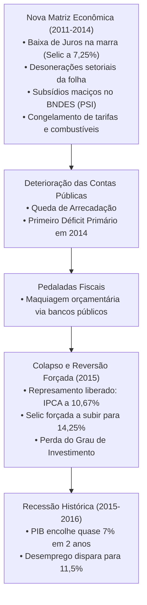

# Governos Lula 1 & 2 e Dilma Rousseff (2003 – 2016): Análise Econômica e Indicadores Reais

> **Período de Gestão:** 2003 – 2016 (A Era dos Governos do PT e a Crise da Nova Matriz Econômica)  
> **Comando Econômico:** Antonio Palocci (2003–2006), Guido Mantega (2006–2014), Joaquim Levy (2015), Nelson Barbosa (2015–2016) e Henrique Meirelles / Alexandre Tombini (Banco Central).  
> **Bases Oficiais de Dados:** IBGE (Contas Nacionais, IPCA, PME/PNADC), Banco Central (SGS Fiscais, Reservas Internacionais), Secretaria do Tesouro Nacional (RTN) e Tribunal de Contas da União (TCU).

---

## 1. Tabela-Síntese de Indicadores Oficiais

| Indicador Macroeconômico | Lula 1 (2003–2006) | Lula 2 (2007–2010) | Dilma 1 (2011–2014) | Dilma 2 / Crise (2015–2016) |
| :--- | :--- | :--- | :--- | :--- |
| **Crescimento Médio do PIB** | +3,5% ao ano | **+4,6% ao ano** (Pico de +7,5% em 2010) | +2,4% ao ano | **-3,5% (2015) / -3,3% (2016)** |
| **IPCA Anual Médio** | 6,4% a.a. (Pico de 9,3% em 2003) | 5,1% a.a. | 6,0% a.a. | **10,67% (2015) / 6,29% (2016)** |
| **Taxa Selic Meta (Final do Período)** | 13,25% a.a. | 10,75% a.a. | 11,75% a.a. (Queda forçada a 7,25% em 2012) | **14,25% a.a.** |
| **Taxa de Desocupação (Média)** | ~10,0% | ~6,7% (Mínima histórica da PME) | ~4,8% (PME) | **Disparada para 11,5%** (PNADC 2016) |
| **Reservas Internacionais** | De US$ 37 bi para US$ 85 bi | **Salto para US$ 288 bi** | US$ 374 bilhões | **Estáveis em ~US$ 370 bi** |
| **Resultado Primário Governo Central** | Superávits constantes (+3,0% PIB) | Superávits sólidos (+2,0% a +2,5% PIB) | Deterioração gradual (1º déficit em 2014: -R$ 17,2 bi) | **Déficits recordes: -R$ 116 bi (2015) / -R$ 161 bi (2016)** |
| **Dívida Líquida (DLSP % do PIB)** | Redução de 60% para 47% | **Queda para 38% do PIB** | Manteve-se em torno de 33% | **Explosão para 46% do PIB** |
| **Classificação de Risco Soberano** | Grau especulativo | **Conquista do Grau de Investimento (2008)** | Grau de Investimento mantido | **Perda do Grau de Investimento (2015)** |

---

## 2. O Ciclo Lula 1 e 2 (2003 – 2010): Ortodoxia Inicial, Boom de Commodities e Inclusão

### A Visão Keynesiana / Desenvolvimentista (Pró-Governo)
* **Argumento:** Os dois primeiros mandatos de Lula representaram o período de maior florescimento socioeconômico da história moderna brasileira:
  1. **Redução Histórica da Desigualdade:** O Índice de Gini de rendimento do trabalho desabou de 0,58 para 0,53. Mais de 30 milhões de brasileiros ascenderam à classe média (Classe C), impulsionados pela criação do **Bolsa Família**, expansão do crédito consignado e valorização sistemática do salário mínimo acima da inflação.
  2. **Geração de Emprego e Mercado Interno:** Mais de 15 milhões de empregos formais criados, transformando o consumo das famílias no grande dínamo do crescimento.
  3. **Soberania Externa:** O país quitou integralmente sua dívida com o FMI em 2005 e acumulou quase US$ 300 bilhões em **reservas cambiais**, blindando a economia de crises de balanço de pagamentos que historicamente quebravam o Brasil.
  4. **Enfrentamento da Crise Global de 2008:** Enquanto as economias centrais colapsavam, o governo adotou medidas fiscais e monetárias anticíclicas exemplares (redução de IPI para linha branca e automóveis, atuação agressiva de bancos públicos como BB e Caixa ofertando crédito, criação do Minha Casa Minha Vida e investimentos no PAC), resultando em um crescimento espetacular de **7,5% no PIB de 2010**.

### A Visão Liberal / Ortodoxa (Crítica de Mercado)
* **Argumento:** O sucesso econômico de Lula 1 e 2 derivou da combinação de herança institucional e sorte externa colossal:
  1. **A Herança do Tripé Macroeconômico:** Lula preservou a política econômica ortodoxa de FHC (Palocci manteve superávit primário elevado, metas de inflação e câmbio flutuante), impedindo o colapso de confiança que ameaçava o país em 2002.
  2. **O Superciclo Global das Commodities:** A urbanização e industrialização acelerada da China explodiram os preços internacionais de ferro, soja e petróleo a níveis nunca antes vistos. O crescimento brasileiro não decorreu de ganhos internos de produtividade, mas de termos de troca extraordinariamente favoráveis.
  3. **Desperdício de Reformas Estruturais:** Em vez de aproveitar o mar de dólares para realizar as reformas da Previdência, tributária e administrativa, o governo expandiu os gastos públicos correntes em ritmo superior ao do PIB e iniciou o inchaço do BNDES, plantando as raízes do descontrole fiscal posterior.

---

## 3. O Ciclo Dilma Rousseff (2011 – 2016): A "Nova Matriz Econômica" e a Maior Recessão da História

### A Visão Liberal / Ortodoxa (Crítica de Mercado)
* **Argumento:** A gestão Dilma Rousseff e Guido Mantega implementou a **Nova Matriz Econômica (NME)**, um experimento heterodoxo e intervencionista que gerou o pior colapso econômico desde a redemocratização:
  1. **Intervencionismo de Preços e Destruição de Setores:** A **Medida Provisória 579/2012** forçou a redução artificial de 20% nas tarifas de energia elétrica, descapitalizando e quebrando as empresas do setor elétrico. O represamento forçado dos preços da gasolina e diesel para segurar o IPCA impôs prejuízos de dezenas de bilhões de reais à Petrobras.
  2. **Capitalismo de Compadrio e Desonerações Seletivas:** A renúncia fiscal generalizada da folha de pagamento e os subsídios do Programa de Sustentação do Investimento (PSI) custearam mais de R$ 100 bilhões a grandes grupos empresariais sem exigir contrapartidas de investimento ou produtividade.
  3. **A Ruína Fiscal e as Pedaladas:** Para esconder o rombo orçamentário na eleição de 2014, o governo atrasou repasses a bancos públicos (Banco do Brasil, Caixa e FGTS), cometendo crime de responsabilidade contra a Lei de Responsabilidade Fiscal (as "pedaladas fiscais" condenadas pelo TCU).
  4. **A Conta da Crise:** Em 2015, com as contas esgotadas, as represas de preços estouraram: o IPCA disparou para 10,67%, o Banco Central foi obrigado a elevar a Selic para 14,25%, o Brasil perdeu o Grau de Investimento e a economia mergulhou em uma contração acumulada de quase 7% do PIB no biênio 2015-2016, destruindo milhões de empregos formais.

### A Visão Keynesiana / Desenvolvimentista (Pró-Governo / Heterodoxa)
* **Argumento:** A crise enfrentada no governo Dilma decorreu do esgotamento do ciclo externo e de sabotagem política interna que paralisou a capacidade de governar:
  1. **Queda das Commodities e Crise Global Prolongada:** Os preços do minério de ferro e do petróleo despencaram mais de 50% no mercado internacional a partir de 2013-2014, reduzindo drasticamente as receitas de exportação e a arrecadação tributária da União e dos estados.
  2. **Intenção Desenvolvimentista Legítima:** A Nova Matriz buscava desonerar o custo do capital para a indústria brasileira, baixar os spreads bancários predatórios e baratear a energia elétrica para dar competitividade à manufatura nacional perante a desindustrialização precoce.
  3. **O Erro da Austeridade Pro-cíclica em 2015:** Ao nomear o banqueiro Joaquim Levy para o Ministério da Fazenda no início do segundo mandato, Dilma cometeu o erro de aplicar um choque recessivo de corte de gastos e elevação de juros em plena desaceleração econômica, transformando uma desaceleração controlável em uma depressão aberta.
  4. **Pautas-Bomba e Paralisia Parlamentar:** A oposição liderada pelo presidente da Câmara, Eduardo Cunha, aprovou sucessivas "pautas-bomba" para elevar despesas do governo e impedir o reequilíbrio fiscal, instrumentalizando as pedaladas contábeis (prática comum em gestões anteriores) como pretexto político para deflagrar o processo de impeachment.
