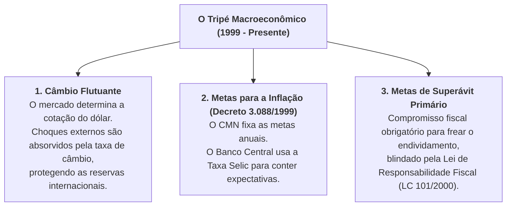

# O Marco Fundacional: Plano Real e o Tripé Macroeconômico (1994 – 2002)

> **Período de Gestão:** 1994 (Transição Itamar Franco) e 1995 – 2002 (Governo Fernando Henrique Cardoso)  
> **Comando Econômico:** Pedro Malan (Ministério da Fazenda), Gustavo Franco / Arminio Fraga (Banco Central) e equipe de concepção do Real (Pérsio Arida, André Lara Resende, Edmar Bacha).  
> **Bases Oficiais de Dados:** IBGE (Séries Históricas de Inflação e PIB), Banco Central do Brasil (SGS, Metas de Inflação) e Secretaria do Tesouro Nacional (LRF).

---

## 1. Tabela-Síntese de Indicadores Oficiais

| Indicador Macroeconômico | Pré-Plano Real (1993) | Fim de FHC 1 (1998) | Fim de FHC 2 (2002) | Fonte Oficial Primária |
| :--- | :--- | :--- | :--- | :--- |
| **IPCA Anual** | **2.477,15%** (Hiperinflação) | **1,65%** (Mínima histórica) | **12,53%** (Crise de confiança eleitoral) | IBGE - Sistema SNIPC |
| **Crescimento Médio do PIB** | +4,7% (1993) | Média 1995-1998: **+2,5% a.a.** | Média 1999-2002: **+2,1% a.a.** | IBGE - Contas Nacionais |
| **Taxa Selic Média Anual** | Incalculável em hiperinflação | **28,8% a.a.** (Pico de 45% na crise russa) | **25,0% a.a.** | Banco Central do Brasil |
| **Taxa de Desocupação (IBGE)** | ~5,3% (1993) | 7,6% (1998) | **11,7% a 12,3%** (2002) | IBGE - Pesquisa Mensal de Emprego |
| **Dívida Líquida (DLSP % do PIB)** | ~30% do PIB (1994) | 41,7% do PIB (1998) | **60,4% do PIB** (2002) | Banco Central do Brasil (Série SGS 4513) |
| **Câmbio (R$ por US$)** | R$ 1,00 = US$ 1,20 (1994) | R$ 1,20 por US$ (1998) | **R$ 3,53 por US$** (Dez/2002) | Banco Central do Brasil (PTAX) |
| **Telefonia Fixa e Móvel** | ~11 milhões de linhas (1994) | Privatização Telebrás (1998) | **Mais de 70 milhões de linhas** | Anatel (Agência Nacional de Telecomunicações) |

---

## 2. A Engenharia do Plano Real e o Fim da Hiperinflação (1993 – 1994)

O Plano Real não utilizou congelamentos de preços ou confisco de contas bancárias (como os fracassados Planos Cruzado, Bresser, Verão e Collor). Sua estrutura de engenharia econômica desenrolou-se em três etapas sincronizadas:
1. **Ajuste Fiscal Prévio:** Criação do Fundo Social de Emergência (FSE), desvinculando temporariamente receitas tributárias da União para equilibrar o orçamento de 1994;
2. **A Desindexação via URV (Unidade Real de Valor):** Instituída em março de 1994, a URV funcionou como um indexador diário fixado em dólares para alinhar todos os preços relativos da economia brasileira, quebrando a inércia psicológica da inflação;
3. **Emissão da Nova Moeda:** Em **1º de julho de 1994**, a URV foi transformada no **Real (R$)**, com paridade inicial fixa com a moeda norte-americana. A inflação anual despencou de quase 2.500% ao ano em 1993 para menos de 10% já em 1996.

---

## 3. A Institucionalização do Tripé Macroeconômico (1999)

Entre 1994 e 1998, a estabilização foi ancorada no câmbio fixo/bandas cambiais. As crises financeiras internacionais sucessivas (México em 1995, Tigres Asiáticos em 1997 e moratória da Rússia em 1998) drenaram as reservas do Banco Central. 

Em **janeiro de 1999**, o Brasil abandonou a âncora cambial e instituiu o **Tripé Macroeconômico**, arquitetura que vigora até os dias atuais:

---

## 4. Confronto Dialético por Eixos Temáticos

### Eixo 1: A Estabilização Monetária e as Reformas Institucionais

#### A Visão Liberal / Ortodoxa (Pró-Governo)
* **Argumento:** O governo FHC executou a mais brilhante e duradoura modernização institucional da República:
  1. **Extinção do Imposto Inflacionário:** A hiperinflação era o tributo mais perverso do país, confiscando o salário das famílias pobres que não tinham acesso a aplicações financeiras diárias ("overnight"). O fim da inflação transferiu renda real para a base da pirâmide e permitiu o consumo de bens básicos.
  2. **Lei de Responsabilidade Fiscal (LC 101/2000):** Revolucionou a gestão pública ao proibir que prefeitos, governadores e o presidente contratassem despesas sem receita correspondente ou deixassem dívidas para os sucessores, encerrando a farra de calotes federativos.
  3. **Privatizações Estruturais:** A venda do Sistema Telebrás (1998) extinguiu as filas de anos e o mercado clandestino de linhas telefônicas, universalizando o acesso ao telefone móvel e à internet para toda a população. A desestatização da Vale e de ferrovias atraiu bilhões em capital internacional.
  4. **Saneamento do Sistema Financeiro (Proer e Proes):** Liquidou e privatizou bancos estaduais que funcionavam como caixas de campanha de governadores (como o Banespa e o Banerj) e saneou bancos privados quebrados (Banco Nacional e Econômico), blindando o sistema bancário brasileiro de colapsos sistêmicos futuros.

#### A Visão Keynesiana / Desenvolvimentista (Crítica)
* **Argumento:** As reformas foram conduzidas sob a cartilha do Consenso de Washington de forma lesiva ao patrimônio nacional:
  1. **Privatizações a Preço Vil e Desnacionalização:** Empresas estratégicas altamente lucrativas (como a Vale do Rio Doce) foram alienadas a preços considerados irrisórios, transferindo o controle de riquezas minerais soberanas ao capital privado internacional.
  2. **Desmonte da Soberania Tecnológica:** A abertura comercial abrupta sem transição destruiu elos inteiros do parque industrial brasileiro de informática, bens de capital e têxtil, que não conseguiram concorrer com produtos estrangeiros subsidiados sob o real sobrevalorizado.
  3. **Austeridade seletiva:** A Lei de Responsabilidade Fiscal engessou a capacidade dos entes federativos de investir em infraestrutura, priorizando o pagamento de juros da dívida em detrimento dos investimentos sociais.

---

### Eixo 2: A Crise do Câmbio Fixo, os Juros Estratosféricos e a Dívida

#### A Visão Liberal / Ortodoxa (Pró-Governo)
* **Argumento:** A âncora cambial dos primeiros anos era o único instrumento capaz de esmagar a memória inflacionária brasileira. 
* Quando as crises externas da Ásia e da Rússia ameaçaram a economia, o governo teve a coragem política de elevar os juros temporariamente para 45% a.a. para evitar a hiperinflação de retorno.
* Assim que as circunstâncias exigiram, o governo operou uma transição ordenada para o câmbio flutuante e criou o Tripé Macroeconômico sob a liderança de Arminio Fraga, deixando para os governos seguintes a infraestrutura macroeconômica responsável pela estabilidade das duas décadas posteriores.

#### A Visão Keynesiana / Desenvolvimentista (Crítica)
* **Argumento:** A teimosia ideológica em manter o real artificialmente sobrevalorizado (R$ 1 = US$ 1) entre 1994 e 1998 custou caro demais ao Brasil:
  1. **Explosão da Dívida Pública:** Para defender o câmbio fictício, o Banco Central manteve juros reais astronômicos. A **Dívida Líquida disparou de 30% do PIB em 1994 para 60,4% do PIB em 2002**, transferindo fortunas do Tesouro para os rentistas financeiros.
  2. **Déficits Externos e Dependência do FMI:** O país acumulou rombos colossais em transações correntes e quebrou três vezes, sendo forçado a pedir socorro financeiro humilhante ao FMI em 1998, 1999 e 2002 com condicionalidades de arrocho salarial.
  3. **Desemprego e Baixo Crescimento:** O mandato inteiro foi marcado por desemprego de dois dígitos (terminando acima de 12% em 2002) e por um crescimento econômico medíocre (média de apenas 2,3% ao ano), culminando no "apagão elétrico" de 2001 decorrente da falta de investimentos estatais em geração de energia.
