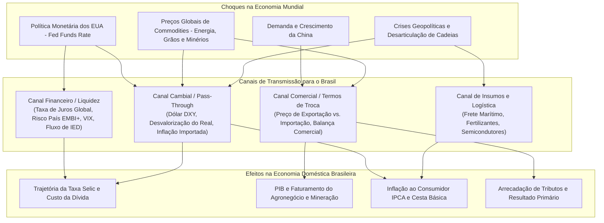

# Ultradocumento: O Cenário Econômico Global, Grandes Crises e Seus Impactos no Brasil (1994 – 2026)

> **Documento Analítico de Macroeconomia Internacional e Geopolítica Econômica**  
> **Objetivo:** Mapear os grandes ciclos da economia mundial, expansões, choques de oferta, alterações na política monetária das superpotências e crises financeiras internacionais, correlacionando-os diretamente aos seus **impactos no Brasil** (**Positivo [+]**, **Negativo [-]** ou **Neutro/Misto [=]**) em cada mandato presidencial.  
> **Bases Oficiais Internacionais Homologadas:** Fundo Monetário Internacional (FMI), Banco Mundial (World Bank), Organização para a Cooperação e Desenvolvimento Econômico (OCDE), Banco de Compensações Internacionais (BIS), Federal Reserve Bank of St. Louis (FRED), Conferência das Nações Unidas sobre Comércio e Desenvolvimento (UNCTAD) e Organização Mundial do Comércio (OMC).

---

## 1. Matriz Teórica dos Canais de Transmissão Internacional para o Brasil

A economia brasileira é historicamente classificada como uma **pequena economia aberta exportadora de commodities** (*small open commodity-exporting economy*). Os choques externos atingem o país por quatro canais de transmissão principais:

---

## 2. Linha do Tempo Global e Classificação de Impactos no Brasil

---

### Período 1: A Década de 1990 (Governo FHC / Plano Real)

#### 1.1. Crise Mexicana / Efeito Tequila (1994 – 1995)
* **O Choque Global:** Desvalorização abrupta do Peso mexicano em dezembro de 1994 provocada pela fuga massiva de capitais internacionais após a elevação dos juros pelo Federal Reserve dos EUA. O contágio disseminou pânico nos mercados emergentes latino-americanos.
* **Classificação do Impacto no Brasil:** **`NEGATIVO [-]`**
* **Canal de Transmissão:** Fuga súbita de capitais estrangeiros do Brasil poucos meses após a criação do Real. Para defender a recém-criada âncora cambial (R$ 1 = US$ 1) e evitar a volta da hiperinflação, o Banco Central elevou a taxa básica de juros para **45% ao ano** e aumentou compulsórios bancários.
* **Impacto Interno:** Desaceleração imediata da atividade econômica, quebra de bancos privados nacionais com carteiras fragilizadas (forçando a criação do Proer pelo governo) e forte ampliação do custo de rolagem da dívida pública.
* **Fontes Oficiais:** [FMI - *The Evolving Nature of the Mexican Crisis* (1995)](https://www.imf.org/) e [BIS - *Financial Market Volatility in Emerging Markets*](https://www.bis.org/).

#### 1.2. Crise dos Tigres Asiáticos (1997)
* **O Choque Global:** Colapso monetário e financeiro originado na Tailândia em julho de 1997 (desvalorização do Baht) que se espalhou rapidamente para Indonésia, Coreia do Sul, Malásia e Filipinas, provocando inadimplência corporativa e recessão no Sudeste Asiático.
* **Classificação do Impacto no Brasil:** **`NEGATIVO [-]`**
* **Canal de Transmissão:** Aversão generalizada a risco em mercados emergentes. Investidores estrangeiros liquidaram posições no Brasil para cobrir perdas na Ásia.
* **Impacto Interno:** O Banco Central brasileiro dobrou os juros nominais (de 21% para 43% a.a. em outubro de 1997) para conter a perda de reservas cambiais. A economia entrou em forte desaceleração e o desemprego começou sua escalada rumo aos dois dígitos.
* **Fontes Oficiais:** [Banco Mundial - *East Asia: The Road to Recovery* (1998)](https://openknowledge.worldbank.org/) e [FMI - *World Economic Outlook: International Financial Contagion*](https://www.imf.org/en/Publications/WEO).

#### 1.3. A Moratória da Rússia e a Ruptura Cambial Brasileira (1998 – 1999)
* **O Choque Global:** Em agosto de 1998, a Rússia desvalorizou o rublo e declarou moratória unilateral de sua dívida interna e externa, quebrando fundos de hedge globais (como o lendário LTCM nos EUA) e fechando as linhas de crédito internacional para economias emergentes.
* **Classificação do Impacto no Brasil:** **`EXTREMAMENTE NEGATIVO [-]`**
* **Canal de Transmissão:** Seca total de liquidez internacional. O Brasil perdeu dezenas de bilhões de dólares de reservas cambiais em semanas defendendo a banda cambial.
* **Impacto Interno:** Em janeiro de 1999, o Banco Central esgotou sua capacidade de intervenção e foi forçado a **abandonar o câmbio fixo**, adotando o câmbio flutuante. O dólar saltou de R$ 1,20 para mais de R$ 2,00. O país recorreu a um empréstimo emergencial de **US$ 41,5 bilhões do FMI**.
* **O Desdobramento Positivo Estrutural:** A crise forçou o nascimento do **Tripé Macroeconômico** (câmbio flutuante, metas de inflação e metas fiscais), que reorganizou as bases institucionais do país.
* **Fontes Oficiais:** [FMI - *Brazil: Letter of Intent and Memorandum of Economic Policies* (1998/1999)](https://www.imf.org/external/np/loi/1998/111398.htm) e [Federal Reserve Bank of St. Louis (FRED) - Russian Crisis Spillovers](https://fred.stlouisfed.org/).

---

### Período 2: Os Anos 2000 (Governos Lula 1 e 2)

#### 2.1. A Entrada da China na OMC e o Superciclo das Commodities (2001 – 2011)
* **O Choque Global:** Em dezembro de 2001, a China ingressou formalmente na Organização Mundial do Comércio (OMC). Iniciou-se a maior migração urbano-industrial da história humana: o PIB chinês cresceu a uma média superior a 10% ao ano, demandando volumes colossais de aço, minério de ferro, cimento, soja, carne e petróleo.
* **Classificação do Impacto no Brasil:** **`EXTREMAMENTE POSITIVO [+]`**
* **Canal de Transmissão:** Melhoria espetacular dos **Termos de Troca** (*Terms of Trade*). As cotações internacionais das commodities que o Brasil exporta explodiram (o minério de ferro saltou de US$ 15 para mais de US$ 180 a tonelada; a saca de soja e o barril de petróleo atingiram máximas históricas).
* **Impacto Interno:**
  1. Superávits comerciais recordes contínuos;
  2. Arrecadação tributária em expansão galopante sobre o lucro das mineradoras, petroleiras e agronegócio;
  3. Acúmulo de **reservas internacionais** (de US$ 37 bi para mais de US$ 280 bi);
  4. Quitação da dívida externa com o FMI em 2005;
  5. Espaço fiscal e cambial que permitiu valorização do salário mínimo e crescimento do PIB (pico de 7,5% em 2010) com moeda valorizada.
* **Fontes Oficiais:** [UNCTAD - *The Commodities Special Report: Trade and Development*](https://unctad.org/) e [FMI - *Boom and Bust in Global Commodity Prices*](https://www.imf.org/).

#### 2.2. A Crise Financeira Global de 2008 (Subprime e Quebra do Lehman Brothers)
* **O Choque Global:** Em setembro de 2008, o colapso do mercado imobiliário de alto risco (*subprime*) nos EUA culminou na falência do banco de investimentos Lehman Brothers. Os mercados interbancários globais congelaram, deflagrando a **Grande Recessão**, a pior crise financeira global desde a Grande Depressão de 1929.
* **Classificação do Impacto no Brasil:** **`NEGATIVO NO CURTO PRAZO [-], MAS COM REAÇÃO RESILIENTE [=]`**
* **Canal de Transmissão:** Queda vertical imediata nos preços globais de commodities no final de 2008, fuga de capitais especulativos e congelamento de linhas de crédito externo para empresas exportadoras brasileiras.
* **Impacto Interno:** O PIB brasileiro recuou -0,1% em 2009. No entanto, o contágio foi contido rapidamente porque o Brasil possuía farto colchão de reservas internacionais e adotou uma política anticíclica agressiva: liberação de compulsórios pelo Banco Central, corte rápido da Selic e expansão de crédito por bancos públicos (BB, Caixa e BNDES), permitindo um rebote espetacular de +7,5% no PIB em 2010.
* **Fontes Oficiais:** [BIS - *The global financial crisis of 2008: what went wrong?*](https://www.bis.org/) e [Federal Reserve History - *The 2007–2008 Financial Crisis*](https://www.federalreservehistory.org/).

---

### Período 3: Os Anos 2010 (Governos Dilma Rousseff e Michel Temer)

#### 3.1. O Esgotamento do Superciclo e o "Novo Normal" Chinês (2011 – 2015)
* **O Choque Global:** A China encerrou seu ciclo de crescimento de dois dígitos e transicionou para um modelo de crescimento moderado (6% a 7% a.a.) voltado ao consumo interno e serviços em vez de infraestrutura pesada. Simultaneamente, houve uma oferta excedente de minério e grãos no mercado global.
* **Classificação do Impacto no Brasil:** **`EXTREMAMENTE NEGATIVO [-]`**
* **Canal de Transmissão:** Queda drástica dos Termos de Troca. O preço do minério de ferro desabou de US$ 180 para menos de US$ 40 por tonelada entre 2011 e 2015; o barril de petróleo Brent desabou de US$ 115 para menos de US$ 30 em 2014-2015.
* **Impacto Interno:** Queda abrupta nas receitas fiscais e nos lucros corporativos de estatais e gigantes exportadoras brasileiras (Petrobras e Vale). Combinada com erros domésticos de política econômica (a Nova Matriz Econômica e subsídios do PSI), a contração dos preços internacionais acelerou a pior recessão da história republicana brasileira (-3,5% em 2015 e -3,3% em 2016).
* **Fontes Oficiais:** [World Bank - *Commodity Markets Outlook: The Great Fall in Commodity Prices* (2015)](https://www.worldbank.org/en/research/commodity-markets) e [OCDE - *Economic Outlook: China’s Structural Slowdown*](https://www.oecd.org/).

#### 3.2. O *Taper Tantrum* do Federal Reserve (2013)
* **O Choque Global:** Em maio de 2013, o presidente do Federal Reserve, Ben Bernanke, sinalizou que o banco central norte-americano iria começar a desacelerar suas compras mensais de títulos (*Quantitative Easing*), indicando o fim da era de juros zero nos EUA.
* **Classificação do Impacto no Brasil:** **`NEGATIVO [-]`**
* **Canal de Transmissão:** O anúncio provocou um choque nos mercados emergentes batizado de *Taper Tantrum*. O dólar valorizou-se globalmente e os rendimentos dos títulos do Tesouro dos EUA (*Treasuries* de 10 anos) dispararam.
* **Impacto Interno:** Fuga expressiva de capitais do Brasil. O real sofreu forte desvalorização, forçando o Banco Central brasileiro a inaugurar um massivo programa de venda diária de swaps cambiais (intervenção no mercado futuro) e a iniciar um ciclo doloroso de alta da Selic (de 7,25% para 11,0% a.a.), encarecendo o crédito em plena desaceleração econômica.
* **Fontes Oficiais:** [Federal Reserve - *The Taper Tantrum of 2013 and Emerging Markets*](https://www.federalreserve.gov/) e [FMI - *Global Liquidity and Spillover Risks*](https://www.imf.org/).

---

### Período 4: Fim da Década de 2010 e Início dos Anos 2020 (Governo Jair Bolsonaro)

#### 4.1. A Guerra Comercial EUA-China e as Tarifas de Trump (2018 – 2019)
* **O Choque Global:** A administração de Donald Trump nos EUA impôs tarifas punitivas a centenas de bilhões de dólares de produtos manufaturados e tecnológicos chineses. Em retaliação, a China aplicou tarifas aduaneiras proibitivas sobre produtos agrícolas norte-americanos, especialmente a soja e a carne suína.
* **Classificação do Impacto no Brasil:** **`MISTO / POSITIVO NO COMÉRCIO, NEGATIVO NA INCERTEZA [= / +]`**
* **Canal de Transmissão:** Desvio maciço de comércio (*Trade Diversion*).
* **Impacto Interno:**
  * **Efeito Comercial Positivo:** Pequim substituiu integralmente a soja dos Estados Unidos pela soja brasileira. O Brasil consolidou sua posição como o maior exportador mundial de soja para a China, com prêmios recordes nos portos brasileiros de Santos e Paranaguá.
  * **Efeito Macroeconômico Negativo:** A incerteza geopolítica generalizada reduziu os investimentos globais, depreciou as moedas emergentes e freou a recuperação do crescimento industrial no Brasil.
* **Fontes Oficiais:** [UNCTAD - *Trade and Trade Diversion Effects of United States Tariff Sanctions on China* (2019)](https://unctad.org/webflyer/trade-and-trade-diversion-effects-united-states-tariffs-china) e [OMC - *World Trade Statistical Review*](https://www.wto.org/).

#### 4.2. A Pandemia Global de COVID-19 (2020 – 2021)
* **O Choque Global:** Paralisação física de economias mundiais, fechamento de fronteiras, quarentenas compulsórias e colapso sincronizado de cadeias globais de valor e do tráfego aéreo e marítimo.
* **Classificação do Impacto no Brasil:** **`EXTREMAMENTE NEGATIVO NO INÍCIO [-], SEGUIDO DE CHOQUE DE OFERTA [=]`**
* **Canal de Transmissão:** Queda repentina na demanda global no início de 2020 (o petróleo Brent chegou a ser negociado abaixo de US$ 20), choque financeiro com circuit-breakers na B3, seguido por inflação global de custos (*supply bottlenecks*) provocada pela falta de componentes eletrônicos, fretes marítimos dez vezes mais caros e estímulos monetários massivos no Ocidente.
* **Impacto Interno:**
  1. Contração de -3,3% no PIB em 2020 e explosão do desemprego para 14,9%;
  2. Disparada da taxa de câmbio (dólar acima de R$ 5,80);
  3. Inflação de dois dígitos no Brasil (IPCA em 10,06% em 2021), forçando o Banco Central a elevar a Selic de 2,00% para 13,75% em velocidade recorde;
  4. Por outro lado, a alta global subsequente de commodities no pós-pandemia acelerou a arrecadação da União e gerou o superávit primário em 2022.
* **Fontes Oficiais:** [FMI - *World Economic Outlook: The Great Lockdown* (2020)](https://www.imf.org/en/Publications/WEO/Issues/2020/04/14/weo-april-2020) e [Banco Mundial - *Global Economic Prospects: Pandemic Spillovers*](https://www.worldbank.org/).

#### 4.3. A Guerra na Ucrânia e o Choque de Petróleo e Fertilizantes (2022)
* **O Choque Global:** A invasão da Ucrânia pela Rússia em fevereiro de 2022 e a aplicação de sanções financeiras e energéticas ocidentais contra Moscou provocaram o disparo nas cotações mundiais de petróleo (Brent acima de US$ 120), gás natural, trigo, milho e, criticamente, fertilizantes agrícolas (potássio, ureia e fosfato).
* **Classificação do Impacto no Brasil:** **`MISTO [= / + / -]`**
* **Canal de Transmissão:**
  * **Impacto Negativo:** Ameaça aguda de desabastecimento de fertilizantes para o agronegócio brasileiro (o Brasil importava cerca de 85% dos seus fertilizantes, com grande dependência da Rússia e Bielorrússia) e disparada global nos preços do diesel e gasolina.
  * **Impacto Positivo:** O Brasil, como grande produtor de alimentos e exportador líquido de petróleo, viu a sua balança comercial registrar receitas recordes com a valorização dos grãos e do óleo cru no mercado internacional.
* **Fontes Oficiais:** [Banco Mundial - *Commodity Markets Outlook: The Impact of the War in Ukraine on Commodity Markets* (2022)](https://www.worldbank.org/) e [FAO - *Global Food Price Index Surge*](https://www.fao.org/worldfoodsituation/foodpricesindex/en/).

---

### Período 5: O Cenário Contemporâneo (Governo Lula 3 / 2023 – 2026)

#### 5.1. O Ciclo de Juros Mais Altos em 22 Anos nos EUA (Federal Reserve)
* **O Choque Global:** Para conter a pior inflação em 40 anos nos EUA (que atingiu 9,1% em 2022), o Federal Reserve elevou a *Fed Funds Rate* de 0,00%–0,25% para a faixa de **5,25% a 5,50% ao ano**, mantendo-a em patamares restritivos ao longo de 2023 e meados de 2024.
* **Classificação do Impacto no Brasil:** **`NEGATIVO [-]`**
* **Canal de Transmissão:** Rendimentos atrativos e isentos de risco nos títulos do Tesouro dos EUA (*Treasuries* de curto e longo prazo a 5% em dólar) drenaram capitais de todas as bolsas e mercados emergentes do planeta rumo aos Estados Unidos (*dólar forte global*).
* **Impacto Interno:** Limitou a velocidade e a amplitude do ciclo de corte da Selic pelo Banco Central do Brasil. Para evitar uma desvalorização cambial desordenada do real e fuga de reservas, o Banco Central foi obrigado a manter os juros reais domésticos acima de 8% a.a., restringindo o crédito empresarial e provocando a seca de IPOs na B3.
* **Fontes Oficiais:** [Federal Reserve Bank of St. Louis (FRED) - Federal Funds Effective Rate](https://fred.stlouisfed.org/series/FEDFUNDS) e [BIS - *Annual Economic Report: High interest rates for longer*](https://www.bis.org/).

#### 5.2. Tensões Geopolíticas no Oriente Médio e Conflitos Navais (Estreito de Ormuz e Mar Vermelho)
* **O Choque Global:** Ataques a navios comerciais no Estreito de Bab el-Mandeb (Mar Vermelho) e ameaças de fechamento militar do **Estreito de Ormuz** (por onde trafega cerca de 20% do petróleo mundial consumido no planeta) encareceram o frete marítimo internacional e mantiveram o prêmio de risco geopolítico sobre o barril de petróleo elevado.
* **Classificação do Impacto no Brasil:** **`POSITIVO NO COMÉRCIO, NEGATIVO NA INFLAÇÃO [= / +]`**
* **Canal de Transmissão:** Sustentação das receitas de exportação de petróleo bruto da Petrobras e de operadoras privadas brasileiras no pré-sal. Segundo dados citados por economistas e relatórios do FMI, a sustentação do preço do petróleo adicionou cerca de 0,2 ponto percentual ao PIB brasileiro de forma exógena.
* **Fontes Oficiais:** [EIA (U.S. Energy Information Administration) - *World Oil Transit Chokepoints*](https://www.eia.gov/) e [FMI - *World Economic Outlook: Geopolitical Risks and Energy Markets*](https://www.imf.org/).

#### 5.3. A Reconfiguração das Cadeias Globais (*Friendshoring*, *Nearshoring* e Transição Verde)
* **O Choque Global:** As tensões entre os Estados Unidos e a China e as lições da vulnerabilidade logística da pandemia levaram as potências ocidentais a diversificar seus fornecedores e buscar segurança em parceiros amigáveis (*friendshoring*) e sustentáveis ecologicamente.
* **Classificação do Impacto no Brasil:** **`ALTAMENTE POSITIVO NO LONGO PRAZO [+]`**
* **Canal de Transmissão:** Demanda global acelerada por:
  1. **Matriz Elétrica Limpa e Hidrogênio Verde:** Mais de 85% da eletricidade brasileira provém de fontes renováveis (hidrelétrica, eólica e solar), atraindo fábricas e data centers internacionais que exigem energia descarbonizada;
  2. **Minerais Críticos para Baterias:** Nióbio, níquel, lítio e terras raras necessários para a transição energética e veículos elétricos;
  3. **Segurança Alimentar Global:** O Brasil consolidou sua posição como o maior exportador líquido de alimentos do planeta perante as metas climáticas e estresse hídrico no Hemisfério Norte.
* **Impacto Interno:** Recordes sucessivos no saldo comercial brasileiro (US$ 241 bilhões de superávit acumulados em 3 anos) e atração de volumes consistentes de Investimento Estrangeiro Direto (IED).
* **Fontes Oficiais:** [OCDE - *FDI in Figures: Global Investment Trends*](https://www.oecd.org/investment/investment-policy/fdi.htm) e [Banco Mundial - *Minerals for Climate Action: The Mineral Intensity of the Clean Energy Transition*](https://www.worldbank.org/).

---

## 3. Matriz Consolidada: Cenário Externo vs. Desempenho do Brasil

| Período / Governo | Grandes Choques e Ciclos Mundiais | Saldo do Impacto Externo | Como o Brasil Respondeu Internamente |
| :--- | :--- | :--- | :--- |
| **1994–1998 (FHC 1)** | Crise do México (1995) e Tigres Asiáticos (1997). | **Negativo [-]** | Elevou a Selic para 45% a.a. para segurar a âncora cambial e criou o Proer para salvar bancos. |
| **1999–2002 (FHC 2)** | Moratória da Rússia (1998) e quebra da Argentina (2001). | **Altamente Negativo [-]** | Abandonou o câmbio fixo, recorreu ao FMI e institucionalizou o **Tripé Macroeconômico**. |
| **2003–2010 (Lula 1 e 2)** | Entrada da China na OMC e Superciclo de Commodities; Crise de 2008. | **Extremamente Positivo [+]** | Acumulou reservas cambiais recordes (US$ 280 bi+), expandiu consumo e quitou o FMI. |
| **2011–2016 (Dilma)** | Fim do superciclo, queda vertical do minério e petróleo; *Taper Tantrum* do Fed. | **Extremamente Negativo [-]** | Adotou a Nova Matriz Econômica e desonerações seletivas, culminando na recessão de 2014-2016. |
| **2016–2018 (Temer)** | Normalização gradual dos juros nos EUA e desaceleração global moderada. | **Neutro [=]** | Aprovou o Teto de Gastos, desinflacionou a economia e cortou a Selic para 6,5%. |
| **2019–2022 (Bolsonaro)** | Guerra Comercial EUA-China; Pandemia da Covid-19 e Guerra na Ucrânia. | **Misto / Altamente Volátil [=]** | Resposta via Auxílio Emergencial e BEm; choque inflacionário (IPCA a 10%), seguido por superávit do agro. |
| **2023–2026 (Lula 3)** | Juros do Fed a 5,5% (máxima em 22 anos), conflitos no Oriente Médio e transição verde. | **Misto [=]** (Financeiro [-] / Comercial [+]) | Superávit comercial histórico (US$ 241 bi), desemprego em 5,1%, mas juro real elevado (8,45%) e dívida em alta. |

---

## 4. Conclusão Macroeconômica: Sorte, Mérito ou Determinismo Externo?

> [!IMPORTANT]
> **A Teoria da Maré e do Barco:**
> A análise empírica dos dados do FMI, Banco Mundial e Banco Central do Brasil demonstra que **nenhum governo brasileiro opera em um vácuo isolado**:

1. **Quando a maré global sobe (2003–2010 e choque de grãos pós-guerra):** O crescimento econômico e a arrecadação tributária são turbinados por fatores externos independentes da qualidade da gestão doméstica, aliviando restrições fiscais.
2. **Quando a maré global recua (1998–1999, 2014–2015 e juros altos do Fed em 2023–2024):** Governos que mantêm fragilidades fiscais estruturais são duramente punidos com desvalorização cambial, disparada da inflação e necessidade de juros reais proibitivos.
3. **O Fator Diferencial Doméstico:** O mérito das administrações não reside em evitar as tempestades globais (impossíveis de controlar), mas em **construir colchões de liquidez, credibilidade fiscal e segurança jurídica** que permitam ao país absorver os choques sem destruir a renda da sua população.
