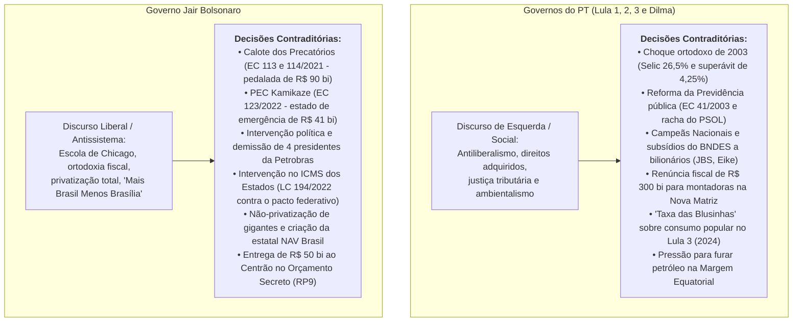

# Decisões Econômicas Contraditórias: Governos do PT e Governo Bolsonaro

> **Classificação:** Economia Política, Análise de Decisões Públicas e História Econômica  
> **Período Coberto:** 2003 – 2026  
> **Objetivo:** Documentar e analisar de forma rigorosa as principais decisões executivas, projetos de lei, reformas fiscais, medidas provisórias e ações orçamentárias adotadas pelos governos do Partido dos Trabalhadores (Lula 1, Lula 2, Dilma e Lula 3) e pelo governo Jair Bolsonaro que **contrariaram frontalmente suas próprias bandeiras ideológicas, promessas de campanha ou discursos públicos**.  
> **Metodologia:** Cada caso apresenta: (1) O que a retórica oficial pregava; (2) A decisão concreta e contraditória adotada; (3) A explicação dos bastidores, pressões e conjuntura do momento; (4) Fontes oficiais primárias.

---

## 1. Matriz Sintética das Contradições Econômicas

---

## PARTE I: GOVERNOS DO PT (LULA E DILMA)

---

### Caso 1: O Choque Ortodoxo de 2003 (Superávit de 4,25% do PIB e Selic a 26,5%)

#### 1. O que o Discurso Pregava:
Durante mais de duas décadas na oposição, o PT e Lula classificaram a política econômica de Fernando Henrique Cardoso como "submissa aos ditames do FMI e ao Consenso de Washington". O partido defendia a suspensão do pagamento e a "auditoria soberana da dívida externa", combatia o regime de metas de inflação e acusava o tripé macroeconômico de enriquecer banqueiros em detrimento dos trabalhadores.

#### 2. A Decisão Concreta e Contraditória:
Ao assumir a presidência em janeiro de 2003, Lula implementou um dos choques monetários e fiscais mais conservadores e ortodoxos da história da República:
* **Nomeação de Símbolos do Mercado:** Escolheu Henrique Meirelles (ex-presidente mundial do BankBoston e recém-eleito deputado federal pelo PSDB) para a presidência do Banco Central, e Antonio Palocci (que adotou discurso pró-mercado estrito) para o Ministério da Fazenda;
* **Super-Selic:** O Copom elevou a taxa Selic para o patamar de **26,5% ao ano** no primeiro trimestre de 2003 para conter as pressões inflacionárias;
* **Superávit Acima do Exigido pelo FMI:** O acordo firmado por FHC com o FMI estipulava meta de superávit primário de 3,75% do PIB. O governo Lula **elevou voluntariamente a meta para 4,25% do PIB**, cortando investimentos e despesas correntes de ministérios sociais para assegurar o pagamento integral dos juros da dívida;
* **Quitação Antecipada ao FMI:** Em dezembro de 2005, liquidou antecipadamente toda a dívida brasileira com o FMI (**US$ 15,5 bilhões**), encerrando a supervisão técnica do fundo sobre a economia nacional.

#### 3. Explicação do Momento (A Conjuntura de Pressão):
* **A Crise de Confiança de 2002:** Durante a campanha eleitoral de 2002, o mercado financeiro entrou em pânico especulativo diante do risco de vitória de um ex-líder operário esquerdista (o fenômeno apelidado pelo mercado de *"Efeito Lula"*). A cotação do dólar disparou de R$ 2,30 para quase R$ 4,00 e o Risco-País superou **2.400 pontos-base**, fechando o crédito externo para o Brasil;
* **A Necessidade de Estabilidade:** Para viabilizar a governabilidade e neutralizar o pânico financeiro, Lula assinou em junho de 2002 a célebre *"Carta ao Povo Brasileiro"*, comprometendo-se com o cumprimento irrestrito de contratos. Uma vez no poder, a equipe econômica calculou que apenas um choque de ortodoxia radical convenceria o sistema financeiro global de que o governo honraria suas dívidas, evitando a hiperinflação e a fuga em massa de capitais.

#### 4. Fontes Oficiais:
* *Banco Central do Brasil (BCB):* Atas das reuniões do Copom de janeiro a abril de 2003 (Série SGS 432 - Selic a 26,5%).
* *Secretaria do Tesouro Nacional (STN):* Relatório do Resultado do Tesouro Nacional de 2003 (Superávit primário consolidado do setor público de 4,25% do PIB).
* *Acervo Histórico da Presidência da República:* "Carta ao Povo Brasileiro" (22 de junho de 2002).

---

### Caso 2: A Reforma da Previdência Pública e a Taxação de Inativos (EC nº 41/2003)

#### 1. O que o Discurso Pregava:
O PT votou sistematicamente contra a reforma previdenciária de FHC em 1998 (EC 20/98). O discurso histórico do partido afirmava que os direitos dos servidores públicos eram conquistas trabalhistas inalienáveis e classificava qualquer tentativa de cobrar contribuição previdenciária de servidores aposentados e pensionistas (inativos) como um "confisco inconstitucional, imoral e perverso".

#### 2. A Decisão Concreta e Contraditória:
Ainda em seu primeiro ano de mandato, Lula enviou ao Congresso a Proposta de Emenda à Constituição da Reforma da Previdência, sancionada como a **Emenda Constitucional nº 41/2003**:
* **Taxação dos Aposentados:** Instituiu uma alíquota de contribuição previdenciária compulsória de **11% sobre os proventos de aposentados e pensionistas** do setor público que superassem o teto do Regime Geral (INSS);
* **Fim da Paridade e Integralidade:** Extinguiu o direito à aposentadoria com salário integral e reajuste idêntico ao dos servidores da ativa para quem ingressasse no serviço público após a emenda;
* **Idade Mínima:** Elevou a idade mínima de aposentadoria para servidores públicos para 60 anos (homens) e 55 anos (mulheres).

#### 3. Explicação do Momento (A Conjuntura de Pressão):
* **O Buraco Previdenciário dos Estados:** Governadores de diversos partidos (inclusive de oposição, como Aécio Neves em Minas Gerais e Geraldo Alckmin em São Paulo) pressionavam o governo federal porque as contas estaduais estavam colapsando devido ao peso das aposentadorias do funcionalismo;
* **O Racha Histórico do PT e o Surgimento do PSOL:** A aprovação da EC 41/2003 produziu a maior fratura ideológica interna da história do partido. Parlamentares históricos da ala socialista que votaram contra a reforma orientada pelo Planalto (a senadora Heloísa Helena e os deputados federais Luciana Genro, Babá e João Fontes) foram sumariamente julgados e **expulsos do PT** pelo Diretório Nacional em dezembro de 2003, fundando no ano seguinte o **Partido Socialismo e Liberdade (PSOL)**.

#### 4. Fontes Oficiais:
* *Presidência da República / Congresso Nacional:* [Emenda Constitucional nº 41, de 19 de dezembro de 2003](https://www.planalto.gov.br/ccivil_03/constituicao/emendas/emc/emc41.htm).
* *Supremo Tribunal Federal:* ADI 3105 e ADI 3128 (O STF confirmou por maioria a constitucionalidade da taxação dos servidores inativos instituída pela EC 41).
* *Diretório Nacional do PT:* Resoluções Políticas de 14 de dezembro de 2003 (Expulsão formal dos parlamentares dissidentes).

---

### Caso 3: A Política das "Campeãs Nacionais" e os Subsídios do BNDES a Megacorporações

#### 1. O que o Discurso Pregava:
A retórica histórica de esquerda fundamenta-se na oposição aos oligopólios capitalistas, no combate à concentração de renda corporativa e na defesa de que recursos públicos estatais devem financiar a agricultura familiar, pequenas empresas e serviços essenciais ao povo trabalhador, e não o grande capital.

#### 2. A Decisão Concreta e Contraditória:
Durante os governos Lula 2 e Dilma Rousseff, o BNDES (presidido pelo economista Luciano Coutinho) operou a chamada **"Política de Campeãs Nacionais"**:
* **Repasse Bilionário do Tesouro:** O Tesouro Nacional emitiu títulos da dívida pública e repassou mais de **R$ 500 bilhões** diretamente ao BNDES entre 2008 e 2014;
* **Taxa de Juros Subsidiada (TJLP):** Esses recursos foram emprestados a grandes grupos empresariais privados cobrando a Taxa de Juros de Longo Prazo (TJLP), que oscilava entre 5% e 6% ao ano, enquanto o Tesouro pagava a Selic (10% a 14% ao ano) para captar esse dinheiro. O diferencial gerou um custo de subsídio implícito de mais de **R$ 150 bilhões bancado pelos cofres públicos**;
* **Concentração de Mercados:** Financiou megafusões e aquisições corporativas bilionárias que criaram oligopólios privados gigantescos: a expansão global da **JBS/Friboi** (compra da norte-americana Swift e Pilgrim's Pride via aporte acionário da BNDESPar de mais de R$ 8 bilhões); a fusão de Sadia e Perdigão para formar a **BRF**; a fusão da Telemar/Oi com a Brasil Telecom; e vultosos financiamentos à Odebrecht e ao grupo EBX de Eike Batista.

#### 3. Explicação do Momento (A Conjuntura de Pressão):
* **A Doutrina Neodesenvolvimentista Pós-Crise de 2008:** Inspirada no modelo das *Chaebols* da Coreia do Sul, a equipe econômica do governo acreditava que o Brasil só ganharia projeção geopolítica se possuísse corporações multinacionais gigantescas capazes de peitar concorrentes dos EUA e da China no comércio internacional;
* **O Custo Fiscal Transferido:** Em vez de promover desconcentração econômica, a política transferiu recursos de toda a sociedade (via endividamento público federal) para fortalecer impérios familiares privados, política que posteriormente virou alvo de duras condenações técnicas do Tribunal de Contas da União (TCU).

#### 4. Fontes Oficiais:
* *Tribunal de Contas da União (TCU):* Acórdão nº 3.077/2018-Plenário (Auditoria profunda sobre o custo dos subsídios e aportes da BNDESPar nas empresas do grupo J&F/JBS).
* *Secretaria do Tesouro Nacional:* Relatórios sobre Subsídios Implícitos da União e Operações com o BNDES (2008–2015).

---

### Caso 4: Desonerações Fiscais Trilionárias na Nova Matriz Econômica sob Dilma

#### 1. O que o Discurso Pregava:
Defesa intransigente da arrecadação estatal para sustentação do Estado de bem-estar social, investimentos em saúde, educação e proteção ambiental, com críticas à transferência de recursos públicos para o lucro empresarial.

#### 2. A Decisão Concreta e Contraditória:
Entre 2011 e 2014, o governo Dilma Rousseff promoveu o maior pacote de desonerações tributárias e subsídios corporativos da história republicana brasileira:
* **Desoneração da Folha (Lei nº 12.546/2011):** Substituiu a contribuição previdenciária patronal de 20% sobre a folha de salários por uma alíquota reduzida de 1% a 2% sobre o faturamento para 56 setores empresariais;
* **Renúncias de IPI:** Concessão sistemática de alíquota zero ou reduzida de IPI para montadoras de automóveis e indústria de eletrodomésticos ("linha branca");
* **Medida Provisória nº 579/2012:** Forçou a redução artificial das tarifas de energia elétrica em 20%, descapitalizando empresas como Eletrobras e Cesp, o que exigiu posteriormente aportes de dezenas de bilhões do Tesouro para cobrir indenizações de usinas e térmicas.

#### 3. Explicação do Momento (A Conjuntura de Pressão):
* **Esgotamento do Ciclo de Commodities:** A partir de 2011, com o desaquecimento chinês, a balança comercial e a indústria brasileira começaram a perder fôlego. Para tentar evitar o fechamento de fábricas e a disparada do desemprego antes da eleição presidencial de 2014, o governo optou por cortar tributos da indústria;
* **O Fiasco do "Acordo de Cavalheiros":** O governo esperava que os empresários reinvestissem as renúncias fiscais na contratação de trabalhadores e em maquinário. Na prática, as empresas utilizaram os subsídios para recompor margens de lucro ou pagar dívidas. O Tesouro perdeu mais de **R$ 300 bilhões em arrecadação**, precipitando o colapso fiscal que levou o país à recessão histórica de 2015-2016 (-7% acumulado do PIB).

#### 4. Fontes Oficiais:
* *Receita Federal do Brasil (RFB):* Relatórios Anuais de Desonerações e Renúncias Fiscais (2011–2016).
* *Congresso Nacional:* [Lei nº 12.546, de 14 de dezembro de 2011](https://www.planalto.gov.br/ccivil_03/_ato2011-2014/2011/lei/l12546.htm).
* *Ministério da Fazenda:* Boletim Fiscal sobre o Impacto da MP 579/2012 no Setor Elétrico.

---

### Caso 5: A "Taxa das Blusinhas" e Proteção ao Grande Varejo no Governo Lula 3 (2024)

#### 1. O que o Discurso Pregava:
Lula e o PT elegeram-se em 2022 com o compromisso de *"colocar o pobre no orçamento e o rico no imposto de renda"*, criticando violentamente a regressividade do sistema tributário brasileiro, que sobretaxa bens de consumo e alivia o patrimônio dos mais ricos.

#### 2. A Decisão Concreta e Contraditória:
Em **junho de 2024**, o presidente Lula sancionou a **Lei nº 14.902/2024** (inserida como emenda ao projeto do programa automotivo Mover), criando um imposto direto sobre compras internacionais de produtos de valor popular:
* **Fim da Isenção até US$ 50:** Instituiu alíquota de **20% de Imposto de Importação** sobre encomendas postais internacionais de valor até US$ 50 (plataformas de comércio eletrônico como Shein, Shopee, AliExpress), que antes eram isentas de imposto de importação federal no programa Remessa Conforme;
* **Carga Efetiva de ~44%:** Combinando os 20% do imposto federal com os 17% do ICMS estadual cobrado "por dentro", a tributação efetiva sobre o valor do produto importado saltou para aproximadamente **44,5%**, atingindo primordialmente itens de baixo custo (vestuário, calçados, utensílios domésticos) adquiridos pelas classes C, D e E.

#### 3. Explicação do Momento (A Conjuntura de Pressão):
* **A Fome Arrecadatória do Novo Arcabouço Fiscal (LC 200/2023):** Para evitar contingenciamentos e cumprir a meta de déficit fiscal zero prometida pelo ministro Fernando Haddad sem cortar despesas sociais ou previdenciárias obrigatórias, o Ministério da Fazenda precisava fechar qualquer brecha de fuga de arrecadação;
* **O Lobby do Instituto para Desenvolvimento do Varejo (IDV):** Grandes empresários do varejo nacional tradicional (liderados por redes como Magalu, Havan, Riachuelo e Renner) exerceram pressão esmagadora sobre o Congresso e sobre o Executivo, argumentando que a isenção tributária das plataformas asiáticas constituía "concorrência desleal" que destruía empregos no comércio nacional.

#### 4. Fontes Oficiais:
* *Diário Oficial da União (DOU):* [Lei nº 14.902, de 27 de junho de 2024](https://www.planalto.gov.br/ccivil_03/_ato2023-2026/2024/lei/l14902.htm).
* *Ministério da Fazenda / Receita Federal:* Portaria MF nº 612/2023 e Programa Remessa Conforme.

---

### Caso 6: Pressão para Explorar Petróleo na Margem Equatorial vs. Discurso Climático

#### 1. O que o Discurso Pregava:
Lula reconquistou enorme prestígio internacional apresentando-se como líder global da sustentabilidade ambiental, defensor do desmatamento zero na Amazônia, promotor da transição energética rumo à economia verde e anfitrião da cúpula climática da ONU (COP 30 em Belém/PA).

#### 2. A Decisão Concreta e Contraditória:
Apesar do veto técnico do IBAMA, o Palácio do Planalto, o Ministério de Minas e Energia (Alexandre Silveira) e a diretoria da Petrobras exerceram intensa pressão institucional e política para liberar a perfuração exploratória de petróleo no bloco FZA-M-59, localizado na bacia da **Foz do Amazonas / Margem Equatorial**:
* Em diversas declarações públicas em 2023 e 2024, Lula defendeu a exploração: *"O Brasil não vai deixar de pesquisar a Margem Equatorial. Se acharmos petróleo, vamos discutir se explora ou não, mas não podemos ficar no escuro"*;
* O governo promoveu reuniões de conciliação na Advocacia-Geral da União (AGU) para contornar exigências ambientais formuladas pelo órgão ambiental federal (IBAMA) e pelo Ministério do Meio Ambiente de Marina Silva.

#### 3. Explicação do Momento (A Conjuntura de Pressão):
* **O Declínio Iminente do Pré-Sal:** Dados geológicos da ANP e da Petrobras demonstram que a curva de produção de petróleo dos campos do Pré-Sal atingirá seu pico na virada de 2029/2030 e entrará em declínio acelerado a partir de então;
* **A Renda Petrolífera da União:** Se não descobrir novas fronteiras ricas em hidrocarbonetos, o Brasil deixará de ser exportador e voltará a ser importador líquido de óleo até 2040, perdendo dezenas de bilhões de reais por ano em royalties, participações especiais e dividendos da Petrobras que financiam o orçamento da União e dos estados do Norte e Nordeste.

#### 4. Fontes Oficiais:
* *Instituto Brasileiro do Meio Ambiente e dos Recursos Naturais Renováveis (IBAMA):* Despacho do Presidente do IBAMA e Parecer Técnico nº 64/2023-CGPEG/DILIC (Indeferimento da licença de perfuração marítima no bloco FZA-M-59).
* *Petrobras:* Plano Estratégico 2024–2028+ (Previsão de US$ 3,1 bilhões em investimentos de exploração na Margem Equatorial).

---

## PARTE II: GOVERNO JAIR BOLSONARO

---

### Caso 1: A PEC dos Precatórios (EC 113 e 114/2021) e o Calote Institucional

#### 1. O que o Discurso Pregava:
Durante toda a campanha de 2018 e nos primeiros anos de gestão, Jair Bolsonaro e seu ministro da Economia, Paulo Guedes, declaravam compromisso inegociável com a ortodoxia da Escola de Chicago: *"respeito sagrado aos contratos"*, *"segurança jurídica absoluta para atrair o investidor estrangeiro"*, *"obediência cega ao Teto de Gastos"* e cumprimento pontual de todas as decisões judiciais.

#### 2. A Decisão Concreta e Contraditória:
Em **dezembro de 2021**, o governo Bolsonaro patrocinou, articulou e promulgou as **Emendas Constitucionais nº 113 e 114/2021**, apelidadas pelo mercado e por juristas de *"PEC do Calote dos Precatórios"*:
* **Teto para Pagamento de Dívidas Judiciais:** O governo limitou o pagamento anual das dívidas judiciais transitadas em julgado da União (valores que a Justiça mandou pagar em última instância a aposentados, servidores públicos e cidadãos que venceram o Estado), postergando ("pedalando") o saldo restante;
* **Represamento de mais de R$ 90 Bilhões:** A manobra represou uma bola de neve de mais de **R$ 90 bilhões em precatórios não pagos** até 2026, transferindo a conta jurídica acumulada para o governo seguinte;
* **Alteração do Teto de Gastos:** A emenda também mudou retroativamente a fórmula de cálculo da correção do Teto de Gastos (EC 95), abrindo artificialmente um espaço fiscal imediato de **R$ 106 bilhões** no orçamento federal de 2022.

#### 3. Explicação do Momento (A Conjuntura de Pressão):
* **O Estrangulamento do Teto de Gastos e a Reeleição:** No final de 2021, o Teto de Gastos estava asfixiando os investimentos federais e impedindo o governo de turbinar programas sociais. Com a proximidade das eleições de 2022 e a liderança de Lula nas pesquisas, Bolsonaro precisava desesperadamente de dinheiro livre para criar o **Auxílio Brasil de R$ 400** (substituindo o antigo Bolsa Família) e saciar a base parlamentar;
* **Financiamento do Orçamento Secreto:** O espaço fiscal bilionário aberto pelo calote dos precatórios foi direcionado não apenas ao benefício social, mas à ampliação massiva das **emendas de relator (RP9)** comandadas pelo deputado Arthur Lira para blindar o presidente no Congresso.

#### 4. Fontes Oficiais:
* *Congresso Nacional:* [Emendas Constitucionais nº 113](https://www.planalto.gov.br/ccivil_03/constituicao/emendas/emc/emc113.htm) e [nº 114, de 2021](https://www.planalto.gov.br/ccivil_03/constituicao/emendas/emc/emc114.htm).
* *Instituição Fiscal Independente (IFI / Senado):* Relatório de Acompanhamento Fiscal nº 59/2021 (Análise do impacto da postergação dos precatórios sobre a dívida bruta).
* *Supremo Tribunal Federal:* ADI 7064 e ADI 7047 (Em novembro de 2023, o STF acolheu pedido do governo Lula e declarou inconstitucional o teto dos precatórios criado por Bolsonaro, obrigando o pagamento imediato do passivo de R$ 95 bilhões).

---

### Caso 2: A "PEC Kamikaze / PEC das Bondades" (EC nº 123/2022) e o Estado de Emergência Eleitoral

#### 1. O que o Discurso Pregava:
Condenação veemente de práticas populistas eleitoreiras, defesa da Lei de Responsabilidade Fiscal (LRF), cumprimento das regras fiscais e exaltação da Lei das Eleições (Lei nº 9.504/1997), que proíbe expressamente a criação de programas sociais, concessão de subsídios ou distribuição gratuita de benefícios pela administração pública no ano em que se realizam eleições.

#### 2. A Decisão Concreta e Contraditória:
Em **julho de 2022**, a menos de 90 dias do primeiro turno da eleição presidencial, o governo Bolsonaro aprovou a **Emenda Constitucional nº 123/2022**:
* **Invenção do "Estado de Emergência":** Para driblar a vedação expressa da Lei Eleitoral e escapar de crimes de responsabilidade fiscal, o texto da emenda decretou um inédito *"Estado de Emergência fiscal decorrente da elevação extraordinária dos preços do petróleo e dos combustíveis provocados pela Guerra na Ucrânia"*;
* **Gastos Eleitorais Extrateto de R$ 41,25 Bilhões:** A emenda autorizou o gasto de mais de R$ 41 bilhões totalmente livres das amarras do Teto de Gastos, da Regra de Ouro e da meta de resultado primário:
  * Aumento do Auxílio Brasil de R$ 400 para **R$ 600** mensais;
  * Criação do "Voucher-Caminhoneiro" (benefício emergencial de **R$ 1.000 mensais** a transportadores autônomos de carga);
  * Criação do benefício emergencial para motoristas de táxi (**R$ 1.000 mensais**);
  * Duplicação do Vale-Gás para 100% do preço do botijão;
  * Subsídio de R$ 2,5 bilhões para gratuidade de transporte público a idosos.

#### 3. Explicação do Momento (A Conjuntura de Pressão):
* **O Pânico da Derrota em Primeiro Turno:** Todas as pesquisas de intenção de voto no primeiro semestre de 2022 indicavam desvantagem expressiva de Bolsonaro frente a Lula, com risco real de vitória da oposição no 1º turno;
* **A Choque Inflacionário Global:** A invasão russa da Ucrânia em fevereiro de 2022 levou o barril de petróleo aos US$ 120 e disparou a inflação doméstica para mais de 11% em 12 meses. A alta brutal do diesel ameaçava paralisar os caminhoneiros autônomos, um dos pilares mais fiéis da base social bolsonarista. O governo recorreu a uma injeção maciça de liquidez na véspera da votação.

#### 4. Fontes Oficiais:
* *Presidência da República / Congresso Nacional:* [Emenda Constitucional nº 123, de 14 de julho de 2022](https://www.planalto.gov.br/ccivil_03/constituicao/emendas/emc/emc123.htm).
* *Secretaria do Tesouro Nacional:* Relatório Fiscal de Execução Orçamentária das Medidas da EC 123/2022.
* *Tribunal Superior Eleitoral (TSE):* Representações e Ações de Investigação Judicial Eleitoral (AIJE) sobre o uso eleitoral da máquina pública em 2022.

---

### Caso 3: Intervenções Políticas Sistemáticas na Petrobras e Demissão de Presidentes

#### 1. O que o Discurso Pregava:
Livre iniciativa irrestrita, política de não-intervenção do Estado nos preços de mercado, preservação rigorosa da Lei das Estatais (Lei 13.303/2016) e manutenção inegociável do Preço de Paridade de Importação (PPI) adotado pela Petrobras desde o governo Temer.

#### 2. A Decisão Concreta e Contraditória:
Durante seus quatro anos de mandato, Jair Bolsonaro realizou intervenções políticas e verbais sistemáticas na governança da Petrobras, resultando na **demissão em série de 4 presidentes da estatal petrolífera**:
1. **Roberto Castello Branco (Demitido em Fev/2021):** Demitido via anúncio em rede social após se recusar a travar reajustes no preço do diesel para agradar caminhoneiros. Bolsonaro declarou publicamente: *"O presidente da Petrobras não pode ficar em casa sem trabalhar e achar que nada tem a ver com a inflação"*;
2. **General Joaquim Silva e Luna (Demitido em Mar/2022):** Nomeado como militar disciplinado para conter os preços, acabou demitido após a Petrobras repassar os aumentos internacionais provocados pela Guerra na Ucrânia;
3. **José Mauro Ferreira Coelho (Demitido em Jun/2022):** Permaneceu apenas **40 dias no cargo**, sendo demitido após novo anúncio de reajuste nas refinarias;
4. **Caio Paes de Andrade (Assumiu em Jun/2022):** Secretário de Paulo Guedes colocado para forçar a contenção tarifária até o término da campanha eleitoral.
* **Ataques Públicos ao Lucro da Estatal:** Bolsonaro fez reiteradas críticas ferozes ao balanço contábil da Petrobras: *"O lucro da Petrobras é um absurdo, é um estupro (...) Vocês não podem aumentar o preço do diesel em ano eleitoral"*.

#### 3. Explicação do Momento (A Conjuntura de Pressão):
* **O Trauma da Greve dos Caminhoneiros de 2018:** O Planalto temia que a disparada do diesel provocasse uma paralisação nacional rodoviária idêntica à de 2018 (que parou o país e derrubou o PIB no governo Temer), destruindo as chances eleitorais do presidente;
* **O Dilema de Paulo Guedes:** O ministro da Fazenda defendia a paridade de mercado e a privatização da empresa, mas foi repetidamente desautorizado pelo presidente quando o tema ameaçava sua popularidade eleitoral.

#### 4. Fontes Oficiais:
* *Comissão de Valores Mobiliários (CVM):* Fatos Relevantes divulgados pela Petrobras comunicando destituições e renúncias de presidentes executivos (Fevereiro/2021, Março/2022 e Junho/2022).
* *Atas do Conselho de Administração da Petrobras:* Registros de deliberação sobre a política de preços e aplicação da Lei 13.303/2016.

---

### Caso 4: Intervenção no ICMS Estadual (LC nº 194/2022) e Quebra do Pacto Federativo

#### 1. O que o Discurso Pregava:
Um dos slogans mais repetidos na campanha de 2018 foi o manifesto liberal: *"Mais Brasil, Menos Brasília"*. A promessa era respeitar a autonomia financeira dos entes federativos (estados e municípios), descentralizar as receitas e retirar o poder concentrado da União sobre os entes regionais.

#### 2. A Decisão Concreta e Contraditória:
Em **junho de 2022**, o governo federal articulou e aprovou a **Lei Complementar nº 194/2022**, que impôs uma intervenção financeira inédita e unilateral sobre os tributos estaduais:
* **Teto do ICMS por Decreto Federal:** Classificou combustíveis, energia elétrica, telecomunicações e transporte coletivo como "bens e serviços essenciais", proibindo os governadores de cobrarem alíquotas de ICMS superiores a **17% ou 18%** (que antes chegavam a 25% a 30%);
* **Confisco de Receitas Regionais:** A medida subtraiu mais de **R$ 40 bilhões** de arrecadação direta dos governos estaduais no segundo semestre de 2022;
* **Deflação Artificial Temporária:** O corte abrupto dos tributos produziu três meses consecutivos de deflação artificial no índice oficial de preços medido pelo IBGE (**-0,68% em jul, -0,36% em ago e -0,29% em set de 2022**), gerando um alívio cosmético imediato na inflação antes da eleição.

#### 3. Explicação do Momento (A Conjuntura de Pressão):
* **Derrubar a Inflação a Qualquer Custo:** Com o IPCA rodando acima de 11% e corroendo o poder de compra da população, o Planalto percebeu que precisava de uma queda visível de preços nos postos de combustíveis antes de outubro de 2022;
* **A Conta Bilionária Empurrada para o STF:** Os governadores recorreram ao STF apontando violação frontal à autonomia financeira federativa. Em 2023, o STF homologou um acordo histórico no qual o governo federal (já sob Lula) foi **obrigado a pagar R$ 26,9 bilhões em compensações aos estados** pelo prejuízo causado pela LC 194 de Bolsonaro.

#### 4. Fontes Oficiais:
* *Congresso Nacional:* [Lei Complementar nº 194, de 23 de junho de 2022](https://www.planalto.gov.br/ccivil_03/leis/lcp/lcp194.htm).
* *IBGE (Sistema Nacional de Índices de Preços ao Consumidor):* Séries históricas do IPCA de julho, agosto e setembro de 2022.
* *Supremo Tribunal Federal:* ADPF 984 e ADI 7191 (Acordo de compensação federativa de R$ 26,9 bilhões homologado em 2023).

---

### Caso 5: A Promessa de "Privatizar Tudo" vs. Preservação de Gigantes e Criação da NAV Brasil

#### 1. O que o Discurso Pregava:
Paulo Guedes declarou formalmente na transição de governo em 2018 que pretendia arrecadar **R$ 1 trilhão** privatizando *"todas as empresas estatais federais"* em um único mandato para abater a dívida pública, alegando que o Estado brasileiro não deveria gerir bancos, refinarias ou infraestruturas logísticas.

#### 2. A Decisão Concreta e Contraditória:
Embora o governo tenha concluído a privatização da **Eletrobras** (em modelo de corporação de capital diluído sem controle privado único) e alienado o controle da distribuidora de combustíveis BR Distribuidora, o saldo ficou imensamente distante das promessas liberais:
* **As Grandes Estatais Ficaram Intocadas:** Petrobras, Banco do Brasil, Caixa Econômica Federal e a Pré-Sal Petróleo S.A. (PPSA) foram expressamente mantidas sob controle estatal 100% público; a desestatização dos Correios foi aprovada na Câmara, mas abandonada no Senado;
* **Criação de uma Nova Empresa Estatal:** Em **dezembro de 2019**, Bolsonaro sancionou a **Lei nº 13.903/2019**, que **criou uma nova empresa estatal dependente do orçamento federal**: a **NAV Brasil Serviços de Navegação Aérea S.A.**, resultado da cisão das atividades de controle aéreo da Infraero.

#### 3. Explicação do Momento (A Conjuntura de Pressão):
* **O Veto Nacionalista da Ala Militar:** A cúpula militar (generais de quatro estrelas que ocupavam cargos de liderança na Casa Civil, Secretaria-Geral e Ministério da Defesa) compartilhava da doutrina militar tradicional de Geisel e Golbery do Couto e Silva. Para os militares, ativos de infraestrutura logística, satélites, controle do espaço aéreo e energia são instrumentos soberanos de segurança nacional e não podiam ser transferidos ao controle estrangeiro;
* **A Resistência Fisiológica do Congresso:** Os grandes partidos do Centrão jamais aceitariam abrir mão das centenas de cargos de indicação política em subsidiárias da Caixa e do Banco do Brasil.

#### 4. Fontes Oficiais:
* *Diário Oficial da União (DOU):* [Lei nº 13.903, de 19 de novembro de 2019](https://www.planalto.gov.br/ccivil_03/_ato2019-2022/2019/lei/l13903.htm) (Criação da NAV Brasil).
* *Ministério da Economia / Secretaria Especial de Desestatização (SEDD):* Relatório de Gestão das Participações Estatais da União (2019–2022).

---

### Caso 6: Entrega da Chave do Cofre ao Centrão (As Emendas RP9 / Orçamento Secreto)

#### 1. O que o Discurso Pregava:
Bolsonaro elegeu-se em 2018 jurando o fim do "toma lá, dá cá", atacando duramente as negociações de bastidores da "velha política" e prometendo um governo de quadros estritamente técnicos, no qual a alocação de recursos federais seguiria critérios científicos de custo-benefício e meritocracia, sem barganhas parlamentares.

#### 2. A Decisão Concreta e Contraditória:
A partir de meados de 2020, o governo federal terceirizou o controle de dezenas de bilhões de reais de investimentos públicos para a liderança do Centrão no Congresso por meio das **emendas de relator-geral (classificador orçamentário RP9)**, apelidadas de *"Orçamento Secreto"*:
* **Mais de R$ 50 Bilhões Transferidos:** Entre 2020 e 2022, o governo Bolsonaro autorizou e pagou mais de **R$ 53 bilhões em emendas RP9**;
* **Ausência de Transparência e Critério:** Os recursos foram distribuídos sem critérios técnicos de prioridade regional ou social e com ocultação dos nomes dos parlamentares proponentes ("padrinhos"), que destinavam verbas milionárias para obras superfaturadas de pavimentação asfáltica (Codevasf) e compras de tratores (*"Tratoraço"*).

#### 3. Explicação do Momento (A Conjuntura de Pressão):
* **O Risco de Impeachment em 2020:** Em abril de 2020, o ministro da Justiça Sergio Moro demitiu-se acusando Bolsonaro de interferir politicamente na Polícia Federal. Em seguida, dezenas de pedidos de impeachment foram protocolados na Câmara, somados ao início da CPI da Covid no Senado e a inquéritos em curso no STF. Politicamente encurralado, Bolsonaro entregou a governabilidade ao Centrão de Arthur Lira (PP-AL) e Ciro Nogueira (PP-PI) para blindar seu mandato em troca de recursos orçamentários recordes.

#### 4. Fontes Oficiais:
* *Senado Federal / Câmara dos Deputados:* Relatórios da Comissão Mista de Planos, Orçamentos Públicos e Fiscalização (CMO) – Execução orçamentária do RP9 (2020–2022).
* *Supremo Tribunal Federal:* ADPF 854 (Em dezembro de 2022, o plenário do STF declarou as emendas de relator RP9 inconstitucionais por violarem os princípios republicanos da impessoalidade e publicidade).

---

## 3. Síntese Teórica: Por que Governos Contradizem suas Próprias Doutrinas?

A análise comparativa dessas doze decisões fundamentais demonstra que a política econômica prática é regida por forças que atropelam a pureza ideológica:

1. **A Tirania do Ciclo Político-Eleitoral (William Nordhaus):** Próximo a eleições, tanto governos de direita quanto de esquerda abandonam a prudência fiscal e a coerência teórica para despejar recursos na economia (a criação da "Taxa das Blusinhas" pelo PT para salvar o Arcabouço e agradar o varejo, ou a decretação de "Estado de Emergência" por Bolsonaro para distribuir R$ 41 bilhões em auxílios a semanas da urna);
2. **O Presidencialismo de Coalizão como Custo de Sobrevivência:** Tanto Lula (ao entregar ministérios e recursos à sua base após o Mensalão) quanto Bolsonaro (ao transferir o controle orçamentário no RP9 a Arthur Lira) precisaram rasgar o manual de ortodoxia e planejamento econômico para não sofrerem paralisia decisória ou impeachment;
3. **A Força Gravitacional dos Mercados e dos Preços Globais:** Nenhuma ideologia governa no vácuo. O pânico cambial de 2002 forçou Lula a um superávit primário de 4,25% e juros de 26,5%; e a alta global do petróleo em 2022 forçou Bolsonaro a atropelar a autonomia da Petrobras e quebrar a arrecadação dos estados para frear a inflação nas bombas.
