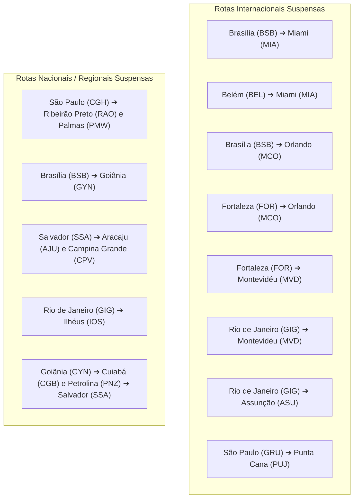
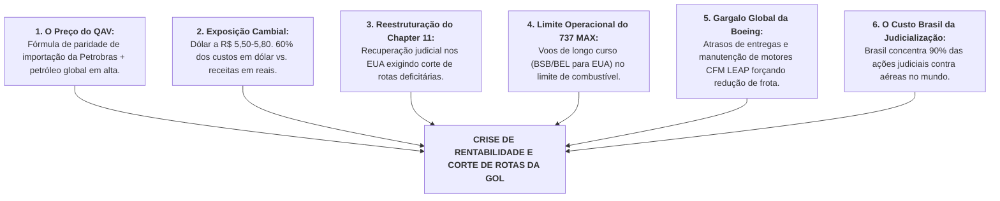

# Relatório Econômico e Setorial: O Caso da Suspensão de Rotas da GOL e a Crise do QAV

> **Classificação:** Economia Setorial, Infraestrutura Aérea e Finanças Corporativas  
> **Objeto de Estudo:** Suspensão em massa de rotas internacionais diretas (Brasília/Belém/Fortaleza/Rio para EUA e América do Sul) e eixos nacionais pela GOL Linhas Aéreas.  
> **Motivação Oficial Declarada:** Disparada de custos operacionais puxada pelo Querosene de Aviação (QAV), que dobrou de preço e atingiu 40% dos custos totais da companhia.  
> **Fontes e Dados:** ANAC, ABEAR (Associação Brasileira das Empresas Aéreas), IATA, Petrobras, CVM e Tribunal de Falências de Nova York (Processo de Chapter 11 da GOL).

---

## 1. O Caso: As Rotas Cortadas e o Comunicado Oficial

A GOL Linhas Aéreas confirmou uma ampla reestruturação de sua malha com a suspensão de voos internacionais de longa distância e rotas regionais:

---

## 2. Anatomia da Crise: Os 6 Vetores que Geraram Esse Impacto

Embora a nota oficial cite genericamente a alta do QAV, a suspensão decorre de uma **tempestade perfeita de seis fatores econômicos, cambiais, operacionais e regulatórios**:

---

### Vetor 1: A Estrutura de Preços do QAV no Brasil (Petrobras e Geopolítica)
* **O Peso no Caixa:** O combustível de aviação é o insumo isolado mais oneroso da aviação comercial. Historicamente oscilava entre 25% e 30% dos custos totais; com a alta recente, **saltou para 40% a 42% dos custos operacionais** das aéreas brasileiras;
* **A Fórmula da Petrobras:** Mesmo sendo refinado majoritariamente em refinarias nacionais, a Petrobras precifica o QAV adotando uma fórmula de **Preço de Paridade de Importação (PPI)**: simula a cotação internacional do Golfo do México (EUA) somada a custos teóricos de frete marítimo internacional, taxas portuárias e margens de importação.
  * *Resultado:* O QAV abastecido nos aeroportos brasileiros chega a ser **20% a 30% mais caro do que a média dos aeroportos norte-americanos e europeus**;
* **Choques Geopolíticos do Petróleo:** A instabilidade militar no Oriente Médio (tensões envolvendo Israel, Irã e rotas marítimas no Estreito de Ormuz) e a Guerra na Ucrânia mantiveram a cotação do barril de petróleo Brent sob pressão, encarecendo os derivados no refino mundial.

---

### Vetor 2: O Descompasso Cambial Estrutural (Dólar vs. Real)
A indústria da aviação comercial opera sob um dos maiores descasamentos de moeda da economia:

$$\text{Estrutura de Custos Típica de Aérea Brasileira: } \begin{cases} \mathbf{60\% \text{ Dolarizados:}} & \text{Combustível (QAV), leasing de aeronaves, peças, manutenção e seguros.} \\ \mathbf{40\% \text{ em Reais:}} & \text{Salários de tripulantes, taxas locais e serviços de solo.} \end{cases}$$

* Enquanto **60% dos custos da GOL são cotados em dólares**, a maior parte de sua receita de bilhetes é faturada em **reais**.
* Com a taxa de câmbio operando em patamares elevados (entre R$ 5,50 e R$ 5,80), qualquer desvalorização do real encarece instantaneamente as despesas contratuais de *leasing* (aluguel de aeronaves pago a multinacionais na Irlanda e nos EUA) e as peças de reposição da Boeing, comprimindo a margem operacional (*EBITDAR*) da empresa.

---

### Vetor 3: O Processo de Chapter 11 nos Estados Unidos
* Em **janeiro de 2024**, a GOL ingressou formalmente com pedido de **Recuperação Judicial nos Estados Unidos (Chapter 11)** perante o Tribunal de Falências de Nova York, com um passivo consolidado superior a **R$ 20 bilhões**;
* Sob as regras do Chapter 11 e o monitoramento rigoroso dos comitês de credores e bancos financiadores (empréstimo *DIP - Debtor-in-Possession*), a companhia aérea é legalmente obrigada a **eliminar operações deficitárias**:
  * Rotas que operavam no "ponto de equilíbrio" (*breakeven*) ou com margem líquida marginal não podem mais ser mantidas por razões de marketing ou posicionamento institucional;
  * O plano de voo passa a ser focado estritamente em **rotas de alta densidade e retorno garantido (*yield*)**.

---

### Vetor 4: O Limite Técnico e Operacional do Boeing 737 MAX 8
A escolha das rotas internacionais cortadas não foi aleatória:
* A GOL opera uma frota monomarca padronizada de **Boeing 737 (NG e MAX 8)**. O Boeing 737 é uma aeronave de fuselagem estreita (*narrow-body*, de corredor único), projetada primordialmente para rotas domésticas de curta e média distância;
* As rotas diretas **Brasília–Miami (5.790 km)** e **Brasília–Orlando (6.079 km)** operavam no **limite máximo de autonomia (*range*) do Boeing 737 MAX 8**:
  * Em voos dessa distância com ventos de proa contrários (*headwinds*), o avião queima combustível em taxa máxima e frequentemente enfrenta restrições de peso de decolagem (*payload penalty*), não podendo viajar com lotação completa de carga ou passageiros para levar combustível extra de segurança;
  * Com o QAV em alta, o custo por assento-quilômetro oferecido (ASK) dessa rota explode, tornando o voo economicamente inviável quando comparado a aeronaves de dois corredores (*wide-body*, como o Boeing 777 ou Airbus A350/A330) utilizadas por concorrentes como Latam e American Airlines.

---

### Vetor 5: Gargalos na Cadeia Global de Suprimentos da Boeing
* A indústria aeroespacial global enfrenta uma crise de entregas sem precedentes. A fabricante norte-americana **Boeing** atrasou o cronograma de entrega de dezenas de novas aeronaves 737 MAX encomendadas pela GOL devido a auditorias de segurança da FAA (pós-incidentes industriais);
* Somam-se a isso as revisões obrigatórias prematuras e a escassez de peças de reposição nos **motores CFM LEAP-1B**.
* **O Efeito Prático:** Com menos aeronaves ativas na frota do que o planejado no plano de negócios, a diretoria da GOL foi forçada a **deslocar aeronaves de rotas internacionais arriscadas para alimentar o mercado doméstico principal** (a ponte aérea Congonhas–Santos Dumont e hubs lucrativos de Brasília, Confins e Salvador).

---

### Vetor 6: A Hiperjudicialização e o "Custo Brasil" da Aviação
* O Brasil detém uma anomalia jurídica global: segundo dados oficiais da IATA (Associação Internacional de Transportes Aéreos) e da ABEAR, **o Brasil concentra entre 90% e 95% de todas as ações judiciais movidas por passageiros contra empresas aéreas no planeta**;
* Esse ecossistema de litígios em massa (estimulado por *lawtechs* e juizados especiais cíveis) impõe ao setor aéreo um custo anual que **ultrapassa R$ 1 bilhão em indenizações e honorários advocatícios**;
* Rotas regionais de baixa frequência (como CGH-Ribeirão Preto, BSB-Goiânia ou SSA-Aracaju) são especialmente vulneráveis: se um voo é cancelado por razões meteorológicas ou manutenção, o custo de reacomodação e as indenizações judiciais por "dano moral" superam a receita obtida com a venda das passagens do voo inteiro.

---

## 3. Os Impactos Econômicos para os Passageiros e para o País

1. **Perda de Conectividade do Interior e Fora do Eixo Rio-SP:**  
   Passageiros de capitais estratégicas fora do Sudeste (como **Brasília, Belém e Fortaleza**) perdem suas opções diretas de conexão internacional para os Estados Unidos. Os viajantes são forçados a realizar conexões lentas em São Paulo (Guarulhos) ou em hubs estrangeiros (como a Cidade do Panamá via Copa Airlines);
2. **Pressão de Alta nas Tarifas Aéreas (Menor Oferta):**  
   Com a suspensão das rotas da GOL, a oferta de assentos internacionais e regionais cai. Pela lei da oferta e da procura, as companhias remanescentes (Latam, Azul, American Airlines, TAP, Copa) operam com maior taxa de ocupação e **preços médios mais altos para o consumidor final**;
3. **Impacto no Turismo Receptivo e Negócios:**  
   O cancelamento de rotas internacionais diretas reduz a chegada de turistas estrangeiros com moeda forte a polos turísticos do Nordeste e Amazônia, prejudicando a hotelaria e a arrecadação de serviços locais.

---

## 4. Medidas e Soluções em Debate no Brasil

Para enfrentar o estrangulamento financeiro do setor aéreo, governo e agências reguladoras discutem:
* **Fundo Nacional de Aviação Civil (FNAC):** Projeto aprovado no Congresso autorizando o uso de recursos do FNAC para fornecer **linhas de crédito garantidas pelo BNDES de até R$ 5 bilhões** para socorrer as companhias aéreas na reestruturação de dívidas e compra de combustível;
* **Revisão da Precificação do QAV:** Pressão do Ministério de Portos e Aeroportos sobre a Petrobras para flexibilizar a fórmula do PPI e reduzir os custos de distribuição de combustível nos aeroportos;
* **Reforma da Resolução 400 da ANAC:** Atualização das normas regulatórias em parceria com o CNJ para coibir a judicialização abusiva e limitar indenizações por danos morais quando os atrasos decorrerem de eventos externos comprovados (mau tempo ou falha de infraestrutura aeroportuária).
