# Repositório de Economia Brasileira: Análise Dialética dos Governos Recentes

> **Repositório de Estudos Econômicos e Séries Históricas Oficiais**  
> **Objetivo:** Fornecer um panorama aprofundado e tecnicamente fundamentado sobre a trajetória econômica do Brasil nos principais mandatos presidenciais recentes, avaliando cada ciclo sob **duas perspectivas teóricas antagônicas e consolidadas da ciência econômica**:
> 1. **Visão Liberal / Ortodoxa (Neoclássica / Escola de Chicago / Foco na Oferta e Solvência)**
> 2. **Visão Keynesiana / Desenvolvimentista (Social / Estruturalista / Foco na Demanda e Bem-Estar)**

---

## 1. Os Dois Paradigmas Econômicos em Confronto

Cada documento deste repositório submete as decisões de política econômica e os indicadores oficiais a uma análise dual sistemática:

```mermaid
flowchart TD
    subgraph Ortodoxia ["Visão Liberal / Ortodoxa"]
        L1[Foco no Lado da Oferta - Supply Side] --> L2[Equilíbrio Fiscal Rigoroso e Dívida/PIB Baixa]
        L2 --> L3[Redução do Tamanho e Custo do Estado]
        L3 --> L4[Desregulamentação, Privatizações e Livre Mercado]
        L4 --> L5[Banco Central Autônomo e Juros de Equilíbrio]
        L5 --> L6[Confiança dos Mercados e Atração de Capital Privado]
    end

    subgraph Heterodoxia ["Visão Keynesiana / Desenvolvimentista"]
        K1[Foco no Lado da Demanda Agregada - Demand Side] --> K2[Papel Indutor do Estado em Investimentos Públicos]
        K2 --> K3[Políticas Fiscais Anticíclicas contra Crises]
        K3 --> K4[Redistribuição de Renda e Valorização Salarial]
        K4 --> K5[Bancos Públicos e Fomento a Setores Estratégicos]
        K5 --> K6[Crescimento Econômico Puxado pelo Consumo e Inclusão]
    end
```

### Síntese das Divergências Teóricas:

| Dimensão de Análise | Perspectiva Liberal / Ortodoxa | Perspectiva Keynesiana / Desenvolvimentista |
| :--- | :--- | :--- |
| **Equação de Crescimento** | $Y = A \cdot F(K, L)$ (Produtividade dos Fatores, Segurança Jurídica e Capital Privado). | $Y = C + I + G + NX$ (Demanda Agregada; o investimento público e o consumo puxam o produto). |
| **Papel do Estado** | Árbitro regulador, garantidor de contratos, focado em áreas essenciais (segurança, justiça básica). | Indutor direto da atividade econômica, planejador de infraestrutura e provedor de bem-estar social. |
| **Política Fiscal** | Austeridade, superávit primário constante, limitação rígida de gastos públicos e redução da dívida. | Instrumento anticíclico: déficits são legítimos para reativar a economia, sustentar o emprego e combater a pobreza. |
| **Política Monetária** | Rigidez no cumprimento de metas de inflação, banco central independente, aversão a distorções no crédito. | Juros baixos como meta desenvolvimentista; uso de bancos públicos para ofertar crédito direcionado e barato. |
| **Distribuição de Renda** | Consequência natural do aumento da produtividade e da qualificação do capital humano. | Pré-condição do desenvolvimento; a alta propensão marginal a consumir dos mais pobres dinamiza o mercado interno. |

---

## 2. Mapa dos Documentos por Mandato Presidencial

1. **[`01_governo_lula_3_analise_economica.md`](file:///Users/rodrigofregonasse/Code/brasil-project/economia/01_governo_lula_3_analise_economica.md)**
   * Período: 2023 – 2026.
   * Integração integral dos dados do debate (IPCA acumulado recorde de 19,7%, desemprego em 5,1%–5,3%, saída do Mapa da Fome, ganho real de 17,4% na renda, Reforma Tributária EC 132/2023) contrapostos à Dívida Bruta (82,5% do PIB), déficits primários contínuos, Selic restritiva com maior juro real do mundo (8,45%), recorde de recuperações judiciais (2.466) e carga tributária recorde (32,4%).
2. **[`02_governo_bolsonaro_analise_economica.md`](file:///Users/rodrigofregonasse/Code/brasil-project/economia/02_governo_bolsonaro_analise_economica.md)**
   * Período: 2019 – 2022 (Gestão Paulo Guedes).
   * Reforma da Previdência (EC 103/2019), Lei da Liberdade Econômica, privatização da Eletrobras, Marco do Saneamento, autonomia formal do Banco Central (LC 179/2021) e consolidação do superávit primário de R$ 54 bi em 2022.
   * Confronto com o choque inflacionário da Covid (IPCA a 10,06% em 2021), a PEC de Guerra, represamento de precatórios ("pedalada dos precatórios"), desonerações eleitoreiras de ICMS e disparada da insegurança alimentar.
3. **[`03_governo_temer_analise_economica.md`](file:///Users/rodrigofregonasse/Code/brasil-project/economia/03_governo_temer_analise_economica.md)**
   * Período: 2016 – 2018 (Gestão Henrique Meirelles / Ilan Goldfajn).
   * Saída da recessão de 2015-2016, aprovação do Teto de Gastos (EC 95/2016), Reforma Trabalhista (Lei 13.467/2017), criação da TLP no BNDES e ancoragem da inflação (IPCA de 2,95% em 2017).
   * Contraponto: congelamento de investimentos públicos essenciais, aumento da precarização e informalidade no trabalho, greve dos caminhoneiros (2018) e ritmo lento de recuperação do PIB (~1% a.a.).
4. **[`04_governos_lula_1_2_e_dilma_analise_economica.md`](file:///Users/rodrigofregonasse/Code/brasil-project/economia/04_governos_lula_1_2_e_dilma_analise_economica.md)**
   * Período: 2003 – 2016 (A Era dos Governos do PT e a Crise).
   * *Fase I (2003–2010):* O Boom global das Commodities, expansão do crédito e do consumo, redução histórica da desigualdade, acúmulo de mais de US$ 370 bi em reservas internacionais e reação à crise de 2008.
   * *Fase II (2011–2016):* A Nova Matriz Econômica (desonerações seletivas, subsídios do PSI/BNDES, controle artificial de tarifas e combustíveis), descontrole fiscal das "pedaladas fiscais", perda do grau de investimento e a recessão profunda de 2014-2016 (-7% acumulado do PIB).
5. **[`05_fundacao_tripe_macroeconomico_e_plano_real.md`](file:///Users/rodrigofregonasse/Code/brasil-project/economia/05_fundacao_tripe_macroeconomico_e_plano_real.md)**
   * Período: 1994 – 2002 (Governo FHC e a Estabilização Monetária).
   * Criação do Plano Real (URV), fim da hiperinflação, Lei de Responsabilidade Fiscal (LC 101/2000), privatizações de estatais de infraestrutura, Proer e a institucionalização do **Tripé Macroeconômico** em 1999 (Câmbio Flutuante, Metas de Inflação e Metas Fiscais).
6. **[`06_cenario_global_crises_e_impactos_no_brasil.md`](file:///Users/rodrigofregonasse/Code/brasil-project/economia/06_cenario_global_crises_e_impactos_no_brasil.md)**
   * **Ultradocumento de Macroeconomia Global (1994 – 2026).**
   * Mapeamento sistemático de grandes ciclos mundiais, política do Federal Reserve, ascensão da China e crises internacionais (Efeito Tequila, Crise Asiática, Moratória Russa, Superciclo de Commodities, Subprime de 2008, *Taper Tantrum*, Guerra Comercial, Covid-19, Guerra na Ucrânia e aperto do Fed).
   * Classificação de impactos no Brasil como **Positivo [+]**, **Negativo [-]** ou **Misto [=]** ancorados em fontes multilaterais (FMI, Banco Mundial, OCDE, BIS, Fed e UNCTAD).
7. **[`07_decisoes_economicas_contraditorias_pt_e_bolsonaro.md`](file:///Users/rodrigofregonasse/Code/brasil-project/economia/07_decisoes_economicas_contraditorias_pt_e_bolsonaro.md)**
   * **Decisões Econômicas Contraditórias: PT (Lula 1, 2, 3 e Dilma) e Bolsonaro.**
   * Confronto minucioso entre retórica/promessas e atos concretos (leis, decretos, emendas, alocações orçamentárias e intervenções).
   * *PT:* Choque ortodoxo de 2003 (Selic a 26,5% e superávit de 4,25%), Reforma da Previdência com taxação de inativos (EC 41/2003 e racha do PSOL), Campeãs Nacionais e subsídios do BNDES a bilionários (JBS/Friboi, Eike), desonerações de R$ 300 bi a montadoras, a "Taxa das Blusinhas" (Lei 14.902/2024) sobre consumo popular e pressão para explorar petróleo na Margem Equatorial.
   * *Bolsonaro:* Calote dos Precatórios (EC 113 e 114/2021 - pedalada de R$ 90 bi), PEC Kamikaze em ano eleitoral com estado de emergência (EC 123/2022 - gastos de R$ 41 bi), intervenção política e demissão de 4 presidentes da Petrobras, intervenção unilateral no ICMS dos Estados (LC 194/2022 rompendo o pacto federativo), criação da estatal NAV Brasil e entrega de mais de R$ 50 bi ao Centrão no Orçamento Secreto (RP9).
8. **[`08_crise_aviacao_caso_gol_rotas_qav.md`](file:///Users/rodrigofregonasse/Code/brasil-project/economia/08_crise_aviacao_caso_gol_rotas_qav.md)**
   * **Estudo de Caso Setorial: A Suspensão de Rotas da GOL e a Crise do QAV.**
   * Análise profunda das causas reais por trás do corte de voos internacionais (Brasília/Belém/Rio para EUA e América do Sul) e dezenas de rotas regionais.
   * *Os 6 Vetores Geradores:* A fórmula do QAV pela Petrobras (PPI com sobrepreço de 20% a 30%), a desvalorização cambial (dólar a R$ 5,50-5,80 com 60% de custos dolarizados), a reestruturação da GOL sob o Chapter 11 nos EUA, o limite operacional do Boeing 737 MAX em voos longos (*narrow-body*), os gargalos industriais globais de motores da Boeing/CFM e a hiperjudicialização do setor aéreo no Brasil (que concentra 90% das ações judiciais do mundo).

---

### Módulo Especial: Privatizações e Concessões de Infraestrutura
📁 **Subpasta:** [`economia/privatizacoes/`](file:///Users/rodrigofregonasse/Code/brasil-project/economia/privatizacoes/README.md)
* **[`01_privatizacao_eletrobras_processo_indicadores_corrupcao_e_impactos.md`](file:///Users/rodrigofregonasse/Code/brasil-project/economia/privatizacoes/01_privatizacao_eletrobras_processo_indicadores_corrupcao_e_impactos.md):**
  * Histórico da capitalização da Eletrobras (Lei 14.182/2021), a sangria financeira causada pela MP 579/2012 e a venda de distribuidoras sob Temer.
  * Indicadores econômico-financeiros antes e depois (lucro líquido, alavancagem Dívida/EBITDA, CAPEX, PDVs e ratings).
  * Casos de corrupção pré-privatização apurados na Lava Jato (Angra 3 / Eletronuclear com condenação de Othon Pinheiro, propinas de 1% em Belo Monte divididas entre PT e PMDB, feudo de Furnas).
  * Problemas e controvérsias pós-privatização: R$ 40 bi de "jabutis" termelétricos na CDE, a disputa societária da ADI 7385 no STF sobre o teto de 10% de voto da União (acordo de 2025), o apagão nacional de agosto de 2023 e o aumento de salários de executivos.

---

## 3. Fontes de Dados Primárias Homologadas

Todas as análises utilizam exclusivamente os dados brutos e séries temporais das seguintes entidades oficiais (detalhadas com códigos em [`BASE_FONTES_OFICIAIS.md`](file:///Users/rodrigofregonasse/Code/brasil-project/BASE_FONTES_OFICIAIS.md)):
* **IBGE:** IPCA, INPC, PNAD Contínua (Emprego, Desalento e Renda), Contas Nacionais (PIB e Formação Bruta de Capital Fixo).
* **Banco Central do Brasil (BCB):** Taxa Selic, Séries SGS Fiscais (Dívida Bruta DBGG e Dívida Líquida), Estatísticas de Crédito e Boletim Focus.
* **Secretaria do Tesouro Nacional (STN):** Relatório do Resultado do Tesouro Nacional (RTN) e Painéis do Tesouro Transparente.
* **Receita Federal do Brasil (RFB):** Estudos da Carga Tributária Bruta (% do PIB) e Relatórios Mensais de Arrecadação.
* **Ministério do Trabalho e Emprego (MTE):** Painéis Mensais do Novo CAGED.
* **MDIC / SECEX:** Sistema Comex Stat de Balança Comercial.
* **Organismos Multilaterais:** FAO (Relatório SOFI da Fome), FMI (World Economic Outlook - WEO) e OCDE (PISA).
