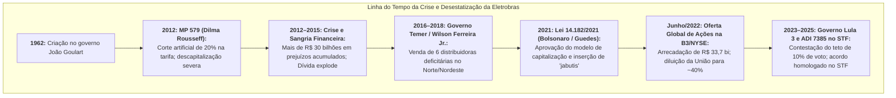
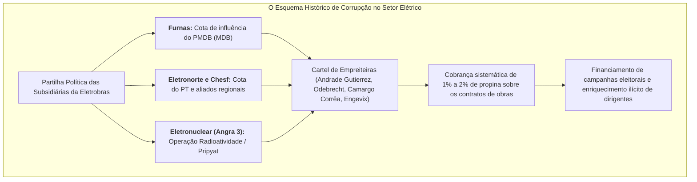

# A Privatização da Eletrobras: Processo Histórico, Indicadores, Corrupção e Impactos Setoriais

> **Classificação:** Economia do Setor Público, Regulação Energética, Finanças Corporativas e Relações Institucionais  
> **Período de Análise:** 2012 – 2026 (Antecedentes da MP 579, Desestatização em 2022 e Desdobramentos no Lula 3)  
> **Objeto de Estudo:** O processo de capitalização das Centrais Elétricas Brasileiras S.A. (Eletrobras) sob a Lei nº 14.182/2021, confrontando os indicadores operacionais e financeiros pré e pós-privatização, os escândalos históricos de corrupção no setor elétrico e a controvérsia jurídica em torno da governança e dos "jabutis" tarifários.  
> **Fontes Primárias:** Demonstrações Financeiras Padronizadas (DFP) na CVM/SEC, Acórdãos do Tribunal de Contas da União (TCU), Ação Direta de Inconstitucionalidade (ADI) nº 7385 no STF, Relatórios de Análise de Perturbação (RAP) do ONS e Aneel, e Inquéritos Judiciais da Operação Lava Jato (7ª Vara Federal do RJ).

---

## 1. O Processo e o Histórico da Privatização da Eletrobras

### 1.1. O Peso Estrutural da Companhia
Fundada em **1962** no governo João Goulart, a Eletrobras consolidou-se como a maior empresa de energia elétrica da América Latina:
* Detentora histórica de cerca de **30% da capacidade instalada de geração** de energia elétrica do Brasil;
* Controladora de aproximadamente **40% de todas as linhas de transmissão** da Rede Básica do Sistema Interligado Nacional (SIN);
* Holding controladora de subsidiárias regionais gigantescas: **Furnas** (Sudeste/Centro-Oeste), **Chesf** (Nordeste), **Eletronorte** (Norte) e **Eletrosul / CGT Eletrosul** (Sul).

---

### 1.2. O Ponto de Inflexão Negativo: A MP 579/2012 e a Sangria Financeira
O estopim para a perda de sustentabilidade econômica da Eletrobras ocorreu em **11 de setembro de 2012**, quando a presidente Dilma Rousseff editou a **Medida Provisória nº 579** (convertida na [Lei nº 12.783/2013](https://www.planalto.gov.br/ccivil_03/_ato2011-2014/2013/lei/l12783.htm)):
* **A Promessa Política:** O governo federal anunciou uma redução artificial média de 20% na conta de luz da população e das indústrias para estimular a economia ("canetada tarifária");
* **O Mecanismo Predatório:** Para baratear a energia no grito, o governo forçou as geradoras estatais a renovarem antecipadamente suas concessões hidrelétricas amortizadas sob o **regime de cotas**, remuneradas apenas por custos de operação e manutenção (O&M), sem direito a margem de lucro de mercado;
* **O Efeito Colateral Catastrófico:**
  * Enquanto geradoras privadas e estatais estaduais (como Cesp e Cemig) recusaram os termos em várias de suas usinas, a Eletrobras, por subordinação política direta ao Planalto, foi obrigada a aderir integralmente;
  * A holding perdeu instantaneamente mais de **60% de sua receita líquida de geração**;
  * Entre 2012 e 2015, a Eletrobras acumulou **mais de R$ 30 bilhões em prejuízos líquidos**, paralisou investimentos, viu sua dívida líquida atingir patamares insustentáveis e perdeu o grau de investimento pelas agências internacionais de classificação de risco.

---

### 1.3. O Saneamento no Governo Temer (2016–2018)
Na gestão do presidente Michel Temer, sob o comando do executivo Wilson Ferreira Jr., iniciou-se um plano de emergência para evitar a falência da estatal:
* **Venda das Distribuidoras Deficitárias:** A Eletrobras carregava seis distribuidoras de energia no Norte e Nordeste que drenavam bilhões de reais em socorros do Tesouro e apresentavam índices de perdas não técnicas (furtos de energia) de até 40%:
  * *Cepisa* (Piauí) — arrematada pela Equatorial Energia;
  * *Ceal* (Alagoas) — arrematada pela Equatorial Energia;
  * *Eletroacre* (Acre) — arrematada pela Energisa;
  * *Ceron* (Rondônia) — arrematada pela Energisa;
  * *Amazonas Energia* (Amazonas) — arrematada pelo consórcio Oliveira Energia/ATEM;
  * *Boa Vista Energia* (Roraima) — arrematada pela Oliveira Energia.
* **A Extinção do Dreno:** A venda das distribuidoras estancou um rombo anual superior a R$ 4 bilhões, permitindo à holding focar exclusivamente nos segmentos de **geração e transmissão**.

---

### 1.4. A Modelagem da Privatização: Lei nº 14.182/2021
Durante o governo Jair Bolsonaro, sob a liderança do ministro da Economia Paulo Guedes e do ministro de Minas e Energia Bento Albuquerque, foi desenhada a desestatização através da **Medida Provisória nº 1.031/2021**, convertida na [Lei nº 14.182/2021](https://www.planalto.gov.br/ccivil_03/_ato2019-2022/2021/lei/l14182.htm):

* **O Modelo de Capitalização (*Follow-on*):**
  * Não houve venda do controle em leilão tradicional em bloco para um único conglomerado;
  * A Eletrobras emitiu novas ações ordinárias na B3 (São Paulo) e na Bolsa de Nova York (NYSE);
  * A União absteve-se de subscrever as novas ações, sendo diluída de cerca de **60% a 70%** (incluindo BNDES e fundos públicos) para aproximadamente **40% a 43%** do capital social total;
* **A Estrutura de *Corporation* com Limite de Voto (*Voting Cap*):**
  * Para impedir que um único grupo econômico privado ou a própria União exercesse controle absoluto, o Estatuto Social fixou um **teto de 10% para o exercício de votos** em assembleia para qualquer acionista, independentemente do percentual de ações detido;
* **Cláusula de *Poison Pill* (Pílula de Veneno):**
  * Estabeleceu-se que qualquer acionista que ultrapassar 30% a 50% do capital com intuito de assumir o controle é obrigado a realizar uma Oferta Pública de Aquisição (OPA) pagando um prêmio punitivo de **300% sobre a maior cotação de mercado** dos últimos anos;
* **Cisão Obrigatória de Itaipu e Angra 3:**
  * Por exigência constitucional (monopólio nuclear da União) e tratados internacionais (Tratado de Itaipu com o Paraguai), a usina nuclear de Angra (Eletronuclear) e a metade brasileira de Itaipu Binacional foram desmembradas e alocadas na nova estatal federal **ENBPar** (Empresa Brasileira de Participações em Energia Nuclear e Binacional);
* **A Oferta Pública (Junho de 2022):**
  * A operação movimentou **R$ 33,7 bilhões**, tornando-se a segunda maior oferta pública de ações do planeta em 2022;
  * Destinação dos recursos: R$ 25,3 bilhões em outorga pagos ao Tesouro Nacional; R$ 29,8 bilhões transferidos para a Conta de Desenvolvimento Energético (CDE) para amortecimento tarifário ao longo dos anos; e R$ 9,7 bilhões para fundos de revitalização das bacias hidrográficas do Rio São Francisco e de Furnas.

---

## 2. Indicadores Econômico-Financeiros: Antes e Depois da Privatização

A tabela a seguir confronta os indicadores auditados da Eletrobras no período estatal crítico (2012–2015), no ciclo de reestruturação intermediária (2016–2021) e no período pós-desestatização (2022–2025):

| Indicador Contábil / Operacional | Período Estatal Crítico (2012–2015) | Fase de Saneamento Pré-Venda (2016–2021) | Pós-Privatização (2022–2025) | Variação Estrutural / Impacto |
| :--- | :--- | :--- | :--- | :--- |
| **Lucro Líquido Anual** | **Prejuízos gigantescos:** 2012: -R$ 6,9 bi 2013: -R$ 6,3 bi 2014: -R$ 3,0 bi 2015: **-R$ 14,4 bi** | Lucros recuperados pós-corte de custos: 2018: R$ 13,3 bi 2020: R$ 6,4 bi 2021: R$ 5,7 bi | 2022: R$ 3,6 bi 2023: **R$ 4,4 bi** 2024: ~R$ 5,0 bi a R$ 6,0 bi | Fim da sangria de caixa crônica e consolidação de lucratividade recorrente. |
| **Alavancagem (Dívida Líquida / EBITDA)** | **5,5x a 6,8x** (Risco iminente de insolvência técnica) | 2,5x a 3,2x (Venda de ativos e recebimento de indenizações) | **1,6x a 2,0x** (Intervalo internacionalmente saudável) | Desalavancagem maciça; capacidade de emitir dívida corporativa barata no mercado global. |
| **Dívida Líquida Total** | Ultrapassou **R$ 45 bilhões** (2015) | ~R$ 35 bilhões a R$ 38 bilhões | ~R$ 30 bilhões (alongada e equalizada) | Redução substancial do custo financeiro de carregamento da dívida. |
| **Investimentos Anuais (CAPEX)** | **Em colapso:** Incapacidade de aportar garantias em leilões da Aneel; perda de *market share*. | R$ 3,0 bi a R$ 4,5 bi/ano (Foco estrito em manutenção) | **R$ 6,0 bi a R$ 9,0 bi/ano** (Projeção plurianual de R$ 15 bi) | Retomada da vitória em leilões de transmissão estratégicos na Aneel em 2023/2024. |
| **Quadro de Empregados** | **Mais de 23.000 funcionários** (Folha com penduricalhos históricos) | Redução para ~12.500 funcionários (PDVs pré-privatização) | **Abaixo de 8.000 funcionários** (Sucessivos PDVs em 2022–2024) | Queda de mais de 65% na folha de pessoal; crítica sindical sobre perda de memória técnica. |
| **Classificação de Risco (Rating)** | **Nível Especulativo (*Junk*):** Rebaixada por Fitch, Moody's e S&P | Nível BB- / BB (Acompanhando o risco soberano do Brasil) | **Grau de Investimento (*Investment Grade*):** AAA em escala nacional | Acesso a financiamentos e debêntures com taxas de juros consideravelmente menores. |
| **Governança e *Compliance*** | Aparelhamento partidário de diretorias; ausência de auditoria SOX. | Implantação de comitês da Lei das Estatais (Lei 13.303/16). | Padrão Novo Mercado da B3; diretoria e conselho independentes. | Eliminação de ingerência política direta em contratações de empreiteiras. |

---

## 3. Relações de Corrupção e Loteamento Político Pré-Privatização

Historicamente, o setor elétrico federal brasileiro funcionou como uma das maiores fontes de financiamento partidário ilícito, loteamento clientelista e propinas corporativas da República. As investigações da **Operação Lava Jato** e processos derivados detalharam o esquema:

### 3.1. O Caso Eletronuclear / Usina de Angra 3 (Operações Radioatividade e Pripyat)
* **O Fato:** Em 2015, a 16ª fase da Lava Jato (*Operação Radioatividade*) atingiu o coração da Eletronuclear, subsidiária da Eletrobras responsável pelo programa nuclear;
* **O Almirante Othon Pinheiro:** O presidente da estatal, almirante Othon Luiz Pinheiro da Silva — figura histórica do programa nuclear brasileiro nomeado no governo Lula e mantido por Dilma —, foi preso pela Polícia Federal;
* **A Sentença Judicial:** Em 2016, o juiz Marcelo Bretas (7ª Vara Federal Criminal do RJ) condenou Othon Pinheiro a **43 anos de prisão** por corrupção passiva, lavagem de dinheiro, evasão de divisas e organização criminosa;
* **O Mecanismo:** As empreiteiras Andrade Gutierrez e Engevix repassaram milhões de reais em propinas disfarçadas por meio de contratos fictícios de consultoria com a empresa *Aratec*, pertencente à família do almirante, para garantir consórcios bilionários nas obras de Angra 3.

---

### 3.2. O Escândalo de Belo Monte e as Doações a Campanhas do PT e MDB
A Usina Hidrelétrica de Belo Monte (PA) — obra símbolo dos governos petistas orçada inicialmente em R$ 16 bilhões que ultrapassou **R$ 35 bilhões** — teve a Eletrobras como principal acionista (detendo 49,98% do capital através de Furnas, Eletronorte e a holding):
* **Delações das Empreiteiras:** Em acordos de colaboração premiada homologados pelo STF, executivos da **Andrade Gutierrez**, **Camargo Corrêa** e **Odebrecht** confessaram que o consórcio construtor pagou uma propina fixa de **1% sobre o valor total do contrato de obras civis**;
* **Destinação Partidária:** Os delatores apresentaram tabelas detalhadas demonstrando que as propinas foram divididas igualmente entre o **Partido dos Trabalhadores (PT)** e o **Partido do Movimento Democrático Brasileiro (PMDB)**;
* **Campanhas Presidenciais:** Parte expressiva das vantagens indevidas foi direcionada na forma de "doações oficiais registradas" para as campanhas da presidente Dilma Rousseff em 2010 e 2014, além de repasses diretos a parlamentares ligados aos ministros de Minas e Energia da época (como o senador Edison Lobão).

---

### 3.3. O Feudo Político de Furnas e a Delação de Delcídio do Amaral
Durante décadas, Furnas Centrais Elétricas foi utilizada como moeda de troca de sustentação parlamentar:
* **A Divisão Parlamentar:** Conforme depoimento do ex-senador petista Delcídio do Amaral e investigações da PGR, Furnas era tratada no Congresso como um reduto controlado pela bancada do PMDB na Câmara dos Deputados (com forte liderança do ex-deputado Eduardo Cunha);
* **O Balcão de Negócios:** Diretorias de planejamento, engenharia e finanças eram distribuídas a apadrinhados políticos com o objetivo de favorecer empresas terceirizadas de informática, vigilância e obras civis, servindo de base de arrecadação informal para deputados da base governista.

---

### 3.4. A Operação Descontaminação (2019)
Em março de 2019, a Operação Descontaminação (desdobramento da Lava Jato) resultou na **prisão preventiva do ex-presidente da República Michel Temer**:
* As investigações do Ministério Público Federal apontaram que um consórcio contratado pela Eletronuclear (formado pela Engevix e pela empresa AF Consult) repassou propinas estimadas em R$ 1,8 milhão que teriam como destinatário final o ex-presidente Temer, intermediadas por seu operador pessoal, o coronel João Baptista Lima Filho.

---

## 4. Problemas e Controvérsias Causados Pós-Privatização

Se por um lado a privatização eliminou o risco de falência e estancou os esquemas tradicionais de corrupção partidária, a modelagem aprovada pelo Congresso Nacional e os anos seguintes geraram severas controvérsias técnicas, tarifárias e institucionais.

---

### 4.1. Os "Jabutis" Legislativos e o Impacto na Conta de Luz (CDE)
Durante a tramitação da Medida Provisória no Congresso Nacional em 2021, parlamentares inseriram dezenas de emendas parlamentares estranhas ao projeto original — conhecidas no jargão político como **"jabutis"**:
* **Contratação Obrigatória de 8.000 MW de Termelétricas a Gás Natural:** A Lei nº 14.182/2021 obrigou o governo federal a contratar 8 GW de usinas termelétricas a gás, operando na base (ligadas o tempo todo, mesmo quando os reservatórios hidrelétricos estiverem cheios), a serem instaladas obrigatoriamente no Norte, Nordeste e Centro-Oeste — a maioria em regiões **distantes de gasodutos ou sem oferta local de gás**, exigindo a construção de gasodutos bilionários subsidiados;
* **Prorrogação de Carvão Mineral e PCHs:** Foram incluídas obrigações de compra de pequenas centrais hidrelétricas (PCHs) com reserva de mercado e subsídios para termelétricas a carvão mineral;
* **O Custo ao Consumidor:** Associações de grandes consumidores industriais (Abrace), o Instituto de Defesa de Consumidores (Idec) e a Frente Nacional dos Consumidores de Energia estimam que esses "jabutis" representarão um sobrecusto tarifário entre **R$ 40 bilhões e R$ 60 bilhões** a serem pagos pelos consumidores de energia brasileiros através da **Conta de Desenvolvimento Energético (CDE)** ao longo de duas décadas.

---

### 4.2. A Batalha Societária da ADI 7385 no STF e o Acordo de 2025
Com a eleição do presidente Lula para o terceiro mandato, o governo federal declarou guerra à estrutura de governança da empresa privatizada:
* **A Ação no STF (Maio de 2023):** A Advocacia-Geral da União (AGU) ajuizou a **ADI nº 7385** perante o Supremo Tribunal Federal, sustentando que a regra do Estatuto Social que limitava a 10% o poder de voto de qualquer acionista (*voting cap*) era inconstitucional;
* **O Argumento do Governo:** A União detém cerca de **42% a 43% do capital total** (somando Tesouro e BNDES). O governo argumentou que restringir seus votos a 10% configurava uma "desapropriação indireta" e um atentado ao patrimônio público, transferindo o controle fático da empresa para fundos minoritários (como 3G Radar, GIC de Cingapura e BlackRock) sem que estes tivessem pago pelo controle;
* **A Conciliação e a Decisão Final do STF (Dezembro de 2025):**
  * O ministro relator Kassio Nunes Marques remeteu a disputa para a Câmara de Conciliação e Arbitragem da Administração Federal (CCAF);
  * Em dezembro de 2025, o Plenário do STF **homologou por maioria o acordo consensual** firmado entre o governo federal e a Eletrobras;
  * *O Termo de Acordo:* Manteve-se a privatização e o modelo de *corporation*, mas a União obteve o direito de indicar **3 dos 10 membros do Conselho de Administração** e **1 membro do Conselho Fiscal**, além de antecipar o aporte de cerca de R$ 26 bilhões para aliviar a CDE e repactuar os investimentos na usina nuclear de Angra 3.

---

### 4.3. O Apagão Nacional de 15 de Agosto de 2023
Em **15 de agosto de 2023**, ocorreu uma perturbação no Sistema Interligado Nacional (SIN) que deixou **25 estados e o Distrito Federal sem energia elétrica**, cortando instantaneamente cerca de 19.000 MW de carga (~27% do consumo nacional):
* **O Ataque Político:** O ministro de Minas e Energia, Alexandre Silveira, declarou que o evento decorreu de uma falha em uma linha de transmissão da **Chesf** (subsidiária da Eletrobras) em Quixadá (CE), afirmando que a perda de técnicos experientes após a privatização fragilizou o sistema, chegando a acionar a Polícia Federal e a Abin para apurar suspeitas de negligência ou sabotagem;
* **O Relatório Técnico Oficial (ONS e Aneel):** O Relatório de Análise de Perturbação (RAP) conclusivo do Operador Nacional do Sistema Elétrico (ONS) demonstrou que:
  * A linha da Chesf desligou por atuação de proteção regular milissegundos após uma oscilação de tensão;
  * O desbalanceamento sistêmico foi provocado pela **resposta dinâmica incorreta e não parametrizada de inversores de centrais eólicas e solares privadas** de terceiros no Nordeste, que não suportaram a queda de frequência e desligaram em massa, sobrecarregando os troncos de transmissão;
  * A atuação dos esquemas de corte de carga (ERAC) evitou um blecaute total e restaurou o sistema em poucas horas.

---

### 4.4. A Remuneração Astronômica de Executivos e Demissões Técnicas
* **Salto Salarial da Cúpula:** A primeira assembleia geral pós-privatização aprovou um reajuste maciço na remuneração global dos administradores. O teto de gastos com a diretoria e conselheiros saltou de R$ 15,4 milhões/ano para patamares superiores a **R$ 60 milhões/ano**. A remuneração individual de conselheiros de administração registrou altas superiores a **3.500%** (de ~R$ 5 mil para mais de R$ 200 mil mensais);
* **Perda de Memória Técnica:** Para enxugar custos, a empresa demitiu mais de 4.000 funcionários através de PDVs sucessivos, focando em técnicos seniores de manutenção com mais de 25 anos de carreira. Sindicatos apontam que a substituição por terceirizados reduziu a agilidade em manutenções preventivas de subestações complexas.

---

## 5. Análise dos Dois Lados: O Debate Teórico e Político

| Eixo Temático | Visão Pró-Privatização / Mercado Liberal (Guedes, Investidores, IBP, Ortodoxia) | Visão Crítica / Desenvolvimentista (Lula 3, Sindicatos, Ilumina, Oposição à Venda) |
| :--- | :--- | :--- |
| **Sustentabilidade Financeira** | **Salvação da Falência Iminente:** A Eletrobras estava descapitalizada pela MP 579, sem conseguir investir R$ 10 bi/ano necessários para acompanhar o crescimento do país. A privatização estancou prejuízos, reduziu a alavancagem para 1,8x e restaurou o grau de investimento internacional. | **Empresa Estratégica Lucrativa Entregue a Preço Vil:** A empresa já havia se recuperado após 2018 (lucrou R$ 13 bi em 2018 e R$ 6 bi em 2020) com o saneamento das distribuidoras. Vender uma geradora dona de reservatórios hídricos amortizados foi abrir mão de um fluxo perene de dividendos para a União. |
| **Soberania e Segurança Energética** | **A Regulação Permanece 100% Estatal:** A Aneel continua fixando as regras de concessão, as tarifas da transmissão e a fiscalização. O ONS continua despachando quais usinas ligam ou desligam. Ter capital privado não altera a segurança física do SIN e atrai capital global. | **Perda do Controle sobre a Água e o Clima:** A Eletrobras controla os maiores reservatórios do país (Sobradinho, Furnas, Tucuruí). O regime de vazão e a prioridade de múltiplos usos da água (irrigação, abastecimento humano vs. geração elétrica) ficaram submetidos à lógica do lucro de acionistas privados. |
| **Governança e Corrupção** | **Fim do Feudo Político e do Mensalão Elétrico:** A transformação em *corporation* sem dono único acabou definitivamente com a partilha criminosa de diretorias de Furnas, Chesf e Eletronuclear entre partidos (Lava Jato, Angra 3 e Belo Monte). A gestão passou a responder a investidores privados sob a lei SOX e CVM. | **Privatização de Lucros e Socialização de Prejuízos:** A lei foi aprovada à base de captura regulatória e concessões fisiológicas ao Centrão, impondo R$ 40 bi de "jabutis" termelétricos na CDE que serão pagos por todos os cidadãos enquanto fundos como 3G Radar capturam os dividendos. |
| **O Teto de Voto de 10%** | **Proteção Essencial da Corporation:** O teto de voto é a regra de ouro das grandes *corporations* mundiais para evitar que qualquer acionista capture a empresa. Se o governo pudesse votar com seus 43%, a empresa continuaria sendo uma estatal informal sob risco de canetadas populistas. | **Esbulho do Patrimônio da Sociedade Brasileira:** A União é dona de 43% do capital total e mais de 40% das ações com direito a voto, mas tem seu poder rebaixado a 10%, equivalendo-se a fundos com frações mínimas de ações, ferindo o princípio constitucional da razoabilidade. |

---

## 6. Quadro-Síntese Comparativo dos Principais Fatos

| Dimensão | Situação Pré-Privatização | Situação Pós-Privatização | Status Atual / Desfecho |
| :--- | :--- | :--- | :--- |
| **Controle Societário** | Estatal Federal (União detinha ~60% a 70% das ações). | *Corporation* privada pulverizada na B3/NYSE. | União detém ~42% do capital, com poder de voto equalizado por acordo judicial. |
| **Resultado Operacional** | Prejuízo de mais de R$ 30 bilhões acumulados (2012–2015). | Lucros consistentes entre R$ 4 bi e R$ 6 bi anuais. | Balanço saneado, dividendos regulares e grau de investimento recuperado. |
| **Corrupção e Crime** | Lava Jato em Angra 3 (Othon Pinheiro); propinas de 1% em Belo Monte (PT/PMDB). | Fim dos esquemas de propina direta em obras estatais. | Foco de controvérsia deslocou-se para captura regulatória e emendas de "jabutis". |
| **Tarifa ao Consumidor** | Desastre da MP 579 gerou tarifaço posterior e endividamento da CDE. | Lei 14.182 aportou R$ 29,8 bi na CDE, mas incluiu R$ 40 bi em termelétricas a gás. | Risco estrutural de aumento de encargos da CDE a médio e longo prazo. |
| **Disputa Judicial (STF)** | Inexistente (empresa subordinada ao Ministério de Minas e Energia). | AGU ajuizou a ADI 7385 para anular o teto de 10% de votos da União. | **Acordo homologado no STF em dez/2025:** Governo obteve 3 vagas no Conselho e 1 no Fiscal. |

---

## 7. Catálogo de Fontes Oficiais Primárias

* *Presidência da República:* [Lei nº 14.182, de 12 de julho de 2021](https://www.planalto.gov.br/ccivil_03/_ato2019-2022/2021/lei/l14182.htm) (Dispõe sobre a desestatização da empresa Centrais Elétricas Brasileiras S.A. - Eletrobras).
* *Presidência da República:* [Lei nº 12.783, de 11 de janeiro de 2013](https://www.planalto.gov.br/ccivil_03/_ato2011-2014/2013/lei/l12783.htm) (Conversão da MP nº 579/2012 sobre concessões de geração, transmissão e distribuição de energia elétrica).
* *Tribunal de Contas da União (TCU):* [Acórdão nº 1.110/2022 - Plenário](https://portal.tcu.gov.br/) (Aprovação da modelagem e do cálculo do valor de outorga para a desestatização da Eletrobras) e [Acórdão nº 2.709/2021](https://portal.tcu.gov.br/).
* *Supremo Tribunal Federal (STF):* [Ação Direta de Inconstitucionalidade nº 7385/DF](https://portal.stf.jus.br/) (Relator Min. Kassio Nunes Marques - Contestação da limitação de votos da União e homologação do termo de conciliação).
* *Comissão de Valores Mobiliários (CVM) / SEC (EUA):* [Demonstrações Financeiras Padronizadas (DFP) da Eletrobras](https://ri.eletrobras.com/) (Séries auditadas de 2012 a 2024: balanços patrimoniais, DRE, Dívida Líquida/EBITDA e despesas de pessoal).
* *Justiça Federal / 7ª Vara Federal Criminal do RJ:* Ação Penal nº 0510926-86.2015.4.02.5101 (Sentença condenatória da 16ª Fase da Operação Lava Jato - Caso Eletronuclear / Angra 3).
* *Operador Nacional do Sistema Elétrico (ONS):* [Relatório de Análise de Perturbação (RAP) nº 0163/2023](https://www.ons.org.br/) (Apuração técnica sobre o desligamento ocorrido no SIN em 15 de agosto de 2023).
