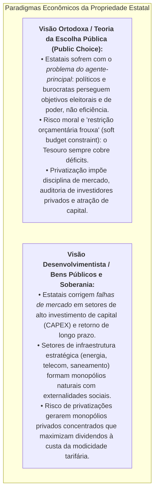

# Privatizações, Concessões e Desestatizações no Brasil

> **Classificação Temática:** Economia do Setor Público, Finanças Corporativas, Direito Regulatório e Governança Estatal  
> **Objetivo:** Analisar a trajetória histórica, os fundamentos microeconômicos, os ganhos de produtividade, os riscos regulatórios e os desfechos concretos dos processos de privatização, concessão e capitalização de empresas estatais no Brasil contemporâneo.  
> **Compromisso Metodológico:** Avaliação baseada estritamente em demonstrações financeiras auditadas (CVM/SEC), relatórios de auditoria do Tribunal de Contas da União (TCU), marcos regulatórios das agências setoriais (Aneel, ANP, Anatel, ANTT) e acórdãos do Supremo Tribunal Federal (STF).

---

## 1. O Debate Teórico sobre Empresas Estatais e Privatização

A literatura de Economia do Setor Público e Finanças Corporativas estrutura o debate sobre a propriedade estatal através de dois paradigmas clássicos:

---

## 2. A Trajetória Histórica das Privatizações no Brasil

O processo de desestatização no Brasil desenvolveu-se em quatro grandes ciclos institucionais:

1. **Primeira Onda (1990 – 2002 | Collor e FHC): O Programa Nacional de Desestatização (PND)**
   * Foco na desestatização direta da indústria pesada e telecomunicações: venda da CSN, Usiminas, Embraer, Companhia Vale do Rio Doce (1997), Telebras (1998) e de bancos estaduais insolventes (Banespa, Banerj, Bemge);
   * Criação do arcabouço das agências reguladoras independentes (Aneel, Anatel, ANP) para fiscalizar os mercados recém-abertos à concorrência.
2. **Segunda Onda (2003 – 2015 | Lula 1, 2 e Dilma): O Modelo de Concessões com Presença Estatal**
   * Retórica anti-privatização no discurso político, mas expansão pragmática de concessões de infraestrutura: leilões de grandes rodovias federais, terminais portuários e dos maiores aeroportos do país (Guarulhos, Viracopos, Brasília, Galeão, Confins);
   * Uso intensivo das estatais (Petrobras e Eletrobras) e do BNDES como instrumentos de política industrial e controle tarifário artificial (especialmente a catastrófica Medida Provisória nº 579/2012 no setor elétrico).
3. **Terceira Onda (2016 – 2018 | Temer): Saneamento de Balanços e Parcerias de Investimentos**
   * Criação do Programa de Parcerias de Investimentos (PPI) e aprovação da Lei das Estatais (Lei nº 13.303/2016);
   * Venda das distribuidoras de energia altamente deficitárias da Eletrobras no Norte e Nordeste (Cepisa, Ceal, Eletroacre, Ceron, Amazonas Energia e Boa Vista Energia), saneando o balanço da holding.
4. **Quarta Onda (2019 – 2022 | Bolsonaro e Paulo Guedes): Desinvestimentos Corporativos e Capitalizações**
   * Modelo de alienação de ativos sem entrega direta a um grupo único: venda de subsidiárias maduras da Petrobras via mercado de capitais (BR Distribuidora, TAG, NTS);
   * Aprovação do Novo Marco Legal do Saneamento Básico (Lei nº 14.026/2020), viabilizando a privatização da Cedae (RJ) e da Sabesp (SP);
   * A **capitalização da Eletrobras** em junho de 2022 via B3 e NYSE (Lei nº 14.182/2021), transformando a maior geradora e transmissora da América Latina em uma *corporation* privada sem acionista controlador.

---

## 3. Mapa dos Estudos Desta Pasta

1. **[`01_privatizacao_eletrobras_processo_indicadores_corrupcao_e_impactos.md`](file:///Users/rodrigofregonasse/Code/brasil-project/economia/privatizacoes/01_privatizacao_eletrobras_processo_indicadores_corrupcao_e_impactos.md)**
   * **Histórico Completo do Processo:** Da fundação em 1962 ao desastre tarifário da MP 579/2012, o modelo de capitalização da Lei nº 14.182/2021 e a oferta de ações na B3 em junho de 2022 (R$ 33,7 bilhões).
   * **Indicadores Econômico-Financeiros Antes e Depois:** Comparativo de Lucro Líquido, Dívida Líquida/EBITDA, capacidade de investimento (CAPEX), quadro de pessoal (PDVs) e rating de crédito internacional.
   * **Relações de Corrupção e Loteamento Político Pré-Privatização:** As investigações da Operação Lava Jato na Usina Nuclear de Angra 3 (Eletronuclear / Operações Radioatividade e Pripyat), o loteamento partidário de Furnas e Eletronorte por alas do PMDB e PT, e os esquemas de propina em Belo Monte e usinas do Rio Madeira.
   * **Problemas e Controvérsias Pós-Privatização:** Os "jabutis" legislativos (8 GW de termelétricas inflexíveis e impactos na CDE), a batalha jurídica da ADI 7385 no STF sobre o teto de 10% de voto da União, o apagão nacional de agosto de 2023 e o salto milionário na remuneração de executivos e conselheiros.
   * **Análise dos Dois Lados:** A tese liberal/mercado (salvação da falência e eficiência) versus a tese crítica/desenvolvimentista (perda de soberania e encarecimento da conta de luz).
   * **Catálogo de Fontes Oficiais Primárias:** Leis, acórdãos do TCU, dados da CVM, processos do STF e relatórios técnicos do ONS/Aneel.
