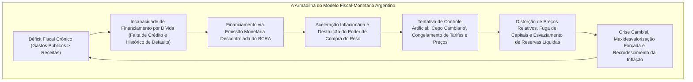
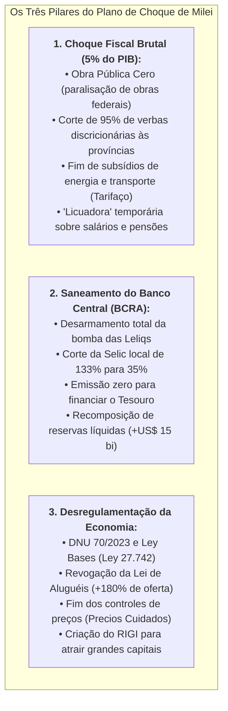
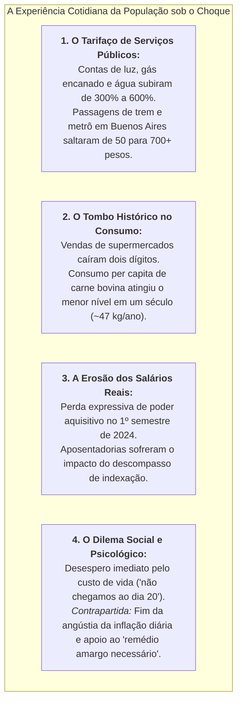

# A Grande Análise da Economia Argentina: O Colapso Pré-Milei, o Choque Libertário e os Impactos na População

> **Classificação:** Macroeconomia Internacional, Teoria Monetária, Políticas de Estabilização e Economia Social  
> **Período de Análise:** 2019 – 2026 (Governo Alberto Fernández / Sergio Massa e Governo Javier Milei)  
> **Objeto de Estudo:** A transição do regime de alta inflação e intervencionismo peronista para o programa de ajuste fiscal e desregulamentação libertária na Argentina, confrontando indicadores oficiais, os debates teóricos e a experiência real de vida da população.  
> **Fontes Primárias:** Instituto Nacional de Estadística y Censos (INDEC), Banco Central de la República Argentina (BCRA), Ministério de Economía de la Nación, Fundo Monetário Internacional (FMI), Banco Mundial e Observatorio de la Deuda Social da Pontificia Universidad Católica Argentina (UCA).

---

## 1. Contexto Histórico e a Trajetória da Crise Argentina

A Argentina apresenta um dos casos mais singulares da história econômica contemporânea: um país que figurava entre as dez economias com maior PIB per capita do planeta no início do século XX e que, ao longo de sucessivas décadas, mergulhou em uma espiral de estagflação crônica, crises de balanço de pagamentos e sucessivos calotes da dívida soberana (*defaults*).

Após o fracasso do gradualismo econômico da presidência de Mauricio Macri (2015–2019), a coalizão peronista-kirchnerista retornou ao poder com a eleição de **Alberto Fernández e Cristina Kirchner (2019–2023)**. Esse mandato aprofundou as contradições estruturais do modelo de intervenção estatal, culminando na pior crise macroeconômica da Argentina desde o colapso de 2001.

---

## 2. A Herança Pré-Milei: A Anatomia do Colapso Peronista (2019 – 2023)

No final de 2023, sob a gestão ministerial de **Sergio Massa** (que acumulou o superministério da Economia enquanto concorria à presidência da República), a economia argentina encontrava-se à beira de uma hiperinflação aberta.

### 2.1. O "Plano Platita" e a Emissão Desenfreada
* Durante a campanha eleitoral de 2023, o governo de Sergio Massa executou o chamado **"Plano Platita"**: um pacote gigantesco de expansão fiscal não financiada para tentar reverter a derrota eleitoral nas primárias (PASO);
* Foram distribuídos bônus a trabalhadores informais, cancelada a cobrança do Imposto de Renda para mais de 800 mil trabalhadores de classe média-alta e congeladas unilateralmente as tarifas de transporte público e energia;
* Esse pacote injetou no mercado o equivalente a **1,5% a 2% do PIB em moeda emitida sem lastro** no intervalo de apenas quatro meses, acelerando a velocidade de circulação do peso e gerando uma corrida aos dólares paralelos.

---

### 2.2. A "Bomba das Leliqs" e o Déficit Quase-Fiscal do BCRA
O Banco Central da República Argentina (BCRA) mantinha uma dívida remunerada de curto prazo monstruosa através das **Leliqs** (Letras de Liquidez) e dos **Pases Passivos**:
* Para enxugar o excesso de pesos que ele próprio imprimia para financiar o Tesouro, o BCRA absorvia esses pesos dos bancos comerciais pagando taxas de juros nominais que atingiram **133% ao ano**;
* Esse passivo remunerado superou **três vezes a base monetária do país**, gerando um déficit quase-fiscal superior a **10% do PIB ao ano**;
* O pagamento de juros das Leliqs exigia uma emissão monetária endógena colossal: o BCRA duplicava a quantidade de moeda em circulação apenas para remunerar os juros da sua própria dívida interna.

---

### 2.3. Reservas Líquidas Negativas e Dívida Comercial com Importadores
* **Esvaziamento de Dólares:** Em dezembro de 2023, as reservas internacionais líquidas do BCRA estavam **negativas entre US$ 11 bilhões e US$ 12 bilhões**. O Banco Central utilizava os depósitos em dólares dos próprios correntistas privados (encaixes bancários) e linhas de *swap* cambial com a China para cobrir rombos diários de divisas;
* **O Calote Comercial (SIRAs):** O governo reteve autorizações de pagamento de importações através do sistema SIRA, acumulando uma **dívida comercial represada superior a US$ 50 bilhões** com fornecedores internacionais, ameaçando o desabastecimento de remédios, autopeças e insumos industriais básicos.

---

### 2.4. O Labirinto do "Cepo Cambiario" e a Brecha Cambial
O controle cambial (*cepo*) criou um emaranhado de mais de **15 cotações paralelas do dólar** (Dólar Oficial, Dólar Blue, Dólar MEP, Contado con Liquidación - CCL, Dólar Tarjeta, Dólar Soja, Dólar Qatar):
* Enquanto o **Dólar Oficial** era mantido artificialmente cotado em cerca de **365 pesos**, o **Dólar Blue** (livre no mercado paralelo) rompeu a barreira dos **1.000 a 1.200 pesos**;
* A **brecha cambial superou 160% a 180%**, incentivando fraudes massivas de comércio exterior (subfaturamento de exportações para reter dólares fora do país e superfaturamento de importações para capturar dólares baratos do Banco Central).

---

### 2.5. A Inflação Reprimida e a Pobreza Estrutural
* O ano de 2023 encerrou com uma inflação acumulada de **211,4%** (a maior do mundo na época, superando a Venezuela e o Líbano);
* Esse índice, contudo, estava fortemente maquiado por congelamentos compulsórios de preços (*Precios Justos*) e subsídios que cobriam mais de 85% dos custos reais de energia e transporte em Buenos Aires;
* A pobreza atingiu **44,7%** da população urbana no quarto trimestre de 2023, e a indigência (fome) chegava a **9,6%**, segundo os dados combinados do INDEC e do Observatório da Dívida Social da UCA.

---

## 3. O Programa de Choque de Javier Milei (2024 – 2026)

Em **10 de dezembro de 2023**, Javier Milei assumiu a presidência proclamando em seu discurso de posse: *"No hay plata"* (não há dinheiro). Ao lado do ministro da Economia **Luis Caputo** e do presidente do BCRA **Santiago Bausili**, implementou um programa de estabilização de choque ortodoxo radical.

### 3.1. A Maxidesvalorização e o *Crawling Peg*
* Em **12 de dezembro de 2023**, Luis Caputo anunciou uma **desvalorização oficial de 118% no peso**: o dólar oficial saltou de 365 para **800 pesos**, aproximando-se da cotação de equilíbrio do mercado livre;
* Instituiu-se um regime de minidesvalorizações graduais previsíveis de **2% ao mês (*crawling peg*)** para servir como âncora nominal contra a espiral inflacionária, acompanhado de um imposto temporário sobre importações (Imposto PAIS).

---

### 3.2. O Ajuste Fiscal Histórico: "Motosserra e Liquidificador" (*Motosierra y Licuadora*)
O governo cumpriu a meta de eliminar o déficit fiscal logo no primeiro mês de mandato, realizando um ajuste fiscal consolidado de **5% do PIB em apenas 12 meses** através de dois instrumentos combinados:

1. **A Motosserra (*Motosierra* - Cortes Diretos de Gastos):**
   * **Obra Pública Cero:** Cancelamento de todas as novas licitações de obras públicas e paralisação de projetos sem financiamento multilateral externo;
   * **Transferências às Províncias:** Redução em mais de 90% das transferências discricionárias que a Casa Rosada historicamente utilizava para cooptar governadores aliados;
   * **Enxugamento da Máquina Federal:** Redução do número de ministérios de 18 para 8; demissão de mais de 30.000 funcionários comissionados e temporários; fechamento de órgãos estatais como o Inadi (instituto contra a discriminação) e a agência estatal de notícias Télam.
2. **O Liquidificador (*Licuadora* - Erosão Inflacionária Temporária):**
   * A inflação herdada, que atingiu **25,5% em dezembro de 2023** e **20,6% em janeiro de 2024**, corroeu temporariamente em termos reais o valor das aposentadorias, pensões do Estado e os salários do funcionalismo público antes de serem reajustados pela nova fórmula inflacionária atrelada ao IPC.

---

### 3.3. O Saneamento do BCRA e o Fim das Leliqs
* O BCRA desarmou o passivo remunerado das Leliqs, transferindo a liquidez dos bancos para títulos da dívida do próprio Tesouro Nacional (**LeFi - Letras Fiscais de Liquidez**);
* As taxas nominais de juros foram reduzidas sucessivamente de **133% para 35% ao ano**, derrubando a taxa de juros real para o território negativo no início do plano para liquidar o estoque de pesos da economia;
* Pela primeira vez em décadas, **o Tesouro Nacional deixou de emitir um único peso para cobrir despesas correntes do governo**.

---

### 3.4. A Desregulamentação Estrutural (DNU 70/2023 e *Ley Bases*)
O governo editou o massivo **Decreto de Necessidade e Urgência (DNU) nº 70/2023** e aprovou no Congresso a **Lei de Bases (*Ley 27.742*)**:
* **O Caso dos Aluguéis:** A revogação da restritiva *Ley de Alquileres* de 2020 restaurou a liberdade contratual (contratos em qualquer moeda, prazo e periodicidade de reajuste livremente pactuados). O resultado em Buenos Aires foi imediato: **a oferta de imóveis residenciais disparou mais de 180%**, e os preços reais dos aluguéis caíram pela primeira vez em anos;
* **Cielos Abiertos:** Abertura irrestrita do mercado de aviação comercial para companhias *low-cost* nacionais e estrangeiras, quebrando o monopólio fático e as restrições sindicais da Aerolíneas Argentinas;
* **Criação do RIGI (*Régimen de Incentivo para Grandes Inversiones*):** Estabilidade tributária, aduaneira e cambial por 30 anos para projetos que aportem mais de US$ 200 milhões, destravando dezenas de bilhões de dólares em investimentos na exploração de petróleo e gás de xisto (*shale gas*) em **Vaca Muerta** e na mineração de lítio e cobre no norte do país.

---

## 4. Painel Comparativo de Indicadores: Pré-Milei vs. Pós-Milei

A tabela a seguir consolida os números oficiais do INDEC, do BCRA, da UCA e de relatórios do FMI, confrontando o cenário herdado em 2023 com a evolução ao longo de 2024 e 2025/2026:

| Indicador Macroeconômico / Social | Cenário Pré-Milei (Fim de 2023) | Pior Momento do Choque (1º Semestre 2024) | Pós-Estabilização (2025 / 2026) | Variação Estrutural / Análise |
| :--- | :--- | :--- | :--- | :--- |
| **Inflação Mensal (IPC INDEC)** | **25,5%** (Dezembro/2023) | 20,6% (Jan/24) ➔ 8,8% (Abr/24) ➔ 4,2% (Mai/24) | **Convergência para 2,0% a 3,0%** ao mês | Queda abrupta e consistente; fim da espiral hiperinflacionária. |
| **Inflação Acumulada em 12 Meses** | **211,4%** (Ano fechado 2023) | **Pico de 289,4%** (Abril/2024) | Desaceleração para **~30% a 35%** anual | Desinflação sem congelamento forçado de preços. |
| **Resultado Fiscal do Governo Federal** | **Déficit Primário:** -2,9% do PIB **Déficit Financeiro:** -5,0% a -6,0% do PIB | **Superávit Financeiro Imediato:** Superávit primário + juros cobertos | **Superávit Fiscal Sustentado:** Fechamento de 2024 e 2025 no azul | Primeiro superávit financeiro anual positivo em 16 anos na Argentina. |
| **Déficit Quase-Fiscal do BCRA (Leliqs)** | **Superior a 10% do PIB** (Juros de 133% a.a.) | Leliqs extintas; dívida migrada para o Tesouro | **Quase-fiscal zerado** (BCRA saneado) | Eliminação da principal fonte de emissão monetária endógena. |
| **Reservas Líquidas do BCRA** | **Negativas em -US$ 11,5 bilhões** | Recomposição acelerada de divisas | **Positivas entre +US$ 5 bi e +US$ 10 bi** | Compras líquidas de mais de US$ 18 bilhões pelo BCRA no mercado. |
| **Brecha Cambiária (Dólar Oficial vs. Blue)** | **160% a 180%** (Oficial 365 vs. Blue 1.000+) | Oscilou entre 40% e 50% | **Reduzida para 15% a 25%** | Queda expressiva da distorção cambial; cepo mantido parcialmente. |
| **Risco País (*JP Morgan EMBI*)** | **Mais de 2.500 pontos base** | 1.400 a 1.600 pontos base | **Abaixo de 900 a 1.000 pontos** | Queda de mais de 60%; reabertura gradual do mercado de crédito externo. |
| **Taxa de Pobreza Urbana (INDEC / UCA)** | **44,7%** (UCA / 41,7% INDEC) | **Pico trágico de 52,9%** (INDEC) / **57,0%** (UCA) | **Recuo para 28,2% a 32,0%** (INDEC / UCA) | Explosão no choque inicial seguida de alívio com a queda da inflação. |
| **Taxa de Indigência (Extrema Pobreza)** | **9,6%** (Dez/2023) | **Pico de 18,1%** (1º Semestre 2024) | Queda para **~7,0% a 8,5%** | Vulnerabilidade severa amortecida por duplicar a AUH e Tarjeta Alimentar. |
| **PIB Real / Atividade Econômica** | **-1,6%** (2023 - Recessão da Seca) | Contração profunda: **-3,5% a -4,0%** em 2024 | **Recuperação em 'V': +4,0% a +5,0%** em 2025 | Tombamento inicial na indústria e construção civil, seguido de recuperação. |

---

## 5. A Perspectiva da População e o Custo Social (A "Microeconomia da Vida Real")

O saneamento dos grandes números macroeconômicos cobrou um preço humanitário severo no cotidiano das famílias argentinas, especialmente durante os primeiros seis a nove meses de mandato de Milei.

### 5.1. O Impacto nas Contas Públicas Domésticas (O Tarifaço)
* A retirada dos subsídios estatais represados por anos transformou a estrutura de custos das famílias:
  * As tarifas de **energia elétrica e gás natural registraram reajustes acumulados entre 300% e 600%**;
  * O transporte público na Região Metropolitana de Buenos Aires (AMBA), onde passagens de ônibus e metrô custavam valores irrisórios subsidiados pelo restante do país (equivalentes a menos de 10 centavos de dólar), teve suas tarifas aumentadas em mais de 500%;
* Para a classe média assalariada, o gasto com serviços públicos passou de menos de 5% da renda familiar para representar entre **15% e 20% do orçamento mensal**.

---

### 5.2. O Colapso do Consumo e o Paradoxo da Carne
* No auge do choque (primeiro trimestre de 2024), a queda nas vendas reais de supermercados, farmácias e bens duráveis atingiu níveis compatíveis com crises agudas;
* **O Consumo de Carne Bovina:** Na terra do tradicional *asado*, o consumo per capita de carne caiu para **47,3 kg por habitante ao ano** no primeiro semestre de 2024 — o patamar mais baixo registrado pela Câmara da Indústria e Comércio de Carnes (Ciccra) em mais de 100 anos, forçando a substituição por cortes de frango, porco e massas.

---

### 5.3. A Rede de Proteção Focalizada: AUH e Fim dos Intermediários
Para evitar que a explosão temporária da pobreza gerasse um colapso social generalizado ou saques em massa:
* O governo Milei **duplicou em termos reais o valor da *Asignación Universal por Hijo (AUH)*** e ampliou a verba do programa *Tarjeta Alimentar*, garantindo que a renda transferida aos mais pobres superasse a inflação da cesta básica de alimentos;
* **Fim dos "Gerentes da Pobreza":** O Ministério do Capital Humano retirou a intermediação de líderes de movimentos sociais piqueteiros e cooperativas que controlavam o acesso a planos sociais como o *Potenciar Trabajo*. O benefício passou a ser pago diretamente na conta bancária do cidadão, eliminando cobranças ilegais de mensalidades sindicais e a coerção de beneficiários para participar de manifestações políticas de oposição.

---

### 5.4. A Polarização e o Sentimento Coletivo
A sociedade argentina fragmentou-se em duas narrativas emocionais profundas:
1. **O Setor Afetado e Crítico:** Trabalhadores informais, servidores públicos demitidos, aposentados e pequenos comerciantes que viram o custo de vida disparar enquanto suas vendas caíam, gerando uma sensação de asfixia financeira e descrença na recuperação;
2. **A Base de Sustentação Resiliente:** Uma parcela expressiva do eleitorado (em especial jovens e classes médias cansadas de décadas de decadência) que manteve a paciência e a esperança em Milei, motivada pelo **alívio de entrar em um supermercado e encontrar preços estáveis** por meses consecutivos, a previsibilidade econômica e a convicção ideológica de que o choque era o único remédio viável para o país não se transformar em uma nova Venezuela.

---

## 6. Análise Econômica dos Dois Lados: O Debate Teórico e Prático

| Dimensão de Análise | Visão Ortodoxa / Libertária / Pró-Milei (Escola Austríaca, Chicago, Wall Street, FMI) | Visão Crítica / Heterodoxa / Peronista (Kirchnerismo, CGT, Desenvolvimentistas) |
| :--- | :--- | :--- |
| **Ajuste Fiscal e Superávit** | **A Maior Vitória Fiscal da História:** Cortar 5% do PIB de despesas em um ano sem calote e alcançar superávit financeiro no primeiro mês é uma façanha sem paralelo moderno. Destruiu a causa primordial da inflação (a emissão monetária para o Tesouro) e restaurou a credibilidade internacional do país. | **Ajuste Artificial, Cruel e Inviável:** O superávit foi obtido às custas da destruição do poder de compra dos aposentados (*licuadora*), do calote temporário em empresas geradoras de energia e da asfixia das províncias. A paralisação da obra pública deteriorará a malha logística e a infraestrutura do país por décadas. |
| **Combate à Inflação** | **A Tese Monetarista Comprovada:** O colapso da inflação de 25% para menos de 3% ao mês sem controle de preços, sem tabelamento e com liberação tarifária comprova que a inflação é sempre e em todo lugar um fenômeno puramente monetário. A estabilidade de preços devolveu o cálculo econômico aos agentes de mercado. | **Desinflação por Repressão do Consumo (Paz dos Cemitérios):** A inflação caiu porque a economia foi asfixiada em uma recessão brutal que destruiu a demanda e a renda da população. As empresas pararam de subir preços porque não havia mais quem comprasse, e não por ganhos reais de produtividade. |
| **Câmbio e o "Cepo"** | **Transição Prudente sem Hiperinflação:** A manutenção temporária de controles cambiais (*cepo*) com brecha reduzida a 15-20% evitou uma corrida bancária desordenada contra os depósitos enquanto o BCRA limpava seu balanço. O *crawling peg* serviu como âncora nominal indispensável na transição. | **Atraso Cambial Perigoso e Dependência:** O *crawling peg* de 2% ao mês acumulou uma forte valorização real do peso, tornando a Argentina uma das economias mais caras em dólares do continente (*Argentina cara en dólares*), ferindo a competitividade das exportações e incentivando o turismo de compras no exterior. |
| **Desregulamentação e Mercado** | **Triunfo da Liberdade Contratual:** A revogação da Lei de Aluguéis (DNU 70/2023) fez a oferta de imóveis disparar em 180% e os aluguéis caírem em termos reais, provando na prática que a intervenção estatal era a única causadora da escassez. O RIGI destrava investimentos multibilionários em Vaca Muerta e lítio. | **Desmonte do Estado e Entrega de Recursos:** A desregulamentação desprotegeu o inquilino, facilitou abusos contratuais e precarizou as relações trabalhistas. O RIGI entrega incentivos fiscais e cambiais de 30 anos para multinacionais explorarem recursos naturais estratégicos sem exigir agregação de valor local. |

---

## 7. Quadro-Síntese Comparativo dos Principais Fatos

| Eixo de Análise | Antes de Milei (Governo Fernández/Massa) | Depois de Milei (Governo Milei/Caputo) | Status Atual / Desfecho |
| :--- | :--- | :--- | :--- |
| **Âncora Fiscal** | Déficit primário e financeiro crônico financiado por emissão monetária. | Superávit primário e financeiro sustentado desde o 1º mês de gestão. | Regra fiscal implacável: qualquer gasto novo exige corte compensatório equivalente. |
| **Trajetória da Inflação** | Aceleração perigosa rumo à hiperinflação (211% em 2023). | Desaceleração histórica de 25,5%/mês para ~2-3%/mês. | Inflação anualizada em forte desinflação estrutural. |
| **Banco Central e Dívida** | Bomba das Leliqs pagando 133% a.a.; reservas líquidas em -US$ 11,5 bi. | Leliqs extintas; títulos transferidos ao Tesouro; reservas recuperadas. | Emissão zero para financiar o Tesouro; taxas nominais reduzidas para 35%. |
| **Preços e Regulação** | Congelamentos coercitivos (*Precios Justos*, aluguéis tabelados). | Liberação integral de preços relativos; revogação de leis punitivas. | Oferta de aluguéis disparou 180%; transparência em preços de mercado. |
| **Pobreza e Bem-Estar** | Pobreza reprimida em 44,7% com salários reais em queda livre. | Salto inicial da pobreza para 52,9% (INDEC) no choque de 2024. | Queda posterior para a casa dos 28% a 32% com a desinflação de 2025/2026. |
| **Inserção Internacional** | Alinhamento com o eixo Brics/Venezuela/China; risco país > 2.500. | Alinhamento geopolítico com EUA e Israel; risco país abaixo de 900. | Reaproximação com o FMI, atração de investimentos via RIGI e apoio ocidental. |

---

## 8. Catálogo de Fontes Oficiais Primárias

* *Instituto Nacional de Estadística y Censos (INDEC):* [Informes Técnicos de Índice de Precios al Consumidor (IPC)](https://www.indec.gob.ar/) e [Incidencia de la Pobreza y la Indigencia en 31 Aglomerados Urbanos](https://www.indec.gob.ar/) (Séries temporais oficiais de 2019 a 2026).
* *Banco Central de la República Argentina (BCRA):* [Boletines Estadísticos y Monetarios](https://www.bcra.gob.ar/) (Evolução do balanço patrimonial, reservas internacionais líquidas, desarmamento das Leliqs e taxas de política monetária).
* *Ministério de Economía de la Nación (Argentina):* [Informes Mensuales de Ejecución Presupuestaria](https://www.argentina.gob.ar/economia) (Demonstrativos oficiais de superávit primário e financeiro do setor público nacional).
* *Fundo Monetário Internacional (FMI):* [IMF Country Report - Argentina: Article IV Consultation and Staff Reports](https://www.imf.org/en/Countries/ARG) (Avaliações técnicas multilaterais do programa de estabilização macroeconômica).
* *Pontificia Universidad Católica Argentina (UCA):* [Observatorio de la Deuda Social Argentina (ODSA)](https://uca.edu.ar/es/observatorio-de-la-deuda-social-argentina) (Relatórios semestrais de pobreza multidimensional, indigência e vulnerabilidade alimentar).
* *Presidência da Nação Argentina:* [Decreto de Necesidad y Urgencia (DNU) nº 70/2023](https://www.boletinoficial.gob.ar/) (Bases para la Reconstrucción de la Economía Argentina) e [Ley nº 27.742 - Ley de Bases y Puntos de Partida para la Libertad de los Argentinos](https://www.boletinoficial.gob.ar/).
