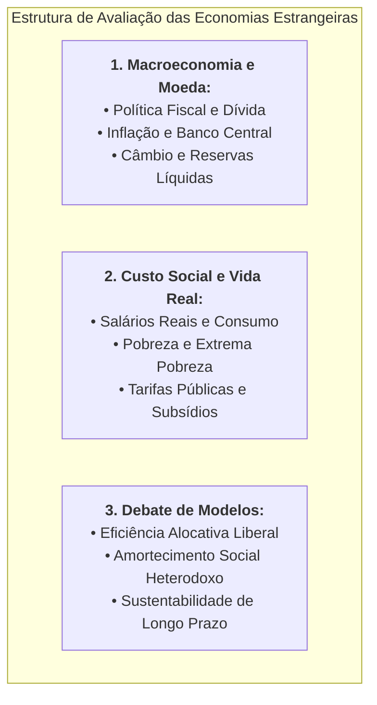

# Economias Internacionais e Estudos de Caso Comparados

> **Classificação Temática:** Macroeconomia Internacional, Economia Comparada, Finanças Globais e Políticas Públicas  
> **Objetivo:** Analisar a trajetória macroeconômica, reformas estruturais, programas de estabilização monetária e dinâmicas sociais de parceiros comerciais estratégicos e países com relevância geopolítica para o Brasil.  
> **Compromisso Anti-Desinformação:** Utilização estrita de estatísticas oficiais primárias dos institutos nacionais de estatística (como o INDEC na Argentina, o BLS nos EUA, o Eurostat na União Europeia), bancos centrais (BCRA, Fed, BCE), relatórios do Fundo Monetário Internacional (FMI), Banco Mundial e CEPAL/ONU.

---

## 1. O Escopo da Análise de Economia Comparada

O estudo de economias estrangeiras permite extrair lições cruciais para os debates fiscais, monetários e regulatórios do Brasil. As análises estruturam-se sob três pilares metodológicos:

1. **A Dinâmica Macroeconômica:** Equilíbrio fiscal (primário e financeiro), política monetária e inflação, regime cambial, sustentabilidade da dívida pública soberana e reservas internacionais;
2. **A Realidade Microeconômica e Social:** Poder de compra dos salários, impacto nos custos de vida (tarifas de energia, habitação, transporte), níveis de pobreza e indigência, e dinamismo do mercado de trabalho;
3. **A Dialética Factual:** Apresentação sistemática do confronto entre a **Visão Ortodoxa / Pró-Mercado** (foco em austeridade fiscal, desregulamentação e atração de capitais) e a **Visão Heterodoxa / Crítica** (foco em demanda agregada, proteção social e intervenção estatal estratégica).

---

## 2. Mapa dos Estudos Desta Pasta

1. **[`01_argentina_analise_economica_pre_e_pos_milei.md`](file:///Users/rodrigofregonasse/Code/brasil-project/economias_internacionais/01_argentina_analise_economica_pre_e_pos_milei.md)**
   * **A Herança do Colapso Peronista (Governo Alberto Fernández e Sergio Massa):** Inflação em 211%, o "Plano Platita" de emissão descontrolada, a bomba das Leliqs no BCRA, reservas líquidas negativas em US$ 11 bilhões e brecha cambial de mais de 160% sob o *cepo*.
   * **O Plano de Choque de Javier Milei ("Motosserra e Liquidificador"):** A desvalorização inicial de 118%, o corte de 5% do PIB em gastos públicos gerando o primeiro superávit financeiro em 16 anos, desregulamentação de aluguéis e preços relativos (DNU 70/2023 e *Ley Bases*).
   * **Painel de Indicadores Comparativos:** Inflação mensal (de 25,5% para ~2-3%), desinflação anual, *Riesgo País* (queda de 2.500 para abaixo de 900 pontos) e recomposição gradual de reservas.
   * **A Perspectiva da População e o Custo Social:** O salto inicial da pobreza para 52,9% (INDEC) e 57% (UCA) no 1º semestre de 2024, tarifaço de luz e transporte, colapso no consumo de alimentos e a recuperação salarial gradual posterior.
   * **Análise dos Dois Lados:** A defesa ortodoxa do fim da hiperinflação e estabilização sem precedentes versus a crítica heterodoxa sobre a liquidação da renda dos aposentados, atraso cambial e recessão industrial.
