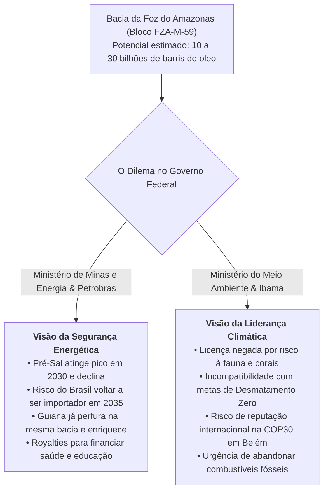

# Transição Energética, Agronegócio e o Dilema da Margem Equatorial

> **Classificação:** Geopolítica da Energia, Recursos Naturais e Política Ambiental  
> **Período de Referência:** 2020 – 2026  
> **Bases Oficiais de Dados:** EPE (Balanço Energético Nacional), ANP (Boletins de Produção), Ibama (Processos de Licenciamento Ambiental), INPE (PRODES/DETER) e Embrapa.

---

## 1. A Vantagem Estratégica: A Matriz Elétrica Limpa do Brasil

O Brasil possui uma das matrizes elétricas mais descarbonizadas do planeta, contrastando de forma flagrante com a média das principais potências industriais:
* **Matriz Elétrica Brasileira (EPE / Balanço Energético Nacional):** **Mais de 85% a 89% renovável** (Hidrelétrica ~58%, Eólica ~14%, Solar Fotovoltaica ~11% e Biomassa ~8%);
* **Média Mundial:** Menos de **30% renovável** (com forte dependência de carvão mineral na China e Índia, e gás natural nos EUA e Europa).

### O Potencial de Hidrogênio Verde (H2V) e "Powershoring":
Essa abundância de energia limpa contínua e barata posiciona o Brasil na vanguarda do **Powershoring** (atração de indústrias pesadas, fundições de aço verde e data centers de Inteligência Artificial para países onde a matriz é limpa), com projetos bilionários de produção e exportação de **Hidrogênio Verde** em portos industriais estratégicos como o Porto do Pecém (Ceará) e Suape (Pernambuco).

---

## 2. O Conflito Existencial da Margem Equatorial (Petróleo vs. Meio Ambiente)

### O Fato Concreto da Disputa:
A **Margem Equatorial** — faixa marítima que se estende do litoral do Amapá até o Rio Grande do Norte — é classificada pela ANP e por geólogos como o **"Novo Pré-Sal"**, com formações geológicas idênticas às descobertas bilionárias de petróleo feitas pela ExxonMobil na costa da Guiana e do Suriname.
* **O Pleito da Petrobras:** A estatal solicitou licença para perfurar um poço exploratório inicial a 175 km da costa do Amapá e a 500 km da foz do Rio Amazonas (Bloco FZA-M-59) para confirmar a existência de reservas comerciais.
* **O Veto Técnico do Ibama:** Em **maio de 2023**, o presidente do Ibama, Rodrigo Agostinho, negou a licença ambiental, apontando deficiências no Plano de Proteção à Fauna, ausência de Avaliação Ambiental de Área Sedimentar (AAAS) e riscos ao bioma marinho sensível e comunidades costeiras indígenas.
* **O Impasse Político:** O Ministério de Minas e Energia (Alexandre Silveira) e lideranças políticas do Amapá (como o senador Davi Alcolumbre) passaram a pressionar abertamente a ministra Marina Silva e o Ibama pela liberação, gerando a maior cisão interna no governo Lula 3.

---

## 3. O Agronegócio e as Barreiras Comerciais da União Europeia (EUDR)

O agronegócio brasileiro — responsável por cerca de 25% do PIB e metade das exportações do país — enfrenta o maior desafio regulatório de sua história recente:
* **O Regulamento Antidesmatamento da UE (EUDR):** Diretiva aprovada pelo Parlamento Europeu proibindo a entrada no bloco europeu de produtos agropecuários (soja, carne bovina, café, cacau, madeira, borracha e óleo de palma) originários de terras desmatadas após **31 de dezembro de 2020**;
* **O Conflito de Legislação:** O regulamento europeu penaliza inclusive o **desmatamento legal** autorizado pelo Código Florestal Brasileiro (que permite ao produtor rural desmatar legalmente até 20% de sua propriedade na Amazônia e até 65% a 80% no bioma Cerrado, região do Matopiba).
* **A Reação Brasileira:** O governo e as entidades do agronegócio (FPA, CNA) classificam a norma como protecionismo comercial disfarçado de bandeira verde, projetado para blindar os agricultores europeus ineficientes da competitividade imbatível da agropecuária brasileira.

---

## 4. Confronto Dialético sobre Energia e Recursos Naturais

### A Visão da Superpotência Verde e Conservação Climática (Ambiental / Internacional)
* **Argumento:** O futuro da riqueza e da reputação internacional do Brasil está na liderança da economia verde do século XXI:
  1. **A Coerência da Liderança Climática:** O Brasil não pode se apresentar ao mundo como líder da defesa climática na cúpula da COP30 em Belém e, simultaneamente, abrir uma nova e gigantesca fronteira exploratória de petróleo na foz do Rio Amazonas. A era do petróleo está em transição global acelerada rumo ao abandono dos combustíveis fósseis.
  2. **Risco de Sanções e Boicotes:** O desrespeito às normas de sustentabilidade e a abertura de poços em áreas ecologicamente sensíveis fornecerão munição perfeita para que a União Europeia e os Estados Unidos imponham tarifas de carbono (CBAM) e embargos ambientais contra toda a cadeia do agronegócio e da indústria brasileira.
  3. **A Riqueza da Bioeconomia:** O valor estratégico real da Amazônia reside na biodiversidade intacta, nos créditos de carbono e nos serviços ecológicos do ciclo das chuvas que abastece as lavouras do Centro-Sul brasileiro.

### A Visão Soberanista e da Riqueza do Pré-Sal (Desenvolvimentista Tradicional / Segurança Energética)
* **Argumento:** A transição energética global levará décadas e a renúncia à exploração do petróleo nacional apenas enriquecerá outros países à custa da pobreza do Brasil:
  1. **A Iminência do Declínio do Pré-Sal:** Estudos técnicos da ANP e da Petrobras comprovam que a curva de produção dos campos atuais do Pré-Sal no Sudeste atingirá seu pico entre 2029 e 2031 e começará a declinar acentuadamente. Se o Brasil não repuser suas reservas na Margem Equatorial, o país deixará de ser exportador e **voltará a ser um importador líquido de petróleo a partir de 2035**, drenando dezenas de bilhões de dólares em moeda forte.
  2. **Hipocrisia Internacional:** Enquanto a União Europeia exige que o Brasil congele suas fronteiras petrolíferas, a Guiana (país vizinho) já extrai centenas de milhares de barris de petróleo na mesma bacia geológica e viu seu PIB crescer mais de 30% ao ano. Os países ricos do Norte continuam emitindo a vasta maioria dos gases do efeito estufa da história.
  3. **O Petróleo como Financiador da Própria Transição:** A exploração da Margem Equatorial pode injetar centenas de bilhões de reais em royalties e participações especiais nos cofres da União e dos estados mais pobres do Norte e Nordeste, recursos indispensáveis para financiar a educação pública, o SUS e a infraestrutura de energias renováveis eólica e solar.
