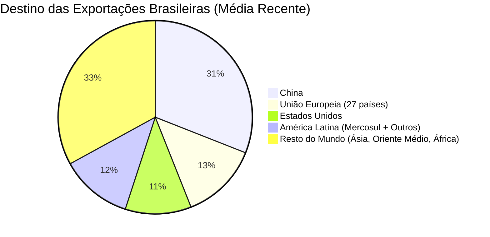

# Geopolítica, BRICS e o Debate da Desdolarização

> **Classificação:** Relações Internacionais, Diplomacia Econômica e Comércio Global  
> **Período de Referência:** 2000 – 2026  
> **Bases Oficiais de Dados:** MDIC (Sistema Comex Stat), Ministério das Relações Exteriores (Itamaraty), Fundo Monetário Internacional (FMI) e Novo Banco de Desenvolvimento (NDB / Banco dos BRICS).

---

## 1. O Mapa do Comércio Exterior: A Dependência da China

Os dados oficiais de comércio exterior compilados pelo Ministério do Desenvolvimento, Indústria, Comércio e Serviços (MDIC / Comex Stat) demonstram uma mudança sísmica no eixo geoeconômico do Brasil nas últimas duas décadas:

### O Peso Estratégico do Mercado Chinês:
* **Volume Financeiro:** A China compra anualmente mais de **US$ 100 a US$ 105 bilhões** em produtos brasileiros — valor que supera a soma de tudo o que os Estados Unidos e a União Europeia inteira adquirem do Brasil juntos;
* **Superávit Bilateral:** O saldo comercial positivo do Brasil com a China gira em torno de **US$ 50 bilhões anuais**, sendo o principal esteio da estabilidade das contas externas e das reservas cambiais do país;
* **Concentração de Commodities:** Mais de 70% de toda a soja exportada pelo Brasil, cerca de 65% do minério de ferro e mais de 40% do petróleo bruto têm como destino os portos chineses.

---

## 2. A Expansão dos BRICS (BRICS+) e o Sistema Financeiro Alternativo

Criado em 2006 (originalmente com Brasil, Rússia, Índia e China, incorporando a África do Sul em 2010), o bloco dos **BRICS** protagonizou um salto geopolítico histórico na Cúpula de Joanesburgo (2023), aprovando a adesão de novos membros plenos: **Arábia Saudita, Emirados Árabes Unidos, Irã, Egito e Etiópia**.

### O Peso do BRICS+ na Economia Global (Dados do FMI):
* Responde por cerca de **37% do Produto Interno Bruto mundial** em Paridade de Poder de Compra (PPC), superando a participação do G7 (30%);
* Concentra cerca de **45% da população global** e mais de **42% de toda a produção mundial de petróleo bruto**.

### A Agenda da "Desdolarização":
A utilização de sanções financeiras pelo governo dos Estados Unidos (como o congelamento de mais de US$ 300 bilhões em reservas soberanas da Rússia e a exclusão de bancos do sistema de mensagens interbancárias SWIFT) acelerou a busca dos membros dos BRICS por alternativas:
1. **Acordo Brasil-China de Moedas Locais (2023):** Assinado para permitir a liquidação direta de transações de exportação e importação em **Reais e Renminbi (Yuan)** sem a obrigatoriedade de conversão intermediária em Dólares norte-americanos, operado pelo banco ICBC em São Paulo;
2. **O Novo Banco de Desenvolvimento (NDB / Xangai):** Presidido pela ex-presidente Dilma Rousseff, o Banco dos BRICS fixou a meta de conceder pelo menos **30% de todos os seus empréstimos em moedas locais** dos países membros, reduzindo a exposição cambial ao dólar e o risco de congelamentos externos.

---

## 3. O Impasse do Acordo Mercosul – União Europeia

Iniciadas em 1999, as negociações para a criação de uma área de livre comércio entre o Mercosul (Brasil, Argentina, Paraguai e Uruguai) e a União Europeia completaram **mais de 25 anos de atrito diplomático**:
* **O Tratado de 2019:** Foi anunciado um acordo político preliminar em 2019, mas sua ratificação foi paralisada;
* **Os Obstáculos Reais:**
  1. **Protecionismo Agrícola Europeu:** Agricultores franceses, irlandeses e poloneses pressionam seus parlamentos contra o acordo, temendo não conseguir competir com os custos mais baixos da carne e do açúcar sul-americanos;
  2. **Cartas Adicionais Ambientais (*Side Letters*):** A UE apresentou exigências ambientais com previsão de sanções comerciais unilaterais contra o desmatamento, rejeitadas pelo governo brasileiro por violarem a soberania e a isonomia de acesso a mercados.

---

## 4. Confronto Dialético sobre a Política Externa Brasileira

### A Visão Universalista do Sul Global e da Multipolaridade (Pró-BRICS / Itamaraty)
* **Argumento:** A política externa de um país de dimensões continentais deve defender a autonomia soberana em um mundo multipolar:
  1. **Pragmatismo Comercial Irrecusável:** A China é a compradora que sustenta a pujança do agronegócio e a balança comercial brasileira. Transformar o Brasil em satélite ideológico dos Estados Unidos seria um suicídio econômico, prejudicando os próprios produtores rurais que exportam grãos e carne para a Ásia.
  2. **Poder de Barganha Geopolítico:** Fortalecer os BRICS não significa ser inimigo do Ocidente, mas sim ter uma cadeira à mesa dos países emergentes para reequilibrar organismos como o FMI e o Conselho de Segurança da ONU, tradicionalmente dominados pelas potências do pós-Segunda Guerra.
  3. **Segurança contra a Arma do Dólar:** Ter canais bilaterais de pagamento em moedas locais protege as empresas brasileiras da arbitrariedade de eventuais sanções financeiras e tarifárias expedidas por governos unilaterais em Washington.

### A Visão Ocidentalista e Liberal-Democrática (Crítica / Pró-Ocidente)
* **Argumento:** O alinhamento prioritário com regimes autoritários corrompe os valores da República e afasta o capital ocidental:
  1. **O Risco da Reputação Democrática:** O Brasil é a maior democracia do hemisfério sul. Fazer coro diplomático com regimes autocráticos e teocráticos como a Rússia de Vladimir Putin, o Irã e a China compromete o *soft power* e a credibilidade institucional brasileira perante o mundo livre.
  2. **A Ilusão da Desdolarização:** O Dólar americano continua respondendo por cerca de 85% a 90% de todas as transações cambiais globais e por quase 60% das reservas dos bancos centrais do planeta. Desafiar a moeda de reserva global apenas gera ruído político e atrai a desconfiança de investidores internacionais de Wall Street e de Londres.
  3. **A Prioridade da OCDE e da Tecnologia:** Os BRICS compram commodities brutas (grãos e minérios não refinados), mas quem transfere tecnologia de ponta, patentes, governança corporativa e semicondutores são os Estados Unidos, Japão e Europa. O verdadeiro salto de desenvolvimento viria da entrada formal do Brasil na **OCDE** e do fechamento do acordo com a União Europeia.
