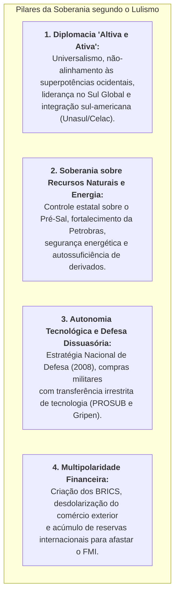

# A Soberania Nacional no Governo Lula: Fatos, Decisões e Análise Dialética

> **Classificação:** Geopolítica, Estratégia de Defesa e Relações Internacionais  
> **Período Coberto:** 2003 – 2026 (Lula 1, Lula 2 e Lula 3)  
> **Objetivo:** Avaliar de forma estritamente factual as principais decisões executivas, tratados, programas de defesa, marcos regulatórios e posicionamentos geopolíticos dos governos de Luiz Inácio Lula da Silva sob o prisma da **Soberania Nacional**.  
> **Estrutura:** (1) A Doutrina Lulista de Soberania; (2) As Grandes Decisões e Fatos Concretos; (3) Análise Favorável (A Soberania Altiva e Estratégica); (4) Análise Crítica (As Contradições e Vulnerabilidades); (5) Fontes Oficiais Primárias.

---

## 1. A Doutrina Lulista de Soberania: Sul-Globalismo e Recursos Estratégicos

No pensamento político e diplomático de Luiz Inácio Lula da Silva e de seu principal conselheiro de política externa, o embaixador Celso Amorim, a soberania nacional é concebida a partir de quatro pilares estruturantes:

---

## 2. As Grandes Decisões e Fatos Concretos

### 2.1. O Marco Regulatório do Pré-Sal e o Regime de Partilha (Lei nº 12.351/2010)
* **A Decisão:** Após a descoberta das maiores reservas petrolíferas do hemisfério ocidental no século XXI (o Pré-Sal, em 2006), o governo Lula substituiu o regime de concessão (criado por FHC em 1997) pelo **Regime de Partilha de Produção**:
  * Instituiu a Petrobras como operadora única com participação mínima obrigatória de **30% em todos os blocos licitados**;
  * Criou uma estatal 100% pública para gerir os contratos de óleo: a **Pré-Sal Petróleo S.A. (PPSA)**;
  * Criou o **Fundo Social do Pré-Sal**, vinculando receitas e participações governamentais a investimentos estratégicos permanentes em educação pública (50%) e saúde.

### 2.2. A Estratégia Nacional de Defesa e os Megaprogramas das Forças Armadas
* **PROSUB (Programa de Desenvolvimento de Submarinos - 2008):** Parceria estratégica firmada entre Lula e o presidente francês Nicolas Sarkozy (Decreto nº 6.703/2008):
  * Construção do Complexo Naval e Estaleiro de Itaguaí (RJ);
  * Transferência de tecnologia para a fabricação no Brasil de 4 submarinos convencionais de propulsão diesel-elétrica da classe *Riachuelo* (Scorpène);
  * Desenvolvimento da infraestrutura e do casco do primeiro **submarino de propulsão nuclear da América Latina (*Álvaro Alberto*)**, com o reator nuclear de água pressurizada desenvolvido autonomamente pela Marinha no Centro Experimental de Aramar (SP).
* **Projeto FX-2 (Caças Gripen NG da Força Aérea Brasileira):** Escolha da fabricante sueca Saab para o fornecimento de 36 caças supersônicos multimissão:
  * O governo rejeitou a proposta dos EUA (caças F-18 Super Hornet da Boeing) após as revelações de espionagem da NSA norte-americana contra a Presidência e a Petrobras (caso Edward Snowden);
  * A exigência central foi a **transferência irrestrita de tecnologia (ToT)** e a montagem de aeronaves pela Embraer na fábrica de Gavião Peixoto (SP).
* **Projeto Guarani (Exército Brasileiro):** Desenvolvimento e fabricação nacional do blindado anfíbio sobre rodas em parceria entre o Exército e a Iveco em Minas Gerais, substituindo as viaturas Urutu e Cascavel.

### 2.3. Blindagem Cambial e Liquidação da Dívida com o FMI
* **Acúmulo de Reservas:** Entre 2003 e 2010, o Banco Central aproveitou o superciclo global de commodities para comprar dólares e elevar as reservas internacionais de **US$ 37 bilhões para mais de US$ 370 bilhões**, convertendo o Brasil em credor externo líquido pela primeira vez na história;
* **Fim da Tutela do FMI:** Em dezembro de 2005, o Brasil pagou antecipadamente a totalidade de sua dívida com o Fundo Monetário Internacional (**US$ 15,5 bilhões**), encerrando as missões técnicas trimestrais do fundo que ditavam diretrizes sobre o orçamento público nacional.

### 2.4. A Criação dos BRICS e a Diplomacia Sul-Sul
* **Fundação do Bloco (2009):** Lula articulou com Rússia, Índia e China a criação do bloco BRIC (depois BRICS com a África do Sul), formalizando uma aliança geopolítica fora da órbita do G7;
* **Criação do NDB (Banco dos BRICS):** Instituição multilateral com sede em Xangai para financiar infraestrutura em economias emergentes sem as condicionalidades políticas e fiscais típicas do Banco Mundial e do FMI;
* **Moedas Locais no Comércio Bilateral (Lula 3 - 2023):** Acordos com a China para compensação financeira de exportações e importações diretamente em Real e Yuan (via *Clearing House* autorizada pelo Banco Central), reduzindo a intermediação do dólar americano.

### 2.5. O Acordo Nuclear com o Irã (Declaração de Teerã - Maio de 2010)
* **A Iniciativa:** Ao lado do primeiro-ministro da Turquia, Recep Tayyip Erdogan, Lula viajou a Teerã e intermediou um acordo diplomático com o presidente Mahmoud Ahmadinejad para que o Irã enviasse 1.200 kg de urânio pouco enriquecido para a Turquia em troca de combustível para pesquisas médicas;
* **O Objetivo Soberano:** Demonstrar que potências médias do Sul Global tinham estatura e legitimidade diplomática para mediar crises nucleares sem a tutela militar dos membros permanentes do Conselho de Segurança da ONU.

### 2.6. O Dilema Energético da Margem Equatorial (Lula 3)
* **A Disputa:** O governo Lula passou a pressionar politicamente pela liberação da licença ambiental da Petrobras para explorar o bloco FZA-M-59 (bacia da Foz do Amazonas), sob o argumento de que o país precisa garantir sua **soberania energética fóssil** para as décadas de 2030 e 2040, contrapondo-se às pressões e exigências de conservação da União Europeia.

---

## 3. Análise Favorável: A Defesa da Soberania Estratégica e Altiva

Os defensores da política de soberania lulista sustentam que as decisões fortaleceram estruturalmente a autonomia material do Estado brasileiro perante o sistema internacional:

1. **Capacidade Dissuasória e Tecnologia Bélica Real:** Ao contrário de governos anteriores que apenas compravam armamentos de prateleira dos EUA sem acesso aos códigos-fonte, a gestão Lula exigiu transferência tecnológica compulsória. O PROSUB e o caça Gripen garantiram ao Brasil autonomia para desenvolver seu próprio reator nuclear naval e capacidade industrial de caças de 5ª geração na Embraer;
2. **Independência Financeira contra Vulnerabilidade Externa:** O acúmulo de mais de US$ 370 bilhões em reservas internacionais livrou o Brasil da humilhação histórica das crises de balanço de pagamentos que paralisaram a soberania nacional nas décadas de 1980 e 1990;
3. **Controle dos Recursos Estratégicos:** O Regime de Partilha e a retenção do controle da Petrobras impediram que o patrimônio mineral mais valioso do país fosse arrematado por petroleiras estrangeiras a preços depreciados, assegurando uma reserva financeira soberana para a União;
4. **Alargamento dos Horizontes Geopolíticos:** A liderança nos BRICS e a diplomacia Sul-Sul reduziram a dependência histórica de Washington e Bruxelas, abrindo mercados trilionários na Ásia, no Oriente Médio e na África para o agronegócio e a indústria brasileira;
5. **Afirmação Internacional:** O Brasil deixou a posição de "anão diplomático" e passou a sentar-se à mesa das grandes decisões globais (G20, clima, mediação de paz).

---

## 4. Análise Crítica: As Contradições, Vulnerabilidades e Custos da Doutrina

Analistas liberais, internacionalistas ortodoxos e opositores apontam fragilidades e riscos profundos na condução da soberania lulista:

1. **Alinhamento e Leninência com Ditaduras Antiocidentais:**  
   Em nome do "anti-imperialismo" e do terceiro-mundismo, o lulismo frequentemente concedeu sustentação diplomática, créditos subsidiados e blindagem retórica a regimes autoritários que violam direitos fundamentais (Venezuela de Chávez/Maduro, Cuba de Fidel/Díaz-Canel, Nicarágua de Ortega e Irã de Ahmadinejad). Críticos sustentam que isso manchou a tradição de defesa da democracia e dos direitos humanos da diplomacia brasileira;
2. **O Fracasso Diplomático de Teerã (2010):**  
   A tentativa de mediar a questão nuclear do Irã desconsiderou a geopolítica das superpotências. Menos de 48 horas após a celebração da Declaração de Teerã, o governo de Barack Obama e a ONU rejeitaram o documento e impuseram novas sanções a Teerã, revelando os limites e a ingenuidade do voluntarismo lulista perante a *Realpolitik*;
3. **A Armadilha do Conteúdo Local e a Quebra do Setor Naval:**  
   A política de "soberania industrial" forçou a Petrobras a encomendar sondas, plataformas e navios exclusivamente em estaleiros nacionais (via Sete Brasil e estaleiros no Rio e Pernambuco). Sem escala e produtividade internacional, os custos explodiram, os prazos atrasaram anos e o modelo desaguou no maior escândalo de cartel e superfaturamento da história da Petrobras (desvendado pela Operação Lava Jato), custando bilhões de dólares ao país;
4. **A Ilusão da Desdolarização e a Troca de Hegemonia pela China:**  
   Embora critique a hegemonia do dólar, o lulismo aprofundou dramaticamente a **dependência comercial e extrativista da China**, que passou a absorver mais de um terço de todas as exportações brasileiras. A soberania brasileira tornou-se hiperdependente das decisões do Partido Comunista Chinês, acelerando a desindustrialização doméstica e a reprimarização da economia (dependência extrema da soja e do minério bruto);
5. **A Posição Ambigua na Guerra da Ucrânia (2022–2024):**  
   Declarações de Lula sugerindo equivalência de culpa entre o invasor e o invadido (*"Zelensky é tão culpado quanto Putin"*) e a recusa em sancionar a agressão russa desgastaram a credibilidade do Brasil perante as democracias ocidentais, violando o princípio constitucional da autodeterminação dos povos e da não-intervenção (Art. 4º da CF/88).

---

## 5. Matriz Síntese: As Grandes Decisões e Seus Impactos na Soberania

| Decisão de Governo | Dimensão da Soberania | Visão Favorable (Pro-Soberanista) | Visão Crítica (Custos e Vulnerabilidades) |
| :--- | :--- | :--- | :--- |
| **Regime de Partilha do Pré-Sal (Lei 12.351/10)** | Soberania Energética e de Recursos | Assegurou o controle estatal sobre o petróleo e criou fundo social para o povo. | Afastou investimentos rápidos e sobrecarregou a Petrobras, abrindo espaço para corrupção. |
| **PROSUB e Submarino Nuclear** | Soberania Militar Dissuasória | Capacitou a Marinha a defender a "Amazônia Azul" com tecnologia nuclear própria. | Custo financeiro elevadíssimo e atrasos cronológicos de quase uma década na entrega. |
| **Compra dos Caças Gripen NG (FX-2)** | Soberania Aeroespacial | Rejeitou a espionagem dos EUA e garantiu transferência irrestrita de tecnologia à Embraer. | Reduzido número de aeronaves contratadas (36) frente à extensão territorial do Brasil. |
| **Acúmulo de Reservas (US$ 370 bi) e FMI** | Soberania Macroeconômica | Blindou o país contra ataques especulativos e encerrou a tutela humilhante do FMI. | Custo fiscal de carregar reservas em títulos em dólar pagando taxas Selic elevadas no Tesouro. |
| **BRICS e Moedas Locais (Real-Yuan)** | Geopolítica Global | Desafia a tirania das sanções do dólar e expande mercados no Sul Global. | Aumenta a subserviência geopolítica a Pequim e a regimes autocráticos. |
| **Margem Equatorial (Foz do Amazonas)** | Autossuficiência Fóssil | Evita que o Brasil volte a ser importador de petróleo e garante receitas públicas. | Coloca em risco a credibilidade ambiental do Brasil e a liderança climática na COP 30. |

---

## 6. Catálogo de Fontes Oficiais Primárias

* *Congresso Nacional:* [Lei nº 12.351, de 22 de dezembro de 2010](https://www.planalto.gov.br/ccivil_03/_ato2007-2010/2010/lei/l12351.htm) (Marco Regulatório do Pré-Sal e Regime de Partilha).
* *Presidência da República:* [Decreto nº 6.703, de 18 de dezembro de 2008](https://www.planalto.gov.br/ccivil_03/_ato2007-2010/2008/decreto/d6703.htm) (Aprova a Estratégia Nacional de Defesa - END).
* *Marinha do Brasil:* [Programa de Desenvolvimento de Submarinos (PROSUB)](https://www.marinha.mil.br/prosub/) - Histórico oficial da parceria com a França e reator de Aramar.
* *Comando da Aeronáutica (FAB):* Projeto FX-2 e Contrato de Transferência de Tecnologia Saab-Embraer (2014).
* *Banco Central do Brasil:* Séries SGS de Reservas Internacionais Líquidas e Liquidação da Dívida com o FMI (2005).
* *Ministério das Relações Exteriores (Itamaraty):* Declaração de Teerã (17 de maio de 2010) e Declarações das Cúpulas dos BRICS.
