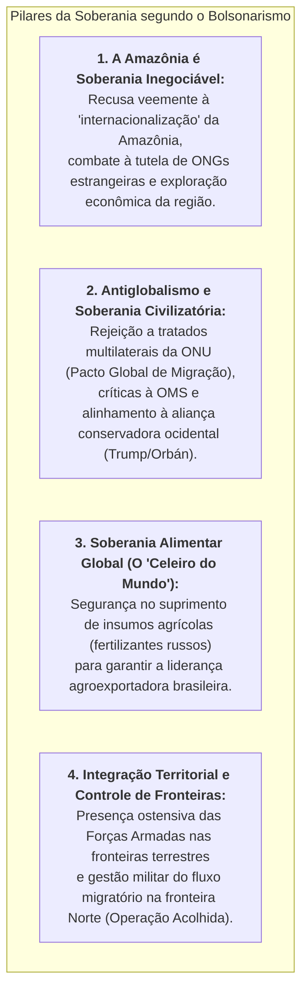

# A Soberania Nacional no Governo Bolsonaro: Fatos, Decisões e Análise Dialética

> **Classificação:** Geopolítica, Estratégia de Defesa e Relações Internacionais  
> **Período Coberto:** 2019 – 2022 (Gestão Jair Bolsonaro)  
> **Objetivo:** Avaliar de forma estritamente factual as principais decisões executivas, tratados, disputas internacionais, acordos de defesa e políticas de recursos estratégicos do governo Jair Bolsonaro sob o prisma da **Soberania Nacional**.  
> **Estrutura:** (1) A Doutrina Bolsonarista de Soberania; (2) As Grandes Decisões e Fatos Concretos; (3) Análise Favorável (O Nacionalismo Territorial e Pragmático); (4) Análise Crítica (O Isolamento Diplomático e a Perda de Ativos); (5) Fontes Oficiais Primárias.

---

## 1. A Doutrina Bolsonarista de Soberania: Nacionalismo Territorial e Antiglobalismo

A concepção de soberania nacional adotada por Jair Bolsonaro, sintetizada na formulação de seu primeiro chanceler, Ernesto Araújo, e na influência do pensamento militar conservador pós-64, estruturou-se em torno de quatro premissas fundamentais:

---

## 2. As Grandes Decisões e Fatos Concretos

### 2.1. O Acordo de Salvaguardas Tecnológicas de Alcântara com os EUA (2019)
* **A Decisão:** Em março de 2019, durante visita oficial à Casa Branca, Bolsonaro assinou o **Acordo de Salvaguardas Tecnológicas (AST)** relativo ao Centro de Lançamento de Alcântara (CLA), no Maranhão, promulgado pelo [Decreto nº 10.220/2020](https://www.planalto.gov.br/ccivil_03/_ato2019-2022/2020/decreto/d10220.htm) após aprovação no Congresso:
  * O acordo estava travado havia quase 20 anos devido a resistências de setores que apontavam risco de cessão de território soberano aos EUA;
  * O tratado viabilizou o uso comercial da base brasileira por empresas globais que utilizam componentes aeroespaciais patenteados nos EUA (cerca de 80% dos satélites mundiais), preservando a jurisdição brasileira e gerando receitas para a Força Aérea Brasileira (FAB).

### 2.2. A Crise da Amazônia e o Confronto com Emmanuel Macron (2019)
* **O Fato:** Em agosto de 2019, durante a disparada dos focos de queimada na floresta amazônica, o presidente da França, Emmanuel Macron, classificou as queimadas como uma *"crise internacional"* e sugeriu discutir a internacionalização da proteção da Amazônia na cúpula do G7:
* **A Resposta Soberanista:** Bolsonaro rebateu de imediato, denunciando uma *"mentalidade colonialista descabida no século XXI"* e declarando que *"a soberania brasileira sobre a Amazônia é inegociável"*. O governo rejeitou a ajuda financeira de US$ 20 milhões anunciada pelo G7 e suspendeu temporariamente o comitê orientador do **Fundo Amazônia** (paralisando doações da Noruega e Alemanha) por discordar do poder concedido a ONGs internacionais na destinação dos recursos.

### 2.3. A Viagem a Moscou e o Acordo de Fertilizantes com Vladimir Putin (Fevereiro de 2022)
* **A Decisão Sob Pressão:** Em 16 de fevereiro de 2022 — escassos dias antes da eclosão da invasão russa à Ucrânia —, Bolsonaro manteve sua viagem oficial a Moscou, desconsiderando apelos formais do governo dos Estados Unidos (administração Joe Biden) que exigiam o cancelamento da visita:
* **O Resultado Estratégico:** Bolsonaro reuniu-se com o presidente russo Vladimir Putin no Kremlin e garantiu a **manutenção ininterrupta do fornecimento de fertilizantes russos (potássio e nitrogenados)** para a safra do agronegócio brasileiro, blindando o setor produtivo nacional do risco iminente de desabastecimento;
* **Posicionamento na ONU:** O Brasil condenou formalmente a invasão territorial da Ucrânia na Assembleia Geral da ONU, mas **recusou-se terminantemente a aderir às sanções econômicas** unilaterais impostas pelo Ocidente contra a Rússia, preservando seus interesses de soberania agroalimentar.

### 2.4. A Operação Acolhida e o Controle da Fronteira com a Venezuela (2019–2022)
* **A Ação Militar:** Diante da catástrofe humanitária e do êxodo em massa de cidadãos venezuelanos que cruzavam a fronteira em Roraima fugindo do colapso do regime de Nicolás Maduro, o governo Bolsonaro estruturou a **Operação Acolhida** sob comando direto do Exército Brasileiro:
* **Soberania e Segurança Integradas:** As Forças Armadas montaram postos avançados de triagem, controle biométrico, imunização e abrigamento em Pacaraima e Boa Vista, interiorizando mais de **100 mil refugiados** para diversos estados brasileiros e impedindo a sobrecarga caótica dos serviços públicos e a desestabilização da segurança pública na fronteira Norte.

### 2.5. A Decisão Soberana no Leilão do 5G e a Tecnologia Chinesa (2021)
* **A Pressão Geopolítica:** O governo dos EUA (tanto a administração Trump quanto enviados de Biden) realizou intensa pressão diplomática e militar para que o Brasil banisse formalmente a fornecedora chinesa **Huawei** da infraestrutura das futuras redes de quinta geração (5G);
* **A Decisão Técnica da Anatel:** Apesar de sua retórica ideológica anticomunista, Bolsonaro optou pelo pragmatismo econômico. O edital do 5G, aprovado pela Anatel em novembro de 2021, **não baniu a tecnologia chinesa** do mercado comercial geral (evitando a explosão de custos para as operadoras de telefonia privadas), mas atendeu às Forças Armadas determinando a criação de uma **rede privativa e criptografada de comunicação para o governo federal e a segurança de Estado**.

### 2.6. A Desestatização da Eletrobras e a Alienação de Refinarias da Petrobras
* **A Decisão:** Em julho de 2021, o Congresso e a Presidência aprovaram a [Lei nº 14.182/2021](https://www.planalto.gov.br/ccivil_03/_ato2019-2022/2021/lei/l14182.htm), privatizando a **Eletrobras** (maior geradora e transmissora hidrelétrica da América Latina) via capitalização em bolsa, na qual a União reduziu sua fatia votante para menos de 50% (mantendo uma *golden share*);
* **Venda de Ativos de Petróleo:** A Petrobras alienou a Refinaria Landulpho Alves (RLAM) na Bahia para o fundo soberano árabe Mubadala e vendeu integralmente a malha de gasodutos estratégicos (NTS e TAG) para consórcios estrangeiros.

---

## 3. Análise Favorável: O Nacionalismo Territorial e a Coragem Pragmática

Os defensores da estratégia bolsonarista sustentam que suas decisões protegeram a soberania do Brasil em episódios de grave perigo e chantagem internacional:

1. **Defesa Altiva da Amazônia contra o Neocolonialismo:** Bolsonaro teve a coragem de confrontar diretamente potências europeias que, sob o manto da bandeira ecológica, buscam impor restrições comerciais protecionistas para frear a competitividade mundial do agronegócio brasileiro ou transformar a Amazônia em santuário sob tutela internacional;
2. **Garantia da Safra e Soberania Alimentar em Moscou:** Ao resistir ao ultimato da Casa Branca e viajar a Moscou às vésperas da guerra em 2022, Bolsonaro garantiu o potássio russo que evitou o colapso da safra agrícola nacional de 2022/2023. Essa decisão preservou o Brasil como o grande garantidor da alimentação de mais de 1 bilhão de pessoas no mundo em meio à crise global;
3. **Destravamento de Alcântara:** Concluiu o Acordo de Salvaguardas Tecnológicas após duas décadas de paralisia da esquerda, inserindo a Base de Alcântara no mercado aeroespacial comercial privado internacional sem ceder um milímetro de soberania territorial;
4. **Independência Pragmática no 5G:** Ao não ceder ao veto cego contra a Huawei exigido pelos EUA, o governo impediu um encarecimento bilionário da infraestrutura digital e evitou uma crise diplomática e retaliações comerciais da China, maior parceira comercial do país;
5. **Comando Militar Exemplar na Fronteira:** A Operação Acolhida demonstrou a capacidade de mobilização das Forças Armadas, afirmando a presença do Estado na Amazônia e gerindo um drama humanitário internacional com ordem, segurança e reconhecimento da ONU.

---

## 4. Análise Crítica: Subserviência Ideológica, Isolamento e Desnacionalização

Analistas diplomáticos, juristas e correntes desenvolvimentistas apontam graves contradições e perdas substanciais de soberania durante a gestão Bolsonaro:

1. **Subserviência Unilateral aos Estados Unidos de Trump:**  
   Em contraste com a tradição de altivez e universalismo do Itamaraty, Bolsonaro adotou um alinhamento automático e acrítico à administração de Donald Trump. O Brasil abriu mão unilateralmente do status de país em desenvolvimento na Organização Mundial do Comércio (OMC) sem obter contrapartidas sólidas e cogitou dar apoio logístico a uma eventual intervenção armada norte-americana na Venezuela, violando o princípio basilar da não-intervenção (Art. 4º da CF/88);
2. **O Status de "Pária Internacional":**  
   O antiglobalismo radical pregado pelo chanceler Ernesto Araújo (*"Se isso faz de nós um pária, sejamos esse pária"*) isolou o país das grandes mesas multilaterais. Bolsonaro colecionou atritos públicos infantis com os chefes de Estado dos principais parceiros comerciais do país: França (Macron), Alemanha (Merkel), Argentina (Alberto Fernández) e a própria China, atacada verbalmente por ministros e deputados da base governista;
3. **Dano à Soberania Comercial pelo Descontrole do Desmatamento:**  
   O desmonte da fiscalização do Ibama e do ICMBio e o aumento expressivo do desmatamento (que superou 13.000 km² na taxa PRODES de 2021) dinamitaram a reputação internacional do Brasil. Isso forneceu o pretexto perfeito para os protecionistas agrícolas da Europa aprovarem a rigorosa **Lei Antidesmatamento da União Europeia (EUDR)** e congelarem a ratificação do Acordo Mercosul – União Europeia, impondo barreiras diretas às exportações do agronegócio;
4. **Desnacionalização e Perda de Soberania Energética:**  
   A privatização da Eletrobras e a entrega de refinarias e gasodutos essenciais (TAG e NTS) a fundos estrangeiros retiraram do Estado brasileiro a capacidade de coordenar investimentos estratégicos em infraestrutura elétrica e de gás natural, convertendo monopólios públicos em monopólios privados desregulados;
5. **A Dependência Crônica de Fertilizantes Importados:**  
   Apesar de celebrar o acordo pontual com a Rússia, o governo não executou um plano de reindustrialização para a produção nacional de fertilizantes nitrogenados, mantendo as fábricas de fertilizantes da Petrobras (Fafens) hibernadas ou vendidas, deixando o país com mais de 85% de dependência externa de insumos agrícolas vitais.

---

## 5. Matriz Síntese: As Grandes Decisões e Seus Impactos na Soberania

| Decisão de Governo | Dimensão da Soberania | Visão Favorável (Pro-Soberanista) | Visão Crítica (Custos e Vulnerabilidades) |
| :--- | :--- | :--- | :--- |
| **Enfrentamento a Macron e Recusa do G7** | Soberania Territorial Amazônica | Barrou a tentativa de internacionalização política e tutela estrangeira da Amazônia. | Enfraqueceu a imagem diplomática e gerou boicote comercial europeu ao agro. |
| **Viagem a Moscou e Fertilizantes (2022)** | Soberania Agroalimentar | Assegurou o insumo vital para a safra do agro, resistindo à pressão da Casa Branca. | Gerou desconforto diplomático com os países ocidentais democráticos. |
| **Acordo de Salvaguardas de Alcântara** | Soberania Aeroespacial e Comercial | Destravou a base para lançamentos de satélites comerciais mantendo o comando da FAB. | Críticos alegam concessão de privilégios de sigilo e inspeção a técnicos dos EUA. |
| **Leilão do 5G e Decisão sobre a Huawei** | Soberania Digital e Tecnológica | Rejeitou o boicote americano, barateando custos e criando rede privativa segura. | Retardou o edital por disputas ideológicas internas antes do consenso técnico. |
| **Operação Acolhida (Fronteira Norte)** | Soberania e Defesa de Fronteiras | Assegurou a segurança do território e acolhimento humanitário modelar pelo Exército. | Absorveu custos orçamentários substanciais das Forças Armadas no acolhimento. |
| **Privatização da Eletrobras e Gasodutos** | Soberania Energética e Infraestrutura | Desestatizou ativos caros e atraiu capitais privados para o setor elétrico. | Desnacionalizou infraestruturas vitais e criou monopólios privados de gás e energia. |

---

## 6. Catálogo de Fontes Oficiais Primárias

* *Presidência da República:* [Decreto nº 10.220, de 5 de fevereiro de 2020](https://www.planalto.gov.br/ccivil_03/_ato2019-2022/2020/decreto/d10220.htm) (Promulga o Acordo de Salvaguardas Tecnológicas de Alcântara com os Estados Unidos).
* *Congresso Nacional:* [Lei nº 14.182, de 12 de julho de 2021](https://www.planalto.gov.br/ccivil_03/_ato2019-2022/2021/lei/l14182.htm) (Desestatização da Eletrobras).
* *Ministério da Defesa:* [Operação Acolhida - Histórico Oficial](https://www.gov.br/acolhida/) e relatórios operacionais do Exército Brasileiro.
* *Anatel (Agência Nacional de Telecomunicações):* Acórdão nº 501/2021 e Edital do Leilão do 5G (Redes Privativas de Segurança Nacional).
* *Ministério das Relações Exteriores (Itamaraty):* Discursos Oficiais na Assembleia Geral da ONU (2019, 2020, 2021 e 2022) e Notas sobre o Conflito Rússia-Ucrânia.
* *INPE (Instituto Nacional de Pesquisas Espaciais):* Séries Históricas de Desmatamento na Amazônia Legal (PRODES e DETER).
