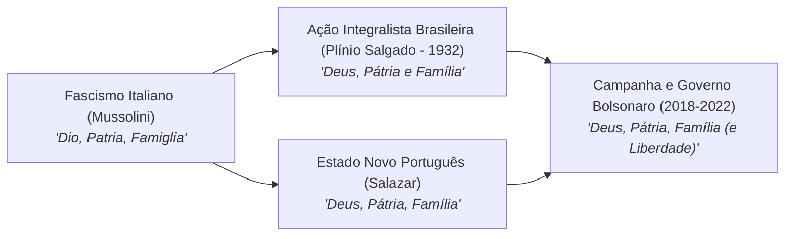

# Jair Messias Bolsonaro: Discursos, Simbologias e Conexões Autoritárias

> **Classificação:** Análise de Discurso, Extrema-Direita e História Política  
> **Período Coberto:** 1998 – 2026  
> **Fontes Primárias Documentadas:** Anais da Câmara dos Deputados, Diário Oficial da União (DOU), Arquivos de Áudio/Vídeo da TV Câmara e TV Bandeirantes, Imprensa Profissional (*Folha de S.Paulo*, *Estadão*, *BBC Brasil*, *O Globo*) e Acórdãos do Superior Tribunal de Justiça.

---

## 1. O Elogio a Torturadores da Ditadura e Ditadores Sul-Americanos

### 1.1. A Homenagem ao Coronel Carlos Alberto Brilhante Ustra (2016)
Em **17 de abril de 2016**, durante a votação pública da admissibilidade do processo de impeachment da presidente Dilma Rousseff no Plenário da Câmara dos Deputados, o então deputado federal Jair Bolsonaro proferiu em transmissão ao vivo de televisão nacional:
> *"Neste dia de glória para o povo brasileiro (...) pela memória do Coronel Carlos Alberto Brilhante Ustra, o pavor de Dilma Rousseff (...) pelo nosso Brasil, o meu voto é sim!"*
* **Contexto Jurídico do Homenageado:** O coronel do Exército Carlos Alberto Brilhante Ustra comandou entre 1970 e 1974 o Destacamento de Operações de Informações - Centro de Operações de Defesa Interna (DOI-CODI) do II Exército em São Paulo, o maior centro de repressão e tortura da ditadura militar brasileira. Em 2008, Ustra foi o **primeiro agente militar formalmente declarado torturador pela Justiça brasileira** em decisão cível do Tribunal de Justiça de São Paulo (TJSP), mantida pelo Superior Tribunal de Justiça (STJ). O relatório final da Comissão Nacional da Verdade (2014) vinculou formalmente o comando de Ustra a 45 mortes e desaparecimentos políticos e centenas de casos documentados de tortura (inclusive de Dilma Rousseff).

### 1.2. Elogios Públicos a Ditadores do Cone Sul
* **Augusto Pinochet (Chile):** Em 1998, em entrevista à rádio *Jovem Pan*, Bolsonaro afirmou que o ditador chileno Augusto Pinochet (responsável por milhares de execuções e torturas registradas nos relatórios Rettig e Valech) *"fez o que tinha que ser feito"* e que *"deveria ter matado mais gente"*. Em setembro de 2019, já como Presidente da República, rebateu críticas da Alta Comissária da ONU para Direitos Humanos e ex-presidente do Chile, Michelle Bachelet, exaltando o golpe militar de 1973 que derrubou Salvador Allende e torturou até a morte o pai de Bachelet: *"Dizendo ainda que o Brasil perde espaço democrático (...) se não fosse o pessoal do Pinochet derrotar a esquerda em 73, entre eles o seu pai, hoje o Chile seria uma Cuba."*
* **Alfredo Stroessner (Paraguai):** Em **26 de fevereiro de 2019**, durante a cerimônia oficial de posse do diretor-geral brasileiro da usina de Itaipu Binacional, Bolsonaro fez elogios públicos ao ditador paraguaio Alfredo Stroessner (que governou o país sob estado de sítio de 1954 a 1989): *"Isso tudo foi graças à coragem de homens de visão, de homens de Estado, que lá atrás, entre eles o general Ernesto Geisel e o general Alfredo Stroessner, souberam conduzir seus países."*

---

## 2. O Lema "Deus, Pátria, Família" e a Conexão com o Integralismo e o Fascismo

Durante sua trajetória política recente e na campanha presidencial de 2022, Jair Bolsonaro adotou como lema central em suas peças de comunicação, eventos cívicos e discursos a tríade:
> **"Deus, Pátria, Família"** (à qual ocasionalmente acrescentava a palavra *"e Liberdade"*).

### As Raízes Históricas do Lema:
1. **A Ação Integralista Brasileira (AIB):** Fundada em 1932 pelo escritor Plínio Salgado, a AIB foi o maior movimento político de extrema-direita de matriz explicitamente inspirada no fascismo europeu da história brasileira. Os membros utilizavam camisas verdes, realizavam marchas paramilitares, adotavam a saudação indígena "Anauê!" e tinham como lema oficial impresso em seus manifestos: *"Deus, Pátria e Família"*;
2. **O Salazarismo em Portugal:** A ditadura corporativista de António de Oliveira Salazar (o Estado Novo português, 1932–1968) utilizou essa mesma tríade como propaganda ideológica do regime para promover a disciplina social católica, o patriotismo antiliberal e a estrutura patriarcal contra os ideais da modernidade democrática.
3. **O Fascismo Italiano:** A fórmula ecoava diretamente o slogan formulado pelo líder fascista Benito Mussolini e seus ministros na Itália: *"Dio, Patria, Famiglia"*.

---

## 3. O Episódio Roberto Alvim e o Discurso Goebbelsiano (Janeiro de 2020)

O caso de maior aproximação estética e textual com o regime nazista no interior do governo federal ocorreu em **16 de janeiro de 2020**, protagonizado pelo então Secretário Especial da Cultura, **Roberto Alvim**, em pronunciamento gravado para lançar o Prêmio Nacional das Artes.

### A Comparação Literal entre os Discursos:
| Trecho de Roberto Alvim (Vídeo Oficial - Jan/2020) | Trecho Original de Joseph Goebbels (Berlim - 1933) |
| :--- | :--- |
| *"A arte brasileira da próxima década será heroica e será nacional. Será dotada de grande capacidade de envolvimento emocional e será igualmente imperativa, posto que profundamente vinculada às aspirações urgentes de nosso povo, ou então não será nada."* | *"A arte alemã da próxima década será heroica, será ferreamente romântica, será objetiva e livre de sentimentalismo, será nacional com grande páthos e igualmente imperativa e vinculada, ou então não será nada."* *(Discurso aos diretores de teatro, extraído da biografia de Goebbels por Peter Longerich).* |

### A Composição Cênica e a Reação:
* **Estética:** Além da cópia quase literal da frase de Goebbels, o vídeo de Alvim utilizou como trilha sonora de fundo a ópera *Lohengrin*, de Richard Wagner (compositor simbolicamente cultuado por Adolf Hitler e pelo regime nazista), cenário com iluminação sombria e uma Cruz de Caravaca sobre a mesa.
* **A Demissão Imediata por Bolsonaro:** O vídeo provocou uma onda nacional e internacional de indignação. O presidente da Câmara dos Deputados (Rodrigo Maia), ministros do STF e a Confederação Israelita do Brasil (CONIB) exigiram a demissão imediata de Alvim. Menos de 24 horas após a veiculação, **Jair Bolsonaro demitiu Roberto Alvim**, publicando nota oficial em que classificou o pronunciamento como *"uma manifestação infeliz, com elementos do nacional-socialismo que tornaram insustentável a permanência do secretário"*.

---

## 4. Declarações Históricas sobre Fechamento do Congresso e Guerra Civil

Ao longo de seus quase 30 anos como deputado federal pelo baixo clero parlamentar, Bolsonaro concedeu diversas declarações de caráter abertamente antidemocrático e de apologia à violência armada:

### 4.1. O Discurso no Plenário da Câmara dos Deputados (Maio de 1999)
Em **20 de maio de 1999**, discursando no Plenário Ulysses Guimarães da Câmara dos Deputados (com registro oficial nos Anais da Casa), Bolsonaro declarou em protesto contra as reformas do governo Fernando Henrique Cardoso:
> *"Através do voto você não vai mudar nada nesse país, nada, absolutamente nada! Só vai mudar, infelizmente, se um dia nós partirmos para uma guerra civil aqui dentro, e fazendo o trabalho que o regime militar não fez: matando uns 30 mil, começando com o FHC! Se vai morrer alguns inocentes, tudo bem, tudo quanto é guerra morre inocente."*

### 4.2. A Entrevista ao Programa *Câmera Aberta* (Band, 1999)
No mesmo ano, em entrevista televisiva concedida ao jornalista Fernando Rodrigues no programa *Câmera Aberta* da TV Bandeirantes, ao ser questionado sobre o que faria se chegasse à Presidência, respondeu:
> *"Não há dúvida, fecharia o Congresso no mesmo dia! Daria golpe no mesmo dia! Não funciona! Tenho certeza de que pelo menos 90% da população faria festa, bateria palmas, porque o Congresso hoje em dia não serve para nada, só vota o que o presidente quer."*

### 4.3. O Ultimato de 7 de Setembro de 2021
Em discurso inflamado para centenas de milhares de manifestantes na Avenida Paulista no feriado da Independência de 2021, Bolsonaro desafiou abertamente a autoridade do Supremo Tribunal Federal, afirmando diante de seus apoiadores:
> *"Dizer a esse ministro [Alexandre de Moraes]: ou você se enquadra ou você pede para sair. Não podemos continuar tolerando medidas e sentenças de quem não tem respaldo popular (...) Dizer a vocês que qualquer decisão do senhor Alexandre de Moraes, este presidente não mais cumprirá!"*
* Dois dias depois, diante da crise política e da ameaça de reações penais do Judiciário, Bolsonaro recuou e publicou a carta pacificatória intitulada *"Declaração à Nação"*, redigida com a mediação do ex-presidente Michel Temer.

---

## 5. Relações com a Extrema-Direita Internacional

Durante seu mandato, Bolsonaro estreitou laços institucionais com partidos e líderes da nova direita radical e populista global:
1. **Encontro com Beatrix von Storch (Julho de 2021):** O presidente recebeu no Palácio do Planalto a deputada federal alemã Beatrix von Storch, vice-líder do partido *Alternative für Deutschland* (AfD, agremiação classificada pelos serviços de inteligência alemães como contendo alas de extremismo de direita). Beatrix é neta de Lutz Graf Schwerin von Krosigk, ministro das Finanças do regime nazista de Adolf Hitler;
2. **Aliança com Viktor Orbán (Hungria):** Relação estreita com o primeiro-ministro húngaro, defensor do modelo de "Democracia Iliberal", que esteve na posse de Bolsonaro em 2019 e a quem o mandatário brasileiro chamou publicamente de *"irmão de valores"*;
3. **Alinhamento com Donald Trump (EUA) e o Partido Vox (Espanha):** Adesão entusiástica à retórica antiglobalista, questionamento preventivo do sistema eleitoral e rejeição aos acordos climáticos da ONU.

---

## 6. Síntese da Ciência Política: A Distância entre Retórica e Prática

Assim como no caso de Lula, a Ciência Política identifica no bolsonarismo uma **distinção entre o radicalismo discursivo e a atuação real no comando do Estado**:

1. **Economia Ultraliberal vs. Corporativismo Fascista:** Os regimes fascistas clássicos da Europa eram abertamente corporativistas, estatizantes, com sindicatos controlados e economia dirigida pelo Partido. O governo Bolsonaro, sob a liderança de Paulo Guedes, adotou uma política econômica diametralmente oposta: cartilha neoliberal ortodoxa da Escola de Chicago, defendendo privatizações (Eletrobras), desregulamentação, corte de impostos e atração de capital privado;
2. **Acomodação Institucional com o Centrão:** Apesar da retórica antissistema, Bolsonaro abandonou a promessa de não negociar com a "velha política" e formalizou uma aliança sólida com o Centrão (Arthur Lira na Câmara e Ciro Nogueira na Casa Civil) para barrar pedidos de impeachment e aprovar reformas;
3. **O Uso Simbólico da Extremidade:** O vocabulário militarizado, o resgate de slogans integralistas e os ataques a ministros do STF funcionaram primordialmente como uma estratégia de **mobilização contínua de sua base eleitoral orgânica mais radicalizada**, preservando a coesão ideológica de massas enquanto o governo operava dentro dos limites das regras do jogo institucional e eleitoral.
