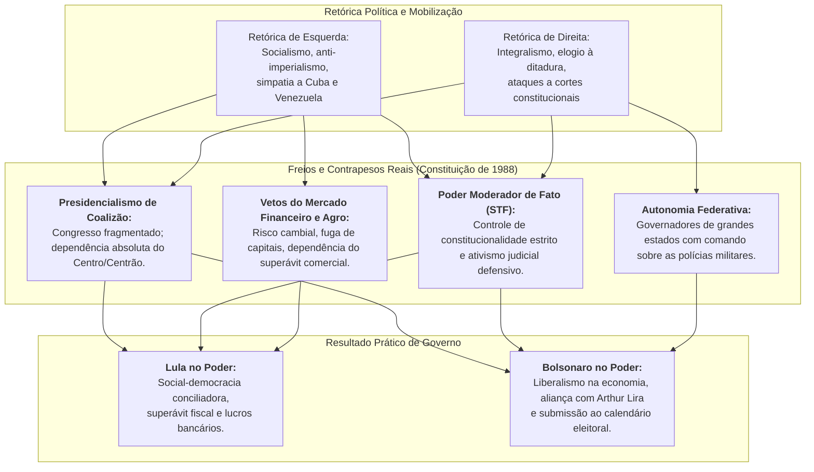
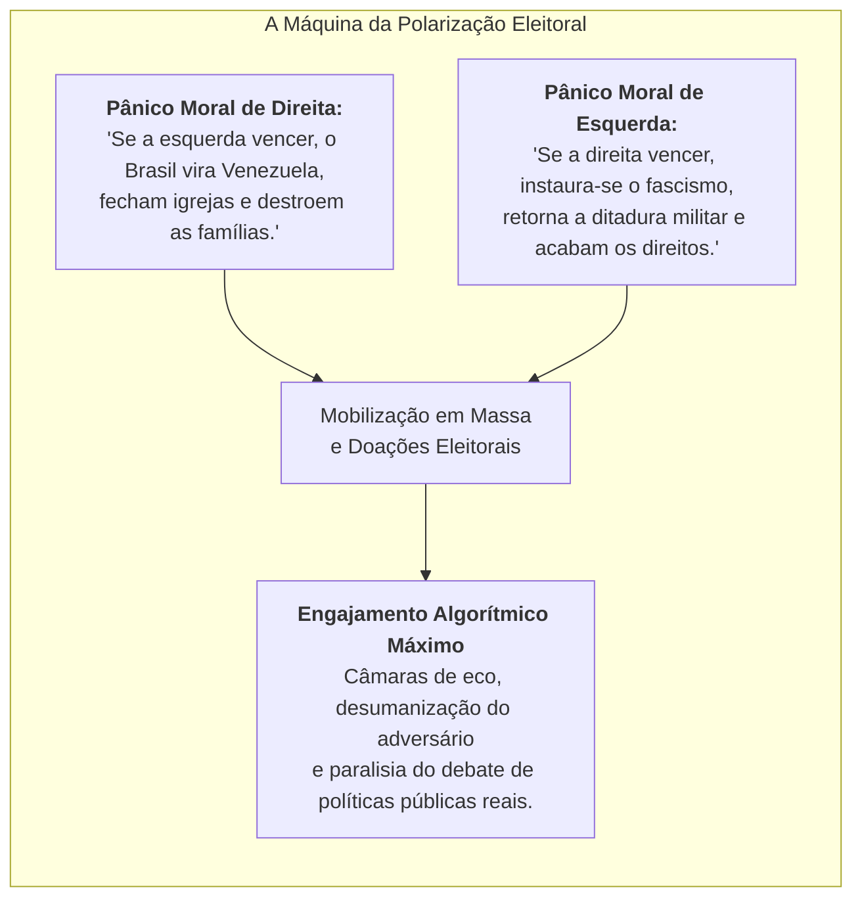

# Ciência Política Comparada: Retórica Radical vs. Realidade Institucional

> **Classificação:** Teoria Política, Sociologia Política e Análise Institucional Comparada  
> **Autores e Marcos Teóricos:** Cas Mudde, Jan-Werner Müller, Ernesto Laclau, Chantal Mouffe, Sérgio Abranches, Steven Levitsky & Daniel Ziblatt.  
> **Objetivo:** Sintetizar como Luiz Inácio Lula da Silva e Jair Bolsonaro instrumentalizam símbolos, discursos e alianças de tradições radicais do século XX (comunismo e fascismo/autoritarismo), contrastando a retórica mobilizadora com a prática de governo real sob as restrições da Constituição de 1988.

---

## 1. Matriz Analítica Comparativa: Retórica vs. Realidade

| Dimensão de Análise | Luiz Inácio Lula da Silva | Jair Messias Bolsonaro |
| :--- | :--- | :--- |
| **Matriz Simbólica Invocada** | Tradição socialista, marxismo sindicalista, solidariedade anti-imperialista, Revolução Cubana, teologia da libertação. | Tradição militar pós-64, integralismo (*"Deus, Pátria, Família"*), anticomunismo da Guerra Fria, conservadorismo cristão. |
| **Construção do "Inimigo"** | *"A elite preconceituosa"*, o sistema financeiro rentista, a imprensa hegemônica, a Faria Lima, o imperialismo dos EUA. | *"O sistema corrupto"*, o comunismo, o STF, a esquerda cultural (*"ideologia de gênero"*), a imprensa tradicional (*"fake news"*). |
| **Prática Econômica no Poder** | **Capitalismo regulado e de coalizão:** Tripé macroeconômico (metas de inflação, câmbio flutuante, superávit/meta fiscal), lucro recorde dos bancos privados, fomento ao agronegócio via Plano Safra recorde, subsídios a grandes corporações (campeãs nacionais via BNDES). | **Neoliberalismo fiscal e desregulamentação:** Teto de gastos, privatizações (Eletrobras), concessões de portos e aeroportos, independência formal do Banco Central (Lei Complementar 179/21), reformas pró-mercado (Previdência, Liberdade Econômica). |
| **Relação com as Instituições** | **Integração negociada ao arranjo tradicional:** Operação contínua dentro do presidencialismo de coalizão, concessão de ministérios e emendas ao Centrão, respeito formal às decisões do STF e ao resultado das eleições. | **Tensionamento retórico e contestação:** Críticas frequentes a ministros do STF e TSE, questionamento público da higidez das urnas eletrônicas, apelos ao Art. 142 da CF/88, participação em atos com faixas pedindo intervenção militar. |
| **Política Externa e Alianças** | **Sul-Sul e Terceiro-Mundismo:** Pragmatismo comercial com a China (maior parceiro), expansão do BRICS+, mas concessão de retórica leniente e suporte diplomático a regimes autoritários de esquerda (Venezuela, Cuba; rompimento posterior com Nicarágua em 2024). | **Populismo transnacional de direita:** Alinhamento preferencial com os Estados Unidos de Donald Trump, Hungria de Viktor Orbán, Israel de Benjamin Netanyahu, e diálogo com partidos de extrema-direita europeia (AfD, Vox, Chega). |
| **Liberdade de Expressão e Mídia** | **Propostas de regulação:** Defesa histórica e recorrente no PT de "controle social da mídia", regulação de monopólios de radiodifusão e projetos de combate à desinformação nas redes sociais. | **Guerra comunicacional direta:** Ataques verbais a jornalistas e conglomerados de mídia, cortes de publicidade oficial de veículos críticos, preferência por canais digitais próprios (*lives* semanais, grupos de mensageria). |
| **Memória Histórica e Direitos Humanos** | **Justiça de Transição:** Criação da Comissão Nacional da Verdade (governo Dilma), abertura de arquivos públicos da ditadura militar, valorização do discurso de direitos humanos. | **Revisionismo e Elogio Autoritário:** Homenagem explícita a agentes da repressão (Carlos Alberto Brilhante Ustra), exaltação do golpe de 1964, veto a homenagens a perseguidos políticos e defesa de imunidade para violência policial. |

---

## 2. Modelos Teóricos da Ciência Política

### 2.1. O Conceito de Populismo segundo Cas Mudde
Para o cientista político Cas Mudde, o populismo é uma **"ideologia de centro tênue" (*thin-centered ideology*)**, caracterizada pela visão de que a sociedade se encontra dividida em dois campos antagônicos e moralmente puros:

$$P_{\text{sociedade}} = \{\text{Povo Puro}\} \times \{\text{Elite Corrupta}\}$$

* **No Lulismo:** O "povo puro" é identificado como a classe trabalhadora, os pobres, os historicamente excluídos do orçamento público; a "elite corrupta" são os banqueiros, os financistas que cobram juros altos e os políticos tradicionais que não aceitam a ascensão social dos mais pobres.
* **No Bolsonarismo:** O "povo puro" são os "cidadãos de bem", os cristãos cumpridores da lei e patriotas; a "elite corrupta" é o *"establishment"* de Brasília, os magistrados do STF, os intelectuais de esquerda e a imprensa que busca supostamente destruir os valores tradicionais da família.

### 2.2. O Populismo de Esquerda (Ernesto Laclau e Chantal Mouffe)
Ernesto Laclau defende que a democracia radical se apoia na criação de uma **"cadeia de equivalências"**: demandas heterogêneas da sociedade (moradia, salário, saúde, combate ao preconceito) encontram no líder carismático (Lula) o significante vazio capaz de unificá-las contra o bloco de poder dominante. No entanto, ao assumir o poder em um país com a estrutura do Brasil, o populismo de esquerda transmuta-se em **governismo conciliador**: a retórica de emancipação e de classe permanece nos discursos aos sindicatos e à militância, mas a política real é regida pela negociação orçamentária com a banca financeira e com o grande capital agrário.

### 2.3. O Populismo de Extrema-Direita (Jan-Werner Müller e Roger Eatwell)
Jan-Werner Müller salienta que os líderes da extrema-direita contemporânea praticam o **exclusivismo moral**: sustentam que apenas eles representam o "verdadeiro povo". O bolsonarismo incorpora elementos clássicos do nacionalismo conservador e do reacionarismo cultural:
1. **Nativismo e Militarismo:** A exaltação dos símbolos pátrios (bandeira, hino, Forças Armadas) como repositórios sagrados da moralidade pública;
2. **Anti-pluralismo:** A sugestão de que os adversários políticos não são oponentes legítimos da arena democrática, mas inimigos que atentam contra a integridade da nação (exemplificado pela frase de Bolsonaro em 2018 prometendo que *"a oposição terá que ir embora da pátria ou ir para a cadeia"*);
3. **Desintermediação Institucional:** A tentativa de falar diretamente às massas via redes digitais, desqualificando os corpos intermediários da democracia liberal (Parlamento, cortes constitucionais, imprensa livre).

---

## 3. O Paradoxo Brasileiro: Por que a Retórica Radical Não Vira Ditadura?

Muitos analistas e cidadãos questionam por que o Brasil não se tornou nem uma "Venezuela socialista" durante os governos petistas, nem uma "ditadura fascista militarizada" sob o governo Bolsonaro. A resposta reside nas **amarras institucionais** e no desenho da ordem constitucional de 1988.

### Os Quatro Vetores de Contenção Institucional:
1. **O Presidencialismo de Coalizão (Sérgio Abranches):** O presidente nunca detém maioria própria no Congresso Nacional. Para não sofrer paralisia decisória ou impeachment, tanto Lula (no Mensalão e na aliança com o Centrão) quanto Bolsonaro (na cessão do controle orçamentário a Arthur Lira e ao PL) precisaram subordinar seus projetos ideológicos à compra de sustentação legislativa.
2. **A Blindagem do Supremo Tribunal Federal (STF):** O STF atuou como verdadeiro muro de contenção institucional. Ao mesmo tempo em que barrou decretos de armas e tentativas de interferência política de Bolsonaro na PF, manteve a higidez do processo eleitoral; e, em relação a governos de esquerda, impôs limites regulatórios a estatizações e submeteu emendas parlamentares a critérios de transparência pública.
3. **A Estrutura de Mercado e o Agronegócio:** O Brasil é dependente de capitais externos para financiar a dívida pública e de compradores internacionais para suas commodities. Nenhuma aventura estatizante comunista resistiria à fuga massiva de capitais e ao colapso do real; e nenhum isolacionismo de extrema-direita resistiria às ameaças de sanções ambientais da União Europeia contra as exportações do agronegócio.
4. **O Federalismo e as Polícias:** O comando operacional das forças de segurança pública armada (Polícias Militares e Civis) pertence aos governadores estaduais, e não ao Presidente da República, o que impediu qualquer tentativa de conversão das forças de segurança em milícias pretorianas federais.

---

## 4. Polarização Afetiva e o Ecossistema das Redes Sociais

A persistência do uso dessas narrativas históricas extremas obedece a uma lógica de **Polarização Afetiva** (Iyengar et al., 2019): o voto não é mais motivado pela aprovação racional do programa do seu candidato, mas pelo **pavor moral** da vitória do adversário.

### O Uso Instrumental dos Rótulos Históricos:
* **"Comunista!":** É utilizado pela direita como um rótulo guarda-chuva para deslegitimar qualquer política pública redistributiva, cobrança de impostos sobre super-ricos, demarcação de terras indígenas ou regulação socioambiental.
* **"Fascista!":** É utilizado pela esquerda como um rótulo desqualificador para interditar qualquer debate sobre responsabilidade fiscal, privatizações, pautas de segurança pública mais punitivas ou valores religiosos tradicionais.

---

## 5. Conclusão da Análise Comparativa

A investigação factual dos fatos, discursos e dados revela uma clivagem nítida entre o **campo simbólico** e o **campo material** da política brasileira:

1. **Na dimensão retórica e simbólica:** Tanto Lula quanto Bolsonaro mantiveram conexões reais, explícitas e documentadas com tradições radicais e autoritárias do século XX. Lula manteve solidariedade pessoal e diplomática histórica a ditaduras comunistas e de esquerda (Cuba, Venezuela e historicamente Nicarágua), enquanto Bolsonaro homenageou torturadores da ditadura militar brasileira, ressuscitou lemas do integralismo fascista e contestou as instituições da democracia liberal.
2. **Na dimensão material e de governo:** O Brasil de Lula permaneceu um país de economia de mercado plenamente integrado ao capitalismo global, onde os bancos privados e o agronegócio bateram recordes históricos de faturamento; e o Brasil de Bolsonaro operou sob a égide do liberalismo econômico convencional e do pragmatismo fisiológico do Centrão, sem romper a legalidade institucional da Constituição de 1988 nem impedir a transmissão de poder a seu sucessor democraticamente eleito.

A compreensão dessa duplicidade é a precondição essencial para uma análise lúcida e isenta da política brasileira contemporânea.

---

## 6. Referências Bibliográficas e Metodológicas

* **ABRANCHES, Sérgio.** *Presidencialismo de coalizão: raízes e evolução do modelo político brasileiro.* São Paulo: Companhia das Letras, 2018.
* **EATWELL, Roger; GOODWIN, Matthew.** *National Populism: The Revolt Against Liberal Democracy.* Pelican Books, 2018.
* **IYENGAR, Shanto et al.** *The Origins and Consequences of Affective Polarization in the United States.* Annual Review of Political Science, 2019.
* **LACLAU, Ernesto.** *A Razão Populista.* São Paulo: Três Estrelas, 2013.
* **LEVITSKY, Steven; ZIBLATT, Daniel.** *Como as Democracias Morrem.* Rio de Janeiro: Zahar, 2018.
* **MUDDE, Cas.** *The Populist Radical Right: A Reader.* Routledge, 2016.
* **MÜLLER, Jan-Werner.** *O que é o Populismo?* São Paulo: Todavia, 2017.
* **NOBRE, Marcos.** *Ponto Final: A guerra de Bolsonaro contra a democracia.* São Paulo: Todavia, 2020.
