# Levantamento Histórico: Atos, Declarações e Posturas Autoritárias de Lula e Aliados

> **Classificação:** Ciência Política, Direito Constitucional, Liberdade de Imprensa e Relações Institucionais  
> **Período Coberto:** 2003 – 2026 (Lula 1, Lula 2 e Lula 3)  
> **Objetivo:** Registrar e detalhar de forma estritamente factual, exaustiva e documentada os principais episódios, medidas executivas, projetos de lei, declarações e manobras institucionais de Luiz Inácio Lula da Silva e de seus aliados políticos que afrontaram a **liberdade de imprensa**, o **equilíbrio entre os Poderes**, a **autonomia das instituições de Estado** e as **garantias fundamentais de direitos humanos**.  
> **Fontes Primárias:** Diário Oficial da União (DOU), Acórdãos do Supremo Tribunal Federal (STF), Anais do Congresso Nacional, Processos Judiciais, Declarações Oficiais da Presidência da República e Arquivos Históricos da Imprensa (*Folha de S.Paulo*, *O Estado de S. Paulo*, *The New York Times*, *G1*).

---

## 1. Mapa Conceitual dos Eixos Autoritários

```mermaid
flowchart TD
    subgraph Eixos ["Dimensões do Autoritarismo Institucional do Lulismo"]
        E1["<b>1. Ataques à Imprensa e Tentativas de Tutela da Mídia:</b><br>• Expulsão do correspondente do NYT (Larry Rohter)<br>• Projeto do Conselho Federal de Jornalismo (CFJ)<br>• 'Controle social da mídia' e PNDD na AGU ('Procuradoria da Verdade')"]
        
        E2["<b>2. Coação e Desqualificação do Poder Judiciário:</b><br>• 'Suprema Corte acovardada' (grampo de 2016)<br>• Desvio de finalidade na nomeação da Casa Civil (barrada no STF)<br>• Indicação do advogado pessoal (Zanin) e do ministro da Justiça (Dino)<br>• Defesa pública de voto secreto dos ministros do STF"]
        
        E3["<b>3. Ataques ao Banco Central e à Autoridade Monetária:</b><br>• Campanha de coação contra o BC independente e Roberto Campos Neto<br>• Tentativa de subordinação política da política de juros"]
        
        E4["<b>4. Cooptação e Hostilidade ao Congresso Nacional:</b><br>• O Mensalão como destruição da independência parlamentar<br>• Incitação a militantes para 'mapear e incomodar a casa de deputados'<br>• Dossiê dos Aloprados (PF - 2006)"]
        
        E5["<b>5. Violação de Direitos Humanos e Apoio a Ditaduras:</b><br>• Deportação forçada dos boxeadores cubanos no Pan de 2007<br>• Dissidentes cubanos tratados como 'bandidos em greve de fome'<br>• Relativização da fraude eleitoral de Nicolás Maduro na Venezuela (2024)"]
        
        E6["<b>6. Crise com Israel, Holocausto e a Relação com o Hamas:</b><br>• Comparação de Gaza ao extermínio de Hitler em Adis Abeba (2024)<br>• Lula declarado 'persona non grata' e recall do embaixador<br>• Recusa partidária do PT em rotular o Hamas como organização terrorista<br>• José Genoino defendendo publicamente boicote a 'empresas de judeus'"]
        
        E7["<b>7. Perseguições Políticas, Dossiês e Quebras Ilegais de Sigilo:</b><br>• Caso Francenildo Costa: quebra de sigilo bancário pela CEF e Fazenda (2006)<br>• Dossiê da Casa Civil contra FHC e Ruth Cardoso (2008)<br>• Violação de sigilo fiscal na Receita Federal de familiares de José Serra (2010)<br>• Declarações de vingança contra Moro e desqualificação da Op. Sequaz da PF (2023)"]
    end
```

---

## 2. Eixo I: Ataques à Liberdade de Imprensa e Tentativas de Controle da Mídia

---

### Caso 1.1: A Ordem de Expulsão de Larry Rohter, Correspondente do *The New York Times* (Maio de 2004)
* **O Fato:** Em 9 de maio de 2004, o respeitado jornalista norte-americano Larry Rohter, chefe do escritório do *The New York Times* no Brasil, publicou a reportagem intitulada *"Brazilian Leader's Drinking Raises Concerns"* ("O hábito de beber do líder brasileiro levanta preocupações"), abordando relatos de bastidores sobre o consumo de bebidas alcoólicas pelo presidente Lula e seus eventuais reflexos na rotina de governo;
* **A Ação Autoritária do Governo:** Em **11 de maio de 2004**, por ordem direta do presidente Lula executada pelo ministro da Justiça Márcio Thomaz Bastos, o governo federal **cancelou o visto temporário de correspondente estrangeiro de Larry Rohter e determinou sua expulsão sumária do território nacional**;
* **A Repercussão e a Gravidade Histórica:**
  * Tratou-se do **primeiro ato formal de expulsão de um jornalista estrangeiro por motivo de reportagem crítica desde o fim da Ditadura Militar (1985)**;
  * A medida provocou indignação internacional generalizada (Comitê para a Proteção dos Jornalistas - CPJ, Repórteres Sem Fronteiras, Associação Brasileira de Imprensa - ABI, Ordem dos Advogados do Brasil - OAB e ministros do STF);
* **O Recuo:** Diante da crise diplomática e do risco iminente de concessão de *Habeas Corpus* preventivo pelo STF, o governo recuou após os advogados de Rohter enviarem uma carta protocolar afirmando que o jornalista *"não tivera a intenção de ofender a honra do presidente"*. Em 14 de maio, o Ministério da Justiça revogou a ordem de expulsão e restabeleceu o visto.

---

### Caso 1.2: O Projeto do Conselho Federal de Jornalismo - CFJ (Agosto de 2004)
* **O Projeto de Lei nº 3.985/2004:** Apenas três meses após a crise com o *NYT*, o governo Lula enviou ao Congresso Nacional o projeto de lei para criar o **Conselho Federal de Jornalismo (CFJ)** e os Conselhos Regionais de Jornalismo:
  * **O Poder de Tutela Estatal:** O projeto atribuía ao órgão o poder legal de *"orientar, disciplinar e fiscalizar o exercício da profissão de jornalista e da atividade de jornalismo"*, com competência expressa para **instaurar processos disciplinares, aplicar multas e cassar o registro profissional de repórteres e editores**;
* **A Reação Democrática:** A Associação Nacional de Jornais (ANJ), a Abert e a Federação Nacional dos Jornalistas (setores independentes) denunciaram o projeto como uma tentativa de reeditar o Departamento de Imprensa e Propaganda (DIP) de Getúlio Vargas ou modelos corporativistas de controle ideológico. Sob forte comoção nacional, o projeto foi amplamente rechaçado e **rejeitado na Câmara dos Deputados em dezembro de 2004**, forçando o governo a retirá-lo de pauta.

---

### Caso 1.3: As Resoluções de "Controle Social da Mídia" (2010 – 2022)
Ao longo de seus mandatos e nos períodos em que esteve na oposição, o PT e Lula aprovaram teses partidárias sistemáticas defendendo a intervenção estatal sobre os meios de comunicação:
* **Cadernos de Teses do 5º Congresso do PT (2014):** Defesa expressa da *"democratização e regulação dos meios de comunicação"*, com a proposta de criação de conselhos civis/governamentais para fiscalizar o conteúdo jornalístico de emissoras de rádio e TV e aplicar sanções a veículos acusados de "parcialidade";
* **Discursos Públicos de Desqualificação:** Em dezenas de comícios e transmissões oficiais, Lula atacou publicamente a imprensa profissional:
  * *"A imprensa mente todo santo dia"* (2010);
  * *"A imprensa brasileira parece um partido político de oposição que não tem coragem de assumir que é partido"* (2016);
  * Defesa constante da revisão das regras de concessão pública para emissoras críticas ao partido.

---

### Caso 1.4: A "Procuradoria da Defesa da Democracia" no Lula 3 (Decreto nº 11.328/2023)
* Em **1º de janeiro de 2023**, no ato de reestruturação dos ministérios, o governo Lula publicou o Decreto nº 11.328/2023 criando, no âmbito da Advocacia-Geral da União (AGU), a **Procuradoria Nacional da União de Defesa da Democracia (PNDD)**:
  * **A Atribuição Polêmica:** O texto original conferiu ao órgão poder para representar judicial e extrajudicialmente o governo em resposta a *"desinformação sobre políticas públicas federais"*;
  * **Crítica de Juristas:** OAB e entidades de imprensa apontaram que o órgão funcionava como uma *"Procuradoria da Verdade"*, pois caberia ao próprio governo de turno definir monocraticamente o que é "verdade" ou "desinformação", abrindo precedente para censura e perseguição judicial (*lawfare*) contra jornalistas e críticos que questionassem estatísticas ou dados do governo.

---

## 3. Eixo II: Ataques e Tensionamentos com o Poder Judiciário

---

### Caso 2.1: A Gravação sobre a "Suprema Corte Acovardada" (Março de 2016)
Em 16 de março de 2016, no âmbito da 24ª fase da Operação Lava Jato, a 13ª Vara Federal de Curitiba levantou o sigilo de interceptações telefônicas judicialmente autorizadas de Luiz Inácio Lula da Silva. Em diálogo gravado com o ministro da Casa Civil Jacques Wagner e com a presidente Dilma Rousseff, Lula atacou virulentamente as mais altas cortes do país:

> **Lula (áudio interceptado):** *"Nós temos uma Suprema Corte totalmente acovardada, um Superior Tribunal de Justiça totalmente acovardado, um presidente da Câmara fodido, um presidente do Senado fodido, não sei quantos parlamentares ameaçados, e fica todo mundo no compasso de que vai acontecer um milagre e vai todo mundo se salvar."*

* **Ataques a Magistrados Específicos:** Durante o julgamento do Mensalão (AP 470), parlamentares e dirigentes do PT promoveram intensa campanha de intimidação contra o ministro relator **Joaquim Barbosa**, acusando-o de ser "traidor da raça" e "capacho da elite branca conservadora".

---

### Caso 2.2: A Nomeação para a Casa Civil e a Suspensão por Desvio de Finalidade (2016)
* **O Fato:** Em 16 de março de 2016, a presidente Dilma Rousseff assinou a nomeação de Lula para o cargo de Ministro-Chefe da Casa Civil, horas após a Polícia Federal ter cumprido mandado de condução coercitiva contra ele;
* **O Diálogo "Bessias":** Minutos antes da publicação de edição extraordinária do Diário Oficial, Dilma telefonou a Lula avisando que estava enviando o termo de posse assinado para ser usado *"só em caso de necessidade"*;
* **A Decisão do STF:** Em **18 de março de 2016**, o ministro Gilmar Mendes, no julgamento do **Mandado de Segurança nº 34.070**, concedeu medida liminar suspendendo a posse de Lula por configurar **desvio de finalidade do ato administrativo**:
  * *Fundamento Jurídico:* O ministro do STF concluiu que a nomeação teve como objetivo manifesto burlar o juiz natural da 1ª instância de Curitiba (Sergio Moro) para transferir a prerrogativa de foro criminal do ex-presidente para o STF, caracterizando uma tentativa de obstrução da Justiça e blindagem penal pelo uso da máquina do Estado.

---

### Caso 2.3: Indicações ao STF que Afrontaram a Impessoalidade Republicana (2023)
Durante seu terceiro mandato presidencial, Lula realizou duas indicações para o Supremo Tribunal Federal que romperam parâmetros históricos de neutralidade institucional:
1. **Cristiano Zanin (Junho de 2023):** Lula indicou para a vaga de Ricardo Lewandowski o seu **advogado pessoal de defesa**, que o havia defendido com exclusividade em todos os processos da Lava Jato. A indicação foi duramente criticada por juristas e pela transparência pública por fragilizar o princípio da impessoalidade (Art. 37 da CF/88), colocando na mais alta corte judicial do país o patrono privado dos interesses pessoais do mandatário;
2. **Flávio Dino (Novembro de 2023):** Indicou seu **Ministro da Justiça em exercício**, senador eleito pelo PSB e figura de linha de frente do combate político partidário, ampliando a partidarização direta da corte constitucional.

---

### Caso 2.4: A Defesa Pública de Voto Secreto dos Ministros do STF (Setembro de 2023)
Em 5 de setembro de 2023, durante a transmissão semanal do programa *"Conversa com o Presidente"*, Lula defendeu publicamente o fim da publicidade e a instituição do **sigilo nos votos dos ministros do STF**:

> **Lula:** *"A sociedade não tem que saber como vota um ministro da Suprema Corte. Acho que o cara tem que votar e ninguém precisa saber. Vota a maioria: cinco a quatro, seis a três... e não precisa ninguém saber quem votou a favor ou contra. Porque aí cada um fica seguro, a família fica segura..."*

* **Reação Institucional:** A proposta foi imediatamente rebatida por ministros do STF, por juristas e pelo presidente da OAB nacional, Beto Simonetti, que ressaltaram que a proposta atenta contra o **Artigo 93, inciso IX, da Constituição Federal**, que estabelece a publicidade dos julgamentos e a motivação das decisões judiciais como garantias republicanas indispensáveis contra o arbítrio e a ditadura.

---

## 4. Eixo III: Coação e Ataques ao Banco Central e à Autoridade Monetária

---

### A Campanha Pública contra a Autonomia do BC e Roberto Campos Neto (2023 – 2024)
Com a aprovação da [Lei Complementar nº 179/2021](https://www.planalto.gov.br/ccivil_03/leis/lcp/lcp179.htm), o Banco Central do Brasil passou a deter autonomia legal formal, com mandatos fixos de 4 anos para presidente e diretores, não coincidentes com o mandato do Presidente da República.

Ao longo de 2023 e 2024, inconformado com a manutenção da taxa Selic em patamar restritivo pelo Copom para conter as expectativas inflacionárias, Lula empreendeu uma **campanha sistemática de desqualificação pública da autoridade monetária**:
* **Desqualificação Pessoal:** Chamou reiteradamente o presidente do BC de *"esse cidadão"*, acusando-o de *"trabalhar para prejudicar o Brasil"*, de *"ser um adversário político do governo"* e de conspirar com forças de oposição;
* **Ameaça à Lei de Autonomia:** Declarou em entrevistas que poderia enviar ao Congresso projeto para revogar a autonomia do Banco Central e recolocar a autarquia sob a subordinação direta do Ministério da Fazenda;
* **Quebra de Liturgia Institucional:** A pressão política contínua e as tentativas de emparedamento público dos diretores técnicos do Copom geraram volatilidade cambial, alta do dólar e aumento do prêmio de risco da dívida pública brasileira nos mercados internacionais.

---

## 5. Eixo IV: Hostilidade ao Parlamento e Uso do Aparelho Policial

---

### Caso 4.1: Incitação para "Mapear e Incomodar a Casa de Deputados" (Abril de 2022)
Em **4 de abril de 2022**, durante discurso na sede da Central Única dos Trabalhadores (CUT) em São Paulo, o então pré-candidato Lula conclamou sindicalistas e militantes a realizarem atos de pressão e assédio nas residências particulares dos parlamentares e de seus familiares:

> **Lula:** *"Se a gente, ao invés de tentar ir para Brasília fazer ato (...) a gente mapeasse o endereço de cada deputado e fosse 50 pessoas na casa do deputado... Não é para xingar, não. É para conversar com ele, conversar com a mulher dele, conversar com o filho dele, incomodar a tranquilidade dele. Eu acho que surte muito mais efeito do que a gente vir fazer manifestação em Brasília."*

* **Repercussão Institucional:** A declaração foi repudiada oficialmente pelo Congresso Nacional. O presidente da Câmara dos Deputados, Arthur Lira, emitiu nota oficial classificando a fala como um **grave incentivo à violência política, ao assédio e à intimidação doméstica** contra deputados e suas famílias, violando a integridade do Poder Legislativo.

---

### Caso 4.2: O Mensalão como Instrumento Autoritário de Compra do Parlamento (2005)
A condenação de 25 réus na **Ação Penal 470 pelo STF** comprovou que o núcleo dirigente do primeiro governo Lula (liderado por José Dirceu, José Genoino e Delúbio Soares) operou a distribuição regular de propinas em dinheiro vivo a deputados federais de partidos da base aliada (PP, PL, PTB e PMDB).
* **O Efeito Institucional Autoritário:** Ao comprar a lealdade de bancadas legislativas com dinheiro público desviado (Visanet/Correios), o governo **anulou o papel fiscalizador e contramajoritário do Poder Legislativo**, transformando o Parlamento em mero órgão homologador dos interesses do Executivo e corrompendo a soberania do voto popular.

---

### Caso 4.3: O Escândalo do "Dossiê dos Aloprados" (Setembro de 2006)
* Em **15 de setembro de 2006**, a duas semanas da eleição presidencial, a Polícia Federal prendeu em flagrante em um hotel em São Paulo membros da cúpula da campanha de reeleição de Lula e do PT (Jorge Lorenzetti, Gedimar Passos e Valdebran Padilha);
* **O Flagrante:** Os operadores portavam **R$ 1,75 milhão em dinheiro vivo** (R$ 1,16 milhão e US$ 248 mil) para comprar um dossiê forjado e fotos com acusações falsas que pretendiam vincular os candidatos de oposição José Serra e Geraldo Alckmin ao escândalo das sanguessugas (máfia das ambulâncias);
* **A Reação de Lula:** Em declaração pública, Lula tentou desvincular seu gabinete da operação criminosa, classificando os próprios assessores e coordenadores de campanha como *"um bando de aloprados"*.

---

## 6. Eixo V: Violações de Direitos Humanos e Apoio a Ditaduras Estrangeiras

---

### Caso 5.1: A Deportação Forçada dos Boxeadores Cubanos (Julho de 2007)
Durante os Jogos Pan-Americanos de 2007, no Rio de Janeiro, os pugilistas cubanos bicampeões olímpicos e mundiais **Guillermo Rigondeaux e Erislandy Lara** abandonaram a delegação oficial de Cuba com a intenção de solicitar asilo político e atuar no boxe profissional internacional.
* **A Ação do Governo Federal:** Localizados pela Polícia Federal em Niterói (RJ), os atletas foram submetidos a um processo sumário de expulsão conduzido pelo Ministério da Justiça (sob comando do ministro Tarso Genro);
* **A Ilegalidade das Garantias:**
  * Os atletas foram embarcados de forma relâmpago em um **jatinho fretado pelo governo de Cuba** de volta a Havana durante a madrugada;
  * **Não lhes foi franqueado acesso a advogados de defesa**, não houve audiência formal e o governo federal **não encaminhou os pedidos ao Comitê Nacional para os Refugiados (Conare)**, ignorando a Convenção das Nações Unidas sobre o Estatuto dos Refugiados de 1951;
* **A Condenação Internacional:** A Anistia Internacional e entidades de direitos humanos classificaram a deportação como uma entrega criminosa de dissidentes políticos a um regime ditatorial. Tempos depois, os boxeadores conseguiram fugir definitivamente de Cuba pelo mar e relataram terem sofrido perseguição, isolamento e banimento esportivo imediato ao retornarem à ilha.

---

### Caso 5.2: A Desumanização de Presos Políticos Cubanos (Março de 2010)
Em 23 de fevereiro de 2010, o prisioneiro político cubano **Orlando Zapata Tamayo** morreu após 86 dias em greve de fome em uma penitenciária de Cuba, protestando contra as torturas e as condições desumanas do regime castrista.

Questionado por jornalistas internacionais da *Associated Press* durante visita oficial a Havana poucas semanas após a tragédia, Lula chocou organizações globais de direitos humanos ao comparar o mártir dissidente a assaltantes e assassinos comuns:

> **Lula (2010):** *"A greve de fome não pode ser usada como pretexto de direitos humanos para libertar pessoas. Imagine se todos os bandidos que estão presos em São Paulo entrassem em greve de fome e pedissem libertação."*

---

### Caso 5.3: Conivência com a Fraude Eleitoral de Nicolás Maduro (2024)
Em **28 de julho de 2024**, o regime chavista de Nicolás Maduro proclamou vitória na eleição presidencial da Venezuela por meio do Conselho Nacional Eleitoral (CNE), sem jamais publicar as atas eleitorais oficiais desagregadas por mesa de votação, contrariando exigências internacionais e relatórios da ONU e do Centro Carter que atestaram a vitória incontestável da oposição liderada por Edmundo González e María Corina Machado.
* **A Postura de Lula:** O governo brasileiro, orientado pelo assessor especial Celso Amorim e pelo presidente Lula:
  * Recusou-se por sucessivos meses a reconhecer o resultado apurado pela oposição;
  * Recusou-se a declarar que a Venezuela vive sob uma ditadura formal;
  * Lula declarou em entrevista pública que o processo venezuelano era apenas *"um processo desagradável"* e que cabia à oposição e ao governo *"resolverem suas divergências"*, relativizando prisões em massa de opositores, mortes em protestos e mandados de prisão contra opositores democraticamente sufragados.

---

## 7. Eixo VI: A Crise Diplomática com Israel, Declarações sobre o Holocausto e a Relação com o Hamas

---

### Caso 6.1: A Declaração de Adis Abeba e a Comparação de Gaza ao Holocausto Nazista (Fevereiro de 2024)
Em **18 de fevereiro de 2024**, durante entrevista coletiva concedida em Adis Abeba (Etiópia) por ocasião da 37ª Cúpula da União Africana, o presidente Lula desencadeou a mais grave crise diplomática da história das relações bilaterais entre o Brasil e o Estado de Israel ao equiparar as ações militares israelenses em Gaza ao extermínio de judeus perpetrado por Adolf Hitler:

> **Lula (Adis Abeba, 18/02/2024):**  
> *"O que está acontecendo na Faixa de Gaza com o povo palestino não existiu em nenhum outro momento histórico. Aliás, existiu quando Hitler resolveu matar os judeus."*

* **A Reação do Governo de Israel:**
  * O primeiro-ministro Benjamin Netanyahu classificou a fala como uma *"banalização inaceitável do Holocausto"* e uma *"linha vermelha cruzada"*;
  * Em **19 de fevereiro de 2024**, o chanceler israelense Israel Katz convocou o embaixador brasileiro em Tel Aviv, Frederico Meyer, para o **Memorial do Holocausto (Yad Vashem)** em Jerusalém, realizando uma reprimenda diplomática pública e declarando formalmente o presidente Lula como ***persona non grata*** no Estado de Israel até que houvesse uma retratação oficial (a qual não ocorreu);
* **A Retaliação Diplomática Brasileira:**
  * Em resposta à humilhação pública no Yad Vashem, o governo brasileiro convocou o embaixador de Israel em Brasília para explicações e determinou o **recall definitivo do embaixador Frederico Meyer**, retirando a chefia máxima da representação diplomática brasileira em Tel Aviv e rebaixando as relações ao nível de encarregado de negócios;
* **Repercussão na Sociedade Civil e Comunidade Judaica:**
  * A Confederação Israelita do Brasil (CONIB), a Federação Israelita do Estado de São Paulo (Fisesp) e a organização StandWithUs Brasil emitiram notas duras de repúdio, apontando que a comparação falseia a história, banaliza o genocídio de 6 milhões de judeus na Segunda Guerra Mundial e estimula o antissemitismo contra a comunidade judaica brasileira;
  * O governo dos Estados Unidos (por meio do secretário de Estado Antony Blinken) e governos europeus manifestaram desacordo explícito com as declarações de Lula.

---

### Caso 6.2: A Postura Partidária do PT e a Recusa Histórica de Classificar o Hamas como Grupo Terrorista
Em **7 de outubro de 2023**, a organização terrorista Hamas perpetrou o maior ataque contra civis judeus desde o Holocausto, assassinando mais de 1.200 pessoas, praticando estupros sistemáticos e sequestrando mais de 250 reféns civis na fronteira com a Faixa de Gaza — entre as vítimas fatais, estavam os jovens cidadãos brasileiros Ranani Nidejelski Glazer, Bruna Valeanu e Karla Stelzer Mendes:
* **A Nota Inicial do PT (Outubro de 2023):**
  * Em sua primeira nota oficial publicada horas após o massacre de 7 de outubro, a bancada e a direção nacional do PT omitiram a palavra "Hamas" e **recusaram-se expressamente a utilizar o termo "terrorismo"** para qualificar os ataques a civis e festivais de música;
  * Em **16 de outubro de 2023**, a resolução oficial do Diretório Nacional do PT citou o Hamas, mas dedicou a maior parte de sua formulação a acusar o Estado de Israel de praticar *"genocídio"* e *"crimes de guerra"*, promovendo uma equiparação moral criticada por analistas internacionais;
* **O Manifesto Partidário de 2021 ("Resistência não é Terrorismo"):**
  * Em dezembro de 2021, parlamentares e dirigentes do PT (junto a deputados do PSOL e do PCdoB) subscreveram manifesto público de solidariedade ao Hamas e de protesto contra a decisão do governo do Reino Unido de banir integralmente o Hamas e incluí-lo na lista britânica de organizações terroristas, sustentando que a organização representava *"um movimento legítimo de resistência palestina"*;
* **A Contradição Diplomática de Estado:**
  * No plano diplomático oficial, o Itamaraty tradicionalmente restringe a classificação de "grupos terroristas" àqueles estritamente chancelados pelas resoluções do Conselho de Segurança da ONU (onde o Hamas não consta devido ao poder de veto de Rússia e China). Contudo, a recusa política e as declarações de lideranças do PT geraram atritos recorrentes com a comunidade judaica e com parlamentos ocidentais.

---

### Caso 6.3: A Declaração de José Genoino Pregando Boicote a "Empresas de Judeus" (Janeiro de 2024)
Em **20 de janeiro de 2024**, durante transmissão ao vivo no programa de debates do canal *DCM TV*, o ex-presidente nacional do PT e ex-deputado federal **José Genoino** defendeu a imposição de retaliações econômicas direcionadas contra cidadãos e empresas de origem judaica:

> **José Genoino (20/01/2024):**  
> *"Acho que o Brasil deveria cortar relações comerciais (...) acho, inclusive, que o Brasil deveria não comprar nada de empresas de judeus, deveria haver um boicote dessas empresas no Brasil."*

* **A Reação Judicial e Repúdio:**
  * A fala gerou imediato repúdio de entidades civis e juristas, apontando identidade direta com os métodos de perseguição econômica do regime nazista nos anos 1930 na Alemanha (*"Kauf nicht bei Juden"* / "Não compre dos judeus");
  * A Confederação Israelita do Brasil (CONIB) ingressou com notícia-crime e representação judicial por crime de racismo e antissemitismo tipificado na Lei nº 7.716/1989;
  * O Tribunal de Justiça de São Paulo (TJ-SP) acolheu ações determinando a exclusão de trechos do vídeo das plataformas digitais por incitação a discriminação religiosa e étnica.

---

## 8. Eixo VII: Perseguições Políticas, Dossiês de Estado e Violações Ilegais de Sigilo

---

### Caso 7.1: O Caso Francenildo Costa e a Devassa Bancária do Caseiro (Março de 2006)
Em março de 2006, durante os trabalhos da **CPI dos Bingos**, o caseiro **Francenildo dos Santos Costa** prestou depoimento bombástico afirmando ter visto com frequência o então ministro da Fazenda, **Antonio Palocci**, frequentando uma mansão no Lago Sul, em Brasília (conhecida como a *"República de Ribeirão Preto"*), alugada por lobistas para partilhar comissões e negociar negócios públicos:
* **O Uso Clandestino da Máquina Pública:**
  * Para desacreditar e desqualificar o testemunho do caseiro, a cúpula do Ministério da Fazenda e a presidência da **Caixa Econômica Federal (CEF)** ordenaram a invasão clandestina e a quebra ilegal do sigilo bancário da conta poupança de Francenildo;
  * O extrato bancário de Francenildo — que registrava um depósito de R$ 25 mil feito por seu pai biológico em acordo de paternidade — foi extraído ilicitamente dos servidores da CEF e vazado para a revista *Época*, tentando sugerir falsamente que o caseiro havia sido subornado por partidos de oposição para mentir na CPI;
* **As Consequências Institucionais e Penais:**
  * O escândalo revelou o uso do aparelho bancário do Estado como instrumento de espionagem e perseguição contra um cidadão de baixa renda;
  * A revelação forçou a **demissão de Antonio Palocci do Ministério da Fazenda** e do presidente da Caixa, Jorge Mattoso;
  * O STF instaurou o **Inquérito nº 2.245** e a **Ação Penal nº 528** contra os envolvidos;
  * No âmbito cível, o **Superior Tribunal de Justiça (STJ)** condenou a Caixa Econômica Federal a pagar uma indenização histórica de **R$ 400 mil a Francenildo Costa** por danos morais e materiais causados pela ação predatória do Estado.

---

### Caso 7.2: O Dossiê da Casa Civil contra Fernando Henrique Cardoso e Ruth Cardoso (2008)
Durante os trabalhos da **CPI dos Cartões Corporativos**, em 2008 — instaurada pelo Congresso para investigar despesas exorbitantes e saques em dinheiro vivo com cartões de crédito do governo federal por ministros do governo Lula (como Matilde Ribeiro e Orlando Silva) —, foi vazado para a imprensa um dossiê sigiloso contendo planilhas detalhadas sobre gastos de viagem e hospedagem do ex-presidente **Fernando Henrique Cardoso** e de sua falecida esposa, a ex-primeira-dama **dona Ruth Cardoso**:
* **A Investigação Policial:**
  * A apuração da Polícia Federal comprovou que o banco de dados e as planilhas do dossiê haviam sido confeccionados e alimentados clandestinamente dentro da própria **Casa Civil da Presidência da República**, chefiada pela então ministra Dilma Rousseff e sua secretária-executiva Erenice Guerra;
* **O Propósito Autoritário:**
  * O dossiê foi elaborado como instrumento de chantagem e intimidação política para emparedar parlamentares da oposição (PSDB e DEM) e constrangê-los a recuar das investigações contra o gabinete de Lula na CPI;
  * O episódio deflagrou crise institucional, foi apelidado de *"terrorismo de Estado contra a oposição"* e forçou o governo a abrir sindicâncias internas que confirmaram a extração indevida de dados sigilosos no Palácio do Planalto.

---

### Caso 7.3: A Espionagem e Violação de Sigilo Fiscal na Receita Federal (2010)
Nas eleições presidenciais de 2010, veio a público um esquema de violação reiterada e clandestina de sigilos fiscais operado dentro da **Receita Federal do Brasil**:
* **Os Alvos:**
  * Auditores e servidores fazendários lotados nas agências da Receita em Mauá e Santo André (SP) acessaram sem autorização judicial os dados confidenciais do Imposto de Renda de **Verônica Serra** (filha do candidato presidencial oposicionista José Serra), do vice-presidente nacional do PSDB **Eduardo Jorge Caldas Pereira**, e de diversos dirigentes oposicionistas;
* **A Conexão Política:**
  * As investigações da Corregedoria-Geral da Receita Federal e da Polícia Federal comprovaram que procurações falsas foram utilizadas para legitimar os acessos e que os dados fiscais violados foram repassados a operadores ligados ao comitê de campanha eleitoral do PT;
  * Servidores envolvidos foram demitidos a bem do serviço público e indiciados judicialmente por violação do segredo funcional e quebra ilícita de sigilo (Art. 325 do Código Penal e Lei Complementar nº 105/2001).

---

### Caso 7.4: Declarações Públicas de Vingança contra Adversários e Desqualificação da Operação Sequaz da PF (Março de 2023)
Em março de 2023, uma sequência de episódios expôs a tensão entre a liturgia do cargo de Presidente da República e a utilização do discurso oficial para deslegitimar investigações criminais de segurança pública por razões de vingança pessoal:
* **A Declaração de Vingança contra Sergio Moro (21/03/2023):**
  * Em entrevista concedida ao portal *Brasil 247*, Lula relatou sentimentos nutridos durante os 580 dias em que esteve encarcerado na Superintendência da Polícia Federal em Curitiba:
  > **Lula (21/03/2023):** *"De vez em quando entrava três padres (...) e eles falavam: 'E aí, tudo bem?'. Eu falava: não tá tudo bem, só vai estar bem quando eu foder esse Moro. Vocês só me perdoem a expressão (...) Eu falava: 'Eu tô aqui para me vingar dessa gente'."*
* **A Operação Sequaz da Polícia Federal (22/03/2023):**
  * No dia imediatamente seguinte, **22 de março de 2023**, a Polícia Federal deflagrou a **Operação Sequaz**, com mandados de prisão expedidos pela 9ª Vara Federal de Curitiba contra integrantes do **Primeiro Comando da Capital (PCC)** que monitoravam e planejavam o sequestro e o assassinato de autoridades públicas — em especial o promotor Lincoln Gakiya e o próprio senador Sergio Moro e sua família, tendo alugado chácaras e instalado câmeras de vigilância;
* **O Ataque à PF e a Desqualificação Institucional (23/03/2023):**
  * Em **23 de março de 2023**, durante agenda oficial no Rio de Janeiro, Lula chocou autoridades policiais, membros do Ministério Público e magistrados ao desqualificar a operação executada pela sua própria Polícia Federal, acusando a investigação de ser uma encenação fabricada:
  > **Lula (23/03/2023):** *"Eu não vou falar porque eu acho que é mais uma armação do Moro, mas eu quero ser cauteloso. Eu vou descobrir o que aconteceu (...) Mas que era visível que era uma armação do Moro, isso era."*
  * **Reação Institucional:** A Associação Nacional dos Delegados de Polícia Federal (ADPF), a Associação dos Juízes Federais (Ajufe) e o Conselho Nacional de Procuradores-Gerais (CNPG) manifestaram público desconforto e repúdio contra a politização e o descrédito lançado pelo chefe do Executivo sobre uma investigação de alta periculosidade da PF chancelada pelo Poder Judiciário.

---

## 9. Quadro Síntese: As Posturas Autoritárias e os Desfechos Oficiais

| Episódio / Ação | Instituição Afetada | Natureza do Ato | Desfecho / Reação das Instituições |
| :--- | :--- | :--- | :--- |
| **Expulsão de Larry Rohter (2004)** | Liberdade de Imprensa / *New York Times* | Cassação arbitrária de visto de correspondente estrangeiro por matéria crítica. | Recuo do Planalto e revogação da expulsão após ameaça de liminar do STF e crise global. |
| **Conselho Federal de Jornalismo (2004)** | Imprensa e Jornalistas | Projeto de lei para fiscalizar e cassar registro profissional de repórteres. | Rejeitado pela Câmara dos Deputados após forte resistência da sociedade civil. |
| **Caso Francenildo Costa (2006)** | Cidadania / Sigilo Bancário | Quebra clandestina de sigilo de caseiro testemunha para desqualificá-lo na CPI. | Demissão de Palocci e do presidente da Caixa; STJ condena a CEF a pagar R$ 400 mil ao caseiro. |
| **Dossiê dos Aloprados (2006)** | Processo Eleitoral / PF | R$ 1,75 milhão em dinheiro vivo para compra de dossiê forjado contra opositores. | Flagrante da PF em SP; cúpula petista investigada; Lula os rotulou de "aloprados". |
| **Deportação dos Boxeadores (2007)** | Direitos Humanos / Refugiados | Devolução forçada e sumária de dissidentes cubanos à ditadura castrista. | Condenação internacional por violação do Estatuto dos Refugiados da ONU de 1951. |
| **Dossiê Casa Civil contra FHC (2008)** | Oposição / Casa Civil | Confecção clandestina de dados sigilosos contra FHC e Ruth Cardoso na CPI. | Inquérito da PF apura origem na Casa Civil; crise política e demissão de assessores. |
| **Violação na Receita Federal (2010)** | Sigilo Fiscal / Oposição | Quebra criminosa de sigilo de filha de Serra e dirigentes oposicionistas. | Demissão de auditores, inquérito policial e condenações judiciais por vazamento de dados. |
| **Gravação "Suprema Corte Acovardada" (2016)** | Poder Judiciário / STF | Ataque verbal e tentativa de coação das cortes superiores em diálogos privados. | Divulgado em decisão judicial da Lava Jato; gerou repúdio de ministros do STF. |
| **Posse na Casa Civil (2016)** | Competência Jurisdicional | Manobra de nomeação para transferir foro criminal de Curitiba para o STF. | **Anulada pelo STF (Min. Gilmar Mendes)** por desvio de finalidade manifesta. |
| **"Mapear a Casa de Deputados" (2022)** | Poder Legislativo / Congresso | Incitação de militantes para assediar deputados e suas famílias em suas casas. | Repúdio formal da Câmara dos Deputados (Arthur Lira) por incitação à violência política. |
| **Indicação de Zanin e Dino (2023)** | Impessoalidade do STF | Nomeação do advogado de defesa pessoal e do ministro da Justiça para o STF. | Aprovados pelo Senado Federal, gerando críticas históricas sobre partidarização da corte. |
| **Vingança e Op. Sequaz da PF (2023)** | Polícia Federal / Magistratura | Fala de vingança ("foder o Moro") e desqualificação da Op. Sequaz como "armação". | Repúdio da ADPF, Ajufe e Ministério Público pela partidarização da ação policial. |
| **Defesa de Voto Secreto no STF (2023)** | Transparência e Publicidade | Defesa de que a sociedade não conheça o voto individual dos ministros da Suprema Corte. | Rechaçada pela OAB e juristas como agressão frontal ao Art. 93, IX da CF/88. |
| **Coação ao Banco Central (2023–24)** | Autoridade Monetária Independente | Ataques diários a Roberto Campos Neto para forçar queda de juros no grito. | Manutenção da autonomia legal do BC pela LC 179/21, com aumento do prêmio de risco país. |
| **Crise Adis Abeba / Holocausto (2024)** | Relações Exteriores / Diplomacia | Comparação formal das ações militares em Gaza ao Holocausto de Adolf Hitler. | Lula declarado ***persona non grata*** por Israel; recall do embaixador brasileiro em Tel Aviv. |
| **Discurso Anti-Judeus de Genoino (2024)** | Liberdade Étnico-Religiosa / CONIB | Pregação de boicote comercial direcionado contra "empresas de judeus". | Notícia-crime por racismo/antissemitismo pela CONIB e decisões judiciais de remoção de vídeo. |

---

## 10. Catálogo de Fontes Oficiais Primárias

* *Ministério da Justiça:* Portaria nº 875/2004 (Cancelamento de Visto Temporário de Larry Rohter) e Portaria nº 902/2004 (Revogação).
* *Câmara dos Deputados:* [Projeto de Lei nº 3.985/2004](https://www.camara.leg.br/proposicoesWeb/fichadetramitacao?idProposicao=261882) (Criação do Conselho Federal de Jornalismo - CFJ).
* *Supremo Tribunal Federal:* [Mandado de Segurança nº 34.070/DF](https://portal.stf.jus.br/processos/detalhe.asp?incidente=4947932) (Decisão liminar do Min. Gilmar Mendes anulando a nomeação de Lula para a Casa Civil em 2016).
* *Superior Tribunal de Justiça:* [REsp nº 1.400.730/DF](https://processo.stj.jus.br/) (Condenação definitiva da Caixa Econômica Federal pelo vazamento de sigilo bancário de Francenildo dos Santos Costa).
* *Supremo Tribunal Federal:* [Ação Penal nº 528 / Inquérito nº 2.245](https://portal.stf.jus.br/) (Ação penal sobre a quebra e vazamento ilegal de dados bancários na Caixa Econômica Federal).
* *Presidência da República:* [Decreto nº 11.328, de 1º de janeiro de 2023](https://www.planalto.gov.br/ccivil_03/_ato2023-2026/2023/decreto/d11328.htm) (Criação da Procuradoria Nacional da União de Defesa da Democracia na AGU).
* *Polícia Federal / 9ª Vara Federal de Curitiba:* Autos da **Operação Sequaz** (Março de 2023 - Planos de sequestro e atentado do PCC contra o senador Sergio Moro e promotor Lincoln Gakiya).
* *Polícia Federal / Justiça Federal de Curitiba:* Autos da Operação Lava Jato - Áudios interceptados com autorização judicial entre Lula, Dilma e Jacques Wagner (Março/2016).
* *Ministério das Relações Exteriores de Israel / Yad Vashem:* Comunicado Diplomático oficial declarando o Presidente do Brasil *persona non grata* (19 de fevereiro de 2024).
* *Anistia Internacional:* Relatório Anual sobre a Deportação Sumária de Desportistas Cubanos pelo Governo Brasileiro (2007).
* *Presidência da República:* Transcrição Oficial da Entrevista Coletiva em Adis Abeba (18 de fevereiro de 2024) e do Programa "Conversa com o Presidente" (5 de setembro de 2023 - Voto Secreto no STF).

