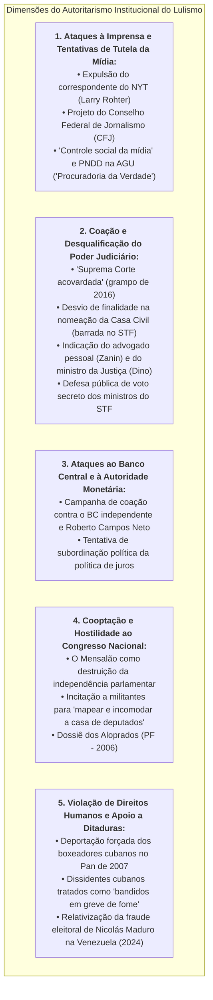

# Levantamento Histórico: Atos, Declarações e Posturas Autoritárias de Lula e Aliados

> **Classificação:** Ciência Política, Direito Constitucional, Liberdade de Imprensa e Relações Institucionais  
> **Período Coberto:** 2003 – 2026 (Lula 1, Lula 2 e Lula 3)  
> **Objetivo:** Registrar e detalhar de forma estritamente factual, exaustiva e documentada os principais episódios, medidas executivas, projetos de lei, declarações e manobras institucionais de Luiz Inácio Lula da Silva e de seus aliados políticos que afrontaram a **liberdade de imprensa**, o **equilíbrio entre os Poderes**, a **autonomia das instituições de Estado** e as **garantias fundamentais de direitos humanos**.  
> **Fontes Primárias:** Diário Oficial da União (DOU), Acórdãos do Supremo Tribunal Federal (STF), Anais do Congresso Nacional, Processos Judiciais, Declarações Oficiais da Presidência da República e Arquivos Históricos da Imprensa (*Folha de S.Paulo*, *O Estado de S. Paulo*, *The New York Times*, *G1*).

---

## 1. Mapa Conceitual dos Eixos Autoritários

---

## 2. Eixo I: Ataques à Liberdade de Imprensa e Tentativas de Controle da Mídia

---

### Caso 1.1: A Ordem de Expulsão de Larry Rohter, Correspondente do *The New York Times* (Maio de 2004)
* **O Fato:** Em 9 de maio de 2004, o respeitado jornalista norte-americano Larry Rohter, chefe do escritório do *The New York Times* no Brasil, publicou a reportagem intitulada *"Brazilian Leader's Drinking Raises Concerns"* ("O hábito de beber do líder brasileiro levanta preocupações"), abordando relatos de bastidores sobre o consumo de bebidas alcoólicas pelo presidente Lula e seus eventuais reflexos na rotina de governo;
* **A Ação Autoritária do Governo:** Em **11 de maio de 2004**, por ordem direta do presidente Lula executada pelo ministro da Justiça Márcio Thomaz Bastos, o governo federal **cancelou o visto temporário de correspondente estrangeiro de Larry Rohter e determinou sua expulsão sumária do território nacional**;
* **A Repercussão e a Gravidade Histórica:**
  * Tratou-se do **primeiro ato formal de expulsão de um jornalista estrangeiro por motivo de reportagem crítica desde o fim da Ditadura Militar (1985)**;
  * A medida provocou indignação internacional generalizada (Comitê para a Proteção dos Jornalistas - CPJ, Repórteres Sem Fronteiras, Associação Brasileira de Imprensa - ABI, Ordem dos Advogados do Brasil - OAB e ministros do STF);
* **O Recuo:** Diante da crise diplomática e do risco iminente de concessão de *Habeas Corpus* preventivo pelo STF, o governo recuou após os advogados de Rohter enviarem uma carta protocolar afirmando que o jornalista *"não tivera a intenção de ofender a honra do presidente"*. Em 14 de maio, o Ministério da Justiça revogou a ordem de expulsão e restabeleceu o visto.

---

### Caso 1.2: O Projeto do Conselho Federal de Jornalismo - CFJ (Agosto de 2004)
* **O Projeto de Lei nº 3.985/2004:** Apenas três meses após a crise com o *NYT*, o governo Lula enviou ao Congresso Nacional o projeto de lei para criar o **Conselho Federal de Jornalismo (CFJ)** e os Conselhos Regionais de Jornalismo:
  * **O Poder de Tutela Estatal:** O projeto atribuía ao órgão o poder legal de *"orientar, disciplinar e fiscalizar o exercício da profissão de jornalista e da atividade de jornalismo"*, com competência expressa para **instaurar processos disciplinares, aplicar multas e cassar o registro profissional de repórteres e editores**;
* **A Reação Democrática:** A Associação Nacional de Jornais (ANJ), a Abert e a Federação Nacional dos Jornalistas (setores independentes) denunciaram o projeto como uma tentativa de reeditar o Departamento de Imprensa e Propaganda (DIP) de Getúlio Vargas ou modelos corporativistas de controle ideológico. Sob forte comoção nacional, o projeto foi amplamente rechaçado e **rejeitado na Câmara dos Deputados em dezembro de 2004**, forçando o governo a retirá-lo de pauta.

---

### Caso 1.3: As Resoluções de "Controle Social da Mídia" (2010 – 2022)
Ao longo de seus mandatos e nos períodos em que esteve na oposição, o PT e Lula aprovaram teses partidárias sistemáticas defendendo a intervenção estatal sobre os meios de comunicação:
* **Cadernos de Teses do 5º Congresso do PT (2014):** Defesa expressa da *"democratização e regulação dos meios de comunicação"*, com a proposta de criação de conselhos civis/governamentais para fiscalizar o conteúdo jornalístico de emissoras de rádio e TV e aplicar sanções a veículos acusados de "parcialidade";
* **Discursos Públicos de Desqualificação:** Em dezenas de comícios e transmissões oficiais, Lula atacou publicamente a imprensa profissional:
  * *"A imprensa mente todo santo dia"* (2010);
  * *"A imprensa brasileira parece um partido político de oposição que não tem coragem de assumir que é partido"* (2016);
  * Defesa constante da revisão das regras de concessão pública para emissoras críticas ao partido.

---

### Caso 1.4: A "Procuradoria da Defesa da Democracia" no Lula 3 (Decreto nº 11.328/2023)
* Em **1º de janeiro de 2023**, no ato de reestruturação dos ministérios, o governo Lula publicou o Decreto nº 11.328/2023 criando, no âmbito da Advocacia-Geral da União (AGU), a **Procuradoria Nacional da União de Defesa da Democracia (PNDD)**:
  * **A Atribuição Polêmica:** O texto original conferiu ao órgão poder para representar judicial e extrajudicialmente o governo em resposta a *"desinformação sobre políticas públicas federais"*;
  * **Crítica de Juristas:** OAB e entidades de imprensa apontaram que o órgão funcionava como uma *"Procuradoria da Verdade"*, pois caberia ao próprio governo de turno definir monocraticamente o que é "verdade" ou "desinformação", abrindo precedente para censura e perseguição judicial (*lawfare*) contra jornalistas e críticos que questionassem estatísticas ou dados do governo.

---

## 3. Eixo II: Ataques e Tensionamentos com o Poder Judiciário

---

### Caso 2.1: A Gravação sobre a "Suprema Corte Acovardada" (Março de 2016)
Em 16 de março de 2016, no âmbito da 24ª fase da Operação Lava Jato, a 13ª Vara Federal de Curitiba levantou o sigilo de interceptações telefônicas judicialmente autorizadas de Luiz Inácio Lula da Silva. Em diálogo gravado com o ministro da Casa Civil Jacques Wagner e com a presidente Dilma Rousseff, Lula atacou virulentamente as mais altas cortes do país:

> **Lula (áudio interceptado):** *"Nós temos uma Suprema Corte totalmente acovardada, um Superior Tribunal de Justiça totalmente acovardado, um presidente da Câmara fodido, um presidente do Senado fodido, não sei quantos parlamentares ameaçados, e fica todo mundo no compasso de que vai acontecer um milagre e vai todo mundo se salvar."*

* **Ataques a Magistrados Específicos:** Durante o julgamento do Mensalão (AP 470), parlamentares e dirigentes do PT promoveram intensa campanha de intimidação contra o ministro relator **Joaquim Barbosa**, acusando-o de ser "traidor da raça" e "capacho da elite branca conservadora".

---

### Caso 2.2: A Nomeação para a Casa Civil e a Suspensão por Desvio de Finalidade (2016)
* **O Fato:** Em 16 de março de 2016, a presidente Dilma Rousseff assinou a nomeação de Lula para o cargo de Ministro-Chefe da Casa Civil, horas após a Polícia Federal ter cumprido mandado de condução coercitiva contra ele;
* **O Diálogo "Bessias":** Minutos antes da publicação de edição extraordinária do Diário Oficial, Dilma telefonou a Lula avisando que estava enviando o termo de posse assinado para ser usado *"só em caso de necessidade"*;
* **A Decisão do STF:** Em **18 de março de 2016**, o ministro Gilmar Mendes, no julgamento do **Mandado de Segurança nº 34.070**, concedeu medida liminar suspendendo a posse de Lula por configurar **desvio de finalidade do ato administrativo**:
  * *Fundamento Jurídico:* O ministro do STF concluiu que a nomeação teve como objetivo manifesto burlar o juiz natural da 1ª instância de Curitiba (Sergio Moro) para transferir a prerrogativa de foro criminal do ex-presidente para o STF, caracterizando uma tentativa de obstrução da Justiça e blindagem penal pelo uso da máquina do Estado.

---

### Caso 2.3: Indicações ao STF que Afrontaram a Impessoalidade Republicana (2023)
Durante seu terceiro mandato presidencial, Lula realizou duas indicações para o Supremo Tribunal Federal que romperam parâmetros históricos de neutralidade institucional:
1. **Cristiano Zanin (Junho de 2023):** Lula indicou para a vaga de Ricardo Lewandowski o seu **advogado pessoal de defesa**, que o havia defendido com exclusividade em todos os processos da Lava Jato. A indicação foi duramente criticada por juristas e pela transparência pública por fragilizar o princípio da impessoalidade (Art. 37 da CF/88), colocando na mais alta corte judicial do país o patrono privado dos interesses pessoais do mandatário;
2. **Flávio Dino (Novembro de 2023):** Indicou seu **Ministro da Justiça em exercício**, senador eleito pelo PSB e figura de linha de frente do combate político partidário, ampliando a partidarização direta da corte constitucional.

---

### Caso 2.4: A Defesa Pública de Voto Secreto dos Ministros do STF (Setembro de 2023)
Em 5 de setembro de 2023, durante a transmissão semanal do programa *"Conversa com o Presidente"*, Lula defendeu publicamente o fim da publicidade e a instituição do **sigilo nos votos dos ministros do STF**:

> **Lula:** *"A sociedade não tem que saber como vota um ministro da Suprema Corte. Acho que o cara tem que votar e ninguém precisa saber. Vota a maioria: cinco a quatro, seis a três... e não precisa ninguém saber quem votou a favor ou contra. Porque aí cada um fica seguro, a família fica segura..."*

* **Reação Institucional:** A proposta foi imediatamente rebatida por ministros do STF, por juristas e pelo presidente da OAB nacional, Beto Simonetti, que ressaltaram que a proposta atenta contra o **Artigo 93, inciso IX, da Constituição Federal**, que estabelece a publicidade dos julgamentos e a motivação das decisões judiciais como garantias republicanas indispensáveis contra o arbítrio e a ditadura.

---

## 4. Eixo III: Coação e Ataques ao Banco Central e à Autoridade Monetária

---

### A Campanha Pública contra a Autonomia do BC e Roberto Campos Neto (2023 – 2024)
Com a aprovação da [Lei Complementar nº 179/2021](https://www.planalto.gov.br/ccivil_03/leis/lcp/lcp179.htm), o Banco Central do Brasil passou a deter autonomia legal formal, com mandatos fixos de 4 anos para presidente e diretores, não coincidentes com o mandato do Presidente da República.

Ao longo de 2023 e 2024, inconformado com a manutenção da taxa Selic em patamar restritivo pelo Copom para conter as expectativas inflacionárias, Lula empreendeu uma **campanha sistemática de desqualificação pública da autoridade monetária**:
* **Desqualificação Pessoal:** Chamou reiteradamente o presidente do BC de *"esse cidadão"*, acusando-o de *"trabalhar para prejudicar o Brasil"*, de *"ser um adversário político do governo"* e de conspirar com forças de oposição;
* **Ameaça à Lei de Autonomia:** Declarou em entrevistas que poderia enviar ao Congresso projeto para revogar a autonomia do Banco Central e recolocar a autarquia sob a subordinação direta do Ministério da Fazenda;
* **Quebra de Liturgia Institucional:** A pressão política contínua e as tentativas de emparedamento público dos diretores técnicos do Copom geraram volatilidade cambial, alta do dólar e aumento do prêmio de risco da dívida pública brasileira nos mercados internacionais.

---

## 5. Eixo IV: Hostilidade ao Parlamento e Uso do Aparelho Policial

---

### Caso 4.1: Incitação para "Mapear e Incomodar a Casa de Deputados" (Abril de 2022)
Em **4 de abril de 2022**, durante discurso na sede da Central Única dos Trabalhadores (CUT) em São Paulo, o então pré-candidato Lula conclamou sindicalistas e militantes a realizarem atos de pressão e assédio nas residências particulares dos parlamentares e de seus familiares:

> **Lula:** *"Se a gente, ao invés de tentar ir para Brasília fazer ato (...) a gente mapeasse o endereço de cada deputado e fosse 50 pessoas na casa do deputado... Não é para xingar, não. É para conversar com ele, conversar com a mulher dele, conversar com o filho dele, incomodar a tranquilidade dele. Eu acho que surte muito mais efeito do que a gente vir fazer manifestação em Brasília."*

* **Repercussão Institucional:** A declaração foi repudiada oficialmente pelo Congresso Nacional. O presidente da Câmara dos Deputados, Arthur Lira, emitiu nota oficial classificando a fala como um **grave incentivo à violência política, ao assédio e à intimidação doméstica** contra deputados e suas famílias, violando a integridade do Poder Legislativo.

---

### Caso 4.2: O Mensalão como Instrumento Autoritário de Compra do Parlamento (2005)
A condenação de 25 réus na **Ação Penal 470 pelo STF** comprovou que o núcleo dirigente do primeiro governo Lula (liderado por José Dirceu, José Genoino e Delúbio Soares) operou a distribuição regular de propinas em dinheiro vivo a deputados federais de partidos da base aliada (PP, PL, PTB e PMDB).
* **O Efeito Institucional Autoritário:** Ao comprar a lealdade de bancadas legislativas com dinheiro público desviado (Visanet/Correios), o governo **anulou o papel fiscalizador e contramajoritário do Poder Legislativo**, transformando o Parlamento em mero órgão homologador dos interesses do Executivo e corrompendo a soberania do voto popular.

---

### Caso 4.3: O Escândalo do "Dossiê dos Aloprados" (Setembro de 2006)
* Em **15 de setembro de 2006**, a duas semanas da eleição presidencial, a Polícia Federal prendeu em flagrante em um hotel em São Paulo membros da cúpula da campanha de reeleição de Lula e do PT (Jorge Lorenzetti, Gedimar Passos e Valdebran Padilha);
* **O Flagrante:** Os operadores portavam **R$ 1,75 milhão em dinheiro vivo** (R$ 1,16 milhão e US$ 248 mil) para comprar um dossiê forjado e fotos com acusações falsas que pretendiam vincular os candidatos de oposição José Serra e Geraldo Alckmin ao escândalo das sanguessugas (máfia das ambulâncias);
* **A Reação de Lula:** Em declaração pública, Lula tentou desvincular seu gabinete da operação criminosa, classificando os próprios assessores e coordenadores de campanha como *"um bando de aloprados"*.

---

## 6. Eixo V: Violações de Direitos Humanos e Apoio a Ditaduras Estrangeiras

---

### Caso 5.1: A Deportação Forçada dos Boxeadores Cubanos (Julho de 2007)
Durante os Jogos Pan-Americanos de 2007, no Rio de Janeiro, os pugilistas cubanos bicampeões olímpicos e mundiais **Guillermo Rigondeaux e Erislandy Lara** abandonaram a delegação oficial de Cuba com a intenção de solicitar asilo político e atuar no boxe profissional internacional.
* **A Ação do Governo Federal:** Localizados pela Polícia Federal em Niterói (RJ), os atletas foram submetidos a um processo sumário de expulsão conduzido pelo Ministério da Justiça (sob comando do ministro Tarso Genro);
* **A Ilegalidade das Garantias:**
  * Os atletas foram embarcados de forma relâmpago em um **jatinho fretado pelo governo de Cuba** de volta a Havana durante a madrugada;
  * **Não lhes foi franqueado acesso a advogados de defesa**, não houve audiência formal e o governo federal **não encaminhou os pedidos ao Comitê Nacional para os Refugiados (Conare)**, ignorando a Convenção das Nações Unidas sobre o Estatuto dos Refugiados de 1951;
* **A Condenação Internacional:** A Anistia Internacional e entidades de direitos humanos classificaram a deportação como uma entrega criminosa de dissidentes políticos a um regime ditatorial. Tempos depois, os boxeadores conseguiram fugir definitivamente de Cuba pelo mar e relataram terem sofrido perseguição, isolamento e banimento esportivo imediato ao retornarem à ilha.

---

### Caso 5.2: A Desumanização de Presos Políticos Cubanos (Março de 2010)
Em 23 de fevereiro de 2010, o prisioneiro político cubano **Orlando Zapata Tamayo** morreu após 86 dias em greve de fome em uma penitenciária de Cuba, protestando contra as torturas e as condições desumanas do regime castrista.

Questionado por jornalistas internacionais da *Associated Press* durante visita oficial a Havana poucas semanas após a tragédia, Lula chocou organizações globais de direitos humanos ao comparar o mártir dissidente a assaltantes e assassinos comuns:

> **Lula (2010):** *"A greve de fome não pode ser usada como pretexto de direitos humanos para libertar pessoas. Imagine se todos os bandidos que estão presos em São Paulo entrassem em greve de fome e pedissem libertação."*

---

### Caso 5.3: Conivência com a Fraude Eleitoral de Nicolás Maduro (2024)
Em **28 de julho de 2024**, o regime chavista de Nicolás Maduro proclamou vitória na eleição presidencial da Venezuela por meio do Conselho Nacional Eleitoral (CNE), sem jamais publicar as atas eleitorais oficiais desagregadas por mesa de votação, contrariando exigências internacionais e relatórios da ONU e do Centro Carter que atestaram a vitória incontestável da oposição liderada por Edmundo González e María Corina Machado.
* **A Postura de Lula:** O governo brasileiro, orientado pelo assessor especial Celso Amorim e pelo presidente Lula:
  * Recusou-se por sucessivos meses a reconhecer o resultado apurado pela oposição;
  * Recusou-se a declarar que a Venezuela vive sob uma ditadura formal;
  * Lula declarou em entrevista pública que o processo venezuelano era apenas *"um processo desagradável"* e que cabia à oposição e ao governo *"resolverem suas divergências"*, relativizando prisões em massa de opositores, mortes em protestos e mandados de prisão contra opositores democraticamente sufragados.

---

## 7. Quadro Síntese: As Posturas Autoritárias e os Desfechos Oficiais

| Episódio / Ação | Instituição Afetada | Natureza do Ato | Desfecho / Reação das Instituições |
| :--- | :--- | :--- | :--- |
| **Expulsão de Larry Rohter (2004)** | Liberdade de Imprensa / *New York Times* | Cassação arbitrária de visto de correspondente estrangeiro por matéria crítica. | Recuo do Planalto e revogação da expulsão após ameaça de liminar do STF e crise global. |
| **Conselho Federal de Jornalismo (2004)** | Imprensa e Jornalistas | Projeto de lei para fiscalizar e cassar registro profissional de repórteres. | Rejeitado pela Câmara dos Deputados após forte resistência da sociedade civil. |
| **Deportação dos Boxeadores (2007)** | Direitos Humanos / Refugiados | Devolução forçada e sumária de dissidentes cubanos à ditadura castrista. | Condenação internacional por violação do Estatuto dos Refugiados da ONU de 1951. |
| **Gravação "Suprema Corte Acovardada" (2016)** | Poder Judiciário / STF | Ataque verbal e tentativa de coação das cortes superiores em diálogos privados. | Divulgado em decisão judicial da Lava Jato; gerou repúdio de ministros do STF. |
| **Posse na Casa Civil (2016)** | Competência Jurisdicional | Manobra de nomeação para transferir foro criminal de Curitiba para o STF. | **Anulada pelo STF (Min. Gilmar Mendes)** por desvio de finalidade manifesta. |
| **"Mapear a Casa de Deputados" (2022)** | Poder Legislativo / Congresso | Incitação de militantes para assediar deputados e suas famílias em suas casas. | Repúdio formal da Câmara dos Deputados (Arthur Lira) por incitação à violência política. |
| **Indicação de Zanin e Dino (2023)** | Impessoalidade do STF | Nomeação do advogado de defesa pessoal e do ministro da Justiça para o STF. | Aprovados pelo Senado Federal, gerando críticas históricas sobre partidarização da corte. |
| **Defesa de Voto Secreto no STF (2023)** | Transparência e Publicidade | Defesa de que a sociedade não conheça o voto individual dos ministros da Suprema Corte. | Rechaçada pela OAB e juristas como agressão frontal ao Art. 93, IX da CF/88. |
| **Coação ao Banco Central (2023–24)** | Autoridade Monetária Independente | Ataques diários a Roberto Campos Neto para forçar queda de juros no grito. | Manutenção da autonomia legal do BC pela LC 179/21, com aumento do prêmio de risco país. |

---

## 8. Catálogo de Fontes Oficiais Primárias

* *Ministério da Justiça:* Portaria nº 875/2004 (Cancelamento de Visto Temporário de Larry Rohter) e Portaria nº 902/2004 (Revogação).
* *Câmara dos Deputados:* [Projeto de Lei nº 3.985/2004](https://www.camara.leg.br/proposicoesWeb/fichadetramitacao?idProposicao=261882) (Criação do Conselho Federal de Jornalismo - CFJ).
* *Supremo Tribunal Federal:* [Mandado de Segurança nº 34.070/DF](https://portal.stf.jus.br/processos/detalhe.asp?incidente=4947932) (Decisão liminar do Min. Gilmar Mendes anulando a nomeação de Lula para a Casa Civil em 2016).
* *Presidência da República:* [Decreto nº 11.328, de 1º de janeiro de 2023](https://www.planalto.gov.br/ccivil_03/_ato2023-2026/2023/decreto/d11328.htm) (Criação da Procuradoria Nacional da União de Defesa da Democracia na AGU).
* *Polícia Federal / Justiça Federal de Curitiba:* Autos da Operação Lava Jato - Áudios interceptados com autorização judicial entre Lula, Dilma e Jacques Wagner (Março/2016).
* *Anistia Internacional:* Relatório Anual sobre a Deportação Sumária de Desportistas Cubanos pelo Governo Brasileiro (2007).
* *Presidência da República:* Transcrição Oficial do Programa "Conversa com o Presidente" (5 de setembro de 2023 - Voto Secreto no STF).
