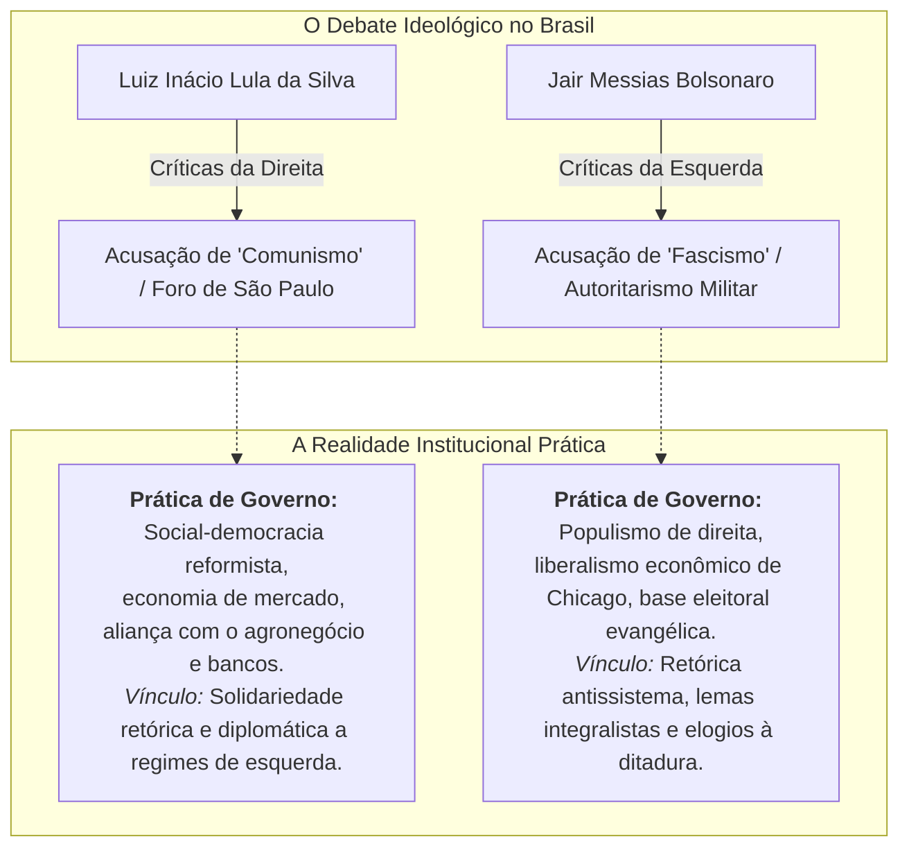

# Ideologia, Discursos e Conexões Históricas: Lula e Bolsonaro

> **Repositório de Análise de Discurso Político e Ciência Política Comparada**  
> **Objetivo:** Registrar e analisar de forma rigorosa, factual e contextualizada as declarações, propostas, alianças diplomáticas e construções retóricas de **Luiz Inácio Lula da Silva** e de **Jair Messias Bolsonaro** que dialogam, elogiam ou apresentam paralelos com regimes, governantes e figuras do **comunismo histórico** e do **fascismo / autoritarismo do século XX**.  
> **Compromisso Anti-Desinformação:** Nenhuma citação descontextualizada ou atribuída sem fonte documental primária verificável (anais do Congresso Nacional, imprensa profissional, gravações oficiais, livros e periódicos de época).

---

## 1. Critérios Metodológicos e Definições da Ciência Política

Para evitar distorções anacrônicas e rotulações simplistas, este repositório adota os critérios formais da Ciência Política e da Teoria dos Regimes:

### Definições Conceituais Rigorosas:

1. **Comunismo Histórico (Marxismo-Leninismo / Totalitarismo de Esquerda):**
   * *Conceito:* Sistema político e socioeconômico caracterizado pela abolição da propriedade privada dos meios de produção, economia estatal centralmente planificada, partido único (vanguarda do proletariado), supressão das liberdades burguesas e tutela ideológica estatal (exemplos: União Soviética, China Maoísta, Cuba de Fidel Castro).
2. **Fascismo Histórico (Totalitarismo / Nacionalismo Autoritário de Direita):**
   * *Conceito:* Ideologia ultranacionalista, antiliberal, antimarxista e corporativista surgida na Europa entre-guerras. Caracterizada pelo culto ao líder infalível (*Duce*, *Führer*), exaltação da violência como instrumento político, militarismo estético, slogan de subordinação do indivíduo ao Estado (*"Tudo no Estado, nada contra o Estado, nada fora do Estado"*), anticomunismo virulento e perseguição a minorias ou opositores (exemplos: Fascismo Italiano de Mussolini, Nazismo Alemão de Hitler, Integralismo de Plínio Salgado no Brasil).

---

## 2. Mapa dos Documentos da Pasta

1. **[`01_lula_discursos_e_conexoes_comunistas.md`](file:///Users/rodrigofregonasse/Code/brasil-project/ideologia_e_discursos/01_lula_discursos_e_conexoes_comunistas.md)**
   * A fundação do **Foro de São Paulo** (1990) com Fidel Castro.
   * As declarações sobre **Fidel Castro e Cuba** (amizade pessoal, homenagens póstumas e tratamento a dissidentes).
   * A relação com a **Venezuela de Hugo Chávez e Nicolás Maduro** ("excesso de democracia" e a tese da "narrativa construída").
   * O vínculo com a **Nicarágua de Daniel Ortega** (da Revolução Sandinista ao rompimento diplomático em 2024).
   * A controversa entrevista à revista ***Playboy* de julho de 1979** (a polêmica menção a Hitler, Mao e Khomeini com explicação contextual).
   * Propostas históricas sobre "Controle Social da Mídia" e socialismo democrático.
   * *Contraponto de Realidade:* O pragmatismo de mercado do lulismo no poder (alianças com grandes bancos, agronegócio e partidos de centro).

2. **[`02_bolsonaro_discursos_e_conexoes_fascistas_autoritarias.md`](file:///Users/rodrigofregonasse/Code/brasil-project/ideologia_e_discursos/02_bolsonaro_discursos_e_conexoes_fascistas_autoritarias.md)**
   * Elogios a **ditadores e torturadores**: a homenagem ao coronel Carlos Alberto Brilhante Ustra na votação do impeachment de Dilma Rousseff; elogios a Augusto Pinochet (Chile) e Alfredo Stroessner (Paraguai).
   * O lema oficial **"Deus, Pátria, Família"**: Paralelos históricos diretos com o **Integralismo de Plínio Salgado (AIB)** e o **Salazarismo** português.
   * O episódio **Roberto Alvim (Secretaria Especial da Cultura, 2020)**: pronunciamento oficial com citações literais, música e estética do ministro da propaganda nazista Joseph Goebbels (e a demissão imediata pelo presidente).
   * Declarações no Parlamento sobre guerra civil, golpe de Estado e fechamento do Congresso Nacional (1999) e ataques ao STF.
   * Reunião com lideranças da extrema-direita europeia (encontro com Beatrix von Storch, deputada da AfD).
   * *Contraponto de Realidade:* A política econômica ultraliberal pró-mercado (Escola de Chicago / Paulo Guedes), aliança parlamentar com o Centrão e a preservação das eleições periódicas.

3. **[`03_analise_comparativa_ciencia_politica.md`](file:///Users/rodrigofregonasse/Code/brasil-project/ideologia_e_discursos/03_analise_comparativa_ciencia_politica.md)**
   * Tabela comparativa confrontando a retórica dos dois líderes com os manuais ideológicos do século XX.
   * A função política do uso de símbolos radicais na era da **polarização afetiva** e das redes sociais.

4. **[`04_lula_e_aliados_casos_autoritarios_instituicoes_imprensa.md`](file:///Users/rodrigofregonasse/Code/brasil-project/ideologia_e_discursos/04_lula_e_aliados_casos_autoritarios_instituicoes_imprensa.md)**
   * Levantamento exaustivo e documentado dos episódios de perfil autoritário de Lula e aliados.
   * *Ataques à Imprensa:* A ordem de expulsão de Larry Rohter (*The New York Times*, 2004), o projeto do Conselho Federal de Jornalismo (CFJ - PL 3.985/2004) para cassar registros de repórteres, teses de "controle social da mídia" e a PNDD na AGU ("Procuradoria da Verdade").
   * *Ataques ao Judiciário e BC:* O áudio da "Suprema Corte acovardada" (2016), a manobra da posse na Casa Civil barrada pelo STF por desvio de finalidade (MS 34.070), indicação do advogado pessoal (Cristiano Zanin) e do ministro da Justiça (Flávio Dino) ao STF, defesa de voto secreto de ministros e campanha contra a autonomia do Banco Central (Roberto Campos Neto).
   * *Hostilidade ao Congresso e Aparelho Policial:* A conclamação a sindicalistas para "mapear e incomodar a casa de deputados" (2022), o Mensalão como coação do Legislativo e o "Dossiê dos Aloprados" (PF - 2006).
   * *Violação de Direitos Humanos:* A deportação sumária forçada dos pugilistas cubanos (Lara e Rigondeaux) no Pan de 2007, a equiparação de dissidentes políticos a criminosos comuns e a conivência com a fraude eleitoral de Nicolás Maduro na Venezuela (2024).

