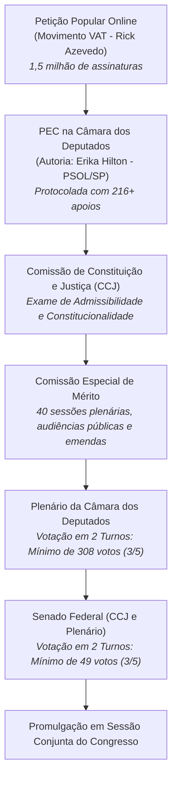
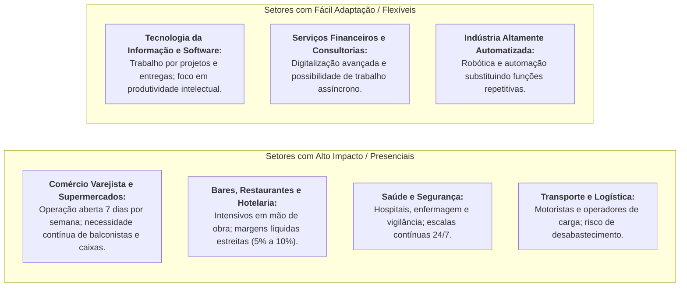

# Proposta de Emenda à Constituição: Fim da Escala 6x1 e Redução da Jornada

> **Classificação:** Direito Constitucional do Trabalho, Economia do Trabalho e Políticas Públicas  
> **Data de Protocolo / Mobilização Principal:** Novembro de 2024 – 2026  
> **Autoria Formal:** Deputada Federal Erika Hilton (PSOL-SP) e Movimento VAT (Vida Além do Trabalho - Rick Azevedo)  
> **Objeto Central:** Alteração do Artigo 7º, Inciso XIII, da Constituição Federal de 1988 para reduzir a jornada máxima semanal de 44 para 36 horas sem redução de salário, viabilizando a escala 4x3 (quatro dias de trabalho e três de descanso) e extinguindo o modelo 6x1.  
> **Fontes Primárias:** Texto da PEC na Câmara dos Deputados, Art. 7º da CF/88, Consolidação das Leis do Trabalho (CLT), Notas Técnicas do DIEESE, CNI, CNC, Abrasel e dados da PNAD Contínua (IBGE).

---

## 1. Origem, Mobilização Social e Trâmite Legislativo

### 1.1. O Movimento Social e a Coleta de Assinaturas
A proposta nasceu da mobilização de base liderada pelo movimento **VAT (Vida Além do Trabalho)**, fundado pelo balconista de farmácia e vereador eleito pelo Rio de Janeiro Rick Azevedo (PSOL), que reuniu mais de 1,5 milhão de assinaturas em uma petição pública online contra a exaustão da escala 6x1 (seis dias consecutivos de trabalho por um dia de folga).

A pauta foi institucionalizada no Congresso Nacional pela deputada federal Erika Hilton (PSOL-SP). Pelo Regimento Interno da Câmara dos Deputados e pelo Art. 60, I da Constituição Federal, uma PEC exige o apoio mínimo formal de **1/3 dos membros da Câmara (171 deputados)** para poder ser protocolada.
* Em **13 de novembro de 2024**, a proposta superou **216 assinaturas de deputados federais**, ultrapassando com folga o quórum mínimo regimental, com adesão maciça de bancadas de esquerda (PT, PSOL, PCdoB, PSB, PDT) e assinaturas pontuais de parlamentares de partidos de centro e centro-direita (União Brasil, PP, MDB, PSD, Republicanos).

---

## 2. O Texto Proposto e as Alterações Legais (Constituição e CLT)

### 2.1. A Modificação no Artigo 7º da Constituição Federal
A PEC altera a redação do **inciso XIII do Art. 7º da CF/88**:

| Texto Vigente (Constituição Federal de 1988) | Texto Proposto pela PEC (Erika Hilton / VAT) |
| :--- | :--- |
| *"Art. 7º (...) XIII - duração do trabalho normal não superior a oito horas diárias e **quarenta e quatro semanais**, facultada a compensação de horários e a redução da jornada, mediante acordo ou convenção coletiva de trabalho;"* | *"Art. 7º (...) XIII - duração do trabalho normal não superior a oito horas diárias e **trinta e seis semanais**, com jornada de trabalho de **quatro dias por semana**, facultada a compensação de horários e a redução da jornada, mediante acordo ou convenção coletiva de trabalho, **sem redução da remuneração**;"* |

### 2.2. O que Precisa ser Alterado na CLT e Legislação Correlata
Caso a PEC seja promulgada, a legislação infraconstitucional precisará ser compulsoriamente adaptada:

1. **Art. 58 da CLT:** O limite padrão legal da jornada normal de trabalho diária/semanal deverá ser reduzido de 44h para 36h semanais;
2. **Art. 59 da CLT (Horas Extras e Banco de Horas):** A remuneração das horas extras (acréscimo mínimo de 50%) incidirá a partir da 36ª hora semanal ou da 8ª hora diária;
3. **Art. 59-A da CLT (Escala 12x36):** O regime de doze horas de trabalho por trinta e seis de descanso precisará de nova regulamentação para compatibilizar o teto semanal médio;
4. **Art. 67 da CLT e Lei nº 605/1949 (Descanso Semanal Remunerado - DSR):** A regra tradicional de "24 horas consecutivas de repouso preferencialmente aos domingos" terá de ser reestruturada para garantir formalmente os **três dias de repouso semanal** da escala 4x3;
5. **Divisor de Cálculo de Salário-Hora:** Para empregados mensalistas, o divisor legal utilizado para calcular o valor da hora de trabalho (hoje em **220 horas mensais**) cairá para **180 horas mensais** ($36\text{h} \times 5\text{ semanas}$ proporcionais), elevando matematicamente o valor-hora do salário.

---

## 3. Impactos Econômicos: A Matemática da Redução da Jornada

A transição de uma jornada de 44 horas para 36 horas semanais sem redução nominal do salário provoca alterações profundas no custo unitário do trabalho e na dinâmica dos setores econômicos:

$$\Delta\% \text{ Custo da Hora Trabalhada} = \left( \frac{44}{36} - 1 \right) \times 100 \approx +22,22\%$$

Para os empregadores que mantiverem o mesmo nível de operação horária sem ganho equivalente de produtividade, **o custo de cada hora efetivamente trabalhada aumenta em 22,2%** antes de encargos previdenciários e benefícios proporcionais.

### Setores Altamente Impactados vs. Pouco Impactados:

---

## 4. Análise Dialética: Os Dois Lados em Confronto

### 4.1. Visão Progressista / Dos Trabalhadores (A Favor da PEC)
*Argumentos sustentados pelo Movimento VAT, parlamentares de esquerda e entidades como o DIEESE:*

1. **Saúde Mental e Dignidade do Trabalhador:** A escala 6x1 é considerada desumana e causadora direta da epidemia de *burnout*, estresse crônico, fadiga e depressão. O trabalhador passa seu único dia de folga realizando tarefas domésticas acumuladas, sem convívio familiar, descanso efetivo ou lazer;
2. **Lei dos Rendimentos Decrescentes na Jornada:** Estudos ergonômicos e da OIT indicam que jornadas longas reduzem a atenção e a eficiência horária, elevando taxas de erro, retrabalho, acidentes de trabalho e absenteísmo por atestados médicos;
3. **Experiências Internacionais Positivas (*4 Day Week Global*):** Projetos-piloto de semana de 4 dias realizados no Reino Unido (com 61 empresas em 2022), na Espanha, Alemanha e Islândia demonstraram que 92% das empresas mantiveram ou aumentaram seu faturamento, com queda drástica nos pedidos de demissão e melhora da saúde física dos funcionários;
4. **Geração de Empregos e Dinamização do Mercado Interno:** Para manter lojas e serviços abertos, empresas que dependem de atendimento presencial serão incentivadas a **contratar trabalhadores adicionais** para compor novas equipes, reduzindo o desemprego. Ademais, com 3 dias livres por semana, a população consome mais turismo regional, cultura, entretenimento, gastronomia e educação;
5. **Precedente Histórico da CF/88:** Em 1988, quando a Constituição reduziu a jornada de 48h para 44h semanais, associações empresariais também previram o colapso econômico nacional — o que não se confirmou, gerando na época modernização e absorção da mão de obra.

---

### 4.2. Visão Liberal / Empresarial (Contrária à PEC ou Crítica)
*Argumentos sustentados por entidades como CNI, CNC, Fecomercio, Abrasel e economistas ortodoxos:*

1. **A Realidade da Produtividade Brasileira:** Países ricos da OCDE (como Alemanha e Reino Unido) podem trabalhar menos horas porque possuem altíssima densidade de capital, robótica, infraestrutura de ponta e capital humano qualificado. No Brasil, a **Produtividade Total dos Fatores (PTF) está estagnada há quatro décadas**. Reduzir horas trabalhadas por decreto constitucional sem prévio salto de produtividade encarece a produção e gera inflação;
2. **Asfixia de Pequenas e Microempresas (PMEs):** Mais de 50% dos empregos formais do Brasil estão em micro e pequenas empresas (padarias, farmácias, pequenas oficinas, bares). Esses negócios operam com margens de lucro pequenas e **não possuem recursos de caixa para contratar uma segunda equipe**. A exigência constitucional forçará o fechamento de estabelecimentos ou a redução dos dias de funcionamento ao consumidor;
3. **Pressão Inflacionária no Setor de Serviços:** Para absorver o aumento de 22% no custo da mão de obra, os estabelecimentos repassarão a conta para os preços finais. Como o setor de serviços tem o maior peso na composição do IPCA, a medida pode provocar um choque inflacionário, forçando o Banco Central a manter taxas de juros (Selic) ainda mais elevadas;
4. **Incentivo à Precarização, Pejotização e Informalidade:** Diante do encarecimento do regime CLT sob a escala 4x3, os empregadores serão empurrados a substituir contratos de carteira assinada por contratação de pessoas jurídicas (PJ), contratação por hora via regime intermitente ou informalidade direta;
5. **Defesa do "Negociado sobre o Legislado":** A Reforma Trabalhista de 2017 ([Lei nº 13.467/2017](https://www.planalto.gov.br/ccivil_03/_ato2015-2018/2017/lei/l13467.htm)) já confere plena liberdade para que sindicatos e empresas negociem acordos coletivos instituindo jornadas de 40h, 36h ou 4x3 nos setores onde isso é economicamente viável, sendo contraproducente impor uma regra homogênea e rígida na Carta Magna para toda a diversidade econômica do país.

---

## 5. Experiências Internacionais Comparadas

| País | Jornada Legal Semanal | Modelo / Histórico | Resultados Registrados |
| :--- | :--- | :--- | :--- |
| **Chile** | Redução gradual de **45h para 40h** | Aprovada por consenso político em 2023, com implementação escalonada em **5 anos** (1h a menos por ano até 2028). | Transição suave; permitiu às empresas planejarem custos e ajustarem turnos com previsibilidade. |
| **Colômbia** | Redução gradual de **48h para 42h** | Lei aprovada em 2021 com redução de 1 a 2 horas por ano entre 2023 e 2026, sem redução de salários. | Adaptação gradual nos setores de manufatura e serviços. |
| **França** | **35 horas semanais** | Instituída no ano 2000 pelo governo de Lionel Jospin (Leis Aubry). | Efeito misto: melhorou a qualidade de vida, mas aumentou o custo do trabalho, exigindo subsídios fiscais bilionários do Estado para evitar demissões em massa na indústria. |
| **Reino Unido** | Piloto de **Semana de 4 Dias (32h)** | Experimento voluntário conduzido por ONGs e pela Universidade de Cambridge com 61 empresas em 2022. | 92% das empresas decidiram manter a escala 4x3 permanentemente; redução de 65% em faltas por doença. |

---

## 6. Propostas Alternativas e Caminhos de Conciliação no Congresso

Em virtude da polarização em torno do texto original, líderes partidários e centros de pesquisa econômica articulam modelos intermediários:

1. **Redução para 40 Horas (Fim do Trabalho aos Sábados):** Em vez do salto abrupto de 44h para 36h (escala 4x3), fixar a jornada em **40 horas semanais** (escala 5x2 padrão), extinguindo o expediente tradicional de meio período aos sábados (modelo do Chile);
2. **Cronograma de Transição Escalonada:** Fixar uma redução de 1 hora semanal a cada dois anos (43h, 42h, 41h, 40h), dando tempo para o setor produtivo amortizar os custos e investir em automação;
3. **Diferenciação Tributária / Desoneração Compensatória:** Concessão de alívio na contribuição previdenciária patronal ou no FGTS para setores intensivos em atendimento presencial que adotarem a escala reduzida sem demissões;
4. **Descentralização por Acordo Coletivo:** Manter a meta das 36h na Constituição como diretriz programática, delegando a cada convenção coletiva setorial a definição do calendário e do formato da escala.

---

## 7. Catálogo de Fontes Oficiais Primárias

* *Câmara dos Deputados:* [Proposta de Emenda à Constituição (Erika Hilton / VAT - 2024)](https://www.camara.leg.br/) - Texto da Proposta, Justificação e Lista Oficial de Assinaturas Registradas.
* *Presidência da República:* [Constituição Federal de 1988 (Artigo 7º, Inciso XIII)](https://www.planalto.gov.br/ccivil_03/constituicao/constituicao.htm).
* *Presidência da República:* [Decreto-Lei nº 5.452, de 1º de maio de 1943 (Consolidação das Leis do Trabalho - CLT)](https://www.planalto.gov.br/ccivil_03/decreto-lei/del5452.htm).
* *DIEESE (Departamento Intersindical de Estatística e Estudos Socioeconômicos):* Notas Técnicas sobre Redução da Jornada de Trabalho e Distribuição de Empregos no Brasil.
* *CNI (Confederação Nacional da Indústria):* Sondagem Especial e Documento Técnico sobre Custos Laborais e Produtividade Industrial (2024).
* *Abrasel (Associação Brasileira de Bares e Restaurantes):* Manifesto sobre o Impacto da Escala 6x1 no Setor de Alimentação Fora do Lar.
