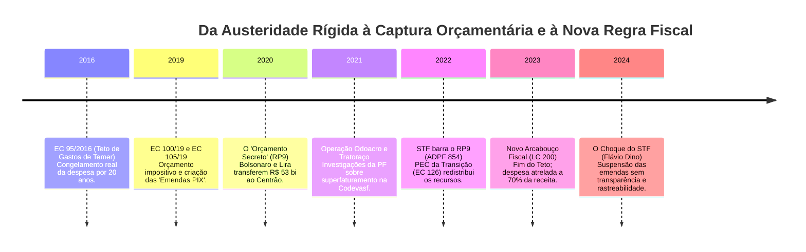
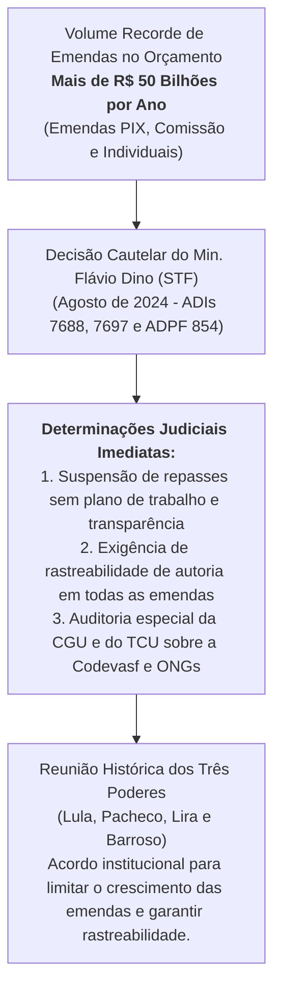

# A Linha Histórica do Orçamento Federal: Do Teto de Gastos ao Orçamento Secreto e ao Novo Arcabouço Fiscal

> **Classificação:** Direito Financeiro, Economia Política e Análise Institucional de Corrupção  
> **Período Coberto:** 2016 – 2026  
> **Marcos Centrais:** EC 95/2016 (Teto de Gastos), EC 100 e 105/2019 (Orçamento Impositivo e Emendas PIX), O "Orçamento Secreto" (RP9 sob Bolsonaro e Arthur Lira), Julgamento da ADPF 854 no STF, EC 126/2022 (PEC da Transição), Lei Complementar nº 200/2023 (Novo Arcabouço Fiscal) e a intervenção do STF nas emendas parlamentares em 2024.  
> **Objetivo:** Mapear a transformação da governança orçamentária no Brasil, demonstrando como a disputa entre o Poder Executivo e o Congresso Nacional pelo controle do dinheiro público gerou desvios de recursos (Codevasf, Tratoraço), enfraqueceu o planejamento nacional e alterou o presidencialismo de coalizão.

---

## 1. Linha do Tempo: A Metamorfose Orçamentária Brasileira (2016 – 2026)

---

## 2. As Fases da Governança Orçamentária e Seus Desdobramentos

---

### Fase 1: O Teto de Gastos (EC nº 95/2016 - Governo Michel Temer)
* **A Regra:** Promulgada em dezembro de 2016 após o impeachment de Dilma Rousseff, a Emenda Constitucional nº 95 instituiu o **Novo Regime Fiscal**, congelando por 20 anos o valor real das despesas primárias da União, corrigidas exclusivamente pela variação anual do IPCA;
* **O Objetivo Declarado:** Forçar o Estado a realizar reformas estruturais (Trabalhista, Previdência e Administrativa) para conter o endividamento público sem elevar a carga tributária;
* **A Distorção e o Estrangulamento:** As despesas obrigatórias federais (benefícios da Previdência, BPC, salários do funcionalismo e pisos constitucionais de Saúde e Educação) continuaram a crescer organicamente acima da inflação devido à dinâmica demográfica. Como o teto total era fixo, as **despesas discricionárias (investimentos públicos, manutenção de rodovias, verbas de universidades e pesquisas)** foram sendo esmagadas, caindo de R$ 120 bilhões para menos de **R$ 35 bilhões anuais**, paralisando ministérios.

---

### Fase 2: O Avanço do Orçamento Impositivo e as "Emendas PIX" (2019)
Diante da perda de poder do Executivo sob o Teto de Gastos, o Congresso Nacional aprovou emendas constitucionais para blindar e expandir os recursos parlamentares de execução obrigatória:
* **EC nº 100/2019:** Tornou impositiva a execução das emendas de bancada estadual;
* **EC nº 105/2019 (Criação das "Emendas PIX"):** Instituiu a modalidade de **Transferência Especial Direta**. Por esse mecanismo, o deputado ou senador transfere recursos federais diretamente para a conta corrente de uma prefeitura ou governo estadual, **sem a necessidade de celebração prévia de convênio, sem projeto básico de engenharia e sem fiscalização prévia da Caixa Econômica Federal ou do TCU**.
  * *O Efeito Prático:* O dinheiro cai no caixa livre do município quase como recurso próprio, facilitando o uso eleitoreiro e dificultando brutalmente o rastreamento por órgãos de controle externo.

---

### Fase 3: A Explosão do "Orçamento Secreto" (2020 – 2022 - Governo Bolsonaro e Arthur Lira)
* **O Pacto de Sobrevivência:** Em meados de 2020, acuado pela demissão de Sergio Moro, pelo avanço de investigações da CPI da Pandemia e por dezenas de pedidos de impeachment na mesa da Câmara, Jair Bolsonaro aliou-se ao Centrão liderado pelos deputados Arthur Lira (PP-AL) e Ciro Nogueira (PP-PI);
* **O Mecanismo RP9:** O governo utilizou o classificador orçamentário **RP9 (Emendas de Relator-Geral)** para entregar a governança dos investimentos públicos ao presidente da Câmara e ao relator do Orçamento. Entre 2020 e 2022, o governo pagou mais de **R$ 53 bilhões em emendas RP9**;
* **O Fator "Secreto":** A destinação dos recursos era negociada em planilhas informais nos gabinetes do Congresso. O documento oficial registrava apenas o nome do Relator-Geral do Orçamento (um único parlamentar), omitindo o nome do verdadeiro congressista beneficiário ("o padrinho"), violando a transparência e a isonomia da federação;
* **Os Escândalos de Corrupção Vinculados:**
  1. **O Escândalo do *"Tratoraço"*:** Auditorias do Tribunal de Contas da União (TCU) revelaram a compra maciça de tratores e equipamentos agrícolas pelo Ministério do Desenvolvimento Regional com preços até **259% acima das tabelas de referência**, para distribuição a redutos eleitorais de deputados aliados;
  2. **A Captura da Codevasf (Operações *Odoacro* e *Benfeitor* da PF):** A Companhia de Desenvolvimento dos Vales do São Francisco e do Parnaíba (Codevasf) foi inundada por bilhões em emendas RP9 para obras de pavimentação asfáltica. A Polícia Federal desvendou esquemas de cartel de empreiteiras de fachada (lideradas pela construtora Engefort), lavagem de dinheiro e uso de laranjas para desviar recursos de obras precárias de asfalto (*"asfalto casca de ovo"*).

---

### Fase 4: O Julgamento da ADPF 854 no STF e a PEC da Transição (Dezembro de 2022)
* **O Julgamento no STF (19 de Dezembro de 2022):** Por 6 votos a 5, o Plenário do Supremo Tribunal Federal julgou procedente a **Arguição de Descumprimento de Preceito Fundamental (ADPF) 854** (Relatoria da Min. Rosa Weber), declarando as emendas de relator (RP9) **inconstitucionais**:
  * *Fundamento Jurídico:* O STF declarou que o RP9 violava frontalmente o Artigo 37 da Constituição (princípios da publicidade, impessoalidade e moralidade) e o Artigo 163 (planejamento orçamentário transparente), vedando a distribuição oculta de recursos públicos;
* **A Reação do Congresso (PEC da Transição - EC nº 126/2022):** Apenas dois dias após a decisão do STF, o Congresso promulgou a EC 126/2022. Para acomodar a perda do RP9 e viabilizar a posse de Lula:
  * O saldo de cerca de R$ 19,4 bilhões do orçamento secreto foi **dividido em duas partes**:
    1. **R$ 9,85 bilhões** foram convertidos em **emendas individuais impositivas (RP6)** dos parlamentares;
    2. **R$ 9,55 bilhões** retornaram às dotações discricionárias de ministérios do Executivo (RP2), mas com acordos de bastidores mantendo o atendimento das indicações dos líderes do Centrão.

---

### Fase 5: O Novo Arcabouço Fiscal (Lei Complementar nº 200/2023 - Governo Lula / Haddad)
* **A Nova Matriz Fiscal:** O governo Lula extinguiu o Teto de Gastos rígido da EC 95 e aprovou no Congresso o **Novo Arcabouço Fiscal (LC 200/2023)**:
  * **Regra de Despesa:** O crescimento real da despesa primária foi limitado a **70% da variação da receita primária** dos últimos 12 meses;
  * **Banda de Crescimento Real:** A despesa pública terá sempre um **piso de crescimento de 0,6% ao ano** (garantindo que os gastos não caiam em recessões) e um **teto de 2,5% ao ano** acima da inflação;
  * **Gatilho de Descumprimento:** Se a meta de superávit primário fixada na LDO não for cumprida (dentro de uma margem de tolerância de $\pm 0,25\%$ do PIB), a taxa de crescimento da despesa cai de 70% para **50% da receita** no exercício seguinte;
* **O Dilema Fiscal e a "Fome Arrecadatória":** Como os pisos constitucionais de Saúde e Educação (vinculados à receita) e os gastos previdenciários (vinculados ao Salário Mínimo) crescem historicamente a taxas superiores a 3% ao ano, a despesa obrigatória continuou pressionando o teto de 2,5%. Para fechar as contas sem promover corte nas despesas obrigatórias, o Ministério da Fazenda adotou uma estratégia focada exclusivamente em **aumentar a arrecadação tributária** (taxação de offshores, fundos exclusivos de super-ricos, fim da isenção de compras internacionais de até US$ 50 e tributação de apostas eletrônicas).

---

### Fase 6: O Confronto Institucional no STF e o Bloqueio das Emendas (2024 – 2026)
Apesar da extinção formal do RP9, o Congresso manteve o controle de fatias orçamentárias descomunais (mais de **R$ 53 bilhões anuais** somando emendas individuais, de bancada estadual e de comissões temáticas - RP8):

* **A Intervenção de Flávio Dino (Agosto de 2024):** O ministro do STF determinou a **suspensão de todas as emendas parlamentares impositivas e emendas PIX** até que o Congresso Nacional e o Poder Executivo adotassem medidas que garantissem a total transparência sobre a identidade do parlamentar solicitante, o objeto das obras e a fiscalização pelos órgãos de controle;
* **Auditoria da CGU:** A Controladoria-Geral da União apresentou relatórios comprovando que prefeituras e ONGs sem qualquer capacidade técnica receberam centenas de milhões de reais em emendas parlamentares que foram desviadas ou aplicadas sem licitação regular.

---

## 3. Os Impactos Sistêmicos na Corrupção e no Presidencialismo de Coalizão

A evolução dessa arquitetura orçamentária produziu três transformações profundas na política brasileira:

1. **A Desestruturação do Planejamento Nacional:**  
   Historicamente, os investimentos da União financiavam projetos integrados de longo prazo (grandes usinas, portos, ferrovias estruturantes, saneamento básico interestadual e hospitais de alta complexidade). Com a captura de R$ 50 bilhões anuais pelo Parlamento, os recursos foram **pulverizados em milhares de microprojetos eleitoreiros de curto prazo** (pavimentação asfáltica sem rede de esgoto, compra de ambulâncias municipais e financiamento de shows artísticos em cidades pequenas);
2. **A Criação do "Parlamentarismo Orçamentário":**  
   No presidencialismo de coalizão clássico (estudado por Sérgio Abranches), o Presidente da República utilizava a liberação orçamentária para negociar pontualmente a fidelidade dos partidos no Congresso. Com o orçamento impositivo e as emendas PIX, **os deputados e senadores tornaram-se independentes do Executivo**. Eles têm acesso direto a bilhões do orçamento para reelegerem suas bases eleitorais, independentemente de apoiarem ou não a agenda do governo federal;
3. **A Migração da Corrupção: De Estatais para Emendas Locais:**  
   Enquanto a Operação Lava Jato investigou desvios centralizados em grandes estatais (Petrobras, Eletrobras) operados por diretorias nomeadas pelo Planalto, o modelo atual descentralizou a corrupção para os municípios. O risco de captura e desvio migrou para convênios municipais fictícios, cooperativas de fachada e estatais de obras regionais (como a Codevasf).

---

## 4. Matriz Cronológica Comparativa (2016 – 2026)

| Período / Marco | Instrumento Jurídico | Regra Fiscal / Mecanismo Central | Impacto na Gestão e Corrupção |
| :--- | :--- | :--- | :--- |
| **2016 – 2018 (Temer)** | **EC nº 95/2016 (Teto de Gastos)** | Congelamento real do gasto primário federal pelo IPCA por 20 anos. | Queda abrupta dos investimentos federais; compressão das políticas públicas. |
| **2019 (Congresso)** | **EC nº 100 e EC nº 105/2019** | Orçamento impositivo de bancada e criação das "Emendas PIX". | Início do repasse direto a prefeituras sem convênio ou fiscalização do TCU. |
| **2020 – 2022 (Bolsonaro / Lira)** | **Emendas de Relator (RP9)** | "Orçamento Secreto": R$ 53 bi distribuídos sem transparência de autoria. | Fisiologismo máximo; escândalos do *Tratoraço* e desvios na Codevasf (PF). |
| **Dezembro de 2022** | **ADPF 854 / EC nº 126/2022** | STF declara RP9 inconstitucional; PEC da Transição rateia o valor (RP6 e RP2). | Fim do sigilo formal, mas persistência de acordos informais de direcionamento. |
| **2023 (Lula / Haddad)** | **LC nº 200/2023 (Novo Arcabouço)** | Despesa atrelada a 70% da receita (banda de 0,6% a 2,5% a.a.) e meta de superávit. | Fim do teto rígido; foco do governo voltado exclusivamente para elevar a arrecadação. |
| **2024 – 2026 (STF / Três Poderes)** | **ADIs 7688, 7697 e Decisões Dino** | Suspensão de emendas sem transparência; exigência de rastreabilidade e plano de trabalho. | Choque de freios e contrapesos; imposição de limites à autonomia do Congresso. |

---

## 5. Catálogo de Fontes Oficiais Primárias

* *Presidência da República:* [Emenda Constitucional nº 95, de 15 de dezembro de 2016](https://www.planalto.gov.br/ccivil_03/constituicao/emendas/emc/emc95.htm) (Teto de Gastos Públicos).
* *Presidência da República:* [Emenda Constitucional nº 105, de 12 de dezembro de 2019](https://www.planalto.gov.br/ccivil_03/constituicao/emendas/emc/emc105.htm) (Transferências Especiais / Emendas PIX).
* *Presidência da República:* [Lei Complementar nº 200, de 30 de agosto de 2023](https://www.planalto.gov.br/ccivil_03/leis/lcp/lcp200.htm) (Regime Fiscal Sustentável / Novo Arcabouço Fiscal).
* *Supremo Tribunal Federal:* [ADPF nº 854/DF](https://portal.stf.jus.br/processos/detalhe.asp?incidente=6196238) (Acórdão do Plenário declarando a inconstitucionalidade do Orçamento Secreto RP9).
* *Supremo Tribunal Federal:* ADI 7688 e ADI 7697 (Decisões Cautelares do Ministro Flávio Dino determinando a suspensão e a rastreabilidade total das emendas impositivas em 2024).
* *Tribunal de Contas da União:* Acórdão nº 2.458/2021-Plenário (Auditoria do superfaturamento na aquisição de tratores e máquinas agrícolas via emendas de relator).
* *Instituição Fiscal Independente (IFI / Senado):* Relatórios Especiais de Acompanhamento Fiscal sobre a Composição e Rigidez do Orçamento da União (2020–2024).
