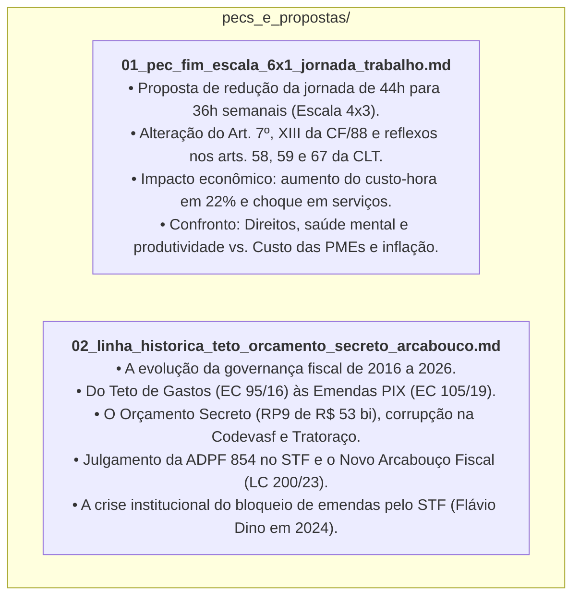

# PECs, Propostas Legislativas e Reformas Estruturais do Brasil

> **Repositório de Análise de Propostas de Emenda à Constituição (PECs), Projetos de Lei e Marcos Institucionais**  
> **Objetivo:** Registrar e dissecar as grandes reformas constitucionais e institucionais que moldam o direito do trabalho, as finanças públicas, a dinâmica orçamentária e a governabilidade no Brasil contemporâneo.  
> **Critério Metodológico:** Análise neutra, ancorada em fontes legislativas primárias (Congresso Nacional, Diário Oficial da União, acórdãos do STF e auditorias do TCU), apresentando sempre o confronto dialético entre visões econômicas e sociais divergentes.

---

## 1. Mapa dos Documentos da Pasta

### 1. **[`01_pec_fim_escala_6x1_jornada_trabalho.md`](file:///Users/rodrigofregonasse/Code/brasil-project/pecs_e_propostas/01_pec_fim_escala_6x1_jornada_trabalho.md)**
* **Tema:** Fim da Escala 6x1 e Transição para a Semana de 4 Dias (Escala 4x3).
* **Autoria e Trâmite:** Deputada Erika Hilton (PSOL/SP), Movimento VAT (Rick Azevedo) e adesão de mais de 216 assinaturas regimentais na Câmara dos Deputados.
* **O que Muda:** Alteração do Art. 7º, XIII da CF/88 (de 44h para 36h semanais sem redução salarial) e adaptação dos arts. 58, 59, 59-A e 67 da CLT (divisor de horas extras caindo de 220 para 180 horas mensais).
* **Análise Dialética:** A defesa da dignidade humana, saúde mental contra o *burnout* e experiências internacionais de 4-Day Work Week (Reino Unido, Espanha, Alemanha) contrapostos ao aumento de 22,2% no custo da hora trabalhada, risco de quebra de pequenas empresas (PMEs), inflação de serviços e incentivo à pejotização.

### 2. **[`02_linha_historica_teto_orcamento_secreto_arcabouco.md`](file:///Users/rodrigofregonasse/Code/brasil-project/pecs_e_propostas/02_linha_historica_teto_orcamento_secreto_arcabouco.md)**
* **Tema:** A Linha Histórica do Orçamento Federal (2016 – 2026).
* **As Seis Fases:** O Teto de Gastos de Temer (EC 95/16) $\rightarrow$ As Emendas Impositivas e Emendas PIX (EC 100 e 105/19) $\rightarrow$ O Orçamento Secreto sob Bolsonaro e Arthur Lira (RP9 - mais de R$ 53 bilhões) $\rightarrow$ A declaração de inconstitucionalidade pelo STF (ADPF 854) e a PEC da Transição (EC 126/22) $\rightarrow$ O Novo Arcabouço Fiscal de Lula e Haddad (LC 200/23) $\rightarrow$ O bloqueio de emendas sem rastreabilidade no STF pelo Min. Flávio Dino (2024).
* **Impacto na Corrupção:** A transferência do foco de desvios das grandes estatais (como na Lava Jato) para municípios e estatais regionais de obras (Codevasf, Tratoraço, asfalto sem licitação) e a perda de capacidade de planejamento do Governo Central em favor do fisiologismo legislativo.

---

## 2. Bases e Fontes Oficiais de Consulta

* **Câmara dos Deputados e Senado Federal:** Portais de Tramitação Legislativa (`camara.leg.br` e `senado.leg.br`).
* **Presidência da República:** Legislação Federal e Emendas Constitucionais (`planalto.gov.br`).
* **Supremo Tribunal Federal (STF):** Acompanhamento Processual das Ações de Controle Concentrado (`stf.jus.br`).
* **Instituição Fiscal Independente (IFI / Senado):** Relatórios de Acompanhamento Fiscal (RAF).
* **Siga Brasil / Senado Federal:** Sistema de Informações sobre Orçamento Público Federal.
* **Tribunal de Contas da União (TCU) e CGU:** Acórdãos de Auditoria e Painéis de Fiscalização Orçamentária.
