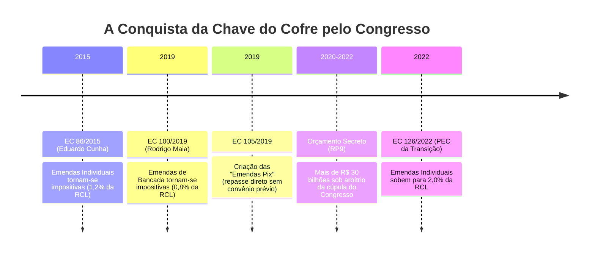

# A Mutação do Congresso: Do Presidencialismo de Coalizão ao Orçamento Impositivo

> **Classificação:** Ciência Política e Arquitetura Institucional do Poder  
> **Período de Transformação:** 2015 – 2026  
> **Bases Oficiais de Dados:** Secretaria do Tesouro Nacional (SIAFI), Câmara dos Deputados (SILEG), Senado Federal e Diário Oficial da União (DOU).

---

## 1. Contexto Histórico: A Morte do "Presidencialismo de Coalizão" Tradicional

Em 1988, o cientista político Sérgio Abranches cunhou o termo **Presidencialismo de Coalizão** para descrever o arranjo institucional brasileiro:
* De um lado, um **Poder Executivo forte** (o Presidente da República), dotado de prerrogativas orçamentárias quase imperiais (poder de contingenciar o orçamento público e editar Medidas Provisórias com força de lei imediata);
* Do outro, um **Congresso Nacional altamente fragmentado** multipartidário, no qual nenhum presidente consegue eleger maioria com seu próprio partido.
* **A Mecânica de Sobrevivência:** O Presidente comprava apoio político na Câmara e no Senado distribuindo cargos de confiança no primeiro e segundo escalão (ministérios, diretorias de estatais e bancos públicos) e liberando parcelas discricionárias de emendas orçamentárias aos parlamentares da base aliada.

Essa assimetria foi a raiz direta dos maiores escândalos da República recente: quando a distribuição legal de cargos não bastava para aprovar projetos impopulares, articuladores governamentais recorriam a propinas e caixas paralelos (como desvendado no **Mensalão** em 2005 e no **Petrolão/Lava Jato** em 2014).

---

## 2. A Virada Constitucional: O Orçamento Impositivo (2015 – 2026)

A partir da crise de governabilidade de Dilma Rousseff e da eleição de Eduardo Cunha para a Presidência da Câmara em 2015, o Congresso Nacional liderou uma **revolução constitucional silenciosa**, aprovando sucessivas Emendas à Constituição que retiraram a "chave do cofre" das mãos do Presidente da República:

### O Salto dos Recursos das Emendas (Dados do Tesouro Nacional / SIAFI):
* **2014:** Cerca de **R$ 4,4 bilhões** executados em emendas parlamentares (autorizativas);
* **2019:** Salto para **R$ 13,8 bilhões**;
* **2022:** Volume recorde de mais de **R$ 38 bilhões** (com o Orçamento Secreto);
* **2024 – 2026:** Patamar consolidado superior a **R$ 50 bilhões por ano**.

> [!IMPORTANT]
> **Comparação Internacional de Poder:**
> O Congresso Nacional brasileiro controla atualmente entre **20% e 25% de todas as despesas discricionárias** (de investimento e custeio livre) do Governo Central. Nos Estados Unidos, França, Alemanha ou Reino Unido, o parlamento aloca diretamente menos de **2%** do orçamento livre da União. O Brasil tornou-se um **Semipresidencialismo Orçamentário de fato**.

---

## 3. O Poder Real: As Bancadas Temáticas Suprapartidárias

O voto e a articulação no Congresso moderno não respondem mais primariamente a fidelidades partidárias ideológicas (PT, PL, União Brasil, MDB), mas à disciplina de **Frentes Parlamentares transversais**:

| Bancada Temática | Nome Formal | Número de Parlamentares | Força Política e Interesses Centrais |
| :--- | :--- | :--- | :--- |
| **Bancada Ruralista** | Frente Parlamentar da Agropecuária (FPA) | **Mais de 300 deputados e 50 senadores** | Maior força legislativa do país. Defende o Marco Temporal, desregulamentação de defensivos agrícolas, ampliação do Plano Safra e flexibilização do licenciamento ambiental. |
| **Bancada Evangélica** | Frente Parlamentar Evangélica (FPE) | **Mais de 210 deputados e 30 senadores** | Pauta de costumes conservadora (antiaborto, anti-drogas, defesa da família tradicional), imunidades tributárias a templos religiosos e cargos em ministérios sociais. |
| **Bancada da Bala** | Frente Parlamentar da Segurança Pública | **Mais de 250 parlamentares** | Pautas punitivistas, ampliação do acesso civil e de CACs a armas de fogo, fim de saídas temporárias de presos e proteção judicial a policiais militares. |

---

## 4. Confronto Dialético sobre o Orçamento Impositivo

### A Visão Municipalista e Legislativista (Pró-Congresso / Descentralizadora)
* **Argumento:** O Orçamento Impositivo foi uma vitória da democracia representativa contra o "Presidencialismo Imperial".
  1. **Conhecimento da Realidade Local:** Um deputado ou senador eleito no interior do Maranhão, de Goiás ou do Pará conhece as carências urgentes de um hospital regional, de uma ponte vicinal ou de uma creche municipal infinitamente melhor do que um burocrata enclausurado em um ministério na Esplanada em Brasília.
  2. **Fim da Chantagem do Executivo:** Durante décadas, a Presidência chantageava deputados, liberando verbas de emendas na véspera de votações cruciais e asfixiando os redutos eleitorais da oposição. O orçamento impositivo garantiu isonomia republicana na liberação de recursos para todos os parlamentares, independentemente do partido.
  3. **Antídoto contra a Corrupção Sistêmica:** Ao desvincular a sobrevivência parlamentar do loteamento clandestino de ministérios e estatais, o Orçamento Impositivo extinguiu os incentivos que geraram esquemas como o Mensalão e o Petrolão.

### A Visão Presidencialista e de Planejamento Estratégico (Crítica / Executiva)
* **Argumento:** O Orçamento Impositivo fragmentou o Estado brasileiro e destruiu o planejamento nacional de longo prazo.
  1. **Pulverização Irracional dos Recursos:** Bilhões de reais são esfarelados anualmente em pequenas obras paroquiais de interesse eleitoreiro imediato (asfalto de baixa qualidade, praças, shows municipais e compras de tratores na Codevasf), enquanto grandes projetos estruturantes nacionais (ferrovias transcontinentais, transição energética, universidades e portos) sofrem com escassez orçamentária.
  2. **Desresponsabilização Política:** O arranjo gerou uma assimetria perversa: os parlamentares controlam a despesa pública para obter votos nas suas bases locais, mas **não têm nenhuma responsabilidade sobre o equilíbrio fiscal ou a arrecadação de tributos**. Quando a conta do déficit chega na forma de inflação ou juros altos, a sociedade culpa exclusivamente o Presidente da República, que foi desprovido de ferramentas de gestão fiscal.
  3. **Captura por Grupos Corporativos:** As emendas criaram feudos orçamentários inatacáveis dominados por dinastias políticas regionais, blindando o Centrão de qualquer alternância de poder ideológica na Presidência da República.
