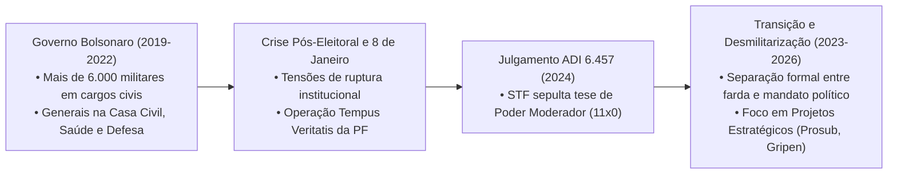

# As Forças Armadas, o Artigo 142 e a Tutela Militar na República

> **Classificação:** Relações Civis-Militares, Direito Constitucional e Segurança Nacional  
> **Período de Referência:** 1988 – 2026  
> **Bases Oficiais de Dados:** Supremo Tribunal Federal (Acórdão ADI 6.457), Tribunal de Contas da União (TCU - Auditoria de Militarização da Burocracia), Ministério da Defesa e Polícia Federal (Operação Tempus Veritatis).

---

## 1. O Debate Constitucional: O Artigo 142 e o Fim do Mito do "Poder Moderador"

O Artigo 142 da Constituição Federal de 1988 estabelece a missão institucional das Forças Armadas:
> *"As Forças Armadas, constituídas pela Marinha, pelo Exército e pela Aeronáutica, são instituições nacionais permanentes e regulares, organizadas com base na hierarquia e na disciplina, sob a autoridade suprema do Presidente da República, e destinam-se à defesa da Pátria, à garantia dos poderes constitucionais e, por iniciativa de qualquer destes, da lei e da ordem."*

### O Julgamento Histórico da ADI 6.457 no STF (Abril de 2024)
Durante as tensões institucionais do governo Jair Bolsonaro, juristas conservadores e apoiadores governistas difundiram a interpretação de que o Artigo 142 conferiria aos militares um **"Poder Moderador"** para arbitrar conflitos caso um dos Poderes (especialmente o STF) cometesse excessos ou invadisse competências dos demais.

Em **abril de 2024**, o Plenário do Supremo Tribunal Federal julgou o mérito da **Ação Direta de Inconstitucionalidade (ADI) 6.457** (ajuizada pelo PDT) sob relatoria do ministro Luiz Fux.
* **Resultado:** **11 votos a 0 (Unanimidade)**.
* **Tese Constitucional Fixada:**
  1. A Constituição de 1988 **não instituiu e não autoriza nenhum Poder Moderador militar** na República brasileira;
  2. As Forças Armadas são órgãos de Estado subordinados à autoridade suprema do Presidente da República, que exerce o comando civil eleito pelo sufrágio popular;
  3. A atuação em missões de **Garantia da Lei e da Ordem (GLO)** é excepcional, subsidiária e de caráter estritamente policial temporário, jamais conferindo prerrogativas de intervenção sobre as decisões do Poder Judiciário ou do Congresso Nacional.

---

## 2. A Presença Militar na Política Recente (2018 – 2026)

### 2.1. A Ocupação de Cargos Civis no Governo Bolsonaro
Auditorias realizadas pelo Tribunal de Contas da União (TCU) apontaram que a presença de militares da ativa e da reserva em cargos comissionados civis na administração pública federal saltou de cerca de 2.700 em 2018 para **mais de 6.100 postos em 2020**:
* **Primeiro Escalão:** Generais assumiram ministérios estratégicos como a Casa Civil (Walter Braga Netto), a Secretaria de Governo (Carlos Alberto dos Santos Cruz e Luiz Eduardo Ramos), o Gabinete de Segurança Institucional (Augusto Heleno), o Ministério da Defesa (Fernando Azevedo e Silva e Paulo Sérgio Nogueira) e o Ministério da Saúde em plena pandemia (Eduardo Pazuello).

### 2.2. A Crise da Sucessão de 2022 e a Operação Tempus Veritatis
As investigações da Polícia Federal autorizadas pelo STF no âmbito da **Operação Tempus Veritatis** (fevereiro de 2024) revelaram a existência de debates internos no núcleo governamental sobre a edição de minutas de decreto de intervenção e Estado de Sítio para impedir a posse do presidente eleito. 
* Depoimentos formais do comandante do Exército (General Freire Gomes) e da Aeronáutica (Brigadeiro Baptista Júnior) à Polícia Federal atestaram que eles se posicionaram contrariamente a qualquer aventura golpista, afirmando que cumpririam rigorosamente a ordem constitucional e dariam voz de prisão a quem tentasse violar o resultado eleitoral.

---

## 3. Confronto Dialético sobre o Papel dos Militares

### A Visão Legalista de Ordem e Reserva Moral (Conservadora / Militarista)
* **Argumento:** As Forças Armadas são a instituição mais duradoura, disciplinada e com os mais altos índices de confiança pública da sociedade brasileira (atestado em pesquisas Datafolha e Ipec):
  1. **Capacidade Logística e Eficiência:** Nenhuma instituição civil brasileira possui a capacidade de desdobramento operacional, logística e capilaridade dos militares para atuar em missões críticas de resgate em catástrofes climáticas (como nas inundações do Rio Grande do Sul), em socorro humanitário em terras indígenas isoladas (Terra Yanomami) e na vacinação em rincões remotos da Amazônia.
  2. **Garantia de Soberania e Dissuasão:** Os militares sustentam a defesa das fronteiras continentais do país contra o narcotráfico internacional e conduzem projetos tecnológicos soberanos de ponta essenciais para a autonomia nacional: o **Programa de Submarinos (PROSUB)** e o desenvolvimento do primeiro submarino de propulsão nuclear da América Latina pela Marinha, os **Caças supersônicos Gripen NG** da Força Aérea e os veículos blindados **Guarani** do Exército.
  3. **Estabilidade Institucional:** A postura legalista dos altos comandos militares em 2022 comprovou o amadurecimento institucional das Forças Armadas, que recusaram atalhos autoritários e garantiram a transição pacífica do poder.

### A Visão Republicana e de Subordinação Civil Estrita (Progressista / Democrática)
* **Argumento:** A presença de militares na política partidária degrada a autoridade do poder civil e corrompe a própria essência da caserna:
  1. **A Violação do Princípio Republicano:** Numa democracia constitucional madura, quem detém o monopólio das armas não pode disputar o poder político. A ocupação de milhares de cargos civis por generais sem concurso no Executivo subordinou o prestígio das Forças Armadas aos fracassos de gestão política transitória (com destaque para a catastrófica gestão de Eduardo Pazuello na crise do oxigênio em Manaus).
  2. **A Herança Não Superada de 1964:** A recusa histórica dos quartéis em reconhecer as violações cometidas durante a ditadura militar e a persistência de setores que alimentam fantasias de tutela sobre o Congresso e o STF exigem reformas institucionais profundas.
  3. **Despolitização Obrigatória:** É imperativo consagrar na Constituição a regra de que qualquer militar que decida concorrer a cargos eletivos ou assumir ministérios políticos seja **automaticamente transferido para a reserva definitiva**, extirpando a contaminação partidária da hierarquia e da tropa ativa.
