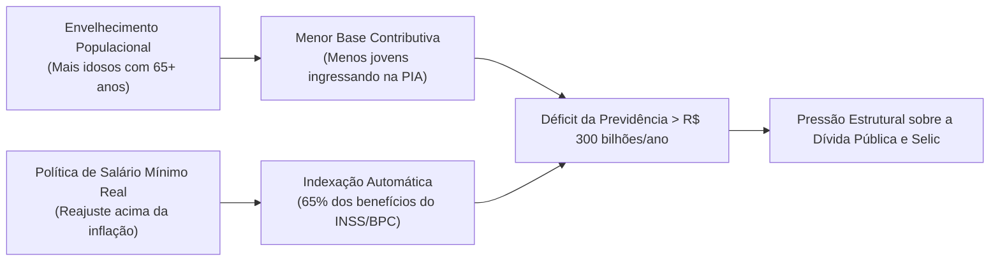

# A Bomba Demográfica, a Previdência Social e o Abismo de Produtividade

> **Classificação:** Demografia Econômica, Mercado de Trabalho e Sustentabilidade da Seguridade Social  
> **Período de Referência:** 2000 – 2026 (Com projeções até 2050)  
> **Bases Oficiais de Dados:** IBGE (Censo Demográfico 2022 e Projeções Populacionais), Secretaria de Previdência (BEPS/RTN), IPEA (Carta de Conjuntura - Produtividade) e FGV IBRE.

---

## 1. O Fim do Bônus Demográfico: Dados do Censo IBGE 2022

O Brasil atravessa a mais rápida transição demográfica do planeta, completando em quatro décadas um processo de envelhecimento que levou mais de um século na Europa ocidental:
* **População Total Recenseada:** **203,1 milhões de habitantes** em 2022 (ritmo de crescimento anual de apenas 0,52%, o mais baixo desde o primeiro censo de 1872);
* **Taxa de Fecundidade Total (TFT):** Despencou para **1,57 filho por mulher**, substancialmente abaixo da taxa de reposição populacional (2,1 filhos por mulher);
* **Explosão do Índice de Envelhecimento:** A proporção de idosos com 65 anos ou mais saltou de 4,8% da população em 1991 para **10,9% em 2022**, devendo ultrapassar 20% antes de 2045.
* **O Esgotamento do Bônus:** A População em Idade Ativa (PIA - entre 15 e 64 anos), que sustentava o crescimento da força de trabalho, atingiu seu pico e iniciou sua trajetória de contração estrutural permanente.

> [!WARNING]
> **A Armadilha Histórica:**
> Países como França, Reino Unido e Japão enriqueceram primeiro para depois envelhecer (quando atingiram a maturidade demográfica, sua renda per capita já superava US$ 30.000). O Brasil está **envelhecendo antes de enriquecer**, com uma renda per capita ainda estagnada na faixa dos US$ 10.000 a US$ 11.000.

---

## 2. A Previdência Social e a Conta Fiscal

### Números Estruturais do RGPS e RPPS (Tesouro Nacional / Previdência):
1. **Déficit Anual do RGPS (Setor Privado):** Supera **R$ 300 bilhões anuais** e cresce vegetativamente.
2. **O Peso da Indexação:** Cada **R$ 1 de aumento real concedido ao Salário Mínimo** acrescenta automaticamente cerca de **R$ 400 milhões em despesas obrigatórias** anuais à Previdência Social e aos cofres do BPC, uma vez que o Artigo 201, § 2º da Constituição Federal proíbe benefícios de valor inferior ao piso nacional.
3. **Déficit dos Regimes Próprios (RPPS e Militares):** Embora atenda um contingente numérico muito menor de aposentados (servidores públicos federais e militares das Forças Armadas), o rombo per capita é dezenas de vezes superior ao do trabalhador comum do regime geral.

---

## 3. O Abismo da Produtividade Total dos Fatores (PTF)

Estudos do IPEA e do FGV IBRE demonstram que a produtividade por trabalhador brasileiro está **estagnada há quatro décadas** (desde o início dos anos 1980):
* Um trabalhador brasileiro médio produz o equivalente a apenas **25% da riqueza gerada por um trabalhador norte-americano** e cerca de 35% de um trabalhador alemão.
* **Causas Estruturais do Subdesenvolvimento da Produtividade:**
  1. **O Apagão Educacional:** Resultados medíocres e estagnados no PISA da OCDE (o Brasil figura na 71ª posição de 89 países em matemática e leitura), somados a um índice de 29% de analfabetismo funcional entre adultos (dados do INAF);
  2. **O "Custo Brasil" Logístico e Tributário:** Menos de 13% das rodovias brasileiras são pavimentadas, o custo de frete encarece a exportação e empresas gastam mais de 1.500 horas ao ano apenas para calcular e pagar tributos;
  3. **Insegurança Jurídica e Custo de Capital:** Juros reais médios históricos acima de 6% inviabilizam investimentos privados em maquinário moderno e automação de ponta.

---

## 4. Confronto Dialético sobre Demografia e Produtividade

### A Visão Liberal / Ortodoxa (Mercado / Foco na Solvência)
* **Argumento:** O modelo de seguridade social baseado em repartição simples (*pay-as-you-go*) faliu demograficamente e operará a quebra do Estado se não for reformado:
  1. **Desvinculação Obrigatória:** É imperativo romper a indexação entre o Salário Mínimo e os benefícios previdenciários e assistenciais (BPC). O salário mínimo deve ser um regulador do mercado de trabalho ativo, enquanto os benefícios previdenciários devem ser reajustados apenas pela inflação passada para estancar a sangria fiscal.
  2. **Transição para Capitalização:** Os jovens trabalhadores devem poder direcionar parcelas de suas contribuições para contas individuais de previdência privada em seu nome (regime de capitalização), estimulando a poupança interna do país e o mercado de ações.
  3. **Choque de Produtividade pela Abertura:** A indústria brasileira só elevará sua produtividade quando for exposta à livre concorrência internacional com a redução unilateral de tarifas de importação de máquinas e bens de capital, forçando as empresas a inovar ou fechar.

### A Visão Keynesiana / Desenvolvimentista (Social / Foco no Bem-Estar)
* **Argumento:** A Previdência Social é a maior e mais bem-sucedida política de distribuição de renda e coesão social da história do Brasil:
  1. **Sustentação do Mercado Interno:** Em mais de **70% dos municípios brasileiros** (especialmente no Nordeste e no interior do país), o volume de dinheiro injetado mensalmente pelos benefícios do INSS e BPC é **maior do que o Fundo de Participação dos Municípios (FPM)** e maior do que toda a arrecadação de tributos locais somada. Retirar a vinculação do salário mínimo destruiria o comércio e a economia de milhares de cidades pequenas.
  2. **A Solução pelo Lado da Receita e do Trabalho Formal:** O déficit da Previdência não deve ser combatido confiscando a renda de aposentados pobres, mas eliminando as desonerações tributárias corporativas bilionárias concedidas a setores empresariais, combatendo a sonegação e formalizando os mais de 38 milhões de trabalhadores que estão na informalidade sem contribuir.
  3. **Produtividade via Educação Pública:** O salto de produtividade só virá quando o Estado investir massivamente em creches, escolas de tempo integral, universidades públicas e no ensino técnico de qualidade (como os Institutos Federais), transformando o jovem brasileiro em mão de obra de alta qualificação técnica.
