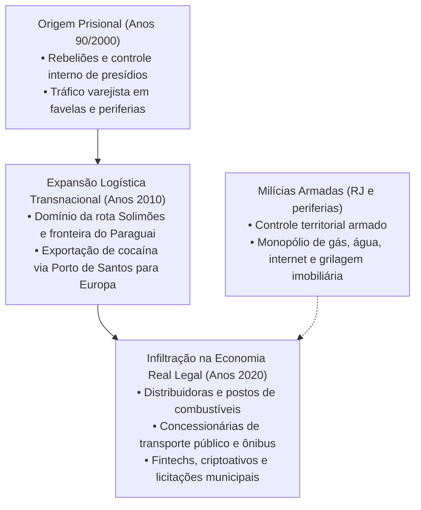

# Segurança Pública e a Nova Geopolítica do Crime Organizado

> **Classificação:** Segurança Pública, Criminologia e Economia do Crime  
> **Período de Referência:** 2000 – 2026  
> **Bases Oficiais de Dados:** Fórum Brasileiro de Segurança Pública (FBSP - Anuário de Segurança), IPEA (Atlas da Violência), Ministério da Justiça e Segurança Pública (MJSP), COAF e Polícia Federal.

---

## 1. O Custo Macroeconômico da Violência

A criminalidade no Brasil não é apenas uma tragédia humanitária crônica, mas um dos maiores entraves ao crescimento econômico do país:
* **Custo Econômico Total da Violência:** Estudos consolidados do IPEA estimam que a violência consome anualmente cerca de **5,9% do Produto Interno Bruto (PIB)** brasileiro (equivalente a mais de **R$ 600 bilhões por ano**);
* **Composição desse Custo:** Gastos governamentais em segurança pública e sistema penitenciário (~1,5% do PIB); despesas privadas das famílias e empresas com segurança patrimonial armada, blindagem e seguros (~2,0% do PIB); custos hospitalares no SUS com atendimento a feridos por arma de fogo; e a perda de capacidade produtiva de dezenas de milhares de jovens assassinados no auge da vida economicamente ativa.

---

## 2. A Mutação do Crime: De Facções Prisionais a Conglomerados Econômicos

### 2.1. A Rota Transnacional do Tráfico (PCC e Comando Vermelho)
As principais facções brasileiras abandonaram o perfil de banditismo tradicional e se transformaram em **multinacionais de logística**:
* **Rotas de Fronteira:** Domínio das rotas de entrada de pasta-base de cocaína e maconha pelo Rio Solimões (fronteira com Colômbia e Peru) e pela fronteira seca de Pedro Juan Caballero / Ponta Porã com o Paraguai.
* **O Corredor de Exportação:** Utilização massiva do Porto de Santos, Paranaguá, Itajaí e Salvador para despachar cargas de drogas ocultas em contêineres de exportação legal (soja, café, suco de laranja) em direção a portos da Europa (Antuérpia, Roterdã, Valência) e África Ocidental.

### 2.2. A Infiltração em Setores Econômicos Legais
Operações recentes da Polícia Federal, Ministério Público de São Paulo (Gaeco) e Receita Federal desvendaram a colonização de negócios legítimos pelo crime organizado para lavar ativos:
1. **Setor de Combustíveis:** Aquisição de usinas de etanol, distribuidoras e centenas de postos de gasolina que praticam fraudes volumétricas e sonegação de tributos para circular bilhões de reais ilícitos;
2. **Transporte Público:** A **Operação Fim da Linha** (abril de 2024 em São Paulo) desarticulou consórcios de ônibus de transporte coletivo municipal controlados pela cúpula do PCC que movimentavam centenas de milhões de reais em contratos públicos de concessão;
3. **Setor Financeiro Clandestino:** Uso de fintechs não autorizadas e corretoras de criptomoedas para escoar recursos para paraísos fiscais sem alerta aos órgãos de inteligência financeira.

### 2.3. As Milícias e o Controle Territorial Armado
No Rio de Janeiro e em regiões metropolitanas do país, grupos paramilitares (milícias compostas por agentes públicos corrompidos e criminosos associados) operam como um poder estatal paralelo:
* Cobrança de taxas de segurança de comerciantes;
* Monopólio violento na venda de botijões de gás de cozinha, galões de água mineral e sinal clandestino de internet e TV a cabo ("gatonet");
* Grilagem de terras públicas e construção de edifícios residenciais sem engenharia ou habite-se (como no colapso dos prédios de Muzema em 2019).

---

## 3. Confronto Dialético sobre Políticas de Segurança Pública

### A Visão de Lei e Ordem e Punitivismo Penal (Conservadora)
* **Argumento:** A violência crônica brasileira decorre da sensação de impunidade e da leniência da legislação penal:
  1. **Endurecimento de Penas e Fim de Benefícios:** O Estado deve extinguir brechas processuais como as "saidinhas temporárias" de presidiários (restringidas pela **Lei nº 14.843/2024**) e aumentar o tempo real de cumprimento de pena em regime fechado para crimes violentos e hediondos.
  2. **Isolamento Total de Lideranças:** Facções só perdem a capacidade de comandar crimes na rua quando seus líderes são transferidos de forma definitiva e sem contato físico para o Sistema Penitenciário Federal de Segurança Máxima.
  3. **Retaguarda Jurídica ao Policial:** O policial que arrisca a vida para defender a sociedade contra criminosos armados com fuzis de guerra deve ter proteção jurídica explícita (excludente de ilicitude em serviço), cessando a perseguição judicial a agentes da lei em confrontos armados.

### A Visão de Inteligência Financeira e Reformas Estruturais (Progressista)
* **Argumento:** O modelo histórico de encarceramento em massa e incursões bélicas periódicas em favelas faliu completamente:
  1. **Os Presídios como Universidades do Crime:** O Brasil já possui a terceira maior população carcerária do mundo (mais de 800 mil presos). Prender jovens pobres por posse de pequenas quantidades de drogas sem arma apenas os joga nos braços das facções nos presídios, fornecendo soldados baratos e vitalícios para o crime organizado.
  2. **Seguir o Rastro do Dinheiro (Follow the Money):** O crime organizado moderno não será derrotado com tiroteios em becos, mas com **auditoria e inteligência financeira integrada** (Coaf, Receita Federal, PF e Banco Central) bloqueando o patrimônio dos chefes nos setores de combustíveis, transportes, imóveis de luxo e empresas de fachada.
  3. **Repensar a Política de Drogas:** A proibição cega gera lucros astronômicos para as máfias armadas. O debate sobre regulação de substâncias e foco em saúde pública é indispensável para retirar o financiamento bilionário que sustenta o poder bélico das facções.
