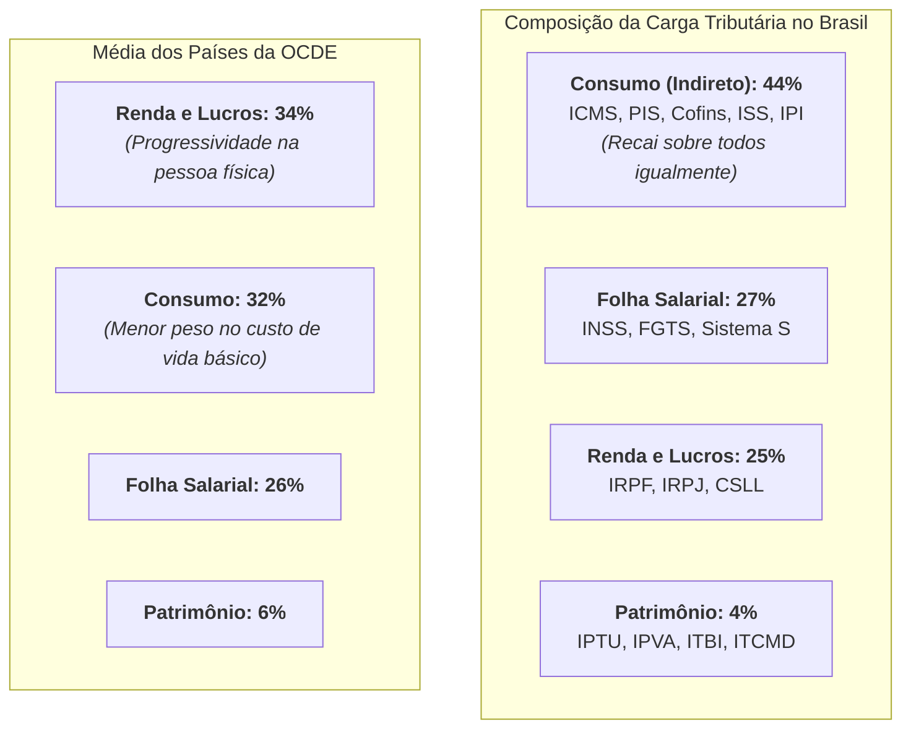

# Tributação Regressiva, Imposto sobre a Renda e Desigualdade Estrutural

> **Classificação:** Finanças Públicas, Direito Tributário e Economia da Desigualdade  
> **Período de Referência:** 1995 – 2026  
> **Bases Oficiais de Dados:** Receita Federal do Brasil (Grandes Números do IRPF e Estudos da Carga Tributária), IPEA, OCDE (*Revenue Statistics*) e Ministério da Fazenda.

---

## 1. A Anatomia do Sistema Tributário Brasileiro

A comparação entre o perfil de arrecadação do Brasil e a média das economias desenvolvidas da OCDE revela uma distorção estrutural histórica:

### O Conceito de Regressividade Tributária:
* **Tributação Regressiva:** Ocorre quando quem ganha menos paga proporcionalmente mais impostos sobre a sua renda do que quem ganha mais.
* Como quase metade dos impostos brasileiros incide sobre o **consumo de mercadorias e serviços** embutido nos preços (e não sobre a renda auferida ou sobre o patrimônio acumulado), o impacto relativo é profundamente desigual:
  * Uma família que ganha **até 2 salários mínimos** compromete cerca de **26% a 28% de todo o seu orçamento mensal** pagando impostos indiretos embutidos no arroz, feijão, energia elétrica, botijão de gás e transporte (pois gasta 100% do que ganha para sobreviver);
  * Uma família situada no **1% mais rico**, que consome apenas uma fração de sua renda e poupa/investe o restante no mercado financeiro, gasta proporcionalmente menos de **10% da sua renda total** em tributos sobre o consumo.

---

## 2. A Isenção de Lucros e Dividendos (Lei nº 9.249/1995)

Desde a promulgação da **Lei nº 9.249/1995** (durante o primeiro governo FHC), o Brasil passou a ser um dos raríssimos países do mundo (junto com Estônia e Letônia) que **isenta integralmente de Imposto de Renda a distribuição de lucros e dividendos** a sócios e acionistas de pessoas jurídicas.

### A Consequência Revelada pela Receita Federal:
Dados oficiais dos relatórios anuais da Receita Federal (*Grandes Números do IRPF*) demonstram que:
1. **O Trabalhador Assalariado:** Um profissional com carteira assinada que ganha R$ 8.000 por mês paga uma alíquota marginal de IRPF de até **27,5%**, retida na fonte;
2. **O Super-Rico de Renda de Capital:** Os contribuintes situados no topo da pirâmide (que recebem centenas de milhares ou milhões de reais por mês majoritariamente sob a forma de lucros e dividendos distribuídos de suas empresas ou holdings) pagam uma **alíquota efetiva média de IRPF inferior a 5% a 6%**, configurando uma inversão progressiva no topo da curva de rendimentos.

---

## 3. O Debate da Reforma Tributária da Renda (2024 – 2026)

Após a aprovação da Reforma dos Tributos sobre o Consumo (EC 132/2023), o Congresso e o Ministério da Fazenda colocaram na mesa a segunda etapa constitucional: a **Reforma da Renda**:
* **Pilar 1: Elevação da Faixa de Isenção do IRPF:** Elevar a isenção de IRPF para salários de até **R$ 5.000 mensais** (desonerando a classe média e os assalariados);
* **Pilar 2: Compensação no Topo:** Instituir alíquotas de tributação sobre a distribuição de lucros e dividendos acima de determinado piso e criar alíquotas progressivas de 35% para rendas anuais milionárias;
* **Pilar 3: Tributação de Ativos no Exterior e Fundos Fechados:** Já regulamentada pela **Lei nº 14.754/2023**, que instituiu o regime de tributação periódica (*come-cotas*) para fundos exclusivos de alta renda e investimentos em paraísos fiscais (*offshores*).

---

## 4. Confronto Dialético sobre a Reforma da Renda

### A Visão Desenvolvimentista e de Justiça Fiscal (Progressista)
* **Argumento:** A regressividade tributária é o principal motor estatal de perpetuação da desigualdade de renda no Brasil:
  1. **Capacidade Contributiva (Art. 145, § 1º da CF):** O princípio constitucional básico prescreve que os impostos devem ser graduados conforme a capacidade econômica do contribuinte. Isentar os lucros dos bilionários enquanto se tributa o trabalhador da classe média e a cesta básica do pobre é uma aberração moral e econômica que contraria a prática dos países mais ricos da OCDE.
  2. **Estímulo ao Mercado Consumidor:** Ao isentar a renda de quem ganha até R$ 5.000, o Estado injeta poder de compra direto na economia popular, pois as famílias de classe média e baixa gastam o alívio tributário imediatamente no comércio local e em serviços, dinamizando o PIB.
  3. **Combate à "Pejotização" Fictícia:** A isenção de dividendos gerou a proliferação artificial de pessoas jurídicas (médicos, advogados, diretores de empresas que abrem empresas individuais apenas para pagar menos imposto do que o assalariado comum), desidratando as receitas da Previdência Social.

### A Visão Liberal e de Competitividade do Capital (Mercado / Ortodoxa)
* **Argumento:** O discurso de taxar os ricos ignora a alta carga tributária que as empresas já pagam na pessoa jurídica e ameaça afugentar o capital produtivo do país:
  1. **O Risco da Bitributação Econômica:** O lucro das empresas já é pesadamente tributado antes de qualquer distribuição aos sócios: a alíquota combinada de IRPJ (15% + adicional de 10%) somada à CSLL (9%) atinge uma **carga de 34% sobre o lucro das pessoas jurídicas** no Brasil — uma das mais elevadas do mundo. Tributar novamente os dividendos na pessoa física configurará bitributação desmedida e destruirá o retorno do investimento de quem arriscou capital para gerar empregos.
  2. **Fuga de Capitais e Domicílio Fiscal:** O capital financeiro e produtivo tem mobilidade global instantânea. Criar alíquotas punitivas de 35% ou impostos sobre fortunas incentivará grandes empresários e investidores a transferir seu domicílio fiscal para países vizinhos competitivos (como Uruguai, Paraguai ou Estados Unidos), reduzindo a arrecadação total e secando os investimentos em novas fábricas.
  3. **A Solução é Cortar Gastos:** O problema do Brasil não é a arrecadação sobre a renda, mas o tamanho desmesurado do gasto público. A verdadeira justiça tributária só existirá quando o Estado enxugar privilégios da burocracia e diminuir o gasto total, permitindo a redução generalizada de impostos para todos os cidadãos.
