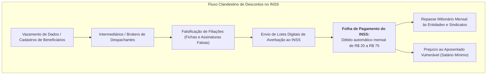
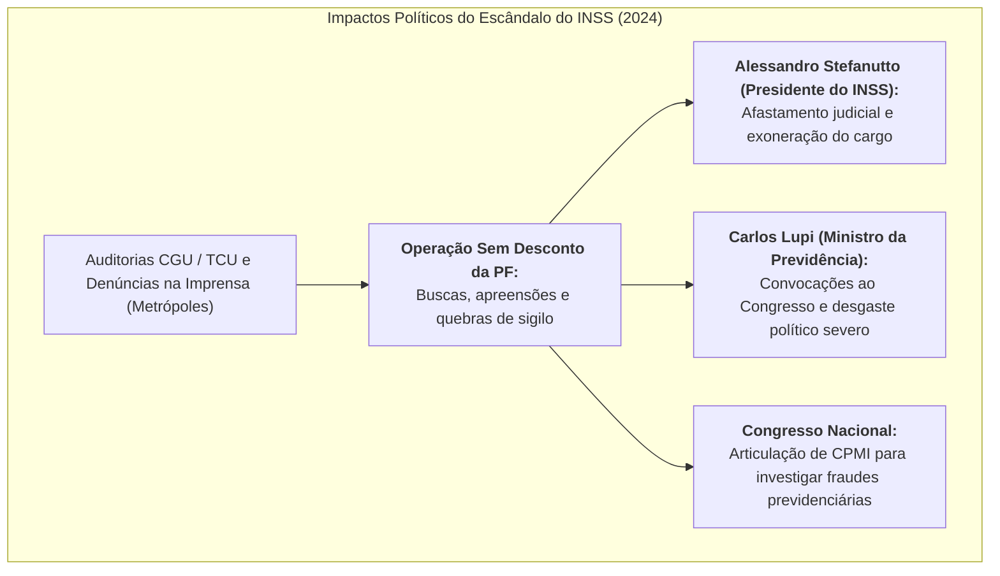

# O Escândalo dos Descontos Indevidos no INSS: Fraudes, Auditorias e Repercussões Políticas

> **Classificação:** Administração Pública, Direito Previdenciário, Crimes Contra o Patrimônio e Responsabilidade Fiscal  
> **Período Central:** 2023 – 2026 (com antecedentes a partir de 2019)  
> **Escopo da Investigação:** A cobrança sistemática e não autorizada de mensalidades associativas e sindicais na folha de pagamento de aposentadorias e pensões do INSS, movimentando cifras bilionárias, sob auditoria da CGU, TCU e Polícia Federal.  
> **Fontes Primárias:** Relatórios de Avaliação da Controladoria-Geral da União (CGU), Acórdãos do Tribunal de Contas da União (TCU), Inquéritos da Polícia Federal (*Operação Sem Desconto*), Atas da Comissão de Previdência e Assistência Social da Câmara e do Senado Federal, e Portarias do Ministério da Previdência Social.

---

## 1. Contexto e Mecânica do Esquema dos Descontos Associativos

### O que são os Acordos de Cooperação Técnica (ACTs)
Desde a regulamentação da [Lei nº 8.213/1991](https://www.planalto.gov.br/ccivil_03/leis/l8213cons.htm) e do Decreto nº 3.048/1999, a legislação previdenciária brasileira autoriza o Instituto Nacional do Seguro Social (INSS) a realizar **descontos de mensalidades associativas diretamente na folha de pagamento** de benefícios de aposentadoria e pensão, desde que:
1. Haja celebração formal de um **Acordo de Cooperação Técnica (ACT)** entre o INSS e a entidade de classe (sindicato, federação ou associação civil de aposentados);
2. Exista **autorização expressa, prévia e inequívoca** do segurado para a realização do débito mensal.

### A Dinâmica das Fraudes
* **Débitos Imperceptíveis em Massa:** As entidades cadastradas debitavam valores unitários aparentemente módicos — geralmente oscilando entre **R$ 20,00 e R$ 75,00 por mês** — no contracheque de segurados, a imensa maioria dos quais recebe exatamente um salário mínimo;
* **O Efeito Escala:** Para um idoso sem acesso fácil ao aplicativo digital ou analfabeto funcional, um corte de R$ 30,00 muitas vezes passava despercebido em meio a flutuações de décimo terceiro ou descontos de empréstimos consignados. No entanto, multiplicado por **centenas de milhares de beneficiários**, uma única associação fantasma ou de fachada passava a arrecadar entre **R$ 5 milhões e R$ 20 milhões por mês**;
* **Crescimento Atípico:** Entre 2021 e 2023, o volume total descontado de aposentados para entidades de classe disparou de forma anômala:
  * **2021:** ~R$ 536 milhões anuais;
  * **2023:** Mais de **R$ 1,3 bilhão anual**;
  * **2019 a 2024 (Acumulado investigado pela PF):** Estima-se que as entidades movimentaram mais de **R$ 6,3 bilhões** em contribuições, com indícios de que mais de 70% a 90% dessas filiações eram fraudulentas ou destituídas de consentimento.

---

## 2. A Atuação dos Órgãos de Controle do Estado

### 2.1. A Auditoria da Controladoria-Geral da União (CGU)
Auditorias minuciosas deflagradas pela CGU identificaram vulnerabilidades crônicas no controle de conformidade do INSS:
* **Inexistência de Checagem Prévia:** O INSS recebia os arquivos digitais contendo lotes massivos de novos associados encaminhados pelas entidades e averbava os descontos na folha **sem exigir a apresentação imediata da ficha de filiação física assinada ou validação biométrica**;
* **Amostragem Categórica:** Em fiscalizações presenciais e ligações telefônicas com amostras estatísticas de aposentados que sofriam descontos:
  * Mais de **90% dos entrevistados declararam jamais ter ouvido falar da entidade** que recolhia mensalidades de seu benefício;
  * Foram identificadas fichas com assinaturas grosseiramente falsificadas, CPFs de pessoas já falecidas incluídas como novos sócios e comprovantes de endereço clonados;
* **Explosão de Denúncias no Consumidor.gov e Ouvidoria:** Em 2023 e no primeiro semestre de 2024, as reclamações formais de aposentados exigindo exclusão de mensalidades não autorizadas registraram **alta superior a 400%**, figurando no topo das queixas de toda a administração pública federal.

---

### 2.2. A Decisão do Tribunal de Contas da União (TCU)
O Tribunal de Contas da União, sob relatoria do ministro Aroldo Cedraz e decisões plenárias subsequentes, apontou que o INSS operava em um cenário de **"preocupante descontrole institucional"**:
* O tribunal determinou a imediata proibição de averbação de novos descontos por meio de autorizações genéricas em papel;
* Estabeleceu a obrigatoriedade de **assinatura eletrônica avançada (nível Prata ou Ouro do Gov.br) ou biometria facial** validada nas bases do Tribunal Superior Eleitoral (TSE);
* Cobrou a abertura de processos administrativos disciplinares (PADs) contra servidores do instituto e a imediata glosa e devolução dos valores debitados ilicitamente.

---

### 2.3. A Investigação da Polícia Federal: A *Operação Sem Desconto*
A Polícia Federal, em conjunto com o Ministério Público Federal (MPF), deflagrou operações de grande envergadura (com destaque para a *Operação Sem Desconto*):
* **Medidas Cautelares:** Foram cumpridos dezenas de mandados de busca e apreensão nas sedes de associações, confederações e sindicatos em Brasília, São Paulo, Rio de Janeiro e estados do Nordeste;
* **Bloqueio de Bens e Ostentação:** A Justiça Federal decretou o bloqueio de centenas de milhões de reais em contas bancárias, além do sequestro de veículos importados de altíssimo luxo (Porsche, Ferrari), iates e mansões pertencentes aos dirigentes das entidades investigadas;
* **O Caso Sindnapi:** Entre as entidades sob apuração, destacou-se o Sindicato Nacional de Aposentados, Pensionistas e Idosos (Sindnapi), ligado à Força Sindical, que teve **cerca de R$ 389 milhões bloqueados judicialmente** por suspeita de repasses massivos irregulares e captação ilícita de cadastros.

---

## 3. Repercussões Políticas e Consequências na Cúpula do Governo

### 1. A Queda do Presidente do INSS (Alessandro Stefanutto)
* O procurador federal Alessandro Stefanutto, que havia assumido a presidência do INSS no início da gestão de 2023, foi alvo direto de inquérito sobre a omissão na fiscalização dos ACTs e a demora na implementação das recomendações da CGU;
* Com o avanço das ordens judiciais e da repercussão nacional das operações policiais, Stefanutto foi **afastado judicialmente e exonerado da presidência do INSS**, provocando uma reformulação na diretoria de benefícios da autarquia.

### 2. A Pressão sobre o Ministro Carlos Lupi
* O ministro da Previdência Social, **Carlos Lupi** (presidente nacional do PDT), foi convocado reiteradas vezes a prestar esclarecimentos na Comissão de Previdência e no plenário do Senado Federal;
* Parlamentares de oposição acusaram o ministro de ter ignorado alertas formais que haviam sido entregues à sua equipe ministerial ainda no início de 2023;
* O caso motivou requerimentos de parlamentares de diversos partidos para a instauração de uma **Comissão Parlamentar Mista de Inquérito (CPMI)** para investigar o aparelhamento político e financeiro dos sindicatos sobre os proventos dos aposentados.

---

## 4. O Cenário Concomitante: O "Pente-Fino" do BPC e Perícias (Arcabouço Fiscal)

Enquanto explodia o escândalo dos descontos associativos, o governo federal implementava uma operação oposta de contenção de despesas obrigatórias:
* **A Meta de Economia (R$ 26 Bilhões):** Pressionado pelos limites de gastos da [Lei Complementar nº 200/2023 (Arcabouço Fiscal)](https://www.planalto.gov.br/ccivil_03/leis/lcp/lcp200.htm), o Ministério do Planejamento e o Ministério da Fazenda exigiram um corte de até **R$ 26 bilhões no orçamento de 2025**, concentrado na revisão de cadastros do INSS;
* **O Pente-Fino do BPC e Benefícios por Incapacidade:** Determinou-se a convocação de mais de 800 mil beneficiários do Benefício de Prestação Continuada (BPC/Loas) e do auxílio-doença para recadastramento biométrico e nova avaliação pericial;
* **A Polêmica do Atestmed:** O governo expandiu o sistema de concessão de auxílio por perícia documental online (*Atestmed*) para reduzir a histórica fila de espera (que ultrapassava 1,5 milhão de pedidos em 2023). Contudo, a Associação Nacional dos Médicos Peritos (ANMP) denunciou que a dispensa de perícia presencial provocou uma explosão de fraudes e atestados médicos falsos emitidos por inteligência artificial ou médicos fictícios.

---

## 5. Análise Crítica dos Dois Lados (Visão Dialética Factual)

| Dimensão de Análise | Visão Crítica (Oposição, CGU, TCU e Entidades de Aposentados) | Visão de Defesa (Governo Federal, Previdência e Dirigentes Sindicais) |
| :--- | :--- | :--- |
| **Responsabilidade pela Explosão das Fraudes** | **Omissão e Conivência Política:** O governo Lula e o comando do Ministério da Previdência tinham conhecimento detalhado do esquema desde o início de 2023 por meio da Ouvidoria e de relatórios da CGU, mas demoraram mais de 14 meses para barrar os descontos automáticos, beneficiando entidades e centrais sindicais aliadas politicamente ao governo. | **Herança de Desregulamentação Prévia:** O modelo de desconto associativo vigora há três décadas e foi fragilizado nas gestões anteriores (Temer e Bolsonaro), quando foram revogadas barreiras de validação física e abertas brechas sistêmicas que permitiram o assédio em lote pelas empresas de intermediação. |
| **Ação contra as Irregularidades** | **Atuação Tardia e Reativa:** As medidas de corte só foram tomadas após a imprensa (reportagens investigativas do *Metrópoles* e grande mídia) expor o caso publicamente e a PF deflagrar mandados judiciais, mostrando descaso com os cidadãos mais vulneráveis do país. | **Medidas Inéditas de Saneamento:** A atual gestão do INSS foi a responsável por suspender novos acordos, criar o botão de bloqueio de mensalidade no app *Meu INSS*, impor a exigência de biometria facial e assinatura eletrônica ouro/prata e iniciar o processo de estorno e ressarcimento dos aposentados lesados. |
| **Papel dos Sindicatos e Associações** | **Estelionato Coletivo e Enriquecimento Ilícito:** As entidades funcionavam como fachada financeira para enriquecer operadores e manter estruturas burocráticas sindicais falidas desde o fim do imposto sindical obrigatório na Reforma Trabalhista de 2017. | **Fraude Praticada por Terceiros Clandestinos:** As diretorias sindicais alegam que prestam serviços reais de convênio médico, seguro de vida e assistência jurídica aos sócios reais, e que as filiações falsas foram inseridas por escritórios despachantes terceirizados (*pastas de captação*) que burlaram a boa-fé das instituições. |
| **Gestão do INSS e Filas** | **Colapso Administrativo e Insegurança Jurídica:** O INSS tornou-se um foco de escândalos, com filas crônicas de espera, falhas graves no Atestmed e perseguição contra beneficiários do BPC enquanto permitia o roubo de R$ 6 bilhões em mensalidades na folha. | **Modernização Digital e Fila Reduzida:** O INSS reduziu substancialmente o tempo médio de concessão de benefícios (de mais de 120 dias para menos de 45 dias em diversas categorias) por meio do uso de IA e bônus de produtividade, equilibrando modernização com pente-fino fiscal. |

---

## 6. Quadro Síntese das Principais Entidades e Casos Investigados

| Entidade / Alvo | Natureza da Instituição | Estimativa de Arrecadação Mensal no Esquema | Medida Cautelar Aplicada |
| :--- | :--- | :--- | :--- |
| **Sindnapi (Força Sindical)** | Sindicato Nacional de Aposentados | R$ 15 milhões a R$ 25 milhões/mês | Bloqueio judicial de **R$ 389 milhões** decretado pela Justiça Federal; mandados de busca e apreensão. |
| **CBPA** | Confederação Brasileira de Aposentados | R$ 10 milhões a R$ 18 milhões/mês | Suspensão do ACT pelo INSS; quebra de sigilo bancário e apreensão de veículos de luxo de diretores. |
| **Amar Brasil** | Associação de Classe de Aposentados | R$ 5 milhões a R$ 12 milhões/mês | Descredenciamento compulsório da folha de pagamento e apuração criminal por estelionato e associação criminosa. |
| **Conafer** | Confederação de Agricultores Familiares | Crescimento superior a 500% em 2023 | Alvo de inquérito na PF por inclusão não autorizada de aposentados rurais e beneficiários da previdência especial. |

---

## 7. Catálogo de Fontes Oficiais Primárias

* *Controladoria-Geral da União (CGU):* [Relatório de Avaliação nº 1.450.982/2024](https://www.gov.br/cgu/pt-br) (Auditoria sobre a Governança e Controles dos Descontos de Mensalidades Associativas no INSS).
* *Tribunal de Contas da União (TCU):* [Acórdão nº 2.145/2023 - Plenário](https://portal.tcu.gov.br/) e Acórdão nº 890/2024 (Processo de Fiscalização de Descontos Indevidos em Folha de Aposentados e Pensionistas).
* *Polícia Federal / Ministério da Justiça:* Inquérito Policial nº 2024.0034291-SR/PF/DF (*Operação Sem Desconto* - Medidas cautelares de busca, apreensão e sequestro de bens de dirigentes sindicais).
* *Senado Federal:* [Notas Taquigráficas da Audiência Pública com o Ministro da Previdência Social Carlos Lupi](https://legis.senado.leg.br/) (Comissão de Previdência e Assistência Social, 2024).
* *Presidência da República / INSS:* [Instrução Normativa PRES/INSS nº 162/2024](https://www.in.gov.br/) (Instituição de biometria e assinatura digital para autorização de consignações associativas).
