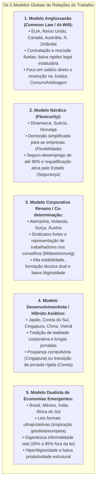

# Comparativo Internacional de Leis Trabalhistas: Brasil vs. Top 25 Economias do Mundo

> **Classificação:** Economia do Trabalho, Direito Comparado, Produtividade Sistêmica e Relações Industriais  
> **Escopo da Análise:** Confronto detalhado entre o modelo trabalhista brasileiro (CLT, Constituição de 1988 e Reforma de 2017) e as legislações das 25 maiores e mais relevantes economias do planeta.  
> **Eixos de Comparação:** Regime de demissão, jornada e horas extras, férias e benefícios obrigatórios, nível de encargos sobre a folha (*tax wedge*), taxa de litigiosidade judicial e produtividade por hora trabalhada.  
> **Fontes Primárias:** Organização Internacional do Trabalho (OIT/ILO), Organização para a Cooperação e Desenvolvimento Econômico (OCDE), Banco Mundial (*Doing Business / B-READY*), Tribunal Superior do Trabalho (TST) e compêndios legislativos nacionais.

---

## 1. O Framework Teórico dos 5 Modelos Globais de Relações de Trabalho

A ciência econômica e o direito comparado classificam os sistemas trabalhistas mundiais em cinco grandes famílias institucionais:

---

## 2. Matriz Comparativa: Brasil vs. Top 25 Economias do Mundo

A tabela abaixo sintetiza os principais indicadores legais e econômicos do Brasil e de 25 economias selecionadas (as maiores economias do G20, potências industriais da OCDE e referências regionais de competitividade).

> **Convenção de Produtividade:** PIB por hora trabalhada em dólares ajustados por Paridade de Poder de Compra (US$ PPP, base OCDE/OIT).

| País | Modelo Trabalhista | Jornada Padrão / Teto | Férias Remuneradas Mínimas | Regime de Rescisão / Proteção ao Emprego | Encargos Médios sobre Salário (*Tax Wedge*) | Disputas Trabalhistas / Litigiosidade | Produtividade por Hora (US$ PPP) |
| :--- | :--- | :--- | :--- | :--- | :--- | :--- | :--- |
| **🇧🇷 Brasil (Benchmark)** | Dualista / CLT Getulista | 44h semanais (máx. 2h extras/dia) | 30 dias corridos + 1/3 constitucional | Justa causa ou sem justa causa (aviso prévio + multa de 40% do FGTS) | ~70% a 100% (INSS 20%, FGTS 8%, Sist. S 5,8%, RAT) | **Extrema** (>3,5 milhões de novas ações/ano no TST) | **~US$ 18,50** |
| **🇺🇸 Estados Unidos** | Anglossaxão (*At-Will*) | 40h semanais (sem teto; hora extra 1,5x) | **0 dias legais federais** (médio: 10 a 15 dias negociados) | *Employment-at-will* (demissão imotivada a qualquer momento, sem aviso nem multa) | ~28,3% (Social Security 6,2%, Medicare 1,45%) | Baixa (resolvida na Justiça Comum ou Arbitragem) | **~US$ 87,00** |
| **🇩🇪 Alemanha** | Corporativo Renano | 38h a 40h semanais (máx. 48h) | 20 dias úteis (para semana de 5 dias) | Lei de Proteção contra Demissão (*KSchG*); aviso proporcional; conselhos de empresa | ~47,8% (Previdência, Saúde, Desemprego e Dependência) | Moderada (*Arbeitsgerichte* tripartite com filtros) | **~US$ 78,50** |
| **🇯🇵 Japão** | Tradição Corporativa | 40h semanais (teto de 45h extras/mês) | 10 a 20 dias (proporcional à senioridade) | Doutrina do Abuso do Direito de Demissão (demissão justificada estrita) | ~32,6% (Seguro Social, Saúde e Pensão) | Muito Baixa (cultura de consenso e resolução interna) | **~US$ 52,00** |
| **🇬🇧 Reino Unido** | Anglossaxão Flexível | 48h semanais (com cláusula de *opt-out*) | 28 dias (inclui feriados públicos) | *Unfair Dismissal* exige 2 anos de casa; aviso prévio escalonado; *Redundancy Pay* | ~31,3% (National Insurance contributivo) | Baixa a Moderada (*Employment Tribunals*) | **~US$ 67,50** |
| **🇫🇷 França** | Europeu Estatutário | 35h semanais (compensações por banco de horas) | 30 dias úteis (5 semanas pagas) | Demissão com motivação econômica ou pessoal real; homologação rigorosa; *Barème Macron* | ~47,0% (Altas contribuições sociais patronais) | Alta para padrões europeus (*Conseils de Prud'hommes*) | **~US$ 76,00** |
| **🇩🇰 Dinamarca** | *Flexicurity* Nórdica | 37h semanais (pactuadas por acordos) | 25 dias úteis (5 semanas) | Demissão simplificada com aviso prévio; seguro-desemprego de até 90% pago pelo Estado | ~35,5% (Financiado por impostos gerais, não folha) | Praticamente Nula (mediação paritária sindical) | **~US$ 84,00** |
| **🇸🇪 Suécia** | Nórdico Negociado | 40h semanais (máx. 48h) | 25 dias úteis | Lei *LAS* (regra do "último a entrar, primeiro a sair" - LIFO negociável) | ~42,4% (Taxas de seguridade social universais) | Muito Baixa (*Arbetsdomstolen* - Corte do Trabalho) | **~US$ 74,00** |
| **🇳🇴 Noruega** | Nórdico Petrolífero | 37,5h a 40h semanais | 25 dias úteis | Forte estabilidade; exigência de plano de recolocação e justificativa sólida | ~36,0% (Forte rede do Fundo Soberano e Estado) | Muito Baixa (negociação quadripartite) | **~US$ 98,00** |
| **🇰🇷 Coreia do Sul** | Desenvolvimentista Dual | 40h regulares (teto estrito de 52h semanais) | 15 a 25 dias (conforme anos de serviço) | Exigência de "causa justificável"; indenização de rescisão (*Severance Pay* de 1 mês/ano) | ~24,2% (Quatro grandes seguros sociais) | Moderada (Comissões Trabalhistas Regionais) | **~US$ 47,00** |
| **🇨🇦 Canadá** | Anglossaxão Misto | 40h semanais (varia por província) | 10 a 15 dias úteis (aumenta com o tempo) | Demissão sem justa causa permitida mediante aviso prévio ou indenização razoável | ~31,5% (CPP/QPP, EI e planos de saúde) | Baixa (resolvida administrativamente ou cortes comuns) | **~US$ 60,00** |
| **🇦🇺 Austrália** | *Modern Awards* Híbrido | 38h semanais (+ horas adicionais razoáveis) | 20 dias úteis (4 semanas acumuláveis) | Regulado pela *Fair Work Commission*; indenização por redundância proporcional | ~28,4% (*Superannuation* compulsória de 11,5%) | Baixa a Moderada (*Fair Work Ombudsman*) | **~US$ 68,00** |
| **🇸🇬 Cingapura** | Ultraliberal Pro-Mercado | 44h semanais (máx. 12h/dia) | 7 a 14 dias (conforme anos de serviço) | Demissão com aviso prévio contratual; sem justa causa obrigatória; sem multa punitiva | ~37,0% (Direcionado ao *CPF* - poupança individual) | Mínima (Tripartite Alliance *TADM*) | **~US$ 82,00** |
| **🇨🇭 Suíça** | Liberal Europeu | 42h a 45h semanais (setor fabril/serviços) | 20 dias úteis (4 semanas) | Liberdade de demissão com aviso prévio; proibição apenas de abusos (discriminação) | ~23,4% (Um dos menores encargos da Europa) | Quase Inexistente ("Paz do Trabalho" pactuada) | **~US$ 89,00** |
| **🇳🇱 Holanda** | Modelo *Polder* Consensual | 36h a 40h (recorde de trabalho *part-time*) | 20 dias úteis (4x os dias semanais) | Demissão pré-aprovada pela Agência Pública (*UWV*) ou Juiz Cantonal; indenização de transição | ~35,8% (Seguridade robusta com incentivo a *part-time*) | Baixa (forte consenso e diálogo corporativo) | **~US$ 77,00** |
| **🇳🇿 Nova Zelândia** | Anglossaxão Desregulamentado | 40h semanais | 20 dias úteis (4 semanas) | Demissão requer "processo justo e substantivo"; sem indenização legal obrigatória | ~18,1% (Impostos de renda diretos, sem taxa de folha) | Baixa (*Employment Relations Authority*) | **~US$ 54,00** |
| **🇮🇹 Itália** | Europeu Mediterrâneo | 40h semanais (máx. 48h com extras) | 20 dias úteis + feriados patronais | *Jobs Act* reduziu reintegração; indenização crescente; *TFR* (rescisão acumulada) | ~45,9% (Carga tributária pesada sobre o trabalho) | Moderada a Alta (Tribunais de Trabalho regionais) | **~US$ 61,00** |
| **🇪🇸 Espanha** | Mediterrâneo em Reforma | 40h semanais em média anual | 30 dias naturais (ou 22 dias úteis) | Reforma de 2021 restringiu contratos temporários; demissão improcedente custa 33 dias/ano | ~39,5% (Cotizações de seguridade social elevadas) | Alta (Comissões de Mediação e Tribunais Sociais) | **~US$ 58,00** |
| **🇨🇳 China** | Estatal Autoritário | 40h semanais (cultura fabril/tech "996") | 5 a 15 dias (conforme tempo de serviço total) | Lei de Contrato de Trabalho de 2008; indenização de 1 mês/ano; sindicato único oficial | ~36,0% (Cinco seguros sociais compulsórios + fundo moradia) | Moderada a Alta (Comitês de Arbitragem Trabalhista) | **~US$ 23,00** |
| **🇮🇳 Índia** | Emergente de Hiper-Informalidade | 48h semanais (reforma dos 4 Códigos) | 15 a 18 dias anuais | Demissão facilitada para empresas até 300 empregados; antes exigia aval do governo | ~25,0% (Fundo de Providência dos Empregados *EPFO*) | Baixa formalmente, com 85% de informalidade total | **~US$ 11,00** |
| **🇲🇽 México** | Latino-Americano Reformista | 48h semanais (6 dias de 8h; em debate 40h) | 12 a 20 dias (reforma *Vacaciones Dignas*) | Demissão sem justa causa paga 3 meses de salário + 20 dias por ano trabalhado | ~20,0% (Proibição rígida de terceirização de atividade-fim) | Média (Centros de Conciliação e Juizados) | **~US$ 24,00** |
| **🇨🇱 Chile** | Latino-Americano em Transição | 40h semanais (transição gradual da Lei 21.561) | 15 dias úteis | Demissão por "necessidade da empresa" paga 1 mês por ano (teto de 11 anos) | ~7,0% patronal (+ contribuição do trabalhador para AFP) | Moderada (Inspección del Trabajo e Juzgados) | **~US$ 34,00** |
| **🇮🇪 Irlanda** | Anglossaxão Pró-Investimento | 39h a 40h semanais (máx. 48h) | 20 dias úteis (4 semanas) | Demissão com aviso proporcional; indenização legal em demissão em massa (*redundancy*) | ~34,7% (Seguro social Pay-Related Social Insurance) | Baixa (*Workplace Relations Commission*) | **~US$ 99,00** |
| **🇮🇱 Israel** | Híbrido Tech / Proteção | 42h semanais (reduzida de 43h) | 12 a 24 dias úteis | Demissão exige audiência formal prévia (*hearing*); fundo compensatório compulsório | ~22,1% (Bituach Leumi e fundos previdenciários) | Baixa a Moderada (Tribunais Regionais do Trabalho) | **~US$ 53,00** |
| **🇵🇱 Polônia** | Pós-Comunista Europeu | 40h semanais (máx. 48h com extras) | 20 a 26 dias úteis | Código do Trabalho da UE; rescisão com aviso prévio; proliferação de contratos B2B | ~33,6% (ZUS - Previdência e saúde estatal) | Moderada (Tribunais de Trabalho distritais) | **~US$ 45,00** |
| **🇻🇳 Vietnã** | Fabril Competitivo de Exportação | 48h semanais (recomendação de 40h) | 12 a 16 dias úteis | Rescisão facilitada; novo Código autoriza organizações independentes | ~22,0% (Seguridade social, saúde e desemprego) | Muito Baixa (arbitragem administrativa) | **~US$ 10,50** |

---

## 3. Análise Detalhada dos Modelos Globais e Seus Contextos

A comparação direta entre legislações trabalhistas exige compreender **por que cada modelo se sustenta economicamente** em seu respectivo país e por que o transplante mecânico de regras sem a contrapartida estrutural gera distorções severas.

---

### 3.1. O Modelo Anglossaxão (EUA, Reino Unido, Canadá, Austrália, Nova Zelândia)
* **O Encaixe Estrutural:** O pilar norte-americano do *Employment-at-will* (emprego por vontade mútua) apoia-se em um mercado com **dinamismo de contratação sem paralelo**: a perda de um emprego é compensada por um tempo médio de recolocação inferior a 12 semanas. O trabalhador norte-americano prefere **salário direto no contracheque** a benefícios diferidos ou tutelados pelo Estado;
* **Produtividade e Salários:** Com uma produtividade média superior a **US$ 87 por hora**, as empresas americanas conseguem remunerar a hora trabalhada em níveis elevados sem necessidade de leis federais impondo férias ou 13º salário (práticas que são concedidas voluntariamente pelo mercado corporativo para atrair talentos);
* **A Fragilidade Social:** Sem uma rede pública universal de saúde, a perda do emprego nos EUA frequentemente implica a perda instantânea do plano de saúde familiar, gerando vulnerabilidade em períodos de recessão profunda.

---

### 3.2. A *Flexicurity* Nórdica (Dinamarca, Suécia, Noruega)
* **O Encaixe Estrutural:** A Dinamarca não possui sequer lei fixando salário mínimo nacional — o piso salarial é definido 100% por acordos coletivos setoriais entre sindicatos e associações patronais. A empresa pode **demitir o empregado com facilidade extrema**, sem pagar multas punitivas rescisórias (como os 40% do FGTS brasileiro);
* **A Contrapartida do Estado:** O trabalhador desempregado recebe do Estado um seguro-desemprego que pode atingir **até 90% do salário anterior**, condicionado à frequência obrigatória em programas estatais de requalificação profissional ativa (*active labor market policies*);
* **Por que o Brasil não pode simplesmente copiar a Dinamarca?**
  * O modelo dinamarquês é sustentado por uma **arrecadação fiscal colossal de impostos gerais** (IVA de 25% sem isenções e imposto de renda que atinge 50%), direcionada a um Estado com eficiência nórdica e taxa de corrupção próxima de zero;
  * O Brasil possui restrição fiscal severa, orçamento engessado e não dispõe de espaço orçamentário para sustentar seguros-desemprego de 90% para dezenas de milhões de trabalhadores.

---

### 3.3. O Modelo Corporativo Renano (Alemanha, Suíça, Holanda)
* **A Co-determinação (*Mitbestimmung*):** Na Alemanha, a legislação impõe que empresas com mais de 2.000 funcionários reservem **metade dos assentos do Conselho de Administração (*Aufsichtsrat*) para representantes eleitos pelos próprios empregados e sindicatos**. As decisões estratégicas de demissão em massa ou fechamento de plantas são pactuadas internamente com anos de antecedência;
* **O Ensino Técnico Dual:** A formação profissional ocorre dentro das fábricas desde os 16 anos (*Duale Ausbildung*), gerando mão de obra hiperqualificada para a indústria manufatureira de alta complexidade;
* **A Suíça e a "Paz do Trabalho":** Desde o histórico acordo de 1937 entre a indústria de máquinas e os sindicatos metalúrgicos, a Suíça baniu greves selvagens e litígios judiciais, resolvendo controvérsias via negociação interna, sustentando uma das maiores rendas per capita do planeta com encargos sobre folha de apenas 23%.

---

### 3.4. O Modelo Desenvolvimentista e Híbrido Asiático (Japão, Coreia do Sul, Cingapura, China)
* **Japão e a Transição do "Emprego Vitalício":** O modelo tradicional do *Shūshin koyō* (lealdade recíproca onde a corporação jamais demitia o trabalhador e este dedicava sua vida à empresa) sustentou o milagre japonês do pós-guerra. Hoje, o país enfrenta envelhecimento demográfico extremo, introduzindo tetos legais rigorosos para horas extras com o objetivo de combater as mortes por estresse laboral (*Karoshi*);
* **Cingapura e o *Central Provident Fund* (CPF):** Cingapura adota intervenção regulatória quase nula na rotina de contratação, mas impõe um dos sistemas de capitalização compulsória mais rigorosos do mundo: empregado e empregador depositam até 37% dos rendimentos em contas individuais intangíveis, utilizadas para financiar a casa própria pública (*HDB*), saúde de ponta e aposentadoria integral sem onerar o caixa do Tesouro;
* **Coreia do Sul e a Batalha das 52 Horas:** O país asiático enfrentava jornadas médias de 68 horas semanais nos grandes conglomerados industriais (*Chaebols*). Em 2018, o governo aprovou lei impondo teto estrito de 52 horas semanais (40h regulares + 12h extras), gerando debates intensos sobre impactos na produtividade industrial e na natalidade.

---

### 3.5. O Modelo Dualista Latino-Americano e Emergente (Brasil, México, Índia)
* **A Falácia do Garantismo sem Base Material:** O Brasil e a Índia compartilham legislações trabalhistas desenhadas no século XX com alto grau de prescrição burocrática estatal (a CLT de 1943 no Brasil e o *Industrial Disputes Act* de 1947 na Índia);
* **A Fuga para a Informalidade:** Quando o custo legal, previdenciário e litigioso de um funcionário formal excede em 70% a 100% o seu salário base líquido, e a produtividade média do trabalhador é de apenas US$ 18/h, o mercado expulsa estruturalmente as empresas e trabalhadores de menor qualificação para o setor informal;
* **A Reforma Trabalhista Mexicana (2021):** O México realizou uma das reformas mais agressivas da região ao proibir formalmente a terceirização de mão de obra para atividades-fim das empresas, ao mesmo tempo em que substituiu as antigas *Juntas de Conciliación y Arbitraje* (conhecidas por lentidão e corrupção) por novos tribunais do Poder Judiciário, acompanhados de saltos reais no salário mínimo.

---

## 4. O Paradoxo Brasileiro: Por que a CLT Gera Tanta Litigiosidade?

O Brasil é um caso anômalo no cenário global de relações laborais. Embora represente cerca de 2% a 3% do PIB mundial, o país historicamente **concentra entre 70% e 80% de todas as ações judiciais trabalhistas de todo o planeta**:

### Principais Fatores Estruturais da Hiperjudicialização Brasileira:
1. **Existência de um Ramo Judicial Autônomo e Hipertrofiado:** O Brasil é uma das pouquíssimas democracias a manter uma estrutura judiciária inteira dedicada com exclusividade ao direito laboral (Varas do Trabalho, 24 Tribunais Regionais do Trabalho e o TST), com orçamento anual superior a **R$ 22 bilhões** custeado pelo contribuinte geral;
2. **A Cultura do "Risco Zero" Pré-Reforma de 2017:** Até a vigência da [Lei nº 13.467/2017](https://www.planalto.gov.br/ccivil_03/_ato2015-2018/2017/lei/l13467.htm), o empregado que ingressava com reclamação trabalhista desfrutava de gratuidade judiciária irrestrita e não pagava honorários sucumbenciais caso perdesse a causa, estimulando petições iniciais infladas com pedidos infundados de horas extras e danos morais;
3. **Complexidade e Insegurança das Normas Regulamentadoras (NRs):** O Ministério do Trabalho mantém dezenas de NRs com exigências minuciosas e subjetivas sobre adicionais de periculosidade e insalubridade, frequentemente arbitradas por laudos periciais divergentes.

---

## 5. A Fronteira Moderna: "Pejotização", *Gig Economy* e Produtividade

### 5.1. O Fenômeno da "Pejotização"
Diante do peso dos encargos sobre a folha formal (INSS patronal de 20%, FGTS de 8%, Sistema S de até 5,8%, além de provisões para 13º salário e férias), milhões de profissionais liberais e trabalhadores qualificados no Brasil migraram voluntária ou compulsoriamente para o modelo de **Pessoa Jurídica (PJ)**:
* **Vantagem Econômica Direta:** Pelo regime do Simples Nacional ou Lucro Presumido, a tributação sobre a renda corporativa do prestador PJ oscila entre 6% e 15%, viabilizando uma remuneração líquida imediata sensivelmente maior do que o teto celetista após retenções de IR e INSS;
* **O Risco Jurídico:** O STF tem consolidado jurisprudência reconhecendo a licitude da terceirização ampla e irrestrita (ADPF 324 e RE 958.252) e derrubando decisões da Justiça do Trabalho que tentavam reconhecer vínculo celetista de executivos, médicos e advogados contratados como PJ.

### 5.2. O Trabalho por Aplicativos (*Gig Economy*) e o PLP 12/2024
O crescimento exponencial de motoristas e entregadores por plataformas (Uber, 99, iFood) expôs o descompasso entre a CLT de 1943 e o trabalho digital intermediado por algoritmos:
* **O Projeto de Lei Complementar nº 12/2024:** O governo federal tentou regulamentar a atividade de motoristas de quatro rodas criando uma terceira categoria jurídica (*"trabalhador autônomo com plataforma"*):
  * Piso de remuneração por hora trabalhada em corrida (R$ 32,10/h);
  * Contribuição previdenciária obrigatória de 7,5% para o motorista e 20% para a plataforma sobre uma base presumida;
* **A Reação dos Trabalhadores:** O projeto enfrentou forte resistência da base dos próprios motoristas e de entregadores de motos (excluídos do texto original), temerosos de que a tributação previdenciária e as regras de controle de jornada reduzissem seus ganhos líquidos diários e a flexibilidade de horários.

---

## 6. Conclusões e Lições para o Desenvolvimento Brasileiro

1. **A Produtividade é o Teto Real dos Direitos:** Não é a lei escrita que garante salários altos ou bem-estar social, mas sim a capacidade de uma economia gerar valor por hora trabalhada. Uma hora de trabalho nos EUA ou Suíça produz de quatro a cinco vezes mais riqueza real do que uma hora de trabalho no Brasil. Tentar impor benefícios europeus sobre uma base de produtividade latino-americana inevitavelmente empurra 40% da população para a informalidade;
2. **A Centralidade da Negociação Coletiva:** Os países mais prósperos do mundo (especialmente os nórdicos e da Europa Central) confiam nos acordos diretos entre sindicatos representativos e empresas (*prevalência do negociado sobre o legislado*), em vez de depender de códigos estatais de milhares de artigos ou da tutela judicial constante;
3. **A Necessidade de Desoneração da Folha:** Tributar a contratação de mão de obra formal com alíquotas que chegam a dobrar o custo salarial funciona como uma punição fiscal explícita à criação de empregos com carteira assinada, mantendo o Brasil preso na armadilha da baixa qualificação e do litígio crônico.

---

## 7. Catálogo de Fontes Oficiais Primárias

* *Organização Internacional do Trabalho (OIT):* [ILOSTAT Database](https://ilostat.ilo.org/) (Labor Productivity, Minimum Wage Regulations, Working Hours and Dismissal Protections).
* *Organização para a Cooperação e Desenvolvimento Econômico (OCDE):* [OECD Employment Outlook 2024](https://www.oecd.org/employment/outlook/) e [Taxing Wages 2024](https://www.oecd.org/tax/taxing-wages-20725124.htm) (Comparative Tax Wedge on Labor).
* *Tribunal Superior do Trabalho (TST):* [Relatório Geral da Justiça do Trabalho](https://www.tst.jus.br/) (Movimentação Processual, Litigiosidade e Custos Institucionais).
* *Presidência da República do Brasil:* [Consolidação das Leis do Trabalho - Decreto-Lei nº 5.452/1943](https://www.planalto.gov.br/ccivil_03/decreto-lei/del5452.htm) e [Lei da Reforma Trabalhista - Lei nº 13.467/2017](https://www.planalto.gov.br/ccivil_03/_ato2015-2018/2017/lei/l13467.htm).
* *Câmara dos Deputados:* [Projeto de Lei Complementar nº 12/2024](https://www.camara.leg.br/proposicoesWeb/fichadetramitacao?idProposicao=2422026) (Regulamentação do Trabalho em Plataformas Digitais de Transporte).
* *Supremo Tribunal Federal:* [ADPF nº 324](https://portal.stf.jus.br/) e [Tema nº 725 da Repercussão Geral (RE 958.252)](https://portal.stf.jus.br/) (Licitude da Terceirização Ampla e Irrestrita de Atividades).
* *United States Department of Labor (DOL):* [Fair Labor Standards Act (FLSA)](https://www.dol.gov/agencies/whd/flsa) (Regulations on Minimum Wage, Overtime and Child Labor).
* *Bundesministerium für Arbeit und Soziales (Alemanha):* [Kündigungsschutzgesetz (KSchG)](https://www.gesetze-im-internet.de/kschg/) e [Betriebsverfassungsgesetz (BetrVG)](https://www.gesetze-im-internet.de/betrvg/) (German Dismissal Protection and Works Council Acts).
