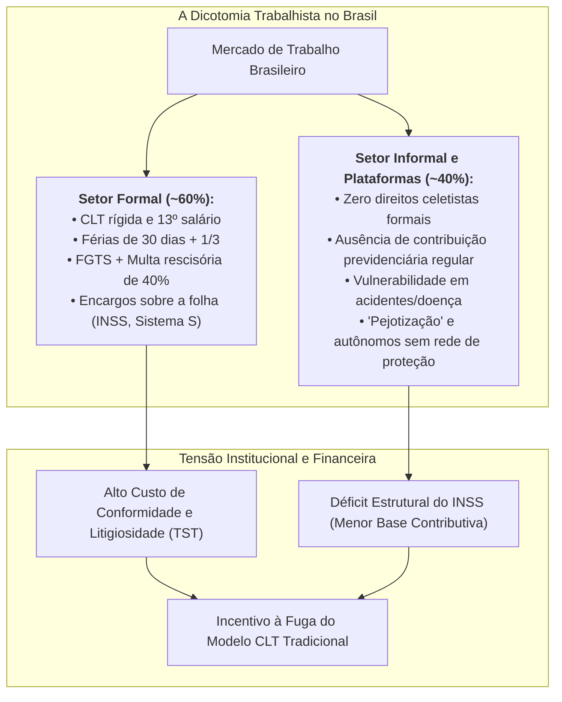

# Trabalho, Legislação Trabalhista e Previdência Social no Brasil

> **Classificação Temática:** Economia do Trabalho, Direito Constitucional, Relações Sindicais e Seguridade Social  
> **Objetivo:** Analisar de forma técnica, empírica e dialética as estruturas do mercado de trabalho brasileiro, as regras da Consolidação das Leis do Trabalho (CLT), a governança da Previdência Social (INSS), as recentes fraudes institucionais e o comparativo internacional com as 25 maiores e mais representativas economias do planeta.  
> **Compromisso Anti-Desinformação:** Apresentação fundamentada em auditorias da Controladoria-Geral da União (CGU), acórdãos do Tribunal de Contas da União (TCU), inquéritos da Polícia Federal (PF), estatísticas da Organização Internacional do Trabalho (OIT/ILO), da Organização para a Cooperação e Desenvolvimento Econômico (OCDE) e dados judiciais do Tribunal Superior do Trabalho (TST).

---

## 1. O Dilema Estrutural do Mercado de Trabalho Brasileiro

O mercado de trabalho no Brasil opera sob um clássico paradoxo de economia em desenvolvimento:
1. **Hiper-regulamentação do Setor Formal:** Legislação detalhista de inspiração corporativista (CLT de 1943), altos encargos parafiscais e previdenciários sobre a folha de pagamento (~70% a 100% sobre o salário líquido direto), associados a um ramo especializado do Judiciário (Justiça do Trabalho) que historicamente concentra o maior volume de litígios individuais do mundo;
2. **Elevada Informalidade:** Cerca de 38% a 40% da População Economicamente Ativa (PEA) — quase 40 milhões de trabalhadores — sobrevive à margem de qualquer garantia da CLT, sem previdência social, sem FGTS, sem férias remuneradas e sem proteção contra acidentes;
3. **Crise de Produtividade Sistêmica:** A produtividade por hora trabalhada no Brasil (aproximadamente US$ 18 a US$ 20 por hora em paridade de poder de compra) encontra-se estagnada há quatro décadas, gerando pressões permanentes sobre a viabilidade financeira das empresas diante dos custos legais impostos.

---

## 2. Mapa dos Documentos Desta Pasta

### 1. [`01_escandalo_inss_fraudes_descontos_associativos_e_investigacoes.md`](01_escandalo_inss_fraudes_descontos_associativos_e_investigacoes.md)
* **O Megaesquema dos Descontos Associativos (2023–2024):** As apurações da PF (*Operação Sem Desconto*), TCU e CGU sobre o desvio de mais de R$ 6 bilhões mediante cobranças indevidas de mensalidades sindicais na folha de aposentados vulneráveis.
* **A Repercussão Política:** Os desgastes do ministro da Previdência Social, Carlos Lupi, a demissão do presidente do INSS, Alessandro Stefanutto, e os pedidos de CPI/CPMI no Congresso.
* **O Pente-Fino no BPC e Benefícios por Incapacidade:** A revisão de 800 mil benefícios exigida pela equipe econômica para cumprir o Arcabouço Fiscal.
* **Análise dos Dois Lados:** A acusação de aparelhamento e complacência estatal versus a defesa do governo sobre medidas de biometria, acordos legados de gestões anteriores e ação de intermediários clandestinos.

### 2. [`02_comparativo_leis_trabalhistas_brasil_vs_top25_mundo.md`](02_comparativo_leis_trabalhistas_brasil_vs_top25_mundo.md)
* **Matriz Comparativa das Top 25 Economias do Planeta:** Brasil confrontado com Estados Unidos, Alemanha, Japão, Reino Unido, França, Dinamarca, Coreia do Sul, Canadá, Austrália, Cingapura, Suíça, Holanda, México, China, Índia, entre outros.
* **Os 5 Modelos Globais de Relações de Trabalho:** 
  1. *Flexibilidade Anglossaxã / At-Will* (EUA, Reino Unido, Canadá);
  2. *Flexicurity Nórdica* (Dinamarca, Suécia, Noruega);
  3. *Corporatismo Renano / Co-determinação* (Alemanha, Holanda, Suíça);
  4. *Desenvolvimentista Asiático / Híbrido* (Japão, Coreia do Sul, Cingapura, China);
  5. *Dualista com Alta Informalidade de Mercados Emergentes* (Brasil, México, Índia).
* **Análise de Contexto:** Por que a flexibilidade funciona nos EUA e Dinamarca, mas geraria desamparo no Brasil sem uma rede de seguridade financiada por impostos gerais? Como a produtividade por hora dita o teto real dos benefícios trabalhistas?
